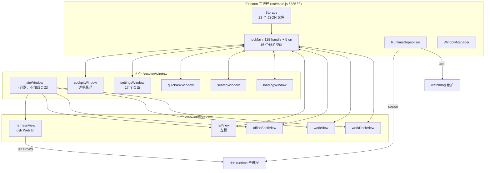
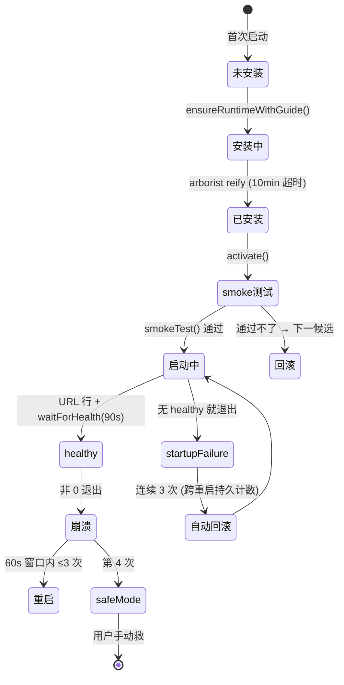
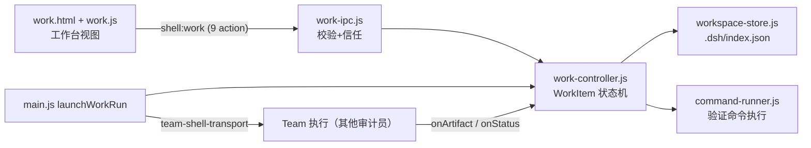
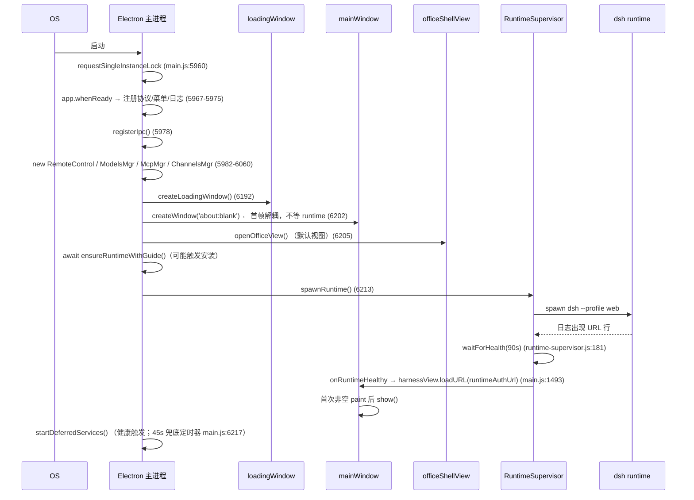
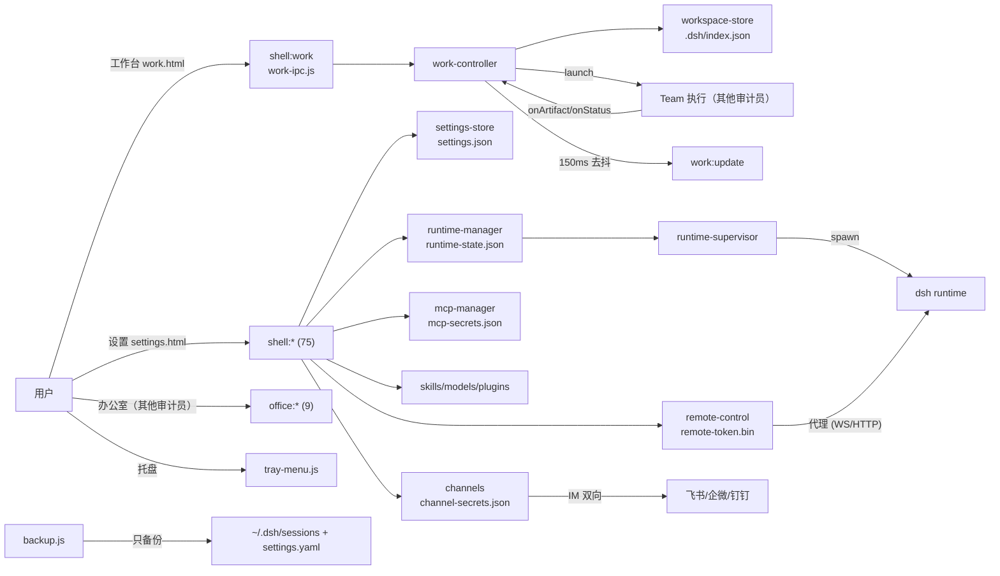

# 壳层总体架构（Electron Shell / Storage / IPC / CI）

> 状态：**审计报告（2026-11-01）** · 审计对象：除虚拟办公室（`src/office`、`src/workbench`）与 Harness 桥（`src/runtime-*`、`src/harness-rpc.js`、`src/team/**`）之外的**全部壳层能力**
> 相邻文档：办公室 → `docs/architecture/office-runtime.md`；桥接 → `docs/architecture/runtime-bridge.md`；目标模型 → `docs/architecture/domain-model.md`
> 校验证据：`npm test` 2026-11-01 本机实测 `tests 1935 / pass 1934 / fail 1`（唯一红为 `test/office-ui.test.js:1294` E5a-R1 真机 Electron 探针 exit 9，环境相关已知红）
> 结论分级：**[已确认]** 有代码+行号或可复现命令 · **[部分实现]** 有代码但覆盖不全 · **[待验证]** 需真机/真环境 · **[设计阶段]** 文档有、代码无 · **[设想]** 无代码无文档

---

## 0. 一句话结论

DshCockpit 的壳层是一套**功能密度很高、但结构性债务同样高**的「单体主进程 + 6 窗口 + 5 视图 + 133 个 IPC 通道」架构：单文件 `src/main.js` 已达 **6385 行 / 196 个顶层函数 / 107 个 IPC handler**，且**任何测试都不加载它**；持久化层是**13 个各自为政的 JSON 文件**（无 SQLite、无统一 schema 版本、无统一迁移、备份只覆盖其中 2 个目录）；CI **不在发布链上跑测试**，测试只在一条 `continue-on-error: true` 的每日定时工作流里跑。

面向「The Workspace for AI Teams」的新定位，这套壳层的**窗口/IPC 骨架是可用的**，但**存储层与主进程组织方式必须重构**才能承载 Mission Core。

---

## 1. 进程与窗口模型

### 1.1 进程

**[已确认]** 只有两个进程族：

| 进程 | 证据 | 职责 |
|---|---|---|
| Electron 主进程 | `package.json:22`（`electron ^37.0.0`，实测 37.10.3） | 全部窗口/视图、IPC、fs、密钥、runtime 监督 |
| dsh runtime 子进程 | `src/runtime-supervisor.js:207` `spawnRuntime()` | Harness 本体（`dsh --profile web --port ... --no-open`，见 :230） |
| dsh headless 一次性子进程 | `src/headless.js:22` | Quick Ask / 定时任务 |
| v0.7 专用 Team runtime | `src/team-runtime-host.js:237` `ensure(workspace)` | cwd=工作区的隔离 runtime（Python 其他审计员范围，此处仅记边界） |
| watchdog 看护进程 | `src/watchdog.js:1-10`、`src/runtime-supervisor.js:467` `armWatchdog` | 壳硬崩后回收 runtime 孤儿 |
| Worker 线程 | `src/session-worker-client.js:5`、`src/search-worker.js` | 会话日志解析/搜索离主线程 |
| runtime 安装子进程 | `src/runtime-install-worker.js:1-10` | arborist 安装不阻塞主线程 |

**渲染进程**：6 个 `BrowserWindow` + 5 个 `WebContentsView`。

| # | 载体 | 类型 | 位置 | 页面 | preload |
|---|---|---|---|---|---|
| 1 | mainWindow | BrowserWindow | `window-manager.js:367` | **不加载任何内容**（容器） | — |
| 2 | harnessView | WebContentsView | `window-manager.js:395` | dsh runtime URL | `src/preload.js`（**故意为空**，5 行） |
| 3 | railView | WebContentsView | `window-manager.js:273` | `office-rail.html` | `office-rail-preload.js` |
| 4 | officeShellView | WebContentsView | `window-manager.js:128` | `office-runtime://` 协议 | `office/office-preload.js` |
| 5 | workView | WebContentsView | `window-manager.js:178` | `work/work.html` | `work/work-preload.js` |
| 6 | workDockView | WebContentsView | `window-manager.js:208` | `work/work.html?compact=1` | `work/work-preload.js` |
| 7 | cockpitWindow | BrowserWindow（透明/无边框） | `window-manager.js:564` | `cockpit.html` | `cockpit-preload.js` |
| 8 | settingsWindow | BrowserWindow | `window-manager.js:671` | `settings.html`（5895 行，17 个页面） | `settings-preload.js` |
| 9 | quickAskWindow | BrowserWindow | `aux-windows.js:44` | `quickask.html` | `quickask-preload.js` |
| 10 | searchWindow | BrowserWindow | `aux-windows.js:84` | `search.html` | `search-preload.js` |
| 11 | loadingWindow | BrowserWindow | `aux-windows.js:122` | `loading.html` | `loading-preload.js` |



### 1.2 安全基线

**[已确认]** **11 个载体全部**是 `contextIsolation: true` + `nodeIntegration: false` + `sandbox: true`。逐项核对：`window-manager.js` 有 8 个载体（mainWindow/harnessView/railView/officeShellView/workView/workDockView/cockpitWindow/settingsWindow）对应 8 处 `sandbox: true`；`aux-windows.js` 有 3 个载体（quickAsk/search/loading）对应 3 处。合计 11/11，无例外。

复现：
```bash
grep -c "sandbox: true" src/window-manager.js src/aux-windows.js   # → 8, 3
grep -c "new BrowserWindow\|new WebContentsView" src/window-manager.js src/aux-windows.js  # → 8, 3
```

**[已确认] 唯一例外**：工作台（创作工具，非产品面）`src/workbench/app/boot.js:176` `sandbox: false` + `nodeIntegrationInSubFrames: true`，理由写在 `boot.js:167-170`（让预览子框架拿到真 office bridge）。该窗口只加载仓库内 `workbench://` / `office-runtime://` 页面，且整棵树被 `electron-builder.js:54` `'!src/workbench/**'` 排除出发行包——**不进产品**，但它是唯一可以执行 Node 的渲染进程，若未来把工作台并入产品必须重新评估。

**[已确认] 缺失项（安全债）**：
- 全库 `setPermissionRequestHandler` / `setPermissionCheckHandler` **0 处**（`grep -rn "setPermissionRequestHandler" src` 无输出）。默认行为由 Electron 决定，摄像头/麦克风/通知/剪贴板权限**没有显式拒绝策略**。
**导航加固是部分覆盖的（实测逐项核对）**：

| 载体 | `will-navigate` 拦截 | `setWindowOpenHandler(deny)` | 备注 |
|---|---|---|---|
| officeShellView | ✅ `wm:140` | ✅ `wm:141` | 完整 |
| workView | ✅ `wm:188` | ✅ `wm:189` | 完整 |
| workDockView | ✅ `wm:217` | ✅ `wm:218` | 完整 |
| railView | ✅ `wm:282` | ✅ `wm:283` | 完整 |
| cockpitWindow | ✅ `wm:584` | ❌ | 缺 deny |
| settingsWindow | ✅ `wm:691` | ❌ | 缺 deny |
| mainWindow | ❌ | ✅ `wm:461` | 容器不加载页面，风险低 |
| **harnessView** | ❌ | ❌ | **加载第三方 dsh Web UI，两项都缺** |
| quickAskWindow | ✅ `aux:61` | ❌ | 缺 deny |
| searchWindow | ✅ `aux:101` | ❌ | 缺 deny |
| loadingWindow | ✅ `aux:137` | ❌ | 缺 deny |

复现：
```bash
grep -c "setWindowOpenHandler" src/window-manager.js src/aux-windows.js   # → 5, 0
grep -cE "will-navigate" src/window-manager.js src/aux-windows.js         # → 6, 3
```

- **最大的一块未加固面是 `harnessView`**（`window-manager.js:395-403`）：它加载 dsh 自己的 Web UI（第三方代码路径），`preload.js` 为空（5 行注释，故意不暴露任何东西）**所以拿不到 IPC**——这一点是好的；但它既无 `will-navigate` 也无 `setWindowOpenHandler`，若 dsh UI 里有 `target=_blank` 或 `window.open`，会派生新窗口。**[待验证]**：需确认 dsh UI 是否真的会开窗。
- 其余 5 个窗口有 `will-navigate` 但无 `setWindowOpenHandler`，属纵深防御缺口（CSP 会挡一部分，但不是 deny-by-default）。

---

## 2. 模块地图（壳层负责面）

按职责分组，行数为实测（`wc -l`）。**共 77 个壳层模块，约 15,000 行**（另有 `src/office` 3.2MB / `src/workbench` 972KB 属其他审计员）。

| 分组 | 模块（行数） | 完成度 |
|---|---|---|
| **组合根** | `main.js`(6385)、`ipc-features.js`(82) | [已确认] 但严重超载 |
| **窗口/视图** | `window-manager.js`(803)、`aux-windows.js`(188)、`tray-menu.js`(182)、`window-state.js`(25)、`cockpit-bounds.js`(38)、`cockpit-snapshot.js`(160) | [已确认] |
| **壳设置** | `settings-store.js`(163) | [已确认] 无 schema 版本 |
| **备份** | `backup.js`(199) | [部分实现] 只覆盖 2 个 key |
| **用量/成本** | `cost.js`(?)、`balance.js`(267)、`token-stats.js`(422)、`cache-economics.js`(143)、`weekly-report.js`(289)、`compact.js`(388) | [已确认] 测试较实（token-stats 13 个 test） |
| **通知/调度** | `notification-center.js`(154)、`scheduler.js`(?) | [已确认] |
| **会话/搜索** | `session-files.js`(54)、`session-search.js`(87)、`session-worker.js`(57)、`session-worker-client.js`(86)、`search-worker.js`(75)、`memory-files.js`(94) | [已确认] |
| **MCP** | `mcp-manager.js`(545)、`mcp-registry.js`(322)、`mcp-connect.js`(281)、`mcp-import.js`(231)、`mcp-usage.js`(215)、`mcp-verify-gate.js`(207) | [已确认] 6 套件测试 |
| **插件/技能/市场** | `plugin-flow.js`(201)、`market.js`(128)、`skills.js`(703)、`pnpm-shim.js`(266)、`models-manager.js`(711) | [已确认] |
| **通道/远程** | `channels/**`(19 文件)、`remote-control.js`(796)、`public-remote.js`(346)、`runtime-auth.js`(83) | [已确认] |
| **Runtime 生命周期** | `runtime-manager.js`(844)、`runtime-supervisor.js`(524)、`runtime-install-worker.js`(45)、`runtime-log-tail.js`、`runtime-pick.js`(58)、`runtime-state.js`(53)、`runtime-events.js`(53)、`runtime-health.js`、`watchdog.js`(51)、`boot-check.js`(446)、`crash-reason.js`(58)、`compat-status.js`(?) | [已确认] **这是壳层最扎实的部分** |
| **诊断** | `diagnostics-bundle.js`(457)、`shell-update-notice.js` | [已确认] |
| **i18n** | `i18n.js`(1347，638 keys) + `workbench/i18n.js`(1188，1008 keys，**零重叠**) | [已确认] 但两套字典 |
| **工作区** | `work/**`(6 文件 1773 行) | [部分实现] 见 §6 |
| **headless** | `headless.js`(56) | [已确认] |

---

## 3. IPC 全景

### 3.1 数量（实测脚本统计，非估算）

```
非 workbench 通道总数: 133 = handle 128 + on 5
命名空间 15 个: shell 75 / cockpit 12 / mcp 11 / office 9 / office-rail 4 /
                weekly 4 / remote 3 / boot 3 / plugins 2 / quickask 2 /
                search 2 / notifications 2 / center 2 / cache-economics 1 / compat 1
（含 workbench 则为 150 个通道 / 16 命名空间 / workbench 17）
```

分文件注册：

| 文件 | handle | on |
|---|---|---|
| `src/main.js` | 107 | 5 |
| `src/ipc-features.js` | 11 | 0 |
| `src/work/work-ipc.js` | 1 | 0 |
| `src/office/office-module.js` | 9 | 0（循环注册 `OFFICE_IPC_CHANNELS`） |
| `src/workbench/app/ipc.js` | 16 | 1 |

复现命令：
```bash
node -e 'const fs=require("fs");let h=new Set(),o=new Set();
for(const f of ["src/main.js","src/ipc-features.js","src/work/work-ipc.js","src/workbench/app/ipc.js"]){
 const s=fs.readFileSync(f,"utf8");
 [...s.matchAll(/ipcMain\.handle\(\s*\x27([^\x27]+)\x27/g)].forEach(m=>h.add(m[1]));
 [...s.matchAll(/ipcMain\.on\(\s*\x27([^\x27]+)\x27/g)].forEach(m=>o.add(m[1]));}
console.log(h.size,o.size);'
```

### 3.2 冻结保护：**只有 `office:*` 是真的，`shell:*` 完全没有**

| 命名空间 | 是否有冻结集合 | 是否被测试保护 | 证据 |
|---|---|---|---|
| `office:*` (9) | ✅ `OFFICE_IPC_CHANNELS` 常量 | ✅ **5 个套件断言精确集合** | 定义 `office-module.js:204-214`；断言 `office-ui.test.js:794`、`office-ui.test.js:854`（注册的 handler 集合必须等于常量）、`office-ux-mustfix.test.js:353`（`length === 9`）、`office-right-panel-p4.test.js:475`、`office-interaction-p3.test.js:262`（preload 白名单 9 个）、`office-pages-english.test.js:154` |
| `office-rail:*` (4) | ❌ | 部分（`office-rail.test.js:61` 只断言"不含 office:state/dispatch/settings"） | — |
| `mcp:*` (11) | ❌ 无常量 | 无集合断言 | — |
| `workbench:*` (17) | ⚠️ `workbench/app/ipc.js:11` 有 `CHANNELS` 常量 | ❌ **无任何测试引用该常量**（`grep CHANNELS src/workbench/test/*.test.js` 无结果），且常量与实际注册不同步（常量 16 项，实际 handle 16 + on 1） | — |
| `shell:*` (75) | ❌ **无常量、无白名单、无集合测试** | ❌ | `grep -rn "SHELL_CHANNELS\|SHELL_IPC" src test` 无输出 |
| `cockpit:*` (12) | ❌ | 部分（`cockpit-ui.test.js` 用 `assert.match` 逐条匹配源码字符串，非集合相等） | — |

**结论 [已确认]**：repo-map.md §2.5 写的「`office:*` 通道集合在契约里冻结」**是真的，且被 5 个测试机械保护**。但 **75 个 `shell:*` 通道 + 17 个 `workbench:*` 通道没有任何冻结机制** —— 这一点在文档里没被声明为"未冻结"，容易被误读为壳层整体有通道纪律。

**风险**：`shell:*` 是壳层最大接口面（占 56%），且包含所有高风险动作（`shell:public-remote-enable`、`shell:tunnel-start`、`shell:plugin-action`、`shell:execute-*`、`shell:work`、`shell:restore-snapshot`）。**没有集合测试意味着：新增/删除/改名一个 `shell:*` 通道不会让任何测试变红**（除非恰好被某个 `assert.match` 覆盖）。

### 3.3 发送方信任校验：只有 1 个通道做了

**[已确认]** 全库只有 `shell:work` 校验 `event.senderFrame.url`：

```js
// src/work/work-ipc.js:79-90
function isTrustedWorkSender(event, expectedFile = 'work.html') { ... parsed.protocol !== 'file:' ... }
// src/work/work-ipc.js:125
ipcMain.handle('shell:work', async (event, payload) => handle(payload, isTrustedWorkSender(event)));
```

其余 127 个 handle **不检查发送方**（`grep -rn "senderFrame\|event.sender"` 在 `src/` 只命中 `work-ipc.js:79`、`workbench/app/ipc.js:72`、`channels/receivers/feishu.js:58`）。

**这是可接受还是有风险？** 判定 **[部分实现/待验证]**：
- 所有渲染进程都由本应用加载、`sandbox:true`、`contextIsolation:true`，且 `will-navigate` 被拦截，因此"恶意渲染进程"的攻击面有限；
- 但 `harnessView` 加载 **dsh 自己的 Web UI**（第三方代码路径），若 dsh UI 存在 XSS 或允许加载外部资源，攻击者可拿到 `ipcRenderer.invoke`（`src/preload.js` 为空，但 harnessView 仍可用 `ipcRenderer`？——`preload.js` 5 行注释说明**故意什么都不暴露**，`contextIsolation:true` 下页面无法直接 `require('electron')`）。**因此 harnessView 实际拿不到 IPC，风险可控。**
- 真正的问题是**纪律不对称**：`shell:work` 做了，别的没做，且没有文档说明"哪些通道需要 sender 校验、为什么"。

### 3.4 推送通道（main → renderer）

**[已确认]** 23 条 push-only 通道（`webContents.send`）：

```
center:close, center:navigate, center:return-cockpit, channels:changed, cockpit:close,
cockpit:mode, cockpit:snapshot, compact:status, loading:meta, loading:progress,
office:visibility, plugins:progress, quickask:close, runtime:health, scheduled:changed,
search:close, shell:language, shell:office-layout, shell:theme, skills:progress,
update:progress, workbench:gallery-progress, workbench:preview-selection
```

注意 `office:visibility` **同时是 invoke 通道和 push 通道**（`office-module.js:211` 注册 handle + `window-manager.js` push），这是唯一的重名双用，[部分实现] 语义靠注释维持。

### 3.5 IPC 组装方式：**没有声明式注册表**

**[已确认]** 133 个通道散在 4 个文件里，靠 `registerIpc()`（`main.js:2356` 起）一个函数 700+ 行按顺序 `ipcMain.handle(...)` 注册。没有：
- 通道→权限/信任级别的元数据表；
- 通道→handler 的映射常量（`workbench/app/ipc.js` 有 `CHANNELS` 常量，但**没有**用它来遍历注册，只是导出）；
- preload↔main 的一致性测试（**不存在**任何测试断言"preload 暴露的每个 invoke 都有对应 handler"）。

复现：
```bash
grep -rn "preload" test/*.test.js | grep -c "invoke.*handle"   # 0
```

---

## 4. 存储层

### 4.1 到底有没有 SQLite？

**没有。这是一个纯 JSON/JSONL 文件系统。**

复现：
```bash
grep -rn "better-sqlite3\|node:sqlite\|sqlite3" src test package.json
# 命中仅 4 处，全部与"数据库"无关：
#   src/mcp-registry.js:51-53      —— MCP 市场里一个名叫 "SQLite" 的可安装 server 条目
#   src/office/runtime/approval-risk.js:122,135,165 —— 危险命令词表里的 "sqlite3" 字符串
#   src/office/runtime/tool-phrases.js:86          —— 工具名→短语词表
```
`package.json` dependencies 中**无任何数据库/ORM 依赖**（`@npmcli/arborist, @wecom/aibot-node-sdk, electron-updater, fzstd, node-forge, pacote, pixi.js, pnpm, semver, ws`）。

**[设计阶段]** `docs/architecture/domain-model.md` §5 对 Mission 存储做了 A/B/C/D 四选一，倾向 **C（append-only JSONL + 内存索引）**，明确"不用 SQLite（原生依赖、打包复杂）"。该判断与本审计一致，但**当前 `src/work` 的实现是 B 的反面：单文档全量覆盖写，不是 append-only**（见 §6）。

### 4.2 13 个持久化文件全表

`app.getPath('userData')` 下（macOS：`~/Library/Application Support/DshCockpit/`），`~/.dsh/` 是 Harness 的 home，两者严格分工。

| # | 文件 | 写出者（唯一？） | 格式 | schemaVersion | 迁移 | 损坏恢复 | 备份 | 证据 |
|---|---|---|---|---|---|---|---|---|
| 1 | `settings.json` | `SettingsStore` ✅ | JSON | ❌ **无** | ⚠️ 仅 7 条值迁移（内存态） | ⚠️ 静默回落默认值 | ❌ | `settings-store.js:91,96-107,109-120` |
| 2 | `runtime-state.json` | `RuntimeManager` ✅ | JSON | ❌ | ❌ | ✅ 逐字段类型校验+过滤 | ❌ | `runtime-manager.js:81-106` |
| 3 | `office-state.v1.json` | `officeStateStore` ✅ | JSON | ✅ `=1` | ✅ 读时 `migrateOfficeState` | ✅ `.bak` 回退 | ❌ | `office-persistence.js:31,141-155,244-255,277-288` |
| 4 | `office-layout.v1.json` | 同上 | JSON | ✅ `=1` | ❌ 仅校验 | ⚠️ 返回错误码不恢复 | ❌ | `office-persistence.js:314-340` |
| 5 | `<workspace>/.dsh/index.json` | `WorkspaceStore` ✅ | JSON | ✅ `=1` | ❌ **fail-closed 无迁移** | ❌ **fail-closed 且不重建、无 .bak** | ❌ | `work/workspace-store.js:20,76-107,196-226` |
| 6 | `<workspace>/.dsh/work.json` | 同上 | JSON | ✅ | — | — | ❌ | `work/workspace-store.js:171-184` |
| 7 | `notification-history.jsonl` | `notification-center` ✅ | JSONL | ❌ | ❌ | ✅ 坏行跳过 | ❌ | `notification-center.js:73`；测试 `notification-center.test.js:117` |
| 8 | `cost-history.json` / `balance-snapshot.json` | main.js | JSON | ❌ | ❌ | [待验证] | ❌ | `main.js:1179-1180` |
| 9 | `compact-history.json` | `compact` | JSON | ❌ | ❌ | ❌ | ❌ | `main.js:4512` |
| 10 | `window-state.json` / `office-rail-state.json` | main.js | JSON | ❌ | ❌ | ✅ 读取失败=null | ❌ | `window-state.js:8-15`；`main.js:1178,1417` |
| 11 | `boot-report.json` / `boot-timing.json` | `boot-check` / main | JSON | ❌ | ❌ | ✅ | ❌ | `boot-check.js:80,83-89` |
| 12 | `market-cache.json` / `compat-cache.json` / `node-cache.json` | main / compat-status | JSON | ❌ | ❌ | ✅ 缓存失效即弃 | ❌ | `compat-status.js:40,54` |
| 13 | `profile-snapshots/<stamp>-<label>/` | main.js | 目录 | ❌ | ❌ | — | ✅ **自身即快照**（保留 8 份） | `main.js:3554-3595` |
| 附 | `remote-token.bin` / `mcp-secrets.json` / `model-keys.json` / `channel-secrets.json` | 各自 vault | 二进制/JSON | ❌ | ❌ | 各自处理 | ❌（**故意**） | `remote-control.js:179`;`mcp-manager.js:317`;`models-manager.js:541`;`channels/credentials.js:14` |
| 附 | `~/.dsh/settings.yaml` | `models-manager`（行级 patch） | YAML | ❌ | ❌ | — | ✅（唯一被备份的 YAML） | `models-manager.js:321,544,670`；`backup.js:24` |
| 附 | `~/.dsh/.credentials.yaml` | `models-manager`（行级 patch，0600） | YAML | ❌ | ❌ | — | ❌ **故意不备份** | `models-manager.js:595-596`；`backup.js:5-6` |

### 4.3 settings 到底存 JSON 还是 YAML？

**两个都有，分属不同 owner，互不读写：**

- **`userData/settings.json`** = **壳自己的设置**（53 个 key，`settings-store.js:25-82`）。JSON。**无 schemaVersion**。
- **`~/.dsh/settings.yaml`** = **Harness 的设置**（`llm-pi-ai.providers.*`、`agent-default-model` 等）。壳只在 `models-manager.js` 里做**行级 section patch**（无 YAML 依赖，保守保留注释与顺序，:35-37），因为 runtime 自己也写这个文件，两个写者必须共存。

这**不是重复**，是**两个事实源的边界**，且 `office-persistence.js:8-11` 明文规定"legacy `settings.json`、`runtime-state.json`、`sessions/` 从不被 office 读写"。所以 **[已确认] 单一写者纪律在文件粒度上是成立的**。

### 4.4 schema 版本号与迁移：只有 office 是真的

| 子系统 | schemaVersion | 迁移代码 |
|---|---|---|
| `office-state.v1.json` | ✅ `=1` | ✅ `migrateOfficeState(raw)` 读时迁移，未知版本返回 `null`（`office-persistence.js:141-155`） |
| `<workspace>/.dsh/index.json` | ✅ `=1` | ❌ **只有拒绝**：`validateIndex` 在 `schemaVersion !== 1` 时抛 `WORK_INDEX_INVALID`（`workspace-store.js:78-80`）——**未来升到 v2 时，所有现存索引会直接变成"不可读"**，没有升级路径 |
| `settings.json` | ❌ 无 | ⚠️ 只有值迁移：`V41_MIGRATIONS`（`settings-store.js:15-23`），在 `load()` 里"若当前值恰好等于旧默认值则换成新默认值"（:101-103）。**这是值级兼容技巧，不是 schema 迁移**：无法处理字段重命名、类型变更、结构嵌套 |
| `runtime-state.json` | ❌ 无 | ⚠️ 逐字段类型兜底（`runtime-manager.js:84-96`），等价"能读就不炸" |
| 其余 10 个文件 | ❌ 无 | ❌ 无 |

**结论 [已确认]**：项目共 3 处声明了 `schemaVersion`（office-state、office-layout、work index），**只有 1 处有真正的迁移函数**（office-state）。**没有任何一个"统一迁移框架"**，各文件自行其是。

### 4.5 损坏恢复策略：三档，且最关键的 Mission 候选文件最弱

| 档位 | 策略 | 使用文件 |
|---|---|---|
| A（最强） | 主文件损坏 → 读 `.bak` → 再不行回落默认 + 诊断码 | `office-state.v1.json`（`office-persistence.js:244-255`：`OFFICE_STATE_CORRUPT`） |
| B（中） | fail-closed 抛出稳定码，**刻意不重建**（避免抹掉用户记录），但**无备份可回** | `<workspace>/.dsh/index.json`（`workspace-store.js:211-215`：`WORK_INDEX_INVALID`，注释写明"kept untouched"） |
| C（弱） | 静默回落默认值，**用户自定义全部丢失且无提示** | `settings.json`（`settings-store.js:104-106`：`catch { /* first run or corrupt file: keep defaults */ }`） |
| D | 坏行跳过 | `notification-history.jsonl`（测试 `notification-center.test.js:117` 覆盖） |

**技术债判定**：
- **`settings.json` 走 C 档是最危险的**：用户丢了 53 个设置（含 `recentWorkspaces`、`installedPlugins`、`scheduledTasks`、`modelProviders`、`mcpServers`、`imChannels`）**不会有任何提示**，下次保存时还会把默认值写回磁盘覆盖掉原文件。
- **`.dsh/index.json` 走 B 档对 Mission Core 是不可接受的**：`docs/architecture/domain-model.md` 把 Mission 定义为 DshCockpit 唯一事实源，而当前底层连 `.bak` 都没有。

### 4.6 备份策略：只覆盖 2 个 key，且不含任何壳设置

**[已确认]** `backup.js:24`：
```js
const INCLUDED_KEYS = ['sessions', 'settings.yaml'];
```
即备份 **Harness 的会话日志 + Harness 的 settings.yaml**。**不备份**：`settings.json`（壳设置）、`office-state.v1.json`（办公室状态）、`.dsh/index.json`（工作产物索引）、`cost-history.json`、`profile-snapshots/`……

设计上这是**有意的**：
- `.credentials.yaml` / `*.bin` / secrets 明确不备份（`backup.js:5-6`：明文密钥副本是负债）；
- 但 `settings.json`、`office-state.v1.json`、`.dsh/index.json` **不在"因为安全而不备份"的名单里，只是没被加进去**。

另外两套自建备份：
- `profile-snapshots/`：插件操作前后快照 4 个 profile 清单文件，保留 8 份（`main.js:3554-3595`），用于插件把 runtime 搞坏后的回滚。
- `runtime/snapshots/pre-<version>-<ts>/`：runtime 切换前的 `DSH_HOME` 轻量快照（`runtime-manager.js:666-716`，`snapshotDshHome`）。
- 办公室状态：`.bak` 单份（`office-persistence.js:288`）。

**[部分实现]**：基础设施（原子写、delta 备份、prune）都有，但**覆盖面按子系统零散决定**，没有一张"哪些状态必须备份、RPO 多少"的声明。

### 4.7 原子写：15 处复制的同一段代码

**[已确认]** `grep -ln "renameSync(tmp" src` 命中 **15 个文件**：

```
balance.js, boot-check.js, channels/credentials.js, channels/receivers/base.js,
compact.js, compat-status.js, main.js, models-manager.js, notification-center.js,
office/persistence, remote-control.js, runtime-manager.js, settings-store.js,
skills.js, window-state.js, work/workspace-store.js
```

每处都是 `写入 <file>.tmp` → `renameSync`。质量参差：
- **最好**：`office-persistence.js:277-281`（`openSync` + `writeFileSync(fd)` + **`fsyncSync`** + rename + 串行写链）
- **中等**：`work/workspace-store.js:186-190`（tmp 名带 pid+时间+随机串，避免并发冲突）
- **最弱**：`settings-store.js:112-114`（固定 `.tmp` 后缀，**两个实例并发保存会互相覆盖**；无 fsync）
- **最弱**：`window-state.js:18-20`（固定 `.tmp`，`catch {}` 全吞）

同时存在 **3 套重复的 safeStorage 加密仓**：
| 类 | 位置 | 文件 |
|---|---|---|
| `KeyVault` | `models-manager.js:451` | `model-keys.json` |
| `TokenStore` | `remote-control.js:179` | `remote-token.bin` |
| `ChannelSecrets` | `channels/credentials.js:14` | `channel-secrets.json` |

其中 `channels/credentials.js:5-7` **自己承认**："Same 范式 as remote-control's TokenStore / models-manager's KeyVault（the shared pattern was kept local to avoid touching stable modules in C5）" —— 即**为了不碰稳定模块而故意复制**，属于已知取舍而非疏忽。

---

## 5. Runtime 生命周期

这是壳层**完成度最高**的部分，有一条完整的「安装 → 选择 → 启动 → 健康 → 崩溃恢复 → 回滚 → 自更新」链。

### 5.1 状态机



### 5.2 各环节实现位置

| 环节 | 实现 | 证据 |
|---|---|---|
| 版本选择/下载 | `checkForUpdate()` / `resolveTarget(packument)` / `fetchPackument` | `runtime-manager.js:328, 273, 296` |
| 安装 | `installVersion` → 子进程跑 arborist（**不阻塞主线程**） | `runtime-manager.js:400, 421`；`runtime-install-worker.js:1-10, 30-44` |
| 安装超时 | 10 分钟硬超时 | `runtime-manager.js:53` `INSTALL_TIMEOUT_MS = 10 * 60_000` |
| 安装去重 | 按 version 的 in-flight promise 锁 | `runtime-manager.js:66` `_installLocks` |
| 冒烟测试 | `smokeTest(entry)` | `runtime-manager.js:599` |
| 候选优先级 | active → system PATH（≥ bundled 版本）→ bundled seed，每个非 active 候选必须过 smoke | `runtime-pick.js:1-16, 37`；`runtime-manager.js:203, 229` |
| 激活 | `activate()` = smoke + `snapshotDshHome()` + 切指针 | `runtime-manager.js:717-740` |
| 启动 | `spawnRuntime()`：`dsh --profile web --port N --no-open`，stdout 直写文件（无 pipe） | `runtime-supervisor.js:207, 230, 240-246` |
| URL 发现 | tail 日志文件找 URL 行（`runtime-log-tail.js`），**8 分钟看门狗** | `runtime-supervisor.js:262-270, 272-293` |
| 健康检查 | `waitForHealth(url, 90s)`：200 或 3xx 算活 | `runtime-supervisor.js:100, 181-206` |
| 崩溃循环保护 | 60s 窗口内最多 3 次自动重启，healthy 归零 | `runtime-supervisor.js:15-16, 25` |
| 崩溃后救援 | 第 4 次进 `enterSafeMode()`：profile 重置为官方最小 bundle 集 | `main.js:3620-3638` |
| 跨重启失败计数 | 连续 3 次启动失败 → 自动回滚 previousVersion | `runtime-manager.js:23, 762-804`；`main.js:2163-2180` |
| 回滚 | `rollback()` = `restoreLastSnapshot()` + 切指针 | `runtime-manager.js:742-760` |
| 孤儿回收 | watchdog 每 2s 查壳 PID，壳死了就 taskkill 树 | `watchdog.js:14-40`；`runtime-supervisor.js:467` `armWatchdog` |
| 自更新（壳本身） | electron-updater：启动 10s 后检查 + 每 4h，自动下载，下载完弹框 | `main.js:5859-5894, 5896-5930` |
| 自更新失败可见性 | `shell-update-notice.js` 策略（手动必答、自动只在下载失败时提示、10min 限流） | `main.js:5832-5852` |
| 启动自检 + 一键修复 | 7 个 check id（`runtime.bin`, `runtime.pointer`, `dshhome.writable`, `profile.links`, `port.available`, `credentials.exists`, `credentials.layout`） | `boot-check.js:38-46, 365, 420` |
| 上游兼容状态 | 读 CI 产出的 `docs/compat/compat-status.json`，6h 缓存，网络挂降级用缓存 | `compat-status.js:17, 24, 40` |

### 5.3 兼容矩阵与"挡板"

**[已确认]** `SUPPORTED_RUNTIME_RANGE = '<0.2.0-0'`（`runtime-manager.js:39`）。注释说明：2026-09-22 用户拍板"放开更新挡板"，该常量语义从"安装挡板"降级为"已测试矩阵"——矩阵外版本**仍可安装**，只记 knownIssue + 提示降级 + 保留一键回滚（`runtime-manager.js:30-38`）。

**这对新定位是关键约束**：`package.json:6` 仍锁 `runtimeVersion: 0.1.5-rc.2`，而官方已是 0.2.1-rc.5。`<0.2.0-0` 的矩阵**明确把 0.2.x 排除在"已测试"之外**——升级到 0.2.x 会走进"已知未测"路径。

### 5.4 跨平台差异（win/mac）

**[已确认]** 32 处 `process.platform` 判断，集中在：

| 场景 | win | mac/linux | 位置 |
|---|---|---|---|
| 进程树杀掉 | `taskkill /pid N /T /F` | `SIGKILL` | `runtime-supervisor.js:499`；`watchdog.js:37`；`public-remote.js:326` |
| 子进程隐藏窗口 | `windowsHide: true` | — | 多处 |
| shell 选择 | `cmd.exe /d /s /c` | `/bin/sh -c` | `work/command-runner.js:17-20` |
| pnpm 探测 | `where.exe` / `pnpm.cmd` + `shell:true` | `which` / `pnpm` | `pnpm-shim.js:130,134,144-145` |
| 安装目录默认 | `C:\Program Files\Tailscale\...` | `/opt/homebrew`、`/usr/local`、App Store App | `public-remote.js:33-50` |
| 开机自启 | 注册表（`syncLoginItemSetting`） | SMAppService/login item | `main.js:6125` `setTimeout(() => syncLoginItemSetting(...), 3_000)` |
| 打包 | NSIS + zip（双轨） | dmg + zip（arm64 only） | `.github/workflows/release-win.yml`、`release-mac.yml` |

**已知 Windows 特有问题的历史修复**（说明这里有真实的、被踩过的坑）：
- 退出路径上的全量 `cpSync` 导致"应用退不掉"（AV 逐字节扫描）→ 改为增量 `backupDeltaNow`（`backup.js:8-17`）
- `where.exe` 在 AV 下卡数秒 → 加硬超时（`main.js:1551-1553`）
- pnpm v10 拒绝运行 git 插件的 `prepare` → 自动加 `onlyBuiltDependencies` 并重试一次（`main.js:3713-3732`）
- 目录遍历的同步 I/O 把主线程钉死 → 改 `fsp.opendir` + 每 256 条 `setImmediate` 让出（`main.js:3002-3019`）

**评测 [已确认]**：Windows 是**一等公民但明显更痛**的平台。`runtime-supervisor.js:47-70` 的 `killTree` 注释、`backup.js:8-17` 的注释都直接写了"Windows+AV"是设计驱动力。

---

## 6. `src/work/**` 现状：是不是 Mission Core 雏形？

**判定 [已确认]：不是。它是"单次工作项（WorkItem）的 MVP"，与 Mission Core（跨 Session 的长期项目连续性）在数据模型、生命周期、存储形状三个层面都不兼容。约 35% 可复用为底座，65% 必须重做。**

### 6.1 它实际是什么（1773 行，6 个文件）



| 文件 | 行数 | 职责 | 完成度 |
|---|---|---|---|
| `workspace-store.js` | 515 | 工作区打开、`.dsh/` 布局、产物索引、原子写、路径守卫、变更扫描/差异 | [已确认] 10 个测试 |
| `work-controller.js` | 410 | WorkItem 状态机、无产物门禁、受控重试、验证证据、diff 捕获 | [已确认] 18 个测试 |
| `work-ipc.js` | 131 | 9 个 action 的校验 + sender 信任 | [已确认] 5 个测试 |
| `command-runner.js` | 108 | 工作区内执行验证命令（超时/输出上限/SIGKILL） | [已确认] 6 个测试 |
| `work.js` | 371 | 视图（纯 textContent，无 innerHTML） | [已确认] 源级测试 |
| `work.html` / `work.css` / `work-preload.js` | 94/91/53 | 页面/样式/受限桥 | [已确认] |

测试总量：**7 个套件 / 60 个 `test()` / 包含 2 个真实 fs 的离线端到端**（`work-e2e-offline.test.js`：真实 transport + dsh backend + controller + Team，断言产物落盘、digest 可验、索引持久、快照无绝对路径）。

### 6.2 可直接复用为 Mission Core 底座的部分（约 35%）

| 能力 | 位置 | 为什么可直接复用 |
|---|---|---|
| **路径安全**：拒绝对路径/空段/`.`/`..`；`resolveInside` 双保险（词法 + resolve 后 relative） | `workspace-store.js:53-69, 142-150` | Mission 也要把数据写进用户工作区，逃逸防护是同一需求。已被变异 M3' 验证（`isSafeRelPath` 恒真 → DETECTED，见 P1 报告 :55） |
| **原子写** | `workspace-store.js:186-190` | tmp 名带 pid+时间+随机串，比 `settings-store.js` 的固定 `.tmp` 更强 |
| **"只存相对路径"纪律** | `workspace-store.js:5-11, 282-314, 348-365` | 与 domain-model.md §2.5「只写 `<workspace>/.dsh/**`」完全对齐 |
| **digest 校验读取** | `workspace-store.js:348-365`（`WORK_ARTIFACT_DIGEST_MISMATCH`） | Deliverable 的完整性校验需要同一套 |
| **有界读取**（256KB 上限 + truncated 标注） | `workspace-store.js:26, 360-364` | Mission 的 Evidence 摘要也要限界 |
| **变更捕获**（manifest 扫描 + diff，排除 `.git`/`node_modules`/`dist`，5000 文件/2MB/200 哈希上限） | `workspace-store.js:28-34, 371-431` | Deliverable 的 `workspace-patch` 直接可用；**但注意：`docs/product/product-vision.md` §3.1 把"文件变更捕获"划给官方 `dsh-workspace-changes`，此处是重复实现，未来应改为消费者** |
| **验证命令执行器** | `command-runner.js:38-104` | 超时 + SIGTERM→3s→SIGKILL + 输出上限 + 平台 shell 选择，无须改 |
| **"没有产物就没有完成"的机械门禁** | `work-controller.js:173`（`artifactRefs.length > 0 ? 'completed' : 'incomplete'`） | 与 `docs/product/product-vision.md` V3 承诺同源，是**正确且已验证**的语义 |
| **重启后不伪造**：running/attention → interrupted | `work-controller.js:61-76` | "不伪造"是项目铁律，这段已经做对 |
| **sender 信任校验** | `work-ipc.js:79-90, 125` | 唯一做对的通道，可抽成公共中间件 |

**复用方式建议**：抽出 `workspace-store` 里的 `isSafeRelPath` / `resolveInside` / `writeJsonAtomic` / `scanManifest` / `diffManifests` / `readArtifact(带 digest)` 六段（约 200 行）到新的通用 `src/storage/**`，`command-runner` 整文件搬走。**不要**复用 `work-controller`。

### 6.3 必须重做的部分（约 65%）

| # | 冲突点 | 现状证据 | 与 Mission 语义的冲突 |
|---|---|---|---|
| 1 | **数据模型缺 6 个实体中的 6 个** | `work-controller.js:19-36` `freezeItem` 只有 `{workItemId, goal, templateId, status, runRef, startedAtMs, finishedAtMs, artifactRefs, phase, verifyCommand, verification, blockedCode, attempt, retryOf}` | domain-model.md §2 要求 Mission / Workstream / Shared Context（Decision/Finding/Assumption/OpenQuestion/Evidence）/ Deliverable Index / Project Workspace。**一个都没有**。当前 `goal` 是一个字符串，不是 Mission 的 `intent` + `constraints` + `status` 生命周期 |
| 2 | **单活动项硬约束** | `work-controller.js:55` `let currentId = null; // 只允许一个活动工作项（P1）`；`:92-95` 返回 `WORK_BUSY` | Mission 要求"多 Mission/多 Workstream 并行"（domain-model.md 开放问题 Q1 甚至还没拍板）。单值 `currentId` 是**结构性的**，不是参数可调 |
| 3 | **索引是单文档全量覆盖写，不是 append-only** | `workspace-store.js:71-73` `emptyIndex()` = `{schemaVersion, workspaceId, items:[], artifacts:[]}`；`:222-226` `saveIndex` = `writeJsonAtomic(indexPathOf(...), index)` —— **每次改动重写整个 JSON** | domain-model.md §5 明确选 C「Append-only JSONL + 内存索引」，理由是可追溯/可审计/可重建。当前实现三条都不满足：无事件流、无审计、损坏即不可读 |
| 4 | **索引无上限、无归档（会无限增长）** | `grep -n "MAX_ITEMS\|items.length\|slice(-" src/work/workspace-store.js` **无输出**；`appendItem` 只 push（:316-322），`registerArtifact` 只 push（:299-311） | 办公室状态有 `TASK_HISTORY_PER_EMPLOYEE = 50` / `ACTIVITY_LOG_LIMIT = 200` 这类上限（`office-persistence.js:39-40`），work 索引**一个都没有**。长期 Mission 会把这个 JSON 撑大，而它每次改动都要全量重写 → O(n²) |
| 5 | **无 schema 迁移** | `workspace-store.js:78-80`：`schemaVersion !== 1` → 抛 `WORK_INDEX_INVALID` | 长期演进必须能升版本。当前是"版本一改，所有用户索引全部不可读" |
| 6 | **无损坏恢复** | `workspace-store.js:211-215` 刻意不重建、**无 `.bak`** | 与 `office-persistence.js:244-255, 288` 对比：同一个仓库里，office 有 `.bak` 回退，work 没有。而 Mission 是"唯一事实源"，安全等级应高于 office |
| 7 | **不跨 Session** | `work-controller.js` 全文无 `sessionId` / `session` 字段；`runRef` 绑定**一次** Team 执行（:101） | 这是 Mission 的**核心诉求**。domain-model.md §0.2 R1/R3：Harness 持久化单位是 Session 不是 Project。当前 WorkItem 与 Team run 一一对应，**重启即断**（:61-76 把 running 全标 interrupted，即承认"上次的链已经没了"） |
| 8 | **`templateId` 是死字段，无模板注册表** | `begin({ templateId = 'research-review' })`（`work-controller.js:87`）是唯一赋值点；`main.js:500` 调用 `controller.begin({ goal, verifyCommand })` **不传 templateId**；`grep templateId src/` 只有 work-controller 内部 + `main.js:2594`（定时任务的不相干字段） | domain-model / Vision 里的 **Starter Kit / Capability Pack 完全不存在**。`templateId` 恒为 `'research-review'`，且没有任何地方消费它 |
| 9 | **`.dsh/` 不写 `.gitignore`，会污染用户仓库** | `workspace-store.js:31-34` 扫描时排除 `.dsh`，但 `grep -rn "gitignore" src/work/ src/main.js` **无输出**；`.gitignore` 里也没有 `.dsh` | domain-model.md Q5「Mission 数据是否要可 git 追踪」还没拍板，但当前状态是**默认污染**：打开任何用户项目工作区都会多一个 `.dsh/`，且不会被提示加入 ignore |
| 10 | **无并发保护** | `workspace-store.js:131` `const openIndexes = new Map(); // 单进程单写者`；无文件锁、无 mtime 检查 | 多窗口/多实例（`requestSingleInstanceLock` 兜住了多实例，但同实例内 workView + workDockView 两个视图会同时开着） |
| 11 | **隐私边界比声明的弱** | `workspace-store.js:479-483` `absolutePathOf` 注释说"不进入任何快照"，但 `main.js:434-438` `workStatusPayload()` 直接把 `controller.snapshot()`（含 `workspace.displayPath` 绝对路径）推给渲染进程 | 推进渲染进程是设计允许的（`workspace-store.js:8-9` 明说），但**"不进快照"这句话本身不准确**——它进的是 Work 快照，只是不进 Team/Office 快照。文档措辞需修正 |
| 12 | **`workStatusPayload()` 无异常保护** | `main.js:424-439`：`controller.snapshot()` 若抛（索引损坏 → `WORK_INDEX_INVALID`）**未 catch**，会让 `shell:work status` 拒绝、`sendWorkUpdate` 静默失败 | 索引损坏时 UI 会表现为"工作台空白且无法恢复"，没有错误码出口 |

### 6.4 与 `docs/product/WORK-FIRST-V0.7.md` 的差距

| V0.7 要求 | 现状 | 判定 |
|---|---|---|
| §3.3 Verification Runner（受信验证证据） | `command-runner.js` + `work-controller.js:230-284` 完整实现，含超时/日志落盘/证据 artifact | ✅ **已实现** |
| §3.2 Artifact 类型 `workspace-patch` | `work-controller.js:290-325` 实现，空变更不写、无基线不写 | ✅ **已实现** |
| §3.2 `report` / `workspace-files` | 未实现（P1 计划修正为"只用 `research-notes` / `review-findings`"） | ⏸ 按计划推迟 |
| §4.2 受控 retry（attempt ≤ 3） | `work-controller.js:199-224` 实现，**手动**触发（明确不做自动重试） | ✅ **已实现** |
| §4.2 gate「没有 verification + review findings 不得进入下游」 | ❌ 只有"没有产物不算完成"一层门禁；**没有** `HANDOFF_UNVERIFIED` 这类跨步骤 gate | ⏸ 未实现 |
| §5.2 工作台四区布局（顶部/左任务板/中详情/右查看器） | 现在只有 左板（任务+输入）+ 右详情（产物+查看器），**无右栏独立查看器、无 attention 常驻卡** | [部分实现] |
| §5.2 计划（plan）作为一级工件 | ❌ 完全不存在 | ⏸ 未实现 |
| §5.2 时间线（工具活动+决策） | ❌ 只有 `phase` 一个字符串 | ⏸ 未实现 |
| §7 P1「首跑 5 分钟产出真实文件」 | 真机验收已过（`docs/research/HARNESS-V0.7-P1-REPORT-2026-10-27.md`），离线端到端测试覆盖 | ✅ **已验收** |
| §7 P3「并行 work-item」 | ❌ 单活动项硬约束 | ⏸ 未实现 |

### 6.5 给路线图的直接建议

1. **新建 `src/mission/**`，不要扩展 `src/work/**`。** `work-controller` 的状态机语义（"一次 run 一个 item"、"单活动项"）与 Mission（"跨 run 一个项目"）是**对立**的；硬改会同时破坏 18 个已有测试的语义。
2. **搬走而非复用**：从 `workspace-store.js` 抽出 6 段（路径守卫 / 原子写 / digest 读取 / 有界读取 / manifest 扫描 / diff）进 `src/storage/**`，`command-runner.js` 整文件搬。其余全部重写。
3. **存储形态选 JSONL + 内存索引**（domain-model.md §5 的选择 C），但必须补三件 `workspace-store` 没有的东西：**每事件 append + `schemaVersion` 迁移函数 + 定期快照/`.bak`**。
4. **`src/work` 保留为"单次任务"执行面**（它是 Team 执行的 UI 入口，与 Mission 不冲突），Mission 作为**上层聚合**引用 WorkItem：`Mission 1—N WorkItem`，而不是替换它。这样已有的 60 个测试与真机验收资产不浪费。
5. **`templateId` 要么删要么做实**：它现在是死字段且 `main.js:500` 不传，属于"看起来有模板实际没有"的假接口，会让后续 Starter Kit 设计误判现状。

---

## 7. 启动时序

**[已确认]** 关键路径（`main.js:5957-6240`）：



**关键设计（值得保留）**：
- **首帧解耦**（v0.6 WP3）：主窗口先开 + 办公室默认视图先上屏，不等 runtime（`main.js:6196-6205`）。splash 只做 boot 提示。
- **延迟服务门**：`startDeferredServices()` 由 runtime 健康触发，不是 paint 触发（`main.js:6213-6217` 注释解释了为什么改）。
- **单实例锁**：`main.js:5960`，第二个实例只 `showMain()`。
- **启动自检异步**：4 秒后才跑 `bootCheck.runChecks`，不阻塞首屏（`main.js:6296-6304`）。

**风险点**：
- `main.js:5967-6240` 是**一个约 280 行的 `whenReady` 回调**，顺序耦合（`registerIpc` 必须在 `settings` 之后、`RemoteControl` 必须在 `safeStorage` 之后……）。没有依赖注入容器，靠注释维持顺序。任何一行前移都可能触发 TDZ（项目已有 `test/tdz-guard.test.js` 专门防这个，见 §8）。
- **没有全局 `will-quit` 超时**：`before-quit` 里同步跑 `backupDeltaNow`（`main.js:6359`），虽然已改增量，但仍可能在超大 session 树上变慢，导致"点了退出没反应"（同类问题在 Windows 上已发生过一次，见 `backup.js:8-17`）。

---

## 8. 关键约束的真实性核查（AGENTS.md / 契约声明的部分）

| 声明 | 是否成立 | 证据 |
|---|---|---|
| 「`src/team/runtime/**` 与 `src/office/runtime/**` 禁止 Electron/DOM/fs/网络」 | ✅ **被机械保护** | `test/office-runtime-boundary.test.js`（4 类断言：清单完整性、静态纯度、传递闭包纯度、运行时证明=拦截 `require('electron')` 后仍能加载） |
| 「office-module 的 require 集合冻结」 | ✅ **真的冻结** | `test/office-runtime-boundary.test.js:510-522` 比对 `FROZEN_REQUIRES` 与源码 require 集合，且"清单自身不允许悄悄删项" |
| 「office-module.js 行数上限」 | ✅ **有硬上限 4800 行**（当前 ~4725） | `test/office-runtime-boundary.test.js:524-532` |
| 「`office:*` 通道集合冻结」 | ✅ **真的**（9 个，5 个测试保护） | 见 §3.2 |
| 「四层事实作者不互相冒充」 | ✅ 部分机械保护 | `test/office-runtime-boundary.test.js` 断言 `ingestTeamFact` 旧名不得回归；`test/worker-execution-contract.test.js` 断言执行层无 office 边 |
| 「文档索引由 `test/docs-index.test.js` 机械校验」 | ✅ **真的**（本文件写入后需登记，否则测试红） | `test/docs-index.test.js:44-50` |
| 「AGENTS.md ≤ 130 行」 | ✅ 被测试保护 | `test/docs-index.test.js`（AGENTS 行数断言） |
| 「`src/main.js` 的 TDZ 类加载崩溃有防护」 | ✅ 有但**只覆盖 `createXxx({...})` 工厂块** | `test/tdz-guard.test.js:11-51`：正则 `const (\w+) = (create\w+)\(\{` 只扫顶层工厂调用，**不覆盖** `registerIpc()` 内部的引用、不覆盖函数体内顺序 |
| 「变异测试纪律」 | ⚠️ **纪律真实存在，但没有工具** | 无 mutation runner（`ls scripts | grep mutat` 无结果）；报告里逐条手写 M1-M7 结果并**如实标注 MASKED**（`docs/research/HARNESS-V0.7-P1-REPORT-2026-10-27.md:51-58`、`docs/plans/completed/HARNESS-V0.6-REPORT-2026-10-26.md:107`）。诚实度可信，但**无法回归验证**：下次改动不会自动重跑变异 |

---

## 9. 与审计范围的边界声明

本文件**不**覆盖（由其他审计员负责）：
- `src/office/**`（3.2MB，办公室运行时/渲染/角色） → `docs/architecture/office-runtime.md`
- `src/workbench/**`（972KB，创作工作台） → 同上（内容/引擎分离、M0 边界）
- `src/runtime-mux.js`、`src/harness-rpc.js`、`src/team/**`、`src/team-shell-transport.js`、`src/team-runtime-host.js` 的 RPC/契约细节 → `docs/architecture/runtime-bridge.md`、`docs/architecture/data-flow.md`
- 官方 DSH 0.2.x API 表面 → `docs/research/deepseek-harness-api-surface.md`

本文件覆盖但仅做**边界记录**的部分：`runtime-manager/supervisor/health/state/pick/events/log-tail/watchdog` —— 它们属于"壳层"但在任务描述里同时列给桥审计员；本文件从**壳的可靠性**角度记录（§5），桥的协议细节请以 `runtime-bridge.md` 为准。

---

## 10. 数据流汇总（壳层视角）



---

## 11. 本节待补 + 原因

| 项 | 原因 |
|---|---|
| `src/work` 真机验收的最新结果 | 报告 `docs/research/HARNESS-V0.7-P1-REPORT-2026-10-27.md` 是 P1 时点的；P2（专用 runtime / diff / verify / retry）的真机结论未在本仓文档中找到，[待验证] |
| IPC 通道的"权限分级"矩阵 | 当前壳层无任何通道→敏感度元数据，无法从代码推导；需要设计而非审计 |
| `settings.json` 各字段的实际使用率 | 需要真实用户数据；本机只有开发者 profile，不代表分布 |
| Windows/mac 双平台真机行为 | 本机为 macOS（`process.platform === 'darwin'`），Windows 行为全部来自代码与历史注释，[待验证] |
