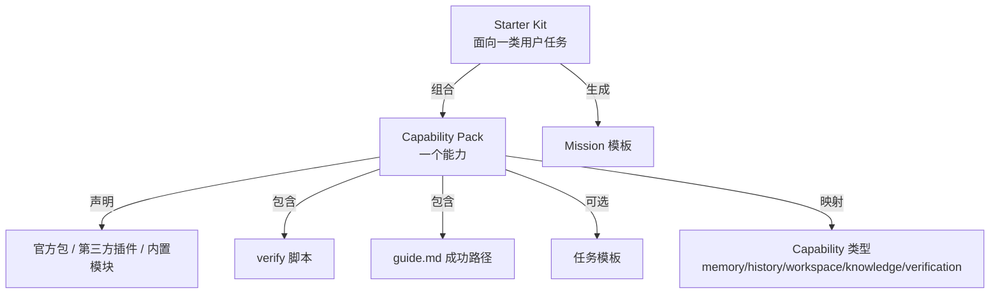
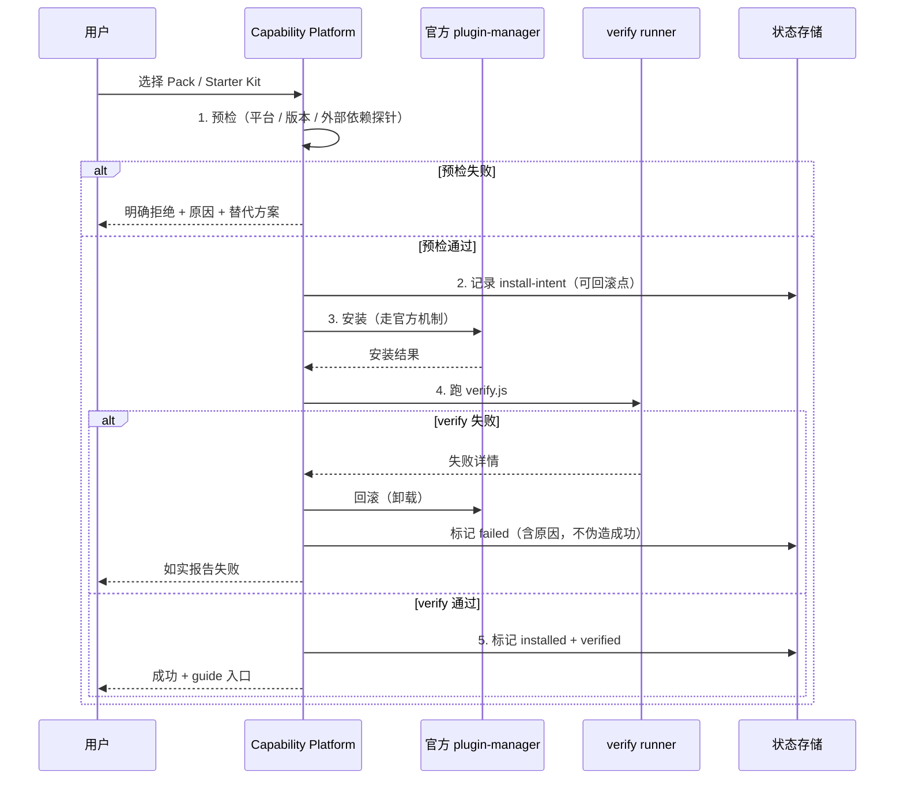

# Capability Platform 架构

> 状态：**设计阶段（2026-11-01）** · 未实现
> 上游：`docs/adr/ADR-0003-capability-packs-not-marketplace.md`（**决策依据**）
> 具体第三方评估：`docs/research/capability-providers.md`、`docs/research/memory-systems.md`、`docs/research/workspace-isolation.md`
> 校验：本文的每个 schema 草案都需要对应的 JSON Schema 校验测试（待建）

## 0. 一句话

> **Capability Platform 不是插件市场，而是「经过端到端验证的能力组合 + 装完之后的成功路径」。**

它解决的不是"有没有"，而是"能不能用"。

## 1. 问题（第一性原理）

### 1.1 用户的真实痛点

| 症状 | 根本原因 |
|---|---|
| 装了一堆插件，不知道哪个能用 | 市场只解决分发，不解决验证 |
| 装完就崩 / 缺依赖 / 平台不支持 | 没有"组合可用性"保证 |
| 不知道该装什么 | 市场是无限选项，新手需要有限推荐 |
| 装完不知道怎么用 | 缺配套使用姿势 |

### 1.2 为什么不能自己做市场

官方已有 `dsh-plugin-manager`（当前 profile 插件/包管理）、`dsh-plugin-market`、`dsh-plugin-market-index`、`dsh-skill`、`dsh-skill-filesystem`、`dsh-skill-office`。

自建市场 = 重复实现 + 与官方争分发入口 → 违反 ADR-0001。

### 1.3 因此我们做什么

| 层 | 谁负责 | 我们做什么 |
|---|---|---|
| 分发（找到/安装插件） | **官方** market | 消费它，不重写 |
| **组合（哪几个一起用）** | **DshCockpit** | Capability Pack |
| **验证（组合能不能跑）** | **DshCockpit** | verify 脚本 + 健康检查 |
| **成功路径（装完怎么用）** | **DshCockpit** | Starter Kit + guide + Mission 模板 |

## 2. 概念模型



### 2.1 Capability（能力类型，闭集）

**初期只有 5 个，不扩张**：

| Capability | 用户看到的名字 | 解决什么 |
|---|---|---|
| `memory` | 持久记忆 | 关闭后仍记得项目关键决策 |
| `history` | 历史检索 | 找得到过去会话里说过什么 |
| `workspace` | 安全工作区 | 改代码不会毁掉当前工作 |
| `knowledge` | 知识库 | （**暂缓**，无真实需求证据） |
| `verification` | 自动验证 | 产物是否真的能用，有证据 |

> **扩张规则**：新增 Capability 必须回答"哪个真实用户问题现有 5 个覆盖不了"。

### 2.2 Capability Pack

一个 Pack = 一个 Capability 的**一个具体实现方案** + 验证 + 引导。

**为什么 Pack 而不是 Provider 接口**：
- Provider 接口是"给第三方实现用的抽象" —— 当前只有一个实现时是负债（ADR-0003 §5.4）。
- Pack 是"给用户用的确定组合" —— 现在就需要。

### 2.3 Capability Manifest（schema 草案）

```jsonc
{
  "$schema": "./manifest.schema.json",
  "schemaVersion": 1,

  // --- 身份 ---
  "id": "workspace-git-worktree",
  "name": "安全工作区（Git Worktree）",
  "version": "1.0.0",

  // --- 第一性原理：必须先写问题 ---
  "problem": "多个 Agent 同时改同一份代码会互相覆盖",
  "userPromise": "团队并行改代码时，各自在独立副本里工作，合并不冲突",

  // --- 能力归属 ---
  "capability": "workspace",
  "provider": {
    "kind": "builtin",              // official-package | third-party-plugin | builtin | external-process
    "packages": [],                  // 若 kind=official-package，列真实包名
    "entry": "src/capability/workspace-worktree.js",
    "whyNotBuiltin": null            // 若 kind=builtin 且官方已有，必须解释
  },

  // --- 平台 ---
  "platforms": ["darwin", "win32", "linux"],
  "platformNotes": {
    "win32": "需要 git >= 2.5（worktree 支持）"
  },

  // --- 依赖 ---
  "requirements": {
    "runtimeMinVersion": "0.2.0",
    "runtimeMaxVersion": null,
    "externalBinaries": [{ "name": "git", "minVersion": "2.5", "probe": "git --version" }],
    "networkAccess": false,
    "diskSpaceMb": 50
  },

  // --- 风险（新手默认安全） ---
  "risk": {
    "level": "low",                  // low | medium | high
    "dataWritten": [".dsh/worktrees/**"],
    "writesOutsideWorkspace": false,
    "reversible": true,
    "uninstallRemovesData": false,   // 默认不删，保护用户数据
    "requiresElevation": false
  },

  // --- 验证 ---
  "verify": {
    "script": "verify.js",
    "timeoutMs": 60000,
    "checks": [
      "install-ok",          // 安装成功
      "probe-ok",            // 依赖探针通过
      "functional-ok",       // 真的能用（最小功能断言）
      "uninstall-clean"      // 卸载无残留
    ],
    "ciRunnable": true       // 能否在 CI 跑（false 则必须标 manual）
  },

  // --- 成功路径 ---
  "guide": "guide.md",
  "prompts": ["prompts/parallel-change.md"],

  // --- 组合 ---
  "defaultFor": ["starter-kit:code-change"],
  "conflictsWith": ["workspace-shared-default"],
  "requiresCaps": [],

  // --- 生命周期 ---
  "maturity": "experimental",     // experimental | stable | deprecated
  "deferred": false,
  "deferredReason": null
}
```

### 2.4 Starter Kit（schema 草案）

```jsonc
{
  "schemaVersion": 1,
  "id": "code-change",
  "name": "改代码",
  "oneLiner": "告诉我改什么，团队改完自己跑测试验证",
  "userPromise": "5 分钟内拿到一份真实可打开的代码改动 + 验证结果",

  "capabilities": ["workspace", "verification", "history"],
  "missionTemplate": "templates/code-change-mission.json",
  "defaultBoundaries": [
    "只修改当前工作区内的文件",
    "每次改动后必须跑验证命令"
  ],

  "platforms": ["darwin", "win32", "linux"],
  "estimatedMinutes": 5,
  "produces": ["code-change", "report"],

  "maturity": "experimental"
}
```

## 3. 生命周期

### 3.1 安装流程（必须全部可回退）



**关键规则**：
1. **预检失败必须明确拒绝**，不允许"装了再说"。
2. **verify 失败必须回滚**，不留半装状态。
3. **成功状态必须来自 verify 的真实结果**，不允许"安装返回 0 就标成功"。

### 3.2 使用期健康检查

| 时机 | 检查 | 失败行为 |
|---|---|---|
| 应用启动 | 包是否还在、版本是否被改 | 标 `degraded`，提示重装 |
| Mission 开始时 | 所需 Capability 是否 `verified` | 阻止开始或降级功能（明确告知） |
| 定期（可配置） | 功能性探针 | 标 `degraded` |

### 3.3 卸载

- 默认**不删用户数据**（`uninstallRemovesData: false`）。
- 卸载后必须让状态回到"未安装"，不能残留 `verified` 标记。

## 4. 状态机

```
         ┌──────────┐
         │ unknown  │
         └────┬─────┘
              │ 检测到 Pack 存在
              ▼
         ┌──────────┐   预检失败   ┌────────────┐
         │ available├─────────────►│ unsupported│
         └────┬─────┘              └────────────┘
              │ 用户选择安装
              ▼
         ┌──────────┐   verify 失败  ┌────────┐
         │installing├───────────────►│ failed │
         └────┬─────┘   （已回滚）    └────────┘
              │ verify 通过
              ▼
         ┌──────────┐  健康检查失败  ┌──────────┐
         │ verified ├───────────────►│ degraded │
         └────┬─────┘                └────┬─────┘
              │ 卸载                     │ 重装
              ▼                          └──► installing
         ┌──────────┐
         │removed   │
         └──────────┘
```

**状态必须真实反映**：`verified` 只能由 verify 通过产生，不能由"安装命令返回 0"产生。

## 5. Profile Composer（有限组合器）

### 5.1 做什么

| 功能 | 做不做 | 说明 |
|---|---|---|
| 列出 Capability 状态 | ✅ | 未安装/已安装/验证通过/验证失败/不支持 |
| 替换某个 Capability 的实现 | ✅ | 但**替换后必须重跑 verify** |
| 显示"当前组合" | ✅ | 让用户知道自己在用什么 |
| 自由拼装任意插件 | ❌ | 组合爆炸无法验证 |
| 编辑 cordis.patch.yml | ✅（高级） | 官方机制，我们只提供入口与说明 |
| 自动解决冲突 | ❌ | 冲突时明确告知，让用户选 |

### 5.2 为什么不做"自由拼装"

自由拼装的组合数是组合爆炸，**每一个组合都需要验证**，否则我们承诺的"保证能用"就是假的。
新手需要的不是"更多选择"，而是"更少但确定的选择"。

高级用户可以通过官方 `cordis.patch.yml` 自己拼 —— 我们提供文档与状态展示，不为他们做抽象。

## 6. Provider 抽象策略（保守）

**规则：只有当存在第二个真实实现且有明确替换需求时，才抽象接口。**

| Capability | 现在抽象？ | 理由 | 未来触发条件 |
|---|---|---|---|
| `memory` | ❌ 不抽象 | 官方 `dsh-goal` + `dsh-compaction` + session-search 已覆盖；第三方记忆方案未验证 | 证明官方三者有明确缺口，且有 ≥2 个候选实现 |
| `history` | ❌ 不抽象 | 官方 `dsh-experimental-session-search` 已覆盖 | 官方搜索不满足某个具体场景 |
| `workspace` | ❌ 不抽象 | `dsh-workspace-changes` + git worktree 已覆盖 | 并行隔离需求被真实验证，且有 ≥2 个方案 |
| `knowledge` | ❌ 不抽象 | 无真实需求证据 | 有用户明确需要 RAG |
| **`verification`** | ✅ **现在抽象** | 已有真实需求 + 已有实现（`src/work/command-runner.js`）+ 天然多实现（shell 命令 / 测试框架 / 外部服务） | 已具备条件 |

### 6.1 VerificationProvider 接口（唯一现在做的抽象）

```js
/**
 * 验证一个工作区状态是否满足声明的要求。
 * 只做"跑命令 + 收集证据"，不做判定语义。
 */
createVerificationProvider({
  id: 'shell-command',
  /** 能否在当前平台/环境下工作 */
  async probe() -> { ok, reason, details },
  /** 执行验证，返回真实证据 */
  async verify({ workspacePath, command, timeoutMs, signal }) -> {
    ok: boolean,
    exitCode: number,
    durationMs: number,
    summary: string,       // 截断的 stdout/stderr 摘要（有上限）
    fullLogRelPath: string // 相对工作区的完整日志路径（不进事实链）
  },
  /** 清理 */
  async dispose()
})
```

**注意**：返回的 `summary` 会进入事实链，必须**有长度上限且不含敏感信息**；完整日志落在工作区 `.dsh/runs/` 下。

## 7. 数据存储

| 数据 | 位置 | 格式 | 理由 |
|---|---|---|---|
| Pack manifest | 仓库 `capability-packs/` | JSON | 随代码版本化 |
| 安装状态 | `<userData>/capabilities/state.json` | JSON（原子写） | 本地状态，不入 git |
| verify 日志 | `<workspace>/.dsh/capability/<packId>/verify-*.log` | 文本 | 工作区内，Agent 可读 |
| 组合（当前 profile） | 官方 `cordis.patch.yml` | YAML | 用官方机制，不自造 |

**边界**：我们不写官方 profile 之外的位置；`state.json` 是我们自己的状态，必须能重建（从实际包存在性推导）。

## 8. 与官方 plugin-manager 的集成

| 我们需要的 | 官方提供 | 集成方式 |
|---|---|---|
| 安装包 | `dsh-plugin-manager`（CLI/Web/agent tool 共享） | 调用官方 API/CLI |
| 列出已装 | `dsh-host-plugin-inventory`（只读投影） | 读取 |
| 启用/禁用 | 官方 profile patch | 通过官方机制 |
| 市场浏览 | `dsh-plugin-market` | 链接过去，不重写 |

**铁律**：**不自己实现包安装**。npm/pnpm 依赖解析交给官方。

## 9. 失败模式与处理

| 失败模式 | 检测 | 处理 |
|---|---|---|
| 外部依赖缺失（如 git） | 预检探针 | 明确拒绝 + 安装指引 |
| 平台不支持 | manifest `platforms` | 卡片置灰 + 原因 |
| 包版本漂移 | 启动时比对 | 标 `degraded`，建议重装 |
| verify 超时 | timeout | 标 `failed`，回滚 |
| verify 脚本本身有 bug | CI 中跑 | 阻止发布该 Pack |
| 网络不可用（需联网 Pack） | 预检 | 明确告知 |
| 磁盘不足 | 预检 | 明确拒绝 |
| 用户手动改了 profile | 启动检测 | 标 `degraded`，不覆盖用户改动 |

## 10. POC 边界（本阶段不实现）

**POC 目标**（P3 阶段做）：验证 "一个 Pack 能否端到端跑通"。

**POC 范围**：
- 1 个 Capability：`verification`
- 1 个 Pack：`verification-shell-command`（复用 `src/work/command-runner.js`）
- 1 个 Starter Kit：`code-change`
- 完整生命周期：安装 → verify → 使用 → 卸载

**POC 不做的**：
- ❌ 多个 Pack。
- ❌ 第三方 Pack。
- ❌ Profile Composer UI。
- ❌ 自动更新机制。

**POC 成功判据**：能演示"安装 → 真实跑通 → 卸载 → 无残留"，且 verify 结果不是伪造的。

## 11. 开放问题

| # | 问题 | 影响 | 状态 |
|---|---|---|---|
| Q1 | Pack 内容是放在主仓库还是独立仓库？ | 影响发布节奏 | 待定（倾向主仓库，初期） |
| Q2 | verify 脚本用 JS 还是 shell？ | 影响跨平台 | 倾向 JS（跨平台一致） |
| Q3 | 是否需要 Pack 签名/来源校验？ | 安全 | 初期不需要（只支持官方+内置），第三方时再议 |
| Q4 | 用户数据在卸载时的默认策略？ | 数据安全 | 倾向"保留并提示路径" |
| Q5 | 与官方 market 的入口关系？ | UX | 倾向"两个入口并存，我们的更窄更可靠" |

## 12. 相关文档

- 决策：`docs/adr/ADR-0003-capability-packs-not-marketplace.md`
- 第三方评估：`docs/research/capability-providers.md`、`memory-systems.md`、`workspace-isolation.md`
- 路线图：`docs/product/product-roadmap.md`（P3）
- 用户旅程：`docs/product/user-journeys.md` §2
