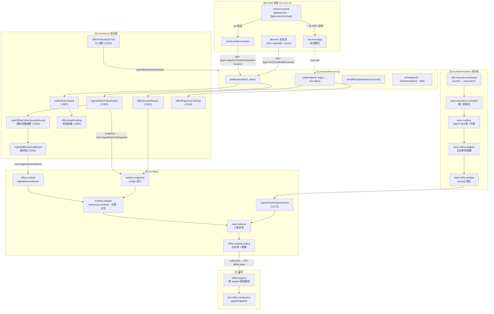
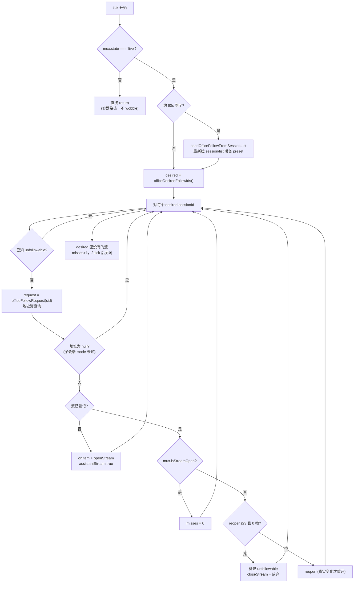
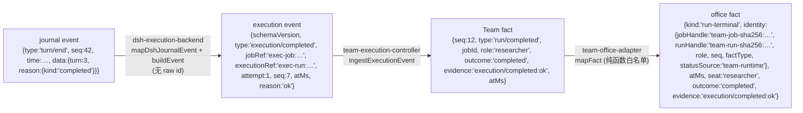
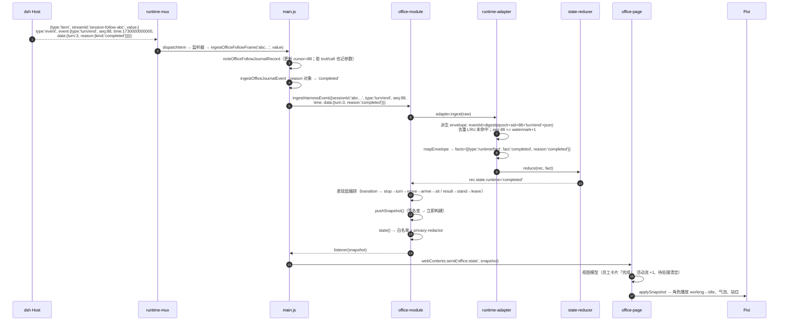

# 端到端数据流（执行事件 → 渲染）

> 状态：**审计 + 可执行设计**（2026-11-01，Harness 集成架构审计）。
> 基线：DshCockpit `develop` @ `ec7e5bc`；runtime 锁 `0.1.5-rc.2`，对照官方 0.2.1-rc.5。
> 本文是 `docs/architecture/runtime-bridge.md` 与 `docs/research/deepseek-harness-api-surface.md` 的**派生文档**：分层与 API 稳定性在那两篇，本文只讲**一个事件从 dsh 到像素的完整旅程**，以及每一步的所有权、形状变换、失败模式。

**证据分级**：**已确认** / **部分实现** / **待验证** / **设计阶段** / **设想**。全文每条结论附文件+行号或可复现命令。

---

## 0. 一句话版本

```
dsh journal {type,seq,time,data}
  → [runtime-mux] WS 帧
  → [main.js] 三条入口（$events / session-follow / session-page）+ 翻译层
  → [Team Runtime] execution/* 事件 → team/* facts（唯一作者）
  → [team-office-bridge] 白名单映射
  → [office-module/runtime-adapter] canonical envelope + 去重 + 水位
  → [state-reducer] 8 维状态
  → [office-module.state()] 白名单快照（脱敏）
  → [IPC office:state] → [office-page] 视图模型 → [PixiJS] 像素
```

**铁律**（`AGENTS.md` §2.1「事实作者唯一」；完整所有权矩阵见 `docs/product/product-vision.md` §3.2）：**单向**。没有任何一条边反向写入上游事实。

---

## 1. 全景图（含所有入口与出口）



**关键事实（已确认）**：

- `runtime-mux` **不解析业务语义**：它只做"帧 → streamId → 监听器"的分发（`src/runtime-mux.js:109-127`），业务语义全在 `main.js`。
- `main.js` 有**三条独立入口**（`$events` / `session-follow` / `session-page`），它们共享同一个 mux 连接但不共享语义。
- `Team Runtime` 的入口**不是** mux 直连，而是 `main.js` 注入的 `transport`（`openTeamFollowStream`，`src/main.js:655-696`），因此 Team 侧对 mux 无编译期依赖。
- `office-module` 有两个事实入口：`ingestHarnessEvent`/`ingestHarnessSnapshot`（Harness 链）与 `ingestTeamProjectionFact`（Team 链）。**没有第三个**。

---

## 2. 入口 A：`$events` 全局流

### 2.1 帧 → 处理映射（已确认）

`src/main.js:4987-5054` 的 `onMuxEventValue`：

| 帧 | 字段 | 处理 | 产出的本地事实 | 证据 |
|---|---|---|---|---|
| `{type:'ready', clientId, host:{home}}` | — | 由 mux 内部消费（`dispatchItem` 先判 ready），**不**进 `onMuxEventValue` | `clientIdValue`（mux 私有）、触发 `openRegisteredStreams()` | `src/runtime-mux.js:110-121` |
| `{type:'emit', event:'api-session/status', args:[sessionId, running]}` | — | `noteOfficeSessionStatus` + `sessionRunning = running`；上升沿 → IM `taskStarted`；下降沿 → `onTaskDone` + `onTurnEnd` | `officeFollowRunning`、`sessionRunning`、IM 广播、成本刷新 | `src/main.js:4992-5013` |
| `{type:'emit', event:'api-session/error', args:[sessionId, message]}` | — | `eventsFeedSessionErrorCount += 1` + log | **只计数**，无业务 fact | `src/main.js:5014-5024` |
| `{type:'emit', event:'api-session/added', args:[summary]}` | summary 含 `sessionId`/`parentSessionId`/`origin` | `noteOfficeSessionAdded` → 记账 + 子会话早期信号 | `officeFollowKnown`、`officeFollowAddresses` | `src/main.js:5025-5027`、`:5144-5162` |
| `{type:'emit', event:'api-session/removed', args:[sessionId]}` | — | `noteOfficeSessionRemoved` → 清 running/cursor/address | 清除三张表 | `src/main.js:5028-5030`、`:5164-5170` |
| `{type:'emit', event:'api-session/activity', …}` | — | **刻意不处理**（`default: break`） | 无 | `src/main.js:5031-5033` 注释："forwarded events the shell does not consume (activity, presets, …)" |
| `{type:'waterfall', event:'approval/request', eventId, agentId, request}` | request = `{toolName, callId?, reason?}` | `onApprovalRequested(request, eventId, agentId)` | `officeNotePending`（P1 镜像）+ IM 广播 + 系统通知 | `src/main.js:5036-5048`、`:5723-5746` |
| `{type:'waterfall', event:'user-questions/request', …}` | request = `{questions:[…]}` | `onQuestionRequested(request, eventId, agentId)` | 同上 | `:5046`、`:5748-5765` |
| `{type:'cancel', eventId}` | — | `officeResolvePending(eventId)` | 待处理项移除 | `src/main.js:5049-5053` |

### 2.2 `agentId` 作为 sessionId 的关键约定（**已确认，有 first-hand 证据**）

waterfall 请求载荷**不含** sessionId。DshCockpit 用帧上的 `agentId` 当 sessionId：

- 代码：`src/main.js:4050-4053`（`officeNotePending` 的 sessionId 取值逻辑）
- 依据：`src/main.js:4043-4048` 注释引用 `dsh-agent` 的 `Agent.id: SessionId`（"Session-backed Agent identity"）
- 影响：这是审批项能绑定到员工、且 detailRef 能按 `sessionId + callId` 找到同 turn 的 `tool/call` 记录的唯一依据（`src/main.js:4144-4147`）

**风险标注（待验证）**：若 0.2.x 某天让 `agentId ≠ sessionId`（例如引入真正的多 Agent per Session），这条约定会静默失效。0.2.1 的 `RemoteEventAgentId` 仍是 Branded 字符串，`dsh-agent` 的 `Agent.id: SessionId` 未见变化（仅能在 asar 的声明里确认类型名存在，无法确认语义）→ **待验证**。

### 2.3 失败模式

| 失败 | 行为 | 证据 |
|---|---|---|
| mux 断线 | `onError` → `runtimeHealth.noteFeedFailure` → 降级姿态；**不产业务 fact** | `src/main.js:4954-4962`、`src/runtime-health.js:96-104` |
| cookie 换不到 | 归入 `auth-fail-streak`（与 feed 失败分开计数，因为 remedy 不同） | `src/runtime-health.js:38-41`、`:96-104` |
| `$events` 流被 host end/error | mux 内部 `scheduleReconnect` | `src/runtime-mux.js:139-155` |
| `clientId` 缺失时收到答案 | `sendResult` 诚实返回 `{ok:false, reason:'mux not ready (no clientId)'}` | `src/runtime-mux.js:340` |
| 运行时重启 | `stopEventsFeed` → `expirePendingFromRuntime()` 让死掉的审批卡失效（而不是继续冒充"待你处理"） | `src/main.js:5071-5085` |

---

## 3. 入口 B：`session/follow` journal 流（主数据通路）

### 3.1 三种帧的处理（已确认）

`src/main.js:5392-5428` 的 `ingestOfficeFollowFrame`：

```text
{type:'snapshot', cursor, records:[{type:'event',event}], hasMore, projections, assistantStream?}
    ├→ officeFollowCursors.set(sessionId, max(cursor))         (:5409-5411)
    ├→ 每条 record → noteOfficeFollowJournalRecord              (:5414)
    └→ mod.ingestHarnessSnapshot({sessionId, records})          (:5417)

{type:'event', event:{type,seq,time,data}}
    └→ ingestOfficeJournalEvent(sessionId, event)               (:5395)

{type:'assistant-stream', frame:{type:'start'|'chunk'|'end'|…}}
    └→ noteOfficeAssistantStreamFrame  （只计数 + 节流 log，正文绝不转发）(:5398-5404)
```

**为什么 snapshot 不能当增量**（这是本项目踩过的真实坑，注释即结论）：
`SessionFollowRequest` 没有 resume cursor，**每次 open 都重启窗口**。窗口首记录可能**高于** office 侧的 watermark——若当作增量投递，会制造"前向断档"，触发 5 次 resync 后 `sync=stale`，员工卡在任务中途。因此窗口必须交给 `ingestHarnessSnapshot`，由水位裁决是 continuation 还是 baseline 重启。证据：`src/main.js:5378-5391`（注释）；`SessionFollowRequest` 声明（两代都无 cursor，见 API surface §3.3）。

### 3.2 翻译层：`ingestOfficeJournalEvent`（0.1.5 journal → adapter 词表）

`src/main.js:5451-5534`。**这是整条链上唯一做"词表转换"的地方**，也是 0.2.x 升级最脆弱的代码。

| journal 事件 | 翻译动作 | 交给 adapter 的 envelope | 丢弃的字段 | 行号 |
|---|---|---|---|---|
| `turn/start` | 改类型 | `{type:'agent/status', data:{status:'running'}}` | `data.turn` 等全部 | `:5465-5468` |
| `turn/end` | `data.reason` 对象 → `reason.kind` 字符串 | `{type:'turn/end', data:{turn, reason}}` | 原始 reason 对象（含 `error: LlmFailure`） | `:5469-5478` |
| `tool/call` | 只提取工具名（`toolNameOfJournalData`，`data.name` 优先） | `{type:'tool/call', data:{tool}}` | **`data.arguments` 原文永不进入**（隐私铁律） | `:5479-5489`（提取器 `src/office/runtime/tool-phrases.js:121-126`） |
| `assistant/message` | 只提取 4 个 usage 数字 + 定价 | `{type:'turn/usage', data:{turn, usage:{input,output,cacheRead,cacheWrite}, cost}}` | **消息正文 `data.message.content` 永不进入** | `:5490-5523` |
| `subagent/catalog` / `tool-workflow/*` / `user/message(source.kind='subagent-settled')` | 交给纯模块 `subagent-wiring.handleEvent` | `subagent/start` / `subagent/end`（沿用自己的 seq 规则） | label/phase 之外的一切 | `:5532` → `src/office/runtime/subagent-wiring.js:170-246` |
| **其它全部** | **原样透传** | `{type: event.type, seq, time, data}` | 无 | `:5533` |

**两个硬约束（已确认）**：

1. 翻译后的 envelope **必须沿用 journal 原始 `seq`**，否则 adapter 的严格水位会开出假断档。只有 `subagent-wiring.flushDeferred` 的迟到 start 例外（用 `seq:null` 让 adapter 自行编号）。
2. `assistant-stream` 帧**故意不转发**（正文是模型原文）。

### 3.3 谁在驱动 follow 流（对账循环）

`officeFollowSyncTick`（`src/main.js:5310-5376`），每 5 秒：



**desired 集合的三来源**（`src/main.js:5190-5199`）：
1. office 有**活跃绑定**的会话（`officeBoundSessionIds`，`:5176-5188`，从 `debugRegistrySnapshot().bindings` 取，`split('#')[0]` 归约回 raw）；
2. **正在跑**的会话（`officeFollowRunning`）；
3. **已知**会话（`officeFollowKnown`，来自 `api-session/added`）。

**为什么需要 4 种表**：`officeFollowStreams`（已开流）、`officeFollowRunning`（运行态）、`officeFollowKnown`（曾出现）、`officeFollowRemoved`（曾消失）+ `officeFollowUnfollowable`（判死）。全部有界（`OFFICE_FOLLOW_KNOWN_CAP=32`）。

### 3.4 resync：唯一的前向断档修复路径

`officeAnswerResync`（`src/main.js:5552-5622`）：

```text
触发：office-module 的 adapter 检测到 seq 跳号 → 发 office:runtime-resync-request
  → main.js onResyncRequest（:1011-1013）→ officeAnswerResync

流程：
  throughSeq = officeFollowCursors.get(sessionId)   ← 已交付的最大 seq
  loop 最多 8 页：
    mux.call('session/page', {request:{address, throughSeq, maxMessages:200, beforeSeq?}})
    pageRecords 是按时间倒序 → records.unshift(...pageRecords)
    if 首页 seq <= request.fromSequence → break（缺口已覆盖）
    if value.hasMore !== true → break（到日志头：诚实降级为 partial baseline）
    beforeSeq = 该页首条 seq
  → mod.ingestHarnessSnapshot({sessionId, records})  ← 水位裁决仍在 module 侧

失败处理：任一页失败 → log + return（不重试；adapter 自己的 250/500/1000/2000/4000ms 重试会再问）
并发保护：officeResyncInFlight（一 session 同时只有一次重读）
```

**关键设计**：resync **不用 follow 重开来"刷新"**——因为那样会重启窗口（见 §3.1）。用一元 `session/page` 读持久日志，不影响 live 流。

### 3.5 失败模式与降级

| 失败 | 行为 | 证据 |
|---|---|---|
| mux 非 live | tick 直接 return，office 保持本地行为 | `src/main.js:5311-5313` |
| 地址被拒（子会话用根地址 → `session/agent-busy`） | 连开 3 次零帧 → 判 `unfollowable`，停止重试 | `src/main.js:5115`、`:5354-5361` |
| 前向断档 | adapter 缓冲 + 发 resync 请求；5 次失败 → `sync=stale`（**只改 sync，不伪造离线**） | `runtime-snapshot.js:34-42`、`runtime-adapter.js:307-322` |
| 日志头到顶 | partial baseline + 诚实诊断 | `src/main.js:5604-5605` |
| `assistant-stream` 涌来 | 只计数 + 每 40 chunk 一条 log | `src/main.js:5276`、`:5299-5303` |

---

## 4. 入口 C：`session/page` 一元 RPC

两条使用路径，都是**按需**（不是常驻）：

| 用途 | 触发 | 参数 | 结果去向 | 证据 |
|---|---|---|---|---|
| resync 补洞 | adapter 的 `office:runtime-resync-request` | `{address, throughSeq, maxMessages:200, beforeSeq?}` | `ingestHarnessSnapshot`（水位裁决） | `:5574-5612` |
| 审批详情回查 | 用户点开危险操作模态 / 提问表单 | `{address, throughSeq, maxMessages:30}` | 返回命令原文给 UI（**不进任何快照**） | `:4243-4262`、`:1011-1013` |

**审批详情回查的必要性**（first-hand 证据链，`src/main.js:4130-4156` 注释）：
- 审批请求携带**没有**工具参数（`dsh-user-approval` README: "The request carries no tool arguments"）；
- 但 `dsh-agent-loop` 的 `tool/call` journal 事件携带 `{turn, step, callId, name, arguments}`；
- `dsh-tools` 的 `serviceAsk()` 传的 `callId` 与 `tool/call` 的 `callId` **是同一个** `ToolCallId`；
- 因此 `sessionId + callId` 能关联出命令原文。

**隐私边界**（`src/main.js:4148-4155` 注释 + 代码）：这个映射**只在主进程内存**（`officeToolCallArgs`，`:4158`，容量 64、TTL 2h），**永不进快照**；唯一出口是用户主动发起的 `office:pending {action:'detail'}` IPC。

---

## 5. Team 链：`execution/*` → `team/*` → office

### 5.1 装配（已确认）

`startTeamRealWithTopic`（`src/main.js:718-897`）：

```text
rpc       = createHarnessRpcWire(runtimeUrl, {protocol:'slash', mux, auth})   (:727-732)
openFollow = openTeamFollowStream(sessionId)                                  (:733)
transport = createShellTeamTransport({rpc, openFollow, artifactDir, topic})   (:742-745)
runtime   = createTeamRuntime({clock: wallClock})                             (:746-747)
backend   = createDshExecutionBackend({clock, transport, phaseForTool})       (:751-754)
executor  = {startRun, observe, cancel, resume, unsupported:['recover']}      (:756-762)
controller= createTeamExecutionController({teamRuntime, executor, clock})     (:763-768)
bridge    = createTeamOfficeBridge({teamRuntime, office, knownSeats})         (:769-773)
```

### 5.2 事件形状的两次变换



**每一次变换都在丢弃身份**（这是按设计）：
- journal → execution：**raw sessionId / runId 消失**，换成 `exec-job:` / `exec-run:` 派生句柄（`src/team/runtime/dsh-execution-backend.js:345` 注释："raw sessionId 只在这条调用线线上出现，绝不进入任何 ExecutionEvent"）；
- execution → Team：`executionRef` 换成 Team 自己的 `runIdFor(jobId, role, attempt)`；
- Team → office：`jobId`/`runId` 换成 `team-job-sha256:<16hex>` / `team-run-sha256:<16hex>`（`src/team/runtime/team-office-adapter.js:97-108`）。

### 5.3 驱动循环（无轮询，事件到达才推进）

`drive()`（`src/main.js:776-832`）：

```text
controller.start()                        → createJob + dispatchReady
loop:
  controller.dispatchReady()              → 绑执行句柄（每个 ready role）
  onStatus(runtime.state())               → 壳把 Team 状态推给工作台
  若 status ∈ {completed,failed,cancelled,attention} → bridge.pump(); break
  若 controller.blocked() 非空            → onBlocked + bridge.pump(); break
  step = await controller.pumpOne()       ← **阻塞等待下一条真实执行事件**
  if step → bridge.pump()
  若 status ∈ {completed,failed,cancelled} → break
  若 status === 'attention'               → **绝不自动恢复**，退场等显式 resume
  若 !step（无事件可拉）→ 再给 dispatchReady 一次机会，仍无进展则 break
```

**三条刻意的设计**（注释即契约）：
1. `attention` **绝不自动恢复**（"显式恢复是铁律"，`:813-820`）——用户点"继续"走 `resumeTeam()` → `controller.resume()` → 重启 drive 循环；
2. `pumpOne` 是**阻塞等待**（`src/team/runtime/team-execution-controller.js:435-450`），无 timers、无墙钟；
3. `startDrive()` 防重入 + `driveRestartQueued`（`:836-852`），避免 resume 与循环收尾的窄竞态启动两个消费者抢同一个迭代器。

### 5.4 artifact 物化的顺序不变式（已确认）

```mermaid
sequenceDiagram
  participant BE as dsh-execution-backend
  participant TST as team-shell-transport
  participant CTRL as controller
  note over BE: 收到 turn/end completed
  BE->>BE: materializeArtifactsBeforeTerminal(state, mapped)
  BE->>TST: artifactFor({sessionId, role, kind})
  TST->>TST: 写 artifactDir/&lt;jobId&gt;/&lt;kind&gt;.md<br/>digest = 'exec-sha256:' + sha256(bytes).slice(0,16)
  TST-->>BE: {kind, digest, locationRef, artifactPath(壳内部), bytes}
  BE->>BE: emissionQueue.push(execution/artifact)
  BE->>BE: emissionQueue.push(execution/completed)
  BE-->>CTRL: 先 artifact（规则 0 优先），后 completed
  note over CTRL: Team 要求"只有 running 的 run 能产 artifact"<br/>若 completed 先到，artifact 会被拒且下游 HANDOFF_INCOMPLETE 永久悬挂
```

证据：`src/team/runtime/dsh-execution-backend.js:428-470`（物化）、`:492-495`（规则 0 优先交付）、`:548-556`（completed 排队在 artifact 之后）；`src/team-shell-transport.js:250-287`。

**fail-closed 语义**（`:454-458`）：没有捕获到正文 → `artifactFor` 返回 null → 不产 artifact 事件 → Team 的 `HANDOFF_INCOMPLETE` 让下游挂起。**宁可挂，不伪造交接**。

---

## 6. Office 侧：canonical envelope → 8 维状态

### 6.1 adapter 的职责（已确认）

`src/office/runtime/runtime-adapter.js`（832 行）是**唯一的 Runtime 事实入口**（`HARNESS-RUNTIME-CONTRACT-v0.md` §2.1 第 3a 行）。它做 6 件事：

| # | 职责 | 关键实现 |
|---|---|---|
| 1 | 接受裸 `{type,seq,time,data}` 与 `{event:{…}}` 包装 | `:328-336` |
| 2 | 派生 canonical envelope：`eventId`（`sessionEpoch + sessionId + seq + type + canonicalJson(payload)` 的 digest）、`sessionEpoch`、`pairingHandle`（子代理配对）、`sequence` | `:357-359` |
| 3 | 去重（LRU + TTL） | `:219-235` |
| 4 | 严格水位 + 前向断档缓冲 + resync 周期 | `:178-190`、`:280-325` |
| 5 | `mapEnvelope` → facts（白名单，未知类型 canonicalize 但不产 fact） | `:445-561` |
| 6 | `deriveRunProxy`（raw runId → `run-sha256:<16hex>`，fail-closed） | 实现在 `:815-820`；设计约束注释在 `:795-814` |

### 6.2 `mapEnvelope` 的事实产生表（已确认）

| envelope.eventType | 产出 facts | 条件 | 行号 |
|---|---|---|---|
| `agent/status` | `runtime/fact running` / `runtime/fact idle` | `idle` 且有活跃子代理时抑制 + 诊断 `IDLE_SUPPRESSED_ACTIVE_SUBAGENTS` | `:449-464` |
| `turn/end` | `runtime/fact completed` / `failed` / `runtime/cancelled`（evidence `turn/end:<reason>`）/ `runtime/fact attention(reason:'blocked')` / `attention(reason)` | 见判定表 | `:465-478` |
| `tool/call` | `runtime/tool` + tool 名 | 用共享提取器 `toolNameOfJournalData(raw)`：**`data.name` 优先、`data.tool` 兼容**（两条投递路径的工具名形状不同，2026-09-26 修复） | `:480-490`；提取器 `src/office/runtime/tool-phrases.js:121-126` |
| 其它 | —— | `default: break; // unmapped types canonicalize without invented facts` | `:559-560` |

**turn/end 的 reason 判定表（本项目唯一权威）**：

| reason | facts | 语义 |
|---|---|---|
| `completed` | `runtime/fact completed` | 正常完成 |
| `error` / `failed` | `runtime/fact failed` | 失败 |
| `aborted` / `interrupted` / `cancelled` | `runtime/cancelled` + evidence `turn/end:<reason>` | 取消/中断 |
| `blocked` | `runtime/fact attention reason='blocked'` | 需人处理 |
| **其它 / 缺失（含 `max-tokens`、0.2.x 的 `forked`）** | `runtime/fact attention`（**粗粒度 reason 保留**） | **有意降级，绝不猜 failed** |

> 这张表是 `dsh-execution-backend.mapDshJournalEvent`（`src/team/runtime/dsh-execution-backend.js:218-234`）的**复刻源**，两处必须保持一致。当前 `forked` 两处都落到 `default`（见 runtime-bridge.md §10 R2）。

### 6.3 8 维状态与 reducer

`src/office/runtime/state-reducer.js` 的 `reduceOfficeState` 维护 8 个维度，每个维度有**权威规则**（谁能写）：

| 维 | 名称 | 写入者（唯一） | 证据 |
|---|---|---|---|
| 1 | `presence` | employee-registry（绑定/释放） | `runtime-adapter.js` 的 facts → `applyFact` |
| 2 | `sync` | adapter 的 `setSync`（healthy/resyncing/stale） | `runtime-adapter.js:321-322`；`HARNESS-RUNTIME-CONTRACT-v0.md` §9 |
| 3 | `runtime` | `runtime/fact`（running/idle/completed/failed/attention） | `runtime-adapter.js:449-478` |
| 4 | `activity` | transition-controller | `HARNESS-RUNTIME-CONTRACT-v0.md` §2.1 第 3g 行 |
| 5 | `movement` | movement-controller | 第 3j 行 |
| 6 | `control` | `control/*` facts（cancel-requested / cancel-ack） | `:721-724`（`noteCancelAcknowledged` 只发 `control/cancel-ack`） |
| 7 | `binding` | employee-registry | 第 3e 行 |
| 8 | `queue` | queue-controller（**唯一队列事实源**） | 第 3f 行 |

**关键约束（已确认）**：`sync` 降级**只改 sync**——永远不伪造 offline、不结束本地行为、不释放绑定（`runtime-adapter.js:30` 注释 + `test/harness-runtime-kernel-probe.test.js` 的 "sync degradation only changes sync" 用例）。

### 6.4 呈现层编排（不是事实）

office-module 在 reducer 之上做**表现层**编排（快照里可见但不是事实来源）：

| 表现 | 位置 | 说明 |
|---|---|---|
| `resultUntilMs` 呈现窗口 | office-module | 终态后停留展示 |
| 行走/落座动画 | transition-controller + movement-controller | 纯表现相位 |
| 气泡/闲聊 | dialogue-engine + idle-director | 内容/引擎分离 |
| 工位预留 | workstation-layout | 布局 |
| 悬停卡 | office-page 视图模型 | 只读派生 |

审查确认：这些**都不产 runtime fact**（`test/harness-runtime-kernel-probe.test.js` 的 "local activity, animation, movement and user control cannot fabricate runtime facts" 用例钉住）。

---

## 7. 快照与渲染

### 7.1 快照节流（已确认，是理解"数据流末端"的关键）

`src/office/office-module.js`：

| 机制 | 值 | 作用 | 证据 |
|---|---|---|---|
| `TICK_MS` | 16 | 仿真时钟步长 | `:86` |
| `PUSH_INTERVAL_MS` | `= TICK_MS`（16ms） | **推送节奏 = 视图帧率**（renderer 的 Pixi ticker 按契约停止，渲染只在快照推送时发生） | `:96`、`:87-95` 注释 |
| `ANIMATION_GRANULARITY_MS` | 250 | 慢速多帧动画按此粒度进内容签名 | `:105` |
| `SNAPSHOT_HEARTBEAT_MS` | 1000 | 心跳兜底：未纳入签名的字段至多 1s 陈旧 | `:104` |
| `contentSignature()` | FNV-1a 整数哈希 | 场景静止时跳过全量构建+脱敏+IPC | `:4229-4245` |
| `SNAPSHOT_LOG_TAIL` / `SNAPSHOT_DIAGNOSTICS_TAIL` | 50 / 20 | 快照只带尾部 | `:166-167` |

`pushSnapshot()`（`:4270-4284`）三步门禁：① 距上次 ≥16ms；② 有订阅者；③ 签名变了 **或** 距上次 ≥1s。

### 7.2 `state()` 的白名单构成（已确认）

`src/office/office-module.js:3300-3322`：

```text
{
  schemaVersion: 1,
  simulatedAtMs, paused,
  sync,                                    ← adapter 的 globalSync
  scene: {referenceWidth, referenceHeight},
  employees: [ … ],                        ← 每员工 rec（白名单字段）
  activityLog: 尾部 50 条,
  diagnostics: 尾部 20 条,
  capabilities: capabilitySnapshot(),      ← PROVEN_CAPABILITIES (:216-228)
  usage,                                   ← main.js 注入（injectOfficeUsage）
  pending,                                 ← waterfall 镜像
  pendingInvalid, pendingInvalidAtMs, pendingInvalidRealMs
}
```

**隐私边界（已确认）**：快照**不含** raw sessionId / prompt 正文 / 产物内容 / 绝对路径。唯一的例外通道是 `office:pending {action:'detail'}`（用户主动发起，返回给 IPC 调用方而非快照）。

### 7.3 IPC → 视图 → 像素

```text
office-module.subscribe(listener)               (:4286-4289)
  → main.js 的订阅回调                         (:1029-1031)
    → windowManager.broadcastToOfficeViews('office:state', snapshot)   (src/window-manager.js:255-258)
      → officeShellView.webContents.send('office:state', payload)
        → office-page.js（零 require 视图模型）
          → pixi-office-renderer.applySnapshot(vm)
```

**两条重要约束**：
- `broadcastToOfficeViews` 在 **office 视图不存在时直接 return**（`window-manager.js:256`）——没有办公室视图时**不推**，因此 `pushSnapshot` 的 `listeners.size === 0` 门禁在第一次打开前会一直挡住（`:4272`）；
- `office-page.js` 是**零 require** 视图模型（`HARNESS-RUNTIME-CONTRACT-v0.md` §2.1 第 5 行）——它可以被独立测试、不依赖 Electron。

---

## 8. 一条真实事件的完整时序（`turn/end completed`）

以一次成功的研究任务为例，标出**每一跳的形状与所有者**。



**同时发生的三条副作用**（都源自同一个 journal 事件，但**走不同路径**）：

| 副作用 | 路径 | 证据 |
|---|---|---|
| 成本统计 | `assistant/message` 的 usage → `turn/usage` → office `usage` 块；主进程 `onTurnEnd()` → 官方价成本 | `src/main.js:5490-5523`、`:5008-5011` |
| Team 事实（若是 Team 会话） | 独立的 Team follow 流（`team-follow-<sid>`）→ backend → controller → Team → bridge | `src/main.js:655-696`、§5 |
| IM 推送 | `api-session/status running=false` → `onTaskDone()` → `channelsMgr.broadcast({kind:'taskDone'})`（8s 去抖） | `src/main.js:5008-5009`、`:5632-5641` |

**注意**：同一个 journal 事件被**两个独立的 follow 流**消费（office 的 `session-follow-<sid>` 与 Team 的 `team-follow-<sid>`），它们各自开流、各自去重、互不感知。这是刻意的隔离（Team 链不依赖 office 链的存活），代价是**同一会话的两倍 follow 开销**（待验证实际成本）。

---

## 9. 失败模式全景表

| # | 失败点 | 检测 | 行为 | 用户可见后果 | 证据 |
|---|---|---|---|---|---|
| F1 | cookie 换不到 | `runtime-auth.exchange` 三次退避失败 | 归入 `auth-fail-streak`；mux 无 cookie 时不建连 | 托盘/设置页显示"降级：鉴权失败" | `src/runtime-auth.js:41-72`、`runtime-health.js:38-41` |
| F2 | mux 断线 | socket close/error | 指数退避重连（3s→60s），重连后重开所有流 | 短暂无更新；超过 30s 显示"断连" | `src/runtime-mux.js:169-199`、`runtime-health.js:108-121` |
| F3 | `$events` 流被 end | `{type:'end', streamId:'s-events'}` | mux 内部 `scheduleReconnect` | 同上 | `src/runtime-mux.js:139-147` |
| F4 | 单条 follow 流被 end | `{type:'end', streamId:'session-follow-x'}` | 只有 `$events` 触发重连；**per-session 留给调用方对账**（避免对已被 host 关掉的 journal 无限重开） | 该员工停止更新，5s 后 tick 决定是否重开 | `src/runtime-mux.js:142-146`、`src/main.js:5339-5363` |
| F5 | 地址被拒（`session/agent-busy`） | error 帧 + 0 帧 | 3 次后判 `unfollowable` | 该员工冻结（诊断可查） | `src/main.js:5350-5361` |
| F6 | seq 前向断档 | adapter 水位 | buffer + resync（250ms…5s，5 次） | 短暂 `sync=resyncing`；失败后 `sync=stale` | `runtime-adapter.js:280-325`、`runtime-snapshot.js:34-42` |
| F7 | resync 到日志头 | `hasMore !== true` | partial baseline + 诊断 | `sync` 诚实标注，不伪造完整 | `src/main.js:5604-5605` |
| F8 | Team follow 流耗尽 | iterator done | 合成**一条** `execution/crashed(stream-ended)` | 工作项 → attention（非终态），可显式 resume | `dsh-execution-backend.js:517-527` |
| F9 | artifact 未物化 | `artifactFor` 返回 null | 不产 artifact 事件 | 下游 `HANDOFF_INCOMPLETE` 挂起（不伪造） | `dsh-execution-backend.js:454-458`、`:405-417`（controller 的 `computedHandoffBlock`） |
| F10 | 运行时重启 | `stopEventsFeed` | 失效所有 pending（`expirePendingFromRuntime`）+ 清空镜像 + 复位 `sessionRunning` | 死掉的审批卡消失；面板显示"已失效" | `src/main.js:5071-5090` |
| F11 | Team 运行中第二次启动 | `officeTeamRealInstance` 非空 | 拒绝（`TEAM_ALREADY_ACTIVE`） | 工作台提示已有任务 | `src/main.js:721-724` |
| F12 | 审批答案到达时 mux 已断 | `clientId === null` | 诚实返回失败，不缓存答案 | IM 回复"运行时事件流离线" | `src/runtime-mux.js:340`、`src/main.js:5797-5802` |
| F13 | 快照过大 | —— | 尾部截断（log 50 / diag 20）+ 内容签名跳过 | 无（设计如此） | `office-module.js:166-167`、`:4229-4245` |

**审查结论**：13 条失败路径**全部**有明确的诚实降级（无一条伪造终态或静默吞掉）。这与 `AGENTS.md` §2.3"不伪造"纪律一致。唯一"静默"的是 F5/F13（有诊断但不打扰用户），可接受。

---

## 10. 0.2.x 对这条数据流的影响（逐段判定）

| 段 | 影响 | 判定 | 依据 |
|---|---|---|---|
| dsh → mux | 帧形状、路径、信封全同 | **零改动** | api-surface §2 |
| mux → main.js（`$events`） | `api-session/*` 5 个事件全同 | **零改动** | api-surface §8 脚本输出 |
| mux → main.js（`session/follow`） | 请求/帧类型全同；新增可选 `turnWindow` | **零改动**（可用不用） | api-surface §3.3 |
| mux → main.js（`session/page`） | 同上 | **零改动** | 同上 |
| **翻译层 `ingestOfficeJournalEvent`** | 净增 6 个事件走兜底（不崩）；`forked` 降级 attention | **必须补** | api-surface §4 |
| adapter 的 reason 判定表 | 同上 | **必须补**（与翻译层同步） | §6.2 |
| Team 链（backend/controller/runtime） | 只消费翻译后的 journal 事件；`forked` 落在 `mapDshJournalEvent` 的 default | **必须补** | `dsh-execution-backend.js:218-234` |
| Team office adapter | 白名单与 Team fact 类型是自己的，不受 dsh 版本影响 | **零改动** | team-office-adapter.js |
| office-module / state-reducer | 同上 | **零改动** | 纯内核无 Harness 依赖（门禁保护） |
| 快照 / IPC / 渲染 | 完全在 office 内部 | **零改动** | 同上 |

**一句话**：0.2.x 的影响**只落在 `main.js:5451-5534` 这一个函数与 `dsh-execution-backend.js:196-235` 这一个函数**。数据流的下游（adapter 之后）完全免疫——这是分层的直接收益。

**补充证据（2026-11-01，来自 CI 而非推断）**：`0.2.1-rc.5` 已在 CI 上被每日安装并启动（2026-10-31 run `41187195013`：darwin-arm64 + win32-x64 均 `ok=true`，含 `dsh web: <url>` 行匹配与 HTTP 200/3xx 探测）。这意味着本表最上面几行（dsh → mux 的启动握手）**已有运行级证据**，而不只是类型声明对比。三个 gate 的边界见 `docs/research/deepseek-harness-api-surface.md` §5.4.2——它们不覆盖 mux/RPC 行为，因此下面的"零改动"仍是**声明级**结论。

---

## 11. 待补与已知缺口

| 缺口 | 状态 | 为什么没补 |
|---|---|---|
| 净增 6 个事件的实际载荷取值（是否含模型自由文本） | **待验证** | 0.2.1 无法在本机运行；只能读到 JSON Schema 声明 |
| `runIdFor(jobId, role, attempt)` 的派生式细节 | **部分** | `src/team/runtime/team-schema.js` 有实现，本文未逐行引用（属 Team 契约文档范围） |
| `deriveRunProxy` 的 fail-closed 词表（`sk-`/`Bearer `/`xox`/`gh[pousr]_`/`>255`） | **已确认** | 不是缺口：实现已核对（`runtime-adapter.js:815-820`：长度 >255 / 含空白 / 敏感前缀 → null）。本文只是不展开，属 `HARNESS-RUNTIME-CONTRACT-v0.md` §6.3 的论述范围 |
| 同一会话被两条 follow 流消费的实际开销 | **待验证** | 需真机测量（本审计未启动运行时） |
| `office:*` 9 个通道的完整请求/响应 schema | **部分** | 见 `src/office/office-module.js:204-214`（`OFFICE_IPC_CHANNELS` 冻结集，9 个）+ `:4494-4520`（`validateOfficePayload` 按 channel 分支校验）；本文只覆盖与 Harness 链相关的 5 个 |
| 快照在 60fps 推送下的实际 IPC 成本 | **待验证** | 需真机 + Chrome tracing；`office-module.js:87-95` 注释给出了作者的设计估算 |

---

## 12. 复现本数据流的证据

```bash
cd DshCockpit

# 1) 入口三条 + 翻译层（行号即证据）
sed -n '655,696p'    src/main.js   # openTeamFollowStream
sed -n '4987,5054p'  src/main.js   # onMuxEventValue ($events)
sed -n '5392,5428p'  src/main.js   # ingestOfficeFollowFrame
sed -n '5451,5534p'  src/main.js   # ingestOfficeJournalEvent ← 翻译层
sed -n '5552,5622p'  src/main.js   # officeAnswerResync (session/page)

# 2) adapter 的 reason 判定表（唯一权威）
sed -n '449,480p' src/office/runtime/runtime-adapter.js

# 3) 快照节流与白名单
sed -n '86,110p'    src/office/office-module.js
sed -n '3300,3322p' src/office/office-module.js
sed -n '4229,4284p' src/office/office-module.js

# 4) 广播路径
sed -n '255,259p' src/window-manager.js
grep -n "broadcastToOfficeViews('office:state'" src/main.js

# 5) Team 链装配
sed -n '718,775p'   src/main.js
sed -n '776,832p'   src/main.js   # drive()
sed -n '428,470p'   src/team/runtime/dsh-execution-backend.js  # artifact 物化顺序
sed -n '489,576p'   src/team/runtime/dsh-execution-backend.js  # pullEvents 四条顺序规则

# 6) 端到端离线测试（不需要任何真实运行时）
node --test test/harness-runtime-kernel-probe.test.js      # 29 项：journal→facts→state 全链
node --test test/dsh-execution-backend.test.js             # journal→execution→Team fact
node --test test/team-shell-transport.test.js              # 含 END-TO-END offline 用例
node --test test/runtime-mux.test.js test/harness-rpc.test.js
```

---

## 13. 与既有文档的关系

| 文档 | 关系 |
|---|---|
| `docs/architecture/runtime-bridge.md` | **姊妹文档**：分层与 API 分级在那里，本文是它的数据流视图 |
| `docs/research/deepseek-harness-api-surface.md` | **姊妹文档**：API 表面证据在那里 |
| `docs/architecture/HARNESS-RUNTIME-CONTRACT-v0.md` | **上游权威**：本文 §6 是它 §1 事实链的逐步展开；本文 §9 的 F6/F7 对应它 §9 sync 语义 |
| `docs/architecture/WORKER-EXECUTION-CONTRACT-v0.md` | **上游权威**：本文 §5 是它的实现侧证据 |
| `docs/architecture/TEAM-RUNTIME-CONTRACT-v0.md` | **上游权威**：本文 §5.2 的两次形状变换对应它 §13.2 白名单映射表 |
