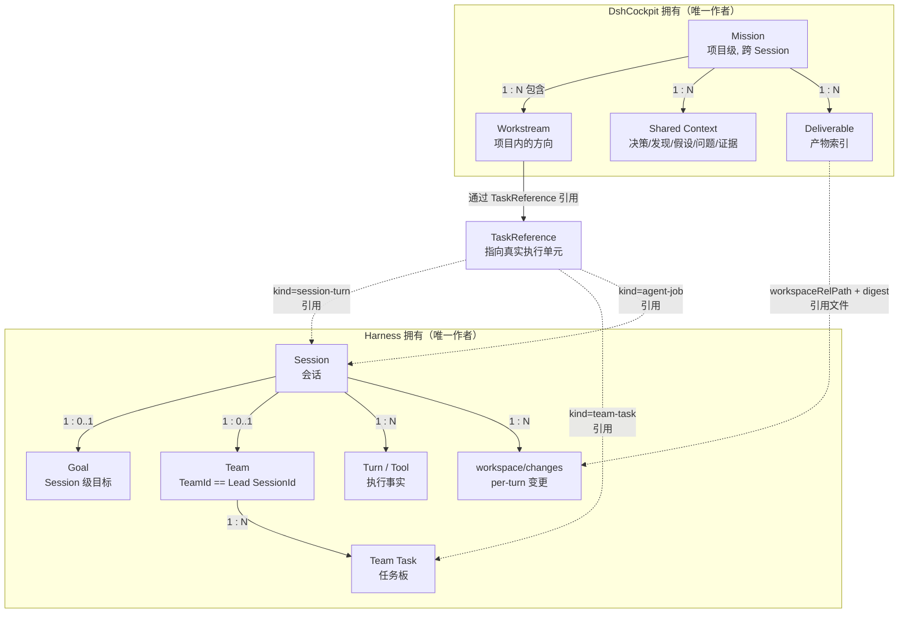

# 领域模型：Mission / Shared Context / Team / Office

> 状态：**设计阶段（2026-11-01）** · 尚未实现。本文件是第一性原理下的目标领域模型，不是现状描述。
> 现状见 `docs/architecture/architecture-overview.md`（审计中）。
> 上游：`docs/product/product-vision.md` §3（单一事实源矩阵）。
> 校验方式：本文件的每个实体都必须在 `docs/architecture/mission-core.md` 里有对应的 schema 草案与存储决策。

## 0. 核心判断（第一性原理）

### 0.1 问题是什么

用户真正的问题**不是**"缺少一个任务管理系统"，而是：

> **同一个项目要开很多次会话，每次都要重新交代背景；做完的工作散落在各处，找不回来；不知道团队上次停在哪、定了什么、还差什么。**

### 0.2 根本原因

| 原因 | 说明 |
|---|---|
| R1 | Harness 的持久化单位是 **Session**，不是 **Project**。Session 结束，上下文就断了。 |
| R2 | `dsh-goal` 是**同会话**的持久目标（官方文档明确"每会话至多一个当前 goal"），**不跨 Session**。 |
| R3 | Agent Teams 的 roster/任务板属于**单次 Team 生命周期**（TeamId = Lead SessionId），**不跨 Session**。 |
| R4 | 会话压缩（compaction）会丢弃细节，只保留摘要 —— 而被丢弃的往往是"为什么这么决定"。 |
| R5 | 用户的工作产物散落在工作区里，但没有**索引**，下次 Agent 找不到。 |

### 0.3 因此我们真正需要自研的是什么

**只有一个东西：跨 Session 的项目级连续性。**

它是 Harness 明确不提供的（R1–R3 有官方文档证据）。
其余一切（Agent 执行、Team 编排、goal 状态机、文件 diff、上下文压缩）都**已有官方实现**。

> **设计铁律**：Mission Core 只做「跨 Session 的项目记忆与索引」。
> 一旦发现它在实现「会话内的任务调度」「Agent 执行循环」「Team 成员管理」—— 越界了，必须停。

## 1. 分层模型

```
┌─────────────────────────────────────────────────────────────┐
│  Mission Layer（DshCockpit 唯一作者）                        │
│  跨 Session、跨 Team、跨天。回答"这个项目是什么/定了什么"      │
│                                                             │
│  Mission ─┬─ Workstream ─── Task Reference ──┐              │
│           ├─ Shared Context（Decision/Finding/│              │
│           │   Assumption/OpenQuestion/Evidence）             │
│           ├─ Deliverable Index               │              │
│           └─ Project Workspace ──────────────┘              │
└──────────────────────────┬──────────────────────────────────┘
                           │ 只读引用（不复制状态）
┌──────────────────────────▼──────────────────────────────────┐
│  Execution Layer（Harness 唯一作者）                          │
│  Session / Turn / Tool / Agent / Team / Goal / 文件变更       │
└─────────────────────────────────────────────────────────────┘
                           │ 派生投影（不写回）
┌──────────────────────────▼──────────────────────────────────┐
│  Presentation Layer（DshCockpit 派生）                        │
│  Office Runtime → Snapshot → PixiJS / Mission Desk           │
└─────────────────────────────────────────────────────────────┘
```

## 2. Mission Layer 实体

### 2.1 Mission（项目级长期工作）

**是什么**：用户想完成的一件**长期的事**。跨天、跨 Session、跨 Team。

#### 2.1.1 三个正交维度（2026-11-01 审查修订：修正"全局唯一 Active"的错误设计）

**这是本领域模型最关键的一处修订。** 之前的设计隐含了"同一时刻只有一个 active Mission"，这是错的。必须把三个概念**彻底分开**：

| 维度 | 语义 | 取值范围 | 数量约束 | 谁来改 |
|---|---|---|---|---|
| **Active** | Mission 是否**仍然有效**（是否还在推进中） | `active` / `paused` / `completed` / `abandoned` | **一个 Workspace 可同时有多个 active** | 用户 |
| **Focused** | 用户**当前正在看哪一个**（UI 焦点） | `missionId \| null` | **全局至多 1 个**（纯 UI 状态） | 用户（点击/切换） |
| **Running** | 是否存在**真实 Agent 正在执行** | `boolean`（派生） | 可多个（多个 Mission 同时跑） | **派生自 Harness，我们不写** |

**三条铁律**：

1. **不得在数据模型（数据库/文件）上加"全局唯一 active Mission"的约束。** Active 是 Mission 自身属性，可以有 N 个。
2. **Focused 是 UI 状态，不是持久事实**（可以持久化"上次聚焦哪个"作为体验优化，但它是 UI 偏好，不是 Mission 状态）。
3. **Running 必须从 Harness 派生**，不允许 Mission 自己维护"我正在跑"的标志位（否则又是第二个事实作者）。

**数量软提示（2026-11-01 用户决策）**：

> 每个 Workspace **建议**最多 10 个 Active Mission。这是**软提示，不是硬限制**。

| 要求 | 说明 |
|---|---|
| ❌ **不得**写成数据库 CHECK 约束 | 不阻止用户创建第 11 个 |
| ❌ **不得**用 schema 校验拒绝 | 校验只保证结构合法，不限制数量 |
| ❌ **不得**用 UI 禁用创建按钮 | 用户始终能创建 |
| ✅ 超过 10 个时给**轻量提醒** | 如"你有 12 个进行中的 Mission，考虑归档一些？" |
| ✅ 提供**整理建议** | 列出长期未更新的 Mission，建议 pause/complete |

**实现位置**：提醒逻辑在 **UI 层**（Mission 列表渲染时计算），不在 `schema.js`、不在存储层、不在 IPC 层。
这样即使 UI 提醒被忽略，数据层也永远允许更多 Mission。

**典型场景**（证明必须支持多 Active）：

```
用户同时推进三件事：
  Mission A: 把 DshCockpit 转型（active，当前 focused）
  Mission B: 写一篇论文（active，本周未动）
  Mission C: 维护一个开源库（active，等社区 PR）

三个都 active，用户此刻 focused 在 A。
Mission B 今天可能有 Agent 在跑（running=true），也可能没有。
```

如果强制"全局唯一 active"，用户就必须手动 pause B 和 C —— 这是**把数据库限制强加给用户的心智**，明显错误。

#### 2.1.2 Mission 实体

```jsonc
{
  "missionId": "mis-<uuid>",              // 稳定，永久
  "title": "把 DshCockpit 转成 Agent-first 工作空间",
  "intent": "用户原话（一句话目标）",       // 不可被模型改写
  "status": "active",                     // active | paused | completed | abandoned（≠ Focused）
  "workspaceId": "ws-...",                // 关联到 Project Workspace，不存绝对路径
  "createdAtMs": 0,
  "updatedAtMs": 0,
  "schemaVersion": 1,

  "constraints": [                        // 用户确认过的边界（不可越界清单）
    { "id": "con-1", "text": "不许改 src/office 的业务代码", "source": "user" }
  ],
  "workstreamIds": ["ws-1", "ws-2"],
  "decisionIds": [...],                   // Shared Context 索引
  "openQuestionIds": [...],
  "deliverableIds": [...],
  "currentFocusWorkstreamId": "ws-1",     // Mission 内聚焦哪个工作流（≠ Mission 的 Focused）
  "lastSessionRef": "sess-h-...",         // 派生句柄，不是 raw id
  "briefVersion": 7                       // Mission Brief 版本号
}
```

**注意字段命名**：Mission 内的 `currentFocusWorkstreamId` 与全局 UI 的 `focusedMissionId` 是**两个不同概念**，不要混用。

#### 2.1.3 持久化位置的约束

| 数据 | 存哪 | 为什么 |
|---|---|---|
| Mission 列表（可多个 active） | `<workspace>/.dsh/mission/events.jsonl` | **按 Workspace 隔离**，不是全局单库 |
| **Focused Mission（UI 偏好）** | `<userData>/ui-state.json` | UI 状态，不属于项目数据 |
| Running 状态 | **不持久化** | 从 Harness 实时读，重启后重新派生 |

**因此**：不存在"全局唯一 active Mission"的数据库限制 —— 因为 Mission 数据本来就是**按 Workspace 分库**的，每个 Workspace 内的多个 Mission 平权共存。

#### 2.1.4 与 `dsh-goal` 的关系（关键边界，2026-11-01 审查强化）

| 维度 | `dsh-goal`（官方，**Session 级**） | Mission（我们，**项目级**） |
|---|---|---|
| 生命周期 | **单 Session**（跨 turns/resume/fork/重启存活） | **跨 Session**，永久 |
| 数量 | **每 Session 至多一个当前 goal** | 每 Workspace 多个 active（无上限，建议 ≤10） |
| 状态机 | active/paused/blocked/complete | **我们不复刻**；Mission 引用它 |
| 归属 | Harness 拥有 | DshCockpit 拥有 |
| 作用域 | "这个会话要完成什么" | "这个项目要完成什么" |

**明确结论**：

> **`dsh-goal` 是 Session 级持久化目标，不能代替 Mission。**
> Mission 是项目级容器；goal 是会话级执行意图。
> 二者的关系是 **1 Mission : N Goal**（一个项目会经历很多次会话，每次会话可能有自己的 goal）。

**实现约定**：
- Mission **不自己维护** goal phase 状态机（那是 `dsh-goal` 的职责）。
- Mission 只通过 `TaskReference` 记录"这次会话的 goal 属于哪个 Workstream"。
- 展示时读 Harness 的 goal 投影，**标注 `observedAtMs`**。

**Mission 显式不负责的事（用户明确要求，硬边界）**：
| 不做 | 谁做 |
|---|---|
| Agent Loop | Harness |
| 自动续跑（goal round driver） | Harness `dsh-goal-round-driver` |
| Harness 原生任务状态（`team/task`） | Harness Agent Teams |
| 任务调度 / 优先级队列 | Harness |
| 工具执行与审批 | Harness |

**状态判定**（避免两套状态）：

| 用户看到的 | 真实来源 | 是否持久化 |
|---|---|---|
| "正在推进"（Mission 层） | `Mission.status === 'active'` | ✅ Mission 自身 |
| "此刻有 Agent 在跑" | 当前 Session 有 running agent（Harness） | ❌ 实时派生 |
| "等你决定" | 当前 Session 有 pending approval/question（Harness） | ❌ 实时派生 |
| "这周没动" | `Mission.updatedAtMs` 距今 > 7 天 | ❌ 纯派生 |
| "已完成" | `Mission.status === 'completed'`（**用户显式确认**） | ✅ Mission 自身 |


### 2.2 Workstream（工作流）

**是什么**：Mission 下的一个**可并行的方向**。回答"这个项目现在有几条线在跑"。

```jsonc
{
  "workstreamId": "ws-1",
  "missionId": "mis-...",
  "title": "Harness 0.2.x 兼容性升级",
  "status": "active",                     // active | blocked | done | dropped
  "order": 1,
  "dependsOn": ["ws-0"],                  // workstream 间依赖（不是 Task 依赖）
  "sessionRefs": ["sess-h-a", "sess-h-b"],// 该工作流用过的会话（派生句柄）
  "deliverableIds": ["del-1"],
  "notes": "为什么开这条线"
}
```

**为什么需要 Workstream 而不是直接用 Session**：
- 一个 Workstream 通常横跨多个 Session（今天做一半，明天继续）。
- 一个 Mission 通常有 2–5 条并行的 Workstream。
- Session 是 Harness 的持久化单位；Workstream 是**人的心智单位**。

**边界**：Workstream **不是** Harness 的 Team 任务板（那是单次 Team 内的任务 DAG）。
Workstream 是跨 Session 的"工作方向"，任务板是"这一次团队要做的几个任务"。
两者通过 `Task Reference` 关联，**不合并**。

### 2.3 Task Reference（任务引用）

**是什么**：指向 Harness 中**真实执行单元**的引用。不是任务本身的副本。

```jsonc
{
  "taskRefId": "tr-1",
  "workstreamId": "ws-1",
  "kind": "session-turn",                 // session-turn | team-task | agent-job
  "harnessRef": "sess-h-<digest>:t-12",   // 派生句柄，不是 raw sessionId
  "summary": "升级 runtime 版本并跑兼容测试",  // 用户/Agent 可读摘要
  "outcome": "completed",                 // 从 Harness 事实派生
  "createdAtMs": 0
}
```

**铁律**：**Task Reference 不存任务状态机**。状态永远从 Harness 读，或者从最近一次快照缓存（标注 `observedAtMs` + `stale`）。

**为什么这样设计**：
- 如果我们在 Mission 里维护任务状态，就会与官方 Team 任务板冲突（两个写入者）。
- 用户真正需要的不是"又一张任务表"，而是"**这次会话做的事属于哪个工作流**"这个关联。

### 2.4 Shared Context（团队共识）

**是什么**：跨 Session 必须保留的**项目级知识**。这是整套设计中**最需要慎重**的部分。

**为什么不用一个 Markdown 文件**：
- 无法确定性检索（全靠模型读全文）。
- 无法版本化（改了不知道谁改的、为什么改）。
- 无法追溯证据（这条结论从哪来的）。
- 会话压缩后无法判断"哪些是已确认的、哪些是猜测的"。

**五个实体 + 一条证据链**：

```jsonc
// 决策：已经定了的事，不再反复讨论
{
  "type": "decision",
  "id": "dec-1",
  "missionId": "mis-...",
  "title": "采用 Harness Agent Teams 而不是继续自研 Team Runtime",
  "rationale": "官方 0.2.1 已提供 roster/任务板/inbox，自研维护成本 > 收益",
  "alternatives": ["继续自研 v1", "两者并行"],
  "status": "accepted",                  // proposed | accepted | superseded | rejected
  "supersededBy": null,
  "decidedBy": "user",                   // user | agent-confirmed
  "decidedAtMs": 0,
  "evidenceRefs": ["ev-1"],
  "affectedPaths": ["src/team/runtime/"]  // 影响范围
}

// 发现：团队查出来的事实
{
  "type": "finding", "id": "fnd-1",
  "statement": "官方 0.2.1 有 308 个 @deepseek-ai 包",
  "confidence": "verified",              // verified | likely | unverified
  "evidenceRefs": ["ev-1"]
}

// 假设：还没验证的推断（必须能过期）
{
  "type": "assumption", "id": "asm-1",
  "statement": "LayerFS 在 Windows 需要 WSL2",
  "confidence": "unverified",
  "expiresAtMs": 0,                      // 过期后必须重新验证
  "status": "open"                        // open | confirmed | invalidated
}

// 待答问题：需要人或其他信息才能推进
{
  "type": "open-question", "id": "oq-1",
  "question": "是否接受 runtime 升级导致的破坏性变更？",
  "blocking": ["ws-1"],                  // 阻塞哪些工作流
  "askedTo": "user",                     // user | agent
  "status": "open"                        // open | answered | dropped
}

// 证据：一切结论的可追溯来源
{
  "type": "evidence", "id": "ev-1",
  "kind": "file",                        // file | command-output | url | session | user-statement
  "locator": "app.asar!/dsh/package.json",  // 相对定位，不是绝对路径
  "excerptDigest": "sha256:...",          // 摘要，不存正文
  "capturedAtMs": 0
}

// 交付物：真实产出的索引
{
  "type": "deliverable", "id": "del-1",
  "missionId": "mis-...",
  "kind": "document",                    // document | code-change | data | report
  "title": "Harness 兼容性评估报告",
  "workspaceRelPath": "docs/research/x.md",  // 相对工作区
  "digest": "sha256:...",
  "producedBy": "tr-1",
  "verified": true,
  "verificationRef": "ev-2"
}
```

**设计取舍**：

| 决策 | 选择 | 替代方案 | 理由 |
|---|---|---|---|
| 存储形式 | Append-only 事件 + 派生当前视图 | 直接存可变文档 | 可追溯、可审计、可重建；符合"仓库是记录系统" |
| 是否用向量检索 | **第一阶段不用** | 上 Embedding/RAG | 一个 Mission 的共享上下文通常 < 500 条，结构化 + 全文检索足够；引入向量库是新的运维面 |
| 是否让模型自由写 | **不**。模型只能"提议"，`decidedBy=user` 的条目需用户确认 | 模型直接写 | 防止上下文被模型幻觉污染（这是最危险的失败模式） |
| 与 session search 的关系 | 互补，不替代 | 用 session search 当记忆 | session search 是"找历史原文"，Shared Context 是"保存结论" |

### 2.5 Project Workspace

**是什么**：Mission 对应的真实目录 + DshCockpit 的管理面。

```jsonc
{
  "workspaceId": "ws-...",
  "kind": "git-repo",                     // git-repo | plain-dir
  "isolation": "shared",                  // shared | worktree | layerfs（见 capability-platform）
  "dshDir": ".dsh",                       // 我们只在这里写
  "missionIds": ["mis-...", "mis-..."]    // 一个 Workspace 可含多个 Mission（平权，无"唯一 active"限制）
}
```

**注意**：`rootPath`（绝对路径）**不存进这里** —— 它是壳侧内存/配置，只在打开时解析。
理由：沿用既有隐私纪律（绝对路径不进事实链），且 Workspace 迁移后绝对路径会失效。

**边界**：我们**只写** `<workspace>/.dsh/**`（已有约定，见 `src/work/workspace-store.js` 顶部注释）。
用户的工作区其他位置由 Harness 的文件工具写，我们不碰。

### 2.6 Mission 与 Harness 实体的完整关联关系

**这是用户明确要求澄清的**。必须精确到"谁引用谁、谁是事实作者"。



**关联规则表**：

| 关系 | 基数 | 方向 | 事实作者 | 说明 |
|---|---|---|---|---|
| Mission → Workstream | 1 : N | 拥有 | DshCockpit | Workstream 是 Mission 的内部结构 |
| Mission → Session | 1 : N | **引用** | Harness | 通过派生句柄引用，不复制 Session 状态 |
| Mission → Goal | 1 : N | **引用** | Harness | 一个项目跨多次会话，每次会话可能有 goal |
| Mission → Team | 1 : N | **引用** | Harness | 每次 Team 生命周期绑定一个 Lead Session |
| Workstream → Task | 1 : N | 通过 TaskReference **引用** | Harness | 不复制任务状态机 |
| Mission → Deliverable | 1 : N | 拥有 | DshCockpit | 产物索引是我们的事 |
| Deliverable → 文件 | 1 : 1 | 引用 | 文件系统 + Harness `workspace/changes` | 用相对路径 + digest 校验 |

**三条硬约束**：

1. **引用不复制**：凡是 Harness 有写入者的状态（Session/Goal/Team/Task/Turn/Tool），Mission 侧**只存引用句柄**（派生哈希），不存状态副本。
2. **不重复实现**：Mission **不负责** Agent Loop、自动续跑、Harness 原生任务状态（`team/task`）、工具执行、审批通道。
3. **降级可见**：Harness 能力不可用时（如 0.1.5 无 Agent Teams），Mission 侧显示"不可用"，**不伪造**。

**特别澄清：TaskReference 不是 Task**

| | TaskReference（我们） | Harness Task（官方 `team/task`） |
|---|---|---|
| 本质 | 一个**指针 + 用户可读摘要** | 完整的任务实体 |
| 字段 | `harnessRef` / `summary` / `outcome`（派生） | title / details / dependsOn / writeScopes / revision / owner |
| 状态机 | **无**（outcome 从 Harness 派生） | 有（CAS revision） |
| 作用 | 回答"这次会话做的事属于哪个工作流" | 回答"团队这次要做哪几个任务" |

**为什么必须分开**：如果我们在 Mission 里维护任务状态，就与官方任务板形成**两个写入者**（违反 §3.2 单一事实源铁律）。


## 3. 状态读取协议（关键设计）

Mission Layer **只读** Execution Layer。两种读取方式：

### 3.1 快照读取（打开 Mission Desk 时）

```
Mission Desk 打开
  → 读 Mission（本地 Mission Store，见 §5 存储决策）
  → 读当前 Session 的 Harness 快照（goal/team/pending/changes）
  → 合并成一个 view model（标注每个字段的 source + observedAtMs）
  → 渲染
```

**每种数据必须带 freshness**：

| 数据 | 来源 | freshness 语义 |
|---|---|---|
| Mission 元信息 | 本地 | 总是 fresh |
| Goal phase | Harness `dsh-goal` 投影 | 带 `observedAtMs` |
| Team roster | Harness `agentTeam` 视图 | 带 `observedAtMs` |
| Pending 审批 | Harness `$events` waterfall | 实时流 |
| 文件变更 | Harness `workspace/changes` 事件 | per-turn |
| 产物 | 本地索引 + 工作区文件 | 校验 digest |

### 3.2 增量订阅（停留在 Mission Desk 时）

订阅 Harness 的 mux 事件流 → 归一化 → 只更新受影响的 view 片段。
**不轮询、不重放、不自己推断**。

### 3.3 断线语义

| 情形 | 行为 |
|---|---|
| mux 断线 | UI 标注 `sync: stale`，保留最后已知状态，**不清空** |
| 重连成功 | 拉一次完整快照，与本地 view 做 diff，替换 |
| 快照与本地矛盾 | **以 Harness 为准**（Mission 元信息除外） |
| 事件 seq 有断档 | 触发一次快照重读，不做"猜测补齐" |

## 4. 与官方 Agent Teams 的映射

**这是最需要精确的部分**。我们**不复制**官方 Team 语义，只做**项目级的外层包装**。

| 用户概念 | DshCockpit 实体 | Harness 实体 | 关系 |
|---|---|---|---|
| "项目" | Mission | —（无对应） | 我们独有 |
| "这个项目的一条线" | Workstream | —（无对应） | 我们独有 |
| "这次让团队做的事" | Task Reference | `team/task`（任务板）| 引用，不复制 |
| "团队成员" | **不建模**，直接读 roster | `team/member` | 只读投影 |
| "谁在干什么" | Office 座位状态 | roster status + session 事件 | 派生 |
| "我们定了什么" | Shared Context Decision | —（无对应） | 我们独有 |
| "这次的目标" | Mission.currentGoalRef | `dsh-goal`（每会话） | 引用，不复制 |

**明确不做的**：
- ❌ 不建"Mission 任务板"（官方 Team 任务板已存在）。
- ❌ 不建"Mission 成员表"（官方 roster 已存在）。
- ❌ 不建"Mission 消息系统"（官方 inbox 已存在）。

## 5. 持久化方案（设计决策）

### 5.0 关键原则：Mission Store ≠ Settings Store（2026-11-01 审查明确）

用户明确要求：**「Mission Store 与 Settings Store 不必强制使用相同的存储实现。」**

这是对第一阶段设计的一处重要修正 —— 之前隐含了"统一存储原语"的想法，但那会把两种**性质完全不同**的数据强行统一：

| 维度 | Settings Store | Mission Store |
|---|---|---|
| 数据性质 | **配置**（键值，少量，单文档） | **事件日志**（append-only，可增长，需溯源） |
| 量级 | ~53 个 key，KB 级 | 一个 Mission 几千条事件，MB 级 |
| 变更模式 | 全量覆盖写 | 追加写 |
| 需要迁移 | 是（字段改名/类型变更） | 是（schema 演进） |
| 需要溯源 | **否**（只关心当前值） | **是**（追溯"为什么这么决定"） |
| 需要并发 | 低 | 单写者串行 |
| 损坏容忍 | 可回落默认值 | **不可丢**（项目记忆） |
| 恢复策略 | 备份 + 默认值 | 备份 + 逐行跳过坏行 + 投影重建 |

**结论**：**两者各自选最适合自己的实现，只共享底层原语（原子写），不共享数据模型。**

- **Settings**：JSON 单文档 + schemaVersion + 迁移表 + `.bak`。（复用现有 `settings-store.js` 形态，补迁移与备份）
- **Mission**：Append-only JSONL + 派生投影 + 迁移 + `.bak`。
- **共享**：`src/lib/atomic-write.js`（原子写原语）。**仅此一项。**

> 修正说明：这样可以避免"为了统一而牺牲各自最优解"，同时仍然解决 TD-11（原子写重复 15 处）。

### 5.1 Mission Store 选型

| 选项 | 优点 | 缺点 | 结论 |
|---|---|---|---|
| A. 纯 JSON 文件（现状风格） | 零依赖、可 git 追踪、人可读 | 并发写风险、无事务、查询弱 | 适合单 Mission，不适合跨 Mission 检索 |
| B. SQLite（better-sqlite3） | 事务、索引、查询强 | 原生依赖、打包复杂、跨平台编译 | **备选**（若写入性能不达标再评估） |
| C. Append-only JSONL + 内存索引 | 简单、可审计、损坏易恢复 | 需要自己实现索引与压缩 | ✅ **选用** |
| D. 用 Harness 的 storage 插件 | 复用官方能力 | 耦合官方内部 API，不稳定 | 暂不采用（官方 storage 是内部包） |

**选 C（JSONL + 索引）**，理由：
1. 与现有 `workspace-store.js` 的原子写 + fail-closed 哲学一致。
2. 无原生依赖，打包简单（B 的痛点）。
3. 事件溯源天然支持"追溯为什么"。
4. 数据量级小（一个 Mission 几千条记录封顶）。

**待 POC 验证**：写入性能、索引重建时间、并发（多窗口）。若 JSONL 在同 Workspace 多 Mission 场景下性能不达标 → 回退到 B（SQLite），但**必须先有基准数据**，不凭直觉换。


## 6. 开放问题（必须被回答，不能默认）

| # | 问题 | 影响 | 状态 |
|---|---|---|---|
| Q1 | ~~Mission 是否允许多个同时 active？~~ | — | ✅ **已决策（2026-11-01）：支持多 Active。Active / Focused / Running 三轴分离，详见 §2.1.1** |
| Q2 | Shared Context 里模型能否直接写 Decision？ | 影响污染风险 | 倾向"只能提议"，用户确认后 accepted（**待拍板**） |
| Q3 | 是否复用官方 `dsh-goal` 作为"Mission 当前目标"？ | 影响是否要自建目标态 | ✅ **已明确：引用，不复制。1 Mission : N Goal（§2.1.4）** |
| Q4 | 工作区隔离分层（shared/worktree/layerfs）的默认值？ | 影响新手上手成本 | 倾向 shared 默认 |
| Q5 | Mission 数据是否要可 git 追踪（进用户仓库的 .dsh/）？ | 影响协作与隐私 | 倾向"是" |
| Q6 | 与官方 Team 的 Task Reference 关联如何自动建立？ | 影响自动化程度 | 待 POC |
| Q7 | 每个 Workspace 的 active Mission 软上限？（建议 10） | 影响 UI 与性能 | 待定 |
| Q8 | Focused Mission 是否跨设备/跨窗口同步？ | 影响存储位置 | 倾向"仅本地 UI 偏好" |

## 7. 相关文档

- Mission Core 实现设计：`docs/architecture/mission-core.md`
- Runtime Bridge：`docs/architecture/runtime-bridge.md`
- Capability Platform：`docs/architecture/capability-platform.md`
- Office Runtime：`docs/architecture/office-runtime.md`
- ADR：Mission 存储方案、与官方 Team 的关系（`docs/adr/`）
