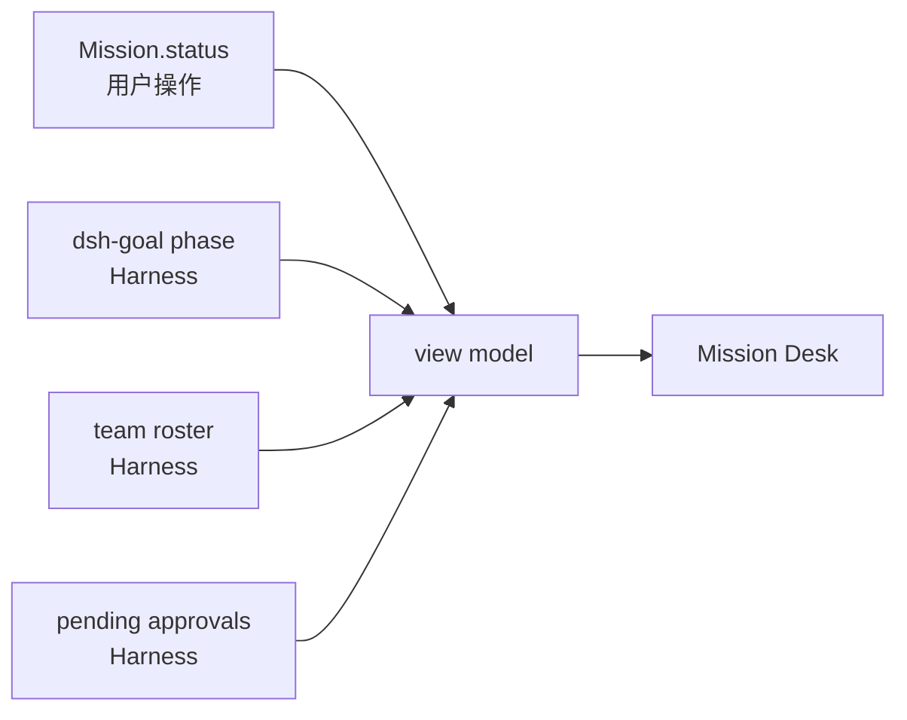

# Mission Core 架构设计

> 状态：**设计阶段（2026-11-01）** · 未实现
> 上游：`docs/architecture/domain-model.md`（实体定义）、`docs/adr/ADR-0001`、`docs/adr/ADR-0002`
> 现状判据：`src/work/**` 已由壳层审计确认是「单次工作项 MVP，约 35% 可复用，65% 必须重做」
> 校验：本文 schema 需对应 JSON Schema 校验测试；状态机需状态转换测试；存储需损坏恢复测试

## 0. 一句话

> **Mission Core 只做一件官方不做的事：跨 Session 的项目级连续性与共识。**

它是**记忆与索引**，不是任务调度器，不是执行引擎。

## 1. 边界（先划死，再设计）

### 1.1 做什么

| 职责 | 说明 | 为什么官方不够 |
|---|---|---|
| Mission 生命周期 | 跨 Session、跨 Team、跨天的项目实体 | Harness 的持久化单位是 Session |
| Workstream | 项目内的并行工作方向 | `dsh-goal` 是每会话一个目标 |
| Shared Context | 跨会话保留的决策/发现/假设/待答问题/证据 | 官方无项目级共识存储 |
| Deliverable Index | 产物的索引与验证状态 | 官方 `workspace/changes` 是 per-turn 的，不是项目级索引 |
| Mission Brief | 面向 Agent 的项目上下文注入 | 官方无跨会话上下文注入 |

### 1.2 明确不做（越界即停）

| 不做 | 谁做 | 检测方式 |
|---|---|---|
| Agent Loop | Harness | 代码评审 + 依赖检查（不得有 LLM 调用） |
| Team 编排 / roster / 消息 | Harness Agent Teams | 不得有 roster/消息的写入 API |
| 任务调度 / 优先级队列 | Harness | 不得有 scheduler |
| Goal 状态机 | Harness `dsh-goal` | 不得有 goal phase 的写入 |
| 文件 diff 捕获 | Harness `dsh-workspace-changes` | 不得自己跑 git 做 diff（除非官方不可用时的降级，需标注） |
| 审批/提问通道 | Harness | 只转发用户决定 |
| 通用记忆/向量检索 | （暂不做） | 不得引入向量库 |

### 1.3 越界检测（建议强制化）

```js
// test/mission-boundary.test.js（待建）
// 1. src/mission/** 不得 require Harness 内部模块（只允许通过 bridge 的公开接口）
// 2. src/mission/** 不得包含 LLM 调用
// 3. src/mission/** 不得有 roster/task/agent 状态机
// 4. src/mission/** 不得自己实现 goal phase 枚举
```

## 2. 现状复用评估（基于 `src/work/**` 实测）

壳层审计结论：`src/work` 约 **35% 可复用，65% 必须重做**。

| 模块 | 行数 | 判定 | 理由 |
|---|---|---|---|
| `workspace-store.js` 原子写 + rename | ~40 行 | ✅ **复用** | 临时文件 + rename 原子替换，已正确 |
| `workspace-store.js` `resolveInside` 路径守卫 | ~30 行 | ✅ **复用** | 拒绝绝对路径/`..` 逃逸，已正确 |
| `workspace-store.js` digest 校验 | ~30 行 | ✅ **复用** | `ref-sha256:` 格式，已正确 |
| `workspace-store.js` `.dsh/` 单一写入边界 | 纪律 | ✅ **保留纪律** | 只写 `<workspace>/.dsh/**` |
| `command-runner.js` 超时 + SIGTERM→SIGKILL | 108 行 | ✅ **复用** | 作为 Deliverable 验证执行器 |
| `work-controller.js` verify/diff 采集思路 | ~60 行 | ⚠️ **改思路** | 逻辑可参考，但要接官方 `workspace/changes` |
| `work-controller.js` 数据模型 | ~30 行 | ❌ **重做** | 无 Mission/Workstream/SharedContext |
| `work-controller.js` 单活动项约束 | `currentId` 单值 | ❌ **重做** | 与多 Mission/Workstream 冲突 |
| `workspace-store.js` 索引覆盖写 | ~20 行 | ❌ **重做** | 需 append-only 事件日志 |
| `workspace-store.js` 无迁移 | — | ❌ **重做** | `schemaVersion≠1` 直接 fail-closed |
| `workspace-store.js` 无损坏恢复 | — | ❌ **重做** | 无 `.bak` 副本，索引损坏即不可用 |
| `workspace-store.js` 无归档/上限 | — | ❌ **重做** | items 无上限 |
| `work-controller.js` 无 session 关联 | — | ❌ **重做** | Mission 的核心诉求就是跨 session |
| `templateId` 死字段 | — | ❌ **重做** | 无模板注册表，Starter Kit 不存在 |
| 无 `.gitignore` 写入 | — | ❌ **补** | `.dsh/` 会污染用户仓库 |

**结论**：**新建 `src/mission/**`**，只搬运约 200 行已验证正确的存储原语；**不扩展 `work-controller.js`**。

## 3. 模块结构

```
src/mission/
├── index.js                  # 聚合导出 + 文件清单（沿用 team/office 的模式）
├── schema.js                 # 实体 schema + 校验（纯函数，零依赖）
├── event-log.js              # append-only JSONL 读写（原子追加）
├── store.js                  # 组合：日志 + 派生的当前视图 + 备份/恢复
├── projection.js             # fold(events) → Mission 当前状态（纯函数）
├── brief.js                  # Mission Brief 生成（面向 Agent 的上下文）
├── deliverable.js            # 产物登记 + digest 校验
├── migration.js              # schema 版本迁移
└── harness-reader.js         # 只读消费 Harness 状态（goal/team/changes）

test/mission-*.test.js        # 待建
```

### 3.1 依赖方向（硬约束）

```
src/mission/**        ← 纯 Node，零 Electron/DOM/网络；可依赖 node:fs
      ↑
src/work/**           ← 壳侧，可依赖 mission
      ↑
src/main.js           ← 组合根

禁止：mission → work（反向依赖）
禁止：mission → office（办公室只读投影）
```

## 4. 存储设计

### 4.0 前置原则：Mission Store ≠ Settings Store（2026-11-01 审查明确）

用户明确要求：**「Mission Store 与 Settings Store 不必强制使用相同的存储实现。」**

| 维度 | Settings Store | Mission Store |
|---|---|---|
| 数据性质 | 配置（键值、单文档） | 事件日志（append-only） |
| 变更模式 | 全量覆盖写 | 追加写 |
| 需要溯源 | ❌ 只关心当前值 | ✅ 追溯"为什么" |
| 损坏容忍 | 可回落默认值 | **不可丢**（项目记忆） |
| 恢复 | `.bak` + 默认值 | `.bak` + 逐行跳过 + 投影重建 |

**决策**：
- Settings：JSON 单文档 + schemaVersion + 迁移表 + `.bak`（补现有实现的缺口）
- Mission：Append-only JSONL + 派生投影 + 迁移 + `.bak`
- **唯一共享**：`src/lib/atomic-write.js`（原子写原语）

> 这样既避免"为统一牺牲各自最优解"，又能解决 TD-11（原子写重复 15 处）。

### 4.1 为什么是「append-only JSONL + 派生索引」

| 方案 | 事务 | 可审计 | 损坏恢复 | 原生依赖 | 查询 | 判定 |
|---|---|---|---|---|---|---|
| 单 JSON 覆盖写（现状） | ❌ | ❌ | ❌（fail-closed 即不可用） | 无 | 弱 | ❌ |
| SQLite | ✅ | ⚠️ | ✅ | **有**（打包复杂） | 强 | ⚠️ 备选（需基准数据才换） |
| **JSONL append + 内存投影** | ⚠️（单写者） | ✅ | ✅（逐行可跳过坏行） | 无 | 中 | ✅ **选用** |
| 用官方 storage 插件 | — | — | — | — | — | ❌（内部 API，不稳定） |

### 4.1.1 多 Mission 并存的存储组织（2026-11-01 新增）

**一个 Workspace 可含多个 active Mission**（见 `domain-model.md` §2.1.1）。
因此 `events.jsonl` 必须是**多 Mission 共存**的单一日志（而不是每 Mission 一个文件），理由：

| 方案 | 优点 | 缺点 | 判定 |
|---|---|---|---|
| 每 Mission 一个 `events.jsonl` | 隔离好 | 无法全局排序；跨 Mission 操作（如移动 Workstream）困难；备份碎片化 | ❌ |
| **单一 `events.jsonl`（每行带 `missionId`）** | 全局 seq 排序、单文件备份、跨 Mission 可查 | 文件随 Mission 数增长 | ✅ **选用** |
| 按 Workspace 分库 | 天然隔离 | 已是（`.dsh/` 在 Workspace 内） | ✅ 已满足 |

**关键**：`seq` 是**全局单调**（不是每 Mission 独立），便于全局排序与断档检测。
投影时按 `missionId` 分组 fold。

**上限与归档**：
- 单 Workspace 的 `events.jsonl` 超过 20MB 或 50 万行时触发归档（compaction 为快照 + 后续事件）。
- 归档策略待 P1 基准测试后定，**先不做**（过早优化）。


### 4.2 目录布局

```
<workspace>/.dsh/
├── mission/
│   ├── events.jsonl              # append-only 事件日志（唯一事实源）
│   ├── events.jsonl.bak          # 上一个完整快照（恢复用）
│   ├── views/                    # 派生视图缓存（可删除重建）
│   │   └── <missionId>.json
│   └── schema.json               # 当前 schema 版本
├── capability/                   # Capability Platform（P3）
└── runs/                         # 验证日志（复用现有约定）
```

### 4.3 事件格式

```jsonc
{
  "v": 1,                          // schema 版本
  "seq": 42,                       // 单调递增（每 mission 独立或全局？→ 全局，便于排序）
  "t": 1761955200000,              // 时间戳（ms）
  "kind": "decision/recorded",     // 事件类型（闭集）
  "missionId": "mis-...",
  "actor": "user",                 // user | agent | system
  "data": { /* 类型相关的负载 */ }
}
```

**事件类型闭集**（初期）：

| kind | 用途 |
|---|---|
| `mission/created` `mission/updated` `mission/status-changed` | Mission 生命周期 |
| `workstream/added` `workstream/updated` `workstream/status-changed` | Workstream |
| `decision/proposed` `decision/accepted` `decision/superseded` `decision/rejected` | 决策生命周期 |
| `finding/recorded` | 发现 |
| `assumption/recorded` `assumption/confirmed` `assumption/invalidated` `assumption/expired` | 假设 |
| `question/asked` `question/answered` `question/dropped` | 待答问题 |
| `evidence/captured` | 证据 |
| `deliverable/registered` `deliverable/verified` | 产物 |
| `session/linked` | 关联到某次 Harness 会话（存派生句柄） |
| `brief/rendered` | Brief 被注入时记录（用于追溯） |

**规则**：
- 事件**只追加，不修改**（更正靠新事件 + `supersedes` 引用）。
- `data` 不存正文大块内容（存 digest + 相对路径）。
- 隐私：不存 raw sessionId / prompt / 绝对路径。

### 4.4 写入协议（单写者）

```
写入一个变更：
  1. 追加一行 JSONL（O_APPEND，单行 < 8KB 保证原子性）
  2. fsync（可选，按性能预算）
  3. 更新内存投影（同步）
  4. 触发订阅者（异步）
```

**并发**：单进程单写者。多窗口通过主进程串行化。
**不做**跨进程并发写（明确限制，写入文档）。

### 4.5 恢复

| 情形 | 处理 |
|---|---|
| JSONL 某行损坏（JSON parse 失败） | 跳过该行，记录警告，继续（**不静默**：日志 + UI 提示） |
| 文件尾部截断（写到一半崩溃） | 丢弃最后一个不完整行 |
| 投影缓存损坏 | 删缓存，从 events.jsonl 重建 |
| events.jsonl 丢失 | 用 `.bak` 恢复；提示用户"丢失了最近 N 条变更" |
| schema 版本不匹配 | 跑 migration；失败则 fail-closed 并提示 |

**关键纪律**：**fail-closed 不等于"坏了就不可用"**。Mission 是唯一事实源，必须有降级读取路径（只读最近 `.bak`）。

## 5. 状态模型

### 5.1 Mission 状态

```js
const MISSION_STATUS = Object.freeze(['active', 'paused', 'completed', 'abandoned']);
```

**注意**：这只是 **Mission（项目）** 的状态，**不是** goal/session 状态。
Mission.status 只能由用户操作改变（或明确的系统规则如"全部 workstream done 时提示用户确认完成"）。

### 5.2 与 Harness 状态的合成（只读）



**合成规则**（必须明确，避免两套状态）：

| 用户看到的 | 合成逻辑 |
|---|---|
| "正在推进" | `Mission.status==='active'` **且** 当前 session 有 running agent |
| "等待你" | 当前 session 有 pending approval/question（优先于上面） |
| "空闲" | `Mission.status==='active'` 且无 running agent |
| "已完成" | `Mission.status==='completed'`（用户确认，不自动推断） |

**禁止**：把 Harness 的 running 状态写回 Mission.status。

## 6. Mission Brief（跨会话连续性的核心）

### 6.1 它是什么

一段**结构化的项目上下文**，在下一次会话开始时注入给 Agent，让 Agent 不用用户重新交代背景。

### 6.2 为什么重要

这是整个 Mission Core 的**用户价值验证点**：如果 Brief 不能让 Agent "接上话"，Mission 就没有意义。

### 6.3 结构（Markdown，有界长度）

```markdown
# Mission: <title>

## 目标
<intent 原文>

## 边界（不可越界）
- <constraint 1>
- <constraint 2>

## 当前焦点
Workstream: <当前 workstream title>
状态: <derived>

## 已定决策（最近 10 条）
- <decision title>（<decidedBy>, <date>）
  理由: <rationale 摘要>

## 未答问题（最多 5 条，标阻塞）
- [阻塞 WS-1] <question>

## 已知假设（未验证，最近 5 条）
- <assumption>（<expiry status>）

## 已有产物（最近 10 条）
- <deliverable title> — <workspaceRelPath> — <verified?>

## 上次停在这
<lastSessionSummary>

## 相关会话
<sessionRefs 派生句柄>
```

### 6.4 硬约束

| 约束 | 值 | 理由 |
|---|---|---|
| 总长度上限 | 8 KB（约 2k tokens） | 不能变成"另一个长文档"（Harness Engineering 原则：给地图不给手册） |
| 决策条数 | 最近 10 条 | 更多则用索引，让 Agent 主动查 |
| 假设条数 | 最近 5 条 | 只保留活跃的 |
| 产物条数 | 最近 10 条 | 更多则看 Mission Desk |
| 敏感信息 | 不包含 | 沿用隐私边界 |

### 6.5 注入方式（待 POC 验证）

| 方式 | 可行性 | 备注 |
|---|---|---|
| 作为 session 初始 user message | 需验证 Harness 是否支持 | **待验证** |
| 写入工作区文件，让 Agent 自己读 | ✅ 可行 | 简单可靠，但依赖 Agent 主动读 |
| 通过 system prompt / agent instructions | 需验证（官方有 `dsh-agent-instructions`） | **待验证** |

**当前倾向**：先做"写入 `.dsh/mission/BRIEF.md` + 在任务描述里指向它"，这是最低风险的方案。

## 7. 与官方能力的对接

### 7.1 只读消费清单

| 需要的 | 官方来源 | 消费方式 |
|---|---|---|
| 当前 goal phase | `dsh-goal` → `ctx.goals.get(agent)` | 只读 |
| Team roster | `dsh-experimental-agent-team` → `agentTeam` 客户端视图 | 只读 |
| Team 任务板 | 同上 | 只读（用于计数展示） |
| 文件变更 | `dsh-workspace-changes` → `workspace/changes` 事件 + `ctx.workspaceChanges.summary()` | 只读 |
| Pending 审批/提问 | `$events` waterfall | 只读 + 转发用户决定 |
| Session 列表 | `session/*` API / mux | 只读 |

### 7.2 版本兼容

所有对接必须经过 **Runtime Bridge**（见 `docs/architecture/runtime-bridge.md`），不直接 import 官方内部模块。

**规则**：
- 只依赖 README 声明的公开面。
- 官方 experimental 包的能力必须 **feature-detect**（不存在则降级，不崩）。
- 每个对接点标注"已验证 / 未验证"。

### 7.3 降级策略

| 官方能力缺失 | Mission Core 降级行为 |
|---|---|
| 无 `dsh-goal` | 不显示 goal phase（不伪造） |
| 无 Agent Teams（0.1.5） | Team 状态显示"不可用" |
| 无 `workspace/changes` | Deliverable 需用户手动登记（不自动捕获） |
| 无 session search | Brief 只含 Mission 数据，不含历史原文 |

## 8. 数据迁移

### 8.1 为什么必须有

`workspace-store.js` 的现状是 `schemaVersion≠1` → fail-closed，**没有迁移**。Mission 作为长期唯一事实源不能这样。

### 8.2 迁移设计

```js
// migration.js
const MIGRATIONS = {
  1: null,            // 初始版本
  2: (event) => {...}, // 1 → 2 转换
};

function migrate(events, fromVersion, toVersion) {
  // 逐版本应用；每步可单独测试
  // 失败则：保留原文件 + 写 .migration-failed + fail-closed
}
```

**规则**：
- 迁移前自动备份 `events.jsonl.bak.<version>`。
- 迁移是**纯函数**（可测试）。
- 迁移失败**不删除原数据**。
- 每个迁移必须有测试 + 变异测试。

## 9. 验证策略

### 9.1 测试分层

| 层 | 内容 | 何时跑 |
|---|---|---|
| 单元 | schema 校验、projection fold、brief 生成、migration | 每次提交 |
| 存储 | 原子写、损坏恢复、并发、大文件 | CI |
| 集成 | 创建 → 关闭 → 重开 → 状态一致 | CI |
| 真机 | Electron 中真实创建 Mission 并跨重启 | 用户执行 |

### 9.2 关键变异测试（必须有）

| 变异 | 期望 |
|---|---|
| 破坏 schema 校验（允许非法 status） | 测试必须红 |
| 破坏原子写（直接写目标文件） | 损坏恢复测试必须红 |
| 破坏 brief 长度上限 | 测试必须红 |
| 破坏隐私过滤（写入绝对路径） | 隐私测试必须红 |
| 破坏 migration（版本跳变） | 迁移测试必须红 |

### 9.3 损坏恢复演练

**必须有可复现脚本**：手工破坏 `events.jsonl`（截断/插坏行/删文件），验证恢复行为符合 §4.5。

## 10. 不做的设计（明确拒绝）

| 设计 | 为什么拒绝 |
|---|---|
| 向量检索 / RAG | 一个 Mission 上下文通常 < 500 条，结构化检索足够；向量库是新的运维面 |
| 多进程并发写 | 复杂且无需求；单写者是特性不是限制 |
| 让模型直接写 Decision | 污染风险最高；只能"提议"，用户确认 |
| 自建 goal 状态机 | 官方已有；重复即冲突 |
| 自建任务调度 | 官方 Team 已编排 |
| Mission 内嵌聊天 | 与官方重复 |
| 自动"完成"判定 | 用户必须显式确认（避免虚假完成） |

## 11. 开放问题

| # | 问题 | 影响 | 待定 |
|---|---|---|---|
| Q1 | ~~是否允许多个 Mission 同时 active？~~ | — | ✅ **已决策（2026-11-01）：支持多 Active。Active/Focused/Running 三轴分离，见 `domain-model.md` §2.1.1** |
| Q2 | ~~events.jsonl 是否全局一个文件还是每 Mission 一个？~~ | — | ✅ **已决策：单一全局 `events.jsonl`（每行带 missionId，seq 全局单调），见 §4.1.1** |
| Q3 | Mission 数据是否进用户 git 仓库？ | 协作 vs 隐私 | 倾向"是，但 .dsh/ 需写 .gitignore" |
| Q4 | Brief 注入方式选哪个？ | 影响自动接续效果 | 待 POC |
| Q5 | ~~与官方 goal 的关联粒度~~ | — | ✅ **已明确：1 Mission : N Goal（`domain-model.md` §2.1.4）** |
| Q6 | 归档策略（completed 的 Mission 何时折叠） | 影响性能 | 待基准测试（§4.1.1 给出触发阈值 20MB/50万行，策略待定） |
| Q7 | 每 Workspace 的 active Mission 软上限？ | 影响 UI 与性能 | 建议 10，待拍板 |

## 12. 实施顺序（P1 内部）

```
P1.1 schema.js + 单元测试        ← 先定型，无 IO
  ↓
P1.2 event-log.js + store.js     ← 存储原语（搬运 workspace-store 的原子写/路径守卫）
  ↓
P1.3 projection.js               ← fold 纯函数 + 测试
  ↓
P1.4 brief.js                    ← Brief 生成 + 长度/隐私测试
  ↓
P1.5 最小 UI                     ← 创建/打开/展示
  ↓
P1.6 harness-reader.js           ← 只读接线（依赖 P0.3 POC 结论）
  ↓
P1.7 迁移与恢复演练              ← 必须有可复现脚本
```

## 13. 相关文档

- 领域模型：`docs/architecture/domain-model.md`
- Runtime Bridge：`docs/architecture/runtime-bridge.md`
- 路线图：`docs/product/product-roadmap.md`（P1）
- 用户旅程：`docs/product/user-journeys.md` §3–§7
- ADR：`docs/adr/ADR-0001`、`ADR-0002`
