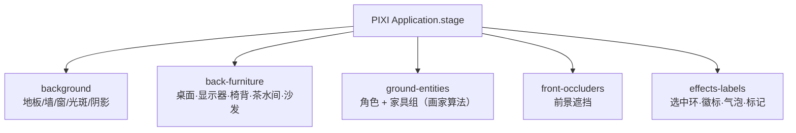
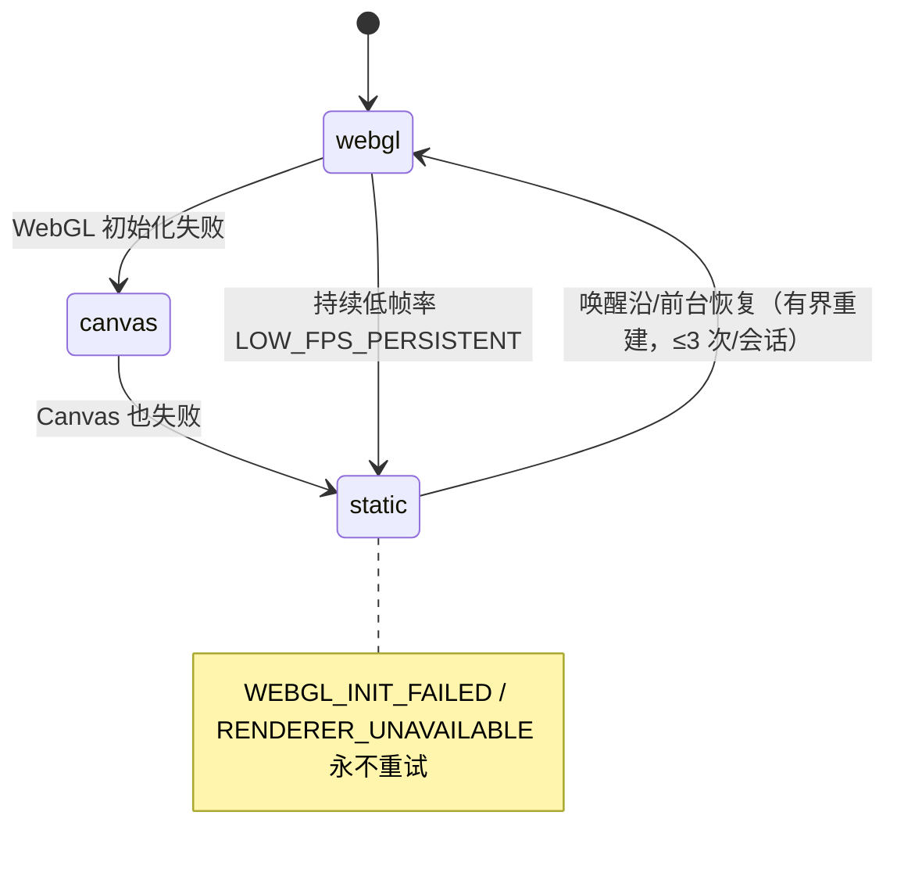

# Office Runtime 架构（虚拟办公室运行时）

> 状态：**审计结论**（2026-11-01）。审计对象：`src/office/**`（27,134 行）+ `src/team/runtime/team-office-*.js` + `src/work/**`。
> 结论分级：**【已确认】**=代码可证（含探针）；**【部分实现】**=链路存在但有缺口；**【待验证】**=需真机/运行才能定论；**【设计阶段】**=只有文档或开关未启用；**【设想】**=本文建议、仓库中不存在。
> **本文不改变任何语义**。所有"改造/废弃"判定都只是建议，落地前仍需计划 + 用户拍板。

---

## 0. 一句话结论

办公室运行时是**一套真实可运行、且事实边界被测试钉住的仿真内核**：Harness 原始事件经 adapter 变成白名单事实，办公室内核只消费投影；渲染器是快照的纯投影。**它不是纸面功能**——有 1,119 条 office 测试、5 道独立门禁、3 个可复现的 headless 探针支撑。真正的风险不是"功能假"，而是**组合根与渲染器两处文件体量已顶到上限**，新增能力会先撞到行数/依赖冻结门禁，而不是撞到设计。

---

## 1. 分层与事实链

```mermaid
flowchart TD
  subgraph H[Harness / dsh runtime]
    J[session journal<br/>agent/status · tool/call · turn/end<br/>turn/usage · subagent/start|end]
  end
  subgraph TM[Team Runtime（纯 Node）]
    TR[team-runtime.js<br/>facts 唯一作者]
    TOA[team-office-adapter.js<br/>白名单纯函数映射]
    TOB[team-office-bridge.js<br/>pump/replay]
  end
  subgraph OM[src/office/office-module.js<br/>组合根 4725 行]
    AD[runtime-adapter.js<br/>去重/水位/resync/epoch]
    SN[runtime-snapshot.js<br/>快照合并契约]
    RD[state-reducer.js<br/>8 维状态机]
    SC[behavior-scheduler.js<br/>本地行为]
    MV[movement-controller.js<br/>BFS + 预约]
    RG[employee-registry.js<br/>绑定/FIFO]
    ST[state&#40;&#41;<br/>白名单 + privacy-redactor]
  end
  subgraph R[渲染 / 页面]
    PG[office.html + office-page.js]
    PX[pixi-office-renderer.js<br/>纯投影]
  end

  J -->|main.js ingestHarnessEvent<br/>office-module.js:3850| AD
  J -->|main.js ingestOfficeJournalEvent<br/>main.js:5451| AD
  TR -->|facts()| TOB --> TOA -->|ingestTeamProjectionFact<br/>office-module.js:2179| OM
  AD -->|mapEnvelope<br/>runtime-adapter.js:441| RD
  SC -->|decide| RD
  MV -->|movement/status| RD
  RG -->|bindSession/queue effects| RD
  RD --> ST
  ST -->|office:state push<br/>pushSnapshot:4270| PG --> PX
  PG -->|office:* invoke 9 通道<br/>office-module.js:204| OM
```

**单向性【已确认】**：渲染层没有 Harness/IPC 订阅；`pixi-office-renderer.js:5-13` 明确"每个可见变化只经 `applySnapshot()` 进入"，`test/office-runtime-boundary.test.js` 用静态闭包 + 运行时 require 拦截双向证明 `src/office/runtime/**` 不触达 electron/pixi/fs（`src/office/runtime/index.js:27-78` 的 KERNEL_MODULES / IO_BOUNDARY_MODULES / GUARDED_SHELL_EDGES 与实际目录集合**相等**才有测试通过）。

---

## 2. 模块地图（按体量，含判定）

| 文件 | 行数 | 职责 | 判定 |
|---|---|---|---|
| `src/office/office-module.js` | 4,725 | 组合根：唯一仿真时钟、10 个 adapter、快照装配、IPC 注册、pending/usage/record、拖拽落点写回 | **保留**（但已顶上限，见 §8） |
| `src/office/render/pixi-office-renderer.js` | 4,673 | Pixi 投影：图层、家具（代码化 2.5D）、实体、拖拽、命中、FPS 降级/自愈、静态兜底 | **保留 + 拆分**（见 §8.2） |
| `src/office/office.html` | 2,103 | 页面引导（mini CJS loader）+ 面板 DOM + 交互（悬停卡/拖拽/模态） | **保留** |
| `src/office/runtime/behavior-scheduler.js` | 1,911 | 本地行为决策（漫游/休息/闲聊/小憩）、左区偏好、配额、走廊优先级 | **保留（核心）** |
| `src/office/runtime/office-layout-compiler.js` | 1,021 | 草稿 → 运行时布局编译（可行走图派生、家具采样） | **保留** |
| `src/office/layout-editor.js` | 998 | 布局草案编辑器核心（仅工作台用，不进包） | **保留（工具侧）** |
| `src/office/office-page.js` | 962 | 页面视图模型（无 DOM，可 headless 测） | **保留** |
| `src/office/runtime/employee-registry.js` | 841 | 绑定 + FIFO 队列唯一账本 | **保留（核心）** |
| `src/office/runtime/runtime-adapter.js` | 832 | 原始事件 → canonical envelope（去重/水位/buffer/resync） | **保留（核心）** |
| `src/office/render/code-office.js` | 822 | 代码化 2.5D 家具几何（6 工位 + 茶水间 + 休闲区 + 4 绿植） | **保留（核心资产）** |
| `src/office/runtime/movement-controller.js` | 724 | 归一化坐标移动 + BFS 寻路 + 预约矩阵 | **保留（核心）** |
| `src/office/runtime/asset-pack.js` | 531 | 角色包解析 + 朝向/回退链 | **保留（核心契约）** |
| `src/office/runtime/validate-character-pack.js` | 509 | 角色包校验唯一实现 | **保留** |
| `src/office/behavior-graph/*`（5 文件） | 1,057 | 行为图解释器（纯模块） | **设计阶段**：产品不引用，asar 明确排除（`electron-builder.js:57`、`scripts/verify-dist.js:46`） |
| `src/office/runtime/character-pack-installer.js` | 442 | 角色包安装（ZIP 安全/原子 rename） | **部分实现**：模块完整，但**无入口**（`src/` 只有 `runtime/index.js:61` 与 `verify-dist` 引用；`main.js` 从不实例化） |
| `src/office/runtime/runtime-snapshot.js` | 398 | 快照/resync 合并契约 | **保留（核心）** |
| `src/office/runtime/idle-director.js` | 383 | 空闲行为导演（权重 + 冷却 + 左区偏好） | **保留** |
| `src/office/runtime/queue-controller.js` | 389 | 每座位 FIFO、终局证据、原子切换 | **保留（核心）** |
| `src/office/runtime/office-persistence.js` | 391 | `userData/office-state.v1.json` 单写者（原子写 + .bak） | **保留** |
| `src/office/render/code-scene.js` | 382 | 场景主题/地板/墙/窗几何 | **保留** |
| `src/office/render/iso-office.js` | 347 | 等轴测家具几何 | **部分实现**（预览态，见 §7.5） |
| `src/office/runtime/state-reducer.js` | 338 | 8 维状态机（权威规则在此） | **保留（不可推翻）** |
| `src/office/runtime/office-layout.js` | 259 | 布局校验 + 地面排序键 | **保留** |
| `src/office/runtime/approval-risk.js` | 266 | 审批风险分级（low/medium/high） | **保留（部分输入待接入）** |
| `src/office/runtime/tool-phrases.js` | 160 | 工具名 → 中文短语闭集 | **保留** |
| `src/office/runtime/privacy-redactor.js` | 165 | 共享脱敏器 | **保留（核心）** |
| `src/office/render/iso-projection.js` | 136 | 2:1 dimetric 投影/反投影 | **保留（内核）+ 未启用** |
| `src/office/render/fps-monitor.js` | 183 | 呈现帧率观察 + 降级判据 | **保留** |
| `src/office/render/presentation-clock.js` | 153 | 双缓冲呈现插值 | **保留** |
| `src/office/runtime/day-record-store.js` | 128 | 每员工今日记录/用量 | **保留** |

### 2.1 工作台（`src/workbench/**`）与 office 的关系【已确认】

工作台是**独立 Electron 工具**（`npm run office:workbench`），13,933 行，与产品办公室是**单向只读复用**关系：

| 关系 | 事实 | 证据 |
|---|---|---|
| **不进发行包** | `electron-builder.js:54 '!src/workbench/**'`；`scripts/verify-dist.js:46` 把 `src/workbench/` 列入 FORBIDDEN_ASAR_PREFIXES（出现即构建失败） | 双向钉死 |
| **产品不得反向引用** | `test/office-ui.test.js:1248-1271` 走 `src/main.js` 的传递 require 闭包 + 扫 `office.html` 的 `loadModule()/script src`，断言零命中 `src/workbench/**` 与 `content/**` | 机械门禁 |
| **工作台可读产品代码** | `workbench-preload.js:31` require `../office/layout-assets.js`；`app/services.js:220` 同；`lib/content-validator.js:274` require `layout-editor.js` | 单向允许 |
| **预览=真产品页面** | 中央舞台 iframe 加载 `office.html` 的**工具侧拷贝**（`workbench://local/preview/office.html`，只改 CSP origin），预载用**真** `office-preload.js` 原文（`scripts/office-workbench.js:13-16`） | 所见即产品 |
| **office:\* 是桩** | 工作台只实现 `office:state`（返回空快照：`createEmptyOfficeSnapshot` `app/boot.js:31-43`）与 6 个通道的 `OFFICE_WORKBENCH_STUB` 拒绝（`app/boot.js:155-161`）。**办公室在工作台里是"不动的一帧"**，不是活的仿真 | 已确认 |
| **能做什么** | 内容树 + 素材库拖拽、图层/属性/几何报表、动作帧序列编辑（拖排/单帧时长/播放逐帧/循环）、语料编辑、行为图（`.vgraph`）编辑与预览、金样画廊（三尺寸 + 走路帧条，像素 + 几何双重 diff）、发布内核（`action-publisher.js`，唯一写生产字节路径 + provenance 台账 + backup） | `workbench.js:1-40`、`gallery.js:1-20` |
| **产物落哪** | 只写 `content/build/**` 与 `content/characters/**`（经发布内核）；`content/scenes/flat/layout.json` 预览时**只读** | `scripts/office-workbench.js:26-31` |
| **测试** | `src/workbench/test/*.test.js` 7 个套件（compare/depth-bands/drop-ghost/history-controller/item-props/action-restore/pipeline-panel）——**不在 `npm test` 的 `test/*.test.js` glob 里**（`package.json` `"test": "node --test \"test/*.test.js\""`），是独立套件 | 已确认（覆盖缺口） |

**判定**：工作台是**核心资产**（内容生产链的唯一入口），与 office 的边界已经用两条机械门禁钉住，**不需要改造**。两个待补：① 它的 7 个测试套件未进 CI 主 glob；② 中央预览用空快照桩，所以**在工作台里永远看不到角色走动/闲聊**（这是刻意的：工具只验内容，不验仿真）。

---

## 3. 状态所有权矩阵（8 维）

冻结词表在 `src/office/runtime/state-reducer.js:34-45`；`test/office-doc-contract.test.js` 机械断言它与 `docs/architecture/2026-08-30-office-spec-00-boundaries.md:48-55` 一致。

| 维度 | 词表 | 真实写入者（唯一） | 写入点（证据） | 真实性 |
|---|---|---|---|---|
| `presence` | `present` | **无写入者 —— 恒真不变式** | 词表 `state-reducer.js:34`；`presence/set` 只接受 `present` 否则拒绝 `:309-314`；快照硬编码 `office-module.js:3393` | **装饰性常量**（不是数据） |
| `sync` | healthy / stale / resyncing | adapter 的 sync 状态聚合 | `runtime-adapter.js:275` emit；聚合 `office-module.js:1381-1393` | **已确认**（本机 0.1.5 链路的真实连接状态） |
| `runtime` | unbound/idle/running/attention/completed/failed | 只由 Harness/Team 事实 | `runtime-adapter.js:441-560` → `office-module.js:1663 applyFact` → `reduce` `:1695`；Team 路径 `:2179 ingestTeamProjectionFact` → `:2207/:2230/:2262` | **已确认**（唯一真实任务事实） |
| `activity`（reducer 侧） | roaming/chatting/resting/sleeping/working/thinking/waiting/celebrating | 本地调度只能写前四个；任务四态由 `runtime/fact` 派生 | `local/activity`：`office-module.js:2462`（主导）/`:2486`（配对伙伴）/`:2007`（取消归位）；`runtime/fact running` 派生 working/thinking/waiting：`state-reducer.js:100-102` | **前四个=本地仿真（装饰）**；working/attention 派生=**推断** |
| `movement` | stationary/moving/arriving/leaving | movement-controller + 模块走位循环 | `office-module.js:2814`（走位段）/`:2950`（路径腿）/`:2517/:2541/:2556/:2578`（落点/到站）/`:2669`（阻塞停车） | **本地仿真**（位置真实但只对"办公室内"有意义） |
| `control` | none/dispatchPending/cancellationPending/preemptPending | 派发与取消两个用户动作 | `control/dispatch` `:1492`；`control/cancel` `:2305`（Team）/`:4127`（IPC）；`control/cancel-ack` `:2318` | **部分实现**：`preemptPending` **无任何生产者**（`control/preempt` 只在 reducer 定义，全仓 grep 无 emit）；`pause/resume` 被 reducer 显式拒绝（`:228-235`） |
| `binding` | unbound/pending/bound/releasing | 由 registry + reduce 共同推进 | pending→bound 在 `runtime/fact running` 分支 `state-reducer.js:103-106`；releasing 在 completed/failed `:117`；`binding/released` `office-module.js:1997/:2367` | **已确认**（绑定=真实会话→座位映射，但**置信度是推断**，见 §5.2） |
| `queue` | empty/queued | queue-controller | `office-module.js:1802/:1828`（入队）+ `:2997-2998`（每 tick 用 `queue.waitingCount` 校正） | **已确认**（FIFO 账本真实，仅当多会话争同一座位时才非空） |

### 3.1 reducer 里"有词表但无生产者"的状态【已确认】

对全仓 `src/` grep 每个枚举值，以下**永远不可能在运行中出现**：

| 值 | 证据 |
|---|---|
| `movement='arriving'` / `'leaving'` | 全仓只有词表（`state-reducer.js:40`）与脱敏器枚举（`privacy-redactor.js:35`）出现；`reduce` 调用点见上表，全部是 `stationary`/`moving` |
| `control='preemptPending'` | 只有 reducer 定义（`:216-226`）与读取（`office-module.js:1994`）；无 `control/preempt` emit |
| `activity='thinking'` / `'waiting'` | reducer 只在 `runtime/fact running` 且 `event.reason==='thinking'|'waiting'` 时写（`state-reducer.js:101`）；但 adapter 的 `agent/status→running` 事实**不带 reason**（`runtime-adapter.js:452`），`applyFact` 传 `reason: fact.reason||null`（`office-module.js:1695`） |
| `binding='bound'`（reducer 事件） | `state-reducer.js:238-246` 的 `binding/bound` 无 emit（实际由 `runtime/fact running` 内部推进） |
| `presence` 非 present | 被 reducer 显式拒绝（`:309-314`），是**冻结的不变式**而非状态 |

**这些不是缺陷，而是"为未来留的词表 + 硬性拒绝"**（`state-reducer.js:22-23` 明文：不支持的 pause/resume/preempt 保持 capability-gated，绝不造假状态）。但**文档若宣称有"到达/离场动画状态"必须按不存在的处理**。

### 3.2 能力矩阵是"活的"【已确认】

`capabilitySnapshot()`（`office-module.js:3109-3118`）对每个 adapter 的 `capability().supports` 做**逻辑与**，即：连了真实 0.1.5 运行时后 `interrupt/pause/resume/preempt` 全为 false，面板据此禁用按钮并给 tooltip（`office.html:872-874` 三个按钮的 `disabled` 由 capabilities 决定；`:1776-1782` 中断按钮"诚实降级"）。**没有安慰剂按钮**是这套设计最硬的优点之一。

---

## 4. 快照契约

### 4.1 顶层键（`office-module.js:3300-3325` 构建 → `:3275-3296` 白名单 + 脱敏）

| 键 | 含义 | 生产者 | 真实性 |
|---|---|---|---|
| `schemaVersion` / `simulatedAtMs` / `paused` | 契约版本、仿真时钟、可见性暂停 | 模块 | 已确认 |
| `sync` | 聚合连接状态 | `recomputeGlobalSync` `:1381` | 已确认 |
| `scene` | 参考分辨率（1280×840） | 布局 fixture `office-layout-flat.json` | 已确认 |
| `employees[]` | 每员工 33 个字段（见 4.2） | 逐员工投影 `:3389-3485` | 混合，见 §5 |
| `capabilities` | 能力矩阵 | `:3109` | 已确认 |
| `usage` | 今日 token/金额/预算 | main.js 从壳缓存组装 `main.js:4025-4035` → `setUsageSnapshot:3519` | **部分实现**：`usage` 为 null 直到壳注入；`normalizeUsageBlock` 缺契约标记**拒绝**而非补零（`:3478+`） |
| `pending[]` | 待处理审批/提问 | `notePendingRequest:3552` | 已确认（见 §4.3） |
| `activityLog[]` | 最近 50 条活动（环 200） | `noteLog:1012` | **部分实现**：闲聊/小憩**不进**日志，只有任务与控制动作进（见 §5.4） |
| `diagnostics[]` | 最近 20 条稳定诊断码（环 100） | `noteDiagnostic:1035` | 已确认 |
| `pendingInvalid*` | 运行时重启后旧请求失效说明 | `expirePendingFromRuntime:3733` | 已确认 |

### 4.2 员工字段（33 个）

`employeeId, displayName, role, presence, runtime, activity, chatPhase, movement, control, sync, position, facing, seatNodeId, binding, queueCount, waiting, taskLabel, lastResult, marker, toolKind, presenting, toolPhraseKey, toolPhrase, taskSeq, artifacts, record, bubble, animation, presentation, transition, segment, preTaskNodeId, workstation`（实测键序见探针 A，任务 4 输出）。

### 4.3 隐私边界核实（本文最硬的一节）

**设计承诺**（`office-module.js:11-28` 顶部注释）：raw `sessionId` / prompt / tool 参数 / 绝对路径 / 逐会话 token 归属 **不进快照**。

**实现有三层防线【已确认】**：
1. **白名单构建**：`state()` 逐字段显式赋值（`:3389-3485`），不是"把内部对象丢出去"。
2. **展示白名单绕行 + 其余全脱敏**：`redactSnapshot:3275-3296` —— `PRESENTATION_ALLOWLIST`（`:3146` = `displayName, role, taskLabel, marker, bubble, toolPhrase, toolPhraseKey, taskSeq, record, chatPhase`）是作者内容/固定词汇，直接保留；其余字段走 `redactor.redactValue()`。
3. **adapter 侧提前脱敏**：`runtime-adapter.js:21-23` payload 在哈希/发射**之前**过同一个 redactor；非 JSON/循环/超 64KB 直接拒（`:76 MAX_PAYLOAD_BYTES`）。
4. **subagent 身份代理**：raw child id 只留在 adapter 的 `rawChildHandleFor`（`:400`）内存账本（cap 512），下游只见 `run-sha256:<16hex>`。
5. **Team 侧派生句柄**：`team-office-adapter.js:97-108` `team-job-sha256:` / `team-run-sha256:`，raw jobId/runId 不出 adapter。

**探针实证**（探针 E，可复现）：
```
入：ingestHarnessEvent({sessionId:'sess-SECRET-ABCDEF-9999', type:'tool/call',
     data:{name:'bash',arguments:{command:'rm -rf /Users/xia/secret'}}})
出：snapshot JSON 中 'sess-SECRET-ABCDEF' = false；'/Users/' = false；'rm -rf' = false
```
Team 路径（探针 B）：喂 `run/started`…`run/completed`，快照中 `job-RAW-1` = false，`team-*sha256:` = false。

**但有两处真实瑕疵（重要）**：

| # | 现象 | 证据 | 分级 |
|---|---|---|---|
| P-1 | 脱敏器把**诊断码也当文本删了**：角色包缺失时 `animation.fallbackReason` 在快照里变成 `[REDACTED:text]` | `privacy-redactor.js:68` `SHORT_ENUM_TOKEN_RE=/^[a-z][a-z0-9_/-]{0,31}$/` 只认小写（判定在 `:88 classifyString`）；`PACK_MISSING` / `ANIMATION_CAPABILITY_MISSING` 等大写码不匹配 → `classifyString` 返回 `REDACTED.TEXT`。`animation` 不在 `PRESENTATION_ALLOWLIST` 内，所以被脱敏。探针 E 实测输出 `"fallbackReason":"[REDACTED:text]"` | **已确认（小缺陷）**：诊断可读性损失，但**不泄露**，方向是安全侧 |
| P-2 | `activityLog` 的 `kind` 被整体跳过脱敏 | `office-module.js:3284-3290` 注释明说：kind 是受控闭集，跳过 value-shape 脱敏（否则 `task-started` 会被 `sk-` 规则误判为密钥）。实测：`/sk-[A-Za-z0-9_-]{6,}/` 确实命中 `ta**sk-started**` → 该豁免是**正确且必要**的 | 已确认（设计正确） |

> **对外部审计的自检**：如果你用正则 `/sk-/` 扫快照，会看到 `sk-started` 的假阳性。这不是泄露，是 `task-started` 的子串。审计脚本必须按 `COARSE_ENUMS`/已知 kind 白名单排除（`test/office-release-gate.test.js:52-63` 的 PRIVACY_FORBIDDEN 用 `\bsk-` 边界规则正是为此）。

### 4.4 pending 的隐私形状

`PENDING_ALLOWLIST`（`:3155-3158`）= `id, kind, employeeId, toolName, summary, summaryKey, detailRef, risk, createdAtMs, eventId, clientId`。**没有 sessionId、没有 reason 原文、没有工具参数**。工具参数只在用户点开危险模态时，经 `office:pending {action:'detail'}` 单次拉取（`:3690 resolvePendingDetail` → main.js 的 `pendingDetail` 注入），且过 `PENDING_DETAIL_ALLOWLIST` 归一化。`test/office-right-panel-p1.test.js:517` 断言 `/"sessionId"/` 在快照中**不存在**。

---

## 5. 真实性三分：哪些是 Harness 数据、哪些是推断、哪些是装饰

这是本次审计最重要的产出。逐字段判定，**不做"大概"**。

### 5.1 真实 Harness 数据（一手，可追溯到 journal 事件）【已确认】

| 数据 | 来源事件 | 代码路径 |
|---|---|---|
| `runtime` 六态（running/idle/attention/completed/failed） | `agent/status`、`turn/end` | `runtime-adapter.js:449-478` |
| `lastTool` / `toolKind` / `toolPhrase` | `tool/call`（`data.name` 或旧形状 `data.tool`） | `runtime-adapter.js:480-489` + `tool-phrases.js:121` |
| `lastResult.outcome` | `turn/end` reason ∈ completed/error/failed/aborted/interrupted/cancelled | `runtime-adapter.js:464-478` |
| 每 turn 用量（input/output/cacheRead/cacheWrite + 成本估算） | `assistant/message` 的 `usage`（main.js 预翻译成 `turn/usage`） | `main.js:5451 ingestOfficeJournalEvent` → `runtime-adapter.js:497-514` |
| 子代理生命周期（数量/座位占用） | `subagent/start|end` + 父侧 journal 的 catalog | `runtime-adapter.js:516-558`、`subagent-wiring.js` |
| `sync` 三态 | adapter 自身的水位/buffer 状态（**不是** Harness 字段） | `runtime-adapter.js:275` |
| 待处理审批/提问 | mux waterfall `approval/request`、`user-questions/request` | `main.js:4064-4111 officeNotePending` |
| `usage`（token/金额/预算） | **壳侧缓存**（token-stats / cost / balance），非 Harness 投影 | `usage-snapshot.js:1-55` |
| Team 侧：run 起止/进度/终态/产物 kind | Team fact 日志 | `team-office-bridge.js:52-101` |

### 5.2 推断（有依据，但不是 Harness 的事实）【已确认】

| 数据 | 推断方式 | 置信度/风险 |
|---|---|---|
| **根会话 → 座位** | 一律 `orchestrator`，`bindingSource='root-default'`，`confidence 0.9`（`employee-registry.js:44-51`、`:258-262`） | 低风险：0.1.5 的根会话确实只有一个编排者；但**多根会话并发时会挤同一座位**（队列吸收） |
| **子代理 → 座位** | 从父侧 journal 的 `label`/`phase` 做**关键词表**匹配（`subagent-classifier.js` RULES：reviewer > coder > researcher），不读 prompt 正文，不匹配→`collaborator` | 中风险：标签是模型自写的。**已明确记录为"表决定，不是名字决定"**，且 `orchestrator` 永不返回 |
| `taskSeq`（任务 #N） | 每员工自增计数器（`office-module.js:1503`） | 只是去标识化标题，不是任务编号 |
| `taskLabel`（"执行任务中"） | 固定中文常量（`:3414`） | 纯展示 |
| `record`（今日工作记录） | 由**本进程**观测到的 noteLog 计数 + 逐 turn 用量汇总（`day-record-store.js`） | **部分实现**：`dayKey` 依赖 main.js 注入 `realClock`（`:472`），未注入时为 null 且页面**不得**标"今日"（`:3185-3188`）；**进程重启即清零**（无持久化） |
| `artifacts.count/kinds` | Team `artifact/available` 计数（`:2326-2342`），kind 必须在 `team-schema.js:40` 闭集 | 已确认，但只有 2 种 kind（`research-notes`、`review-findings`） |
| `chatPhase` | 由"两人是否都在各自 chat 座位"推出（`:3403-3408`） | 已确认（与画面一致是刻意的） |

### 5.3 纯装饰 / 纯本地仿真（与 Harness 无关，也不该假装有关）【已确认】

| 数据 | 性质 | 证据 |
|---|---|---|
| `activity` 的 roaming/resting/chatting/sleeping | **本地行为仿真**，由 `behavior-scheduler` 的种子化随机 + 门禁产生 | `behavior-scheduler.js:41-42` 概率 0.6/0.25/0.15；`:71-86` 常量 |
| `position` / `facing` / `movement` | 本地运动学 | `movement-controller.js:238-359` |
| `bubble.text` | **作者语料**（`resources/dialogue/base.json` 46 条 + `characters/deepseek-default.json` 22 条），权重抽样，**不是 LLM 生成** | `dialogue-engine.js:1-80`；`office-module.js:559-573` |
| `marker`（chat-ellipsis / sleep-zzz） | 固定图标 | `office-module.js:2990-2994` |
| `presentation.heightRatio` | 由布局草案的 composited scale 推算 | `office-module.js:600-620` |
| `animation.*` | 由状态机选资源（见 character-system.md） | `animation-controller.js:70` |
| 墙面钟表 / 白板 / 绿植 / 沙发 / 茶水间 | **纯 Pixi Graphics 绘图**，无任何数据绑定、无 hitTest | `pixi-office-renderer.js:689-760`（钟表固定 10:10）、`code-office.js:384-620` |
| `presence` | 恒 `present` 的常量 | §3 |

### 5.4 一个容易误判的点：`activityLog` 在"纯挂机"时是空的【已确认】

探针 D（640s 仿真，无任务）：`activityLog` 长度 **0**，但 `activity` 采样分布真实（roaming 4479 / resting 974 / chatting 3398 / sleeping 1149）、气泡出现 758 次采样。
原因：`noteLog` 的调用点只有任务/控制/小憩/闲聊**开始**（`:1470/1494/1502/1714/1814/1829/1925/1956/2012/2433/2478/2498/2502/2551/2567/4130/4134`）；漫游/休息不入日志。
**结论**：右栏"时间线"在用户第一次派任务前是空的 —— 这是设计（避免噪声），但**"办公室在动却没有任何记录"容易被误读为功能坏了**。P4 的 `record` 在纯挂机时也返回 null（`:3183` 空门）。

### 5.5 探针证据（可复现）

```bash
# A. 纯本地仿真 60s：活动分布 / 快照体积 / 隐私形状
node /tmp/office_probe.js          # → 5 员工、sync healthy、snapshot 4,564 bytes、无 session/路径
# B. Team 事实端到端（adapter + ingestTeamProjectionFact）
node /tmp/office_probe2.js         # → researcher bound、artifacts{count:1,kinds:{research-notes:1}}、
                                   #   record{tasks:1,completed:1}、raw jobId/handle 均不在快照
# C. Harness journal 事件（running → tool → completed）
node /tmp/office_probe3.js         # → runtime running→completed、toolPhrase 执行命令、
                                   #   transition task-end:result、activity celebrating(投影)
# D. 640s 长跑：小憩/闲聊是否真触发、日志是否为空
node /tmp/probe7.js                # → sleeping 1149 采样、sleep-started/sleep-ended 有、activityLog 空
# E. 隐私：sessionId / 绝对路径 / 工具参数
node /tmp/probe8.js                # → 三者均 false
```
（探针脚本是一次性审计产物，未入库；命令与期望输出已固化在本文，任何人可重建。）

---

## 6. 时间与时钟

| 机制 | 实现 | 证据 |
|---|---|---|
| **唯一逻辑时钟** | `logicalMs += 16`（TICK_MS），仿真**只读**它 | `office-module.js:76`、`:2855-2860` |
| 墙钟仅用于诊断 | `wallNow()` 只服务 `start()` 驱动器与 clock 诊断块 | `:706`、`:765 clockFire`、`:826 clockDiagnostics` |
| 补步（有界追赶） | 每次 fire 最多补 2 步（上限 8），超出的落后**直接丢弃**，绝不爆发式追赶 | `:180-200` 注释 + 常量 `:197-202` |
| 推送节流 | 快照签名（`contentSignature:4229`）未变 + 未到 1s 心跳 → 跳过构建 | `:4270-4285` |
| 呈现插值 | 渲染层双缓冲 prev→curr，**只落后一个推送间隔**，逻辑断点吸附不外推 | `presentation-clock.js:1-30`、`:60-150` |
| 可见性暂停 | `isPaused()` = 曾上报过可见性 且 无可见视图（`:4180-4182`）；隐藏时不构建快照（`:2856-2859`） | 已确认；历史上这里是"办公室永久冻结"的真因（`window-manager.js:78-93` 的强制重发修复） |
| 电源/锁屏 | powerMonitor → `presenting=false` → 渲染器停表 + 唤醒自愈 | `power-presentation.js:1-30`、`window-manager.js:117`、`pixi-office-renderer.js:186-200` |

**注意【已确认】**：`isPaused()` 的语义是"**窗口隐藏/最小化才暂停**"，切到 harness 页**不**暂停（`window-manager.js:95-113` 注释），否则闲聊/走位永远积累不到。这是两次真实缺陷修复的结果，不可"顺手简化"。

---

## 7. 渲染管线

### 7.1 场景图与图层


- 图层顺序**冻结**在 `runtime/office-layout.js:25-31`，fixture 必须逐字匹配（校验 `:92`）。
- `buildLayers()` `pixi-office-renderer.js:450-471`，每层一个 Container，页内用 camelCase 别名。
- **每员工一个持久 Container + Sprite，整个视图生命周期不重建**（renderer 头注 `:15-20`）——这是"不闪、不跳"的基础。

### 7.2 地面排序（画家算法）

- 平面投影：`sortGround()` `:3557`，键 = `(footY, layer, entityType, id)`，稳定排序（`office-layout.js:60-78`）。
- 2.5D 家具与角色**同一次排序**：家具组按组底 `(x+y)` 排序（`code-office.js` 的 group 结构 + `:2931 layoutOfficeGroups`）。
- 等轴测预览：`sortIsoGround()` `:1123`。
- **优化点【已确认】**：只有排序结果变化才 `addChild` 重挂（`:3697-3732` 的"上一次节点序列"账本），否则每推 ~38 次全量重挂会吃满 GPU。

### 7.3 代码化 2.5D 家具（核心资产）

- `code-office.js`：`KIT:22` 尺寸表、`describeOffice:725` 生成 `{scene, groups, stations, stats}`。
- 覆盖：6 工位 ×（桌/显示器/键盘/纸/笔筒/杯/鼠标/便签/台灯/椅 5 部件）、茶水间（冰箱/台面/水槽/龙头/咖啡机/壁架/杯/沥水架/水壶/砧板/罐）、休闲区（地毯/沙发 4 脚+底座+裙边+分段靠背+扶手+坐垫/茶几/杂志堆/遥控器）、4 物种绿植。
- 规模（`stats` `:807-816`）：`groupCount 21`、`partCount 142`、`deskCount 6`、`hasKitchen/hasLounge true`、`plants 4`。
- **材质系统**：每个材质 4 档色（top 受光 / front 立面 / edge 阴影 / lip 高光），由主题调色板驱动（`code-scene.js:16 THEMES`）。
- **完成度判定**：**可用**。9 轮细化记录在 `docs/plans/active/OFFICE-V3-CODED-2.5D-PLAN-2026-10-27.md` §9–§18；仍有"下一排显示器压在过道上方""空工位椅背像小显示器"两项打磨项（§9.4、§12.8）。
- **没有数据绑定**：家具是纯几何，不随任务/员工状态变化（见 office-interaction.md 的改造面）。

### 7.4 场景主题（code-scene）与主题跟随

- 默认**开启**（`office.html:549`：`enabled: codeSceneParam !== '0'`），`?codeScene=0` 是回退/诊断开关。
- 主题跟随壳（`office.html:536` 拉 `shell:get-theme`；`:1794-1799` 收 `shell:theme` 推送 → `renderer.setSceneTheme()` `:4308`）。
- 亮/暗两套调色板（`code-scene.js:16-150`）：暗色是"夜间办公室"而非反色。

### 7.5 等轴测投影（iso）—— 内核完整，产品未启用【部分实现】

| 项 | 状态 | 证据 |
|---|---|---|
| 投影/反投影数学 | **已确认**（2:1 dimetric，含 depth key 与相机 fit） | `iso-projection.js:24/57/86/98` |
| 等轴测家具几何 | **已确认**（桌/显示器/椅/键盘/杯/抽屉/地毯/沙发/茶几/台面/咖啡机/绿植） | `iso-office.js:18 SIZES`、`:265 describeIsoOffice` |
| 渲染接入 | **预览态**：仅 `?projection=iso` 打开，默认 `flat` | `pixi-office-renderer.js:291`；`office.html:544-547` |
| 用户决策 | **不切换**：等轴测视角压缩，2.5D 优先 | `docs/plans/active/OFFICE-V3-ISOMETRIC-PLAN-2026-10-27.md:257+` |
| 命中测试 | 反投影已备（`unproject`），但实际拖拽仍用**屏幕像素矩形** | `pixi-office-renderer.js:4282-4320` |
| 判定 | **保留为可选内核**（数学/几何无债，随时可复活），**不投入继续打磨** | 本文建议 |

### 7.6 帧卫生

- `frame-hygiene.js`：角色包导出时 visibleBounds 周界带 1px 近白半透明矩形，在暗色场景下读成"幽灵框"。纹理加载时按 alpha<128 且 RGB≥240 逐像素清除，**几何不动、PNG 不改**。接线在 `office.html:405-420`（建 canvas → `stripGuideRing`(:413) → `PIXI.Texture.from(canvas)`）。
- **为什么必须在加载时**：属资产缺陷，若用 CSS/裁剪补偿就是"用渲染层掩盖资产层"（`test/office-release-gate.test.js:175` 明文 `codeOffsetCompensation:false`）。

### 7.7 降级与自愈


- 判据在 `fps-monitor.js:64`；`staticFloorFps=10`（`:56`）——"慢"不等于"不呈现"。
- 两个前置抑制：**前台门控**（`setVisible`）与**呈现门控**（`setPresenting`，锁屏/息屏期间停表、不消耗恢复预算）（`pixi-office-renderer.js:40-70`）。
- 每次视图自持纹理，`destroy()` 只释放自己的（`:4640-4650`）。

---

## 8. 耦合与门禁（可迁移性评估）

### 8.1 三处过度耦合（按严重度）

**① 组合根承载"表现决策" + 已顶到行数上限**
- `office-module.js` 4,725 行（`wc -l`）；门禁按 `split('\n').length` 计为 **4,726**，上限 4,800（`test/office-runtime-boundary.test.js:523-529`）→ **余量 74 行**。
- require 集合**冻结**（同一测试 `:487-521`，24 个说明符），新增依赖必须显式改清单。
- 真实耦合点：`state()` 里混入"背面朝向合成"业务规则（`:3320-3390`，约 70 行，判据是"物理上真的在座位节点" `reachedSeat`，见 `:3362`）、`animationStateFor`/`activityFor`（`:3756-3805`）、`pendingSnapshot` 排序（`:3716`）。这些**不是组合**，是表现逻辑。
- 后果：任何新呈现字段都要改组合根 → 立刻撞上限 → 只能继续"拆函数到 runtime/"。上一次拆分（2026-10-30）已把 `employee-placement.js`(78) 与 `day-record-store.js`(128) 抽出（`docs/plans/completed/OFFICE-V3-INTERACTION-STAGE-REPORT-2026-10-30.md` §5.1）。

**② 单文件承担三套投影 + 全套视图生命周期**
- `pixi-office-renderer.js` 4,673 行，同时包含：平面瓦片场景（`code-scene`）、代码化 2.5D 家具（`code-office` + `drawOfficeGroupNode`）、等轴测房间（`iso-office` + `sortIsoGround`）、实体/插值/拖拽/命中、FPS 观察/降级/重建/静态兜底、纹理所有权。
- 三套投影共用一个 `applySnapshot` 与一套层容器，`projectionMode` 分支散布在 30+ 处（`:291/523/559/825/1094/1161/2932/3050/3074/3099/3104/3558/3561/3570/3826/4253/4259/4538/4555`）。
- **后果**：iso 一旦复活，分支数会再翻倍；而 iso 已拍板不做（§7.5）——所以这是**可安全冻结的分支债**，但不能继续加第四套投影。

**③ 布局事实"三处并存 + 预编译快照"**
- `src/office/fixtures/office-layout-flat.json`（37 节点/41 边/32 家具/6 工位）是**预编译产物**；
- `runtime/office-layout-compiler.js`（`LEFT_WING_COLUMN_X:427` = 0.335 等常量）是生成器；
- `layout-assets.js` 是**唯一素材声明面**，`layout-schema.js` 是草案校验器。
- **已实测的坑**：改编译器**不影响**运行画面，必须手工重生成 fixture（`OFFICE-V3-CODED-2.5D-PLAN` §19.3 原话："改编译器不会影响运行画面…必须用生产编译器重新生成"）。重生成脚本曾在 `/tmp`，现收编为 `scripts/office-regen-flat-layout.js`（`...INTERACTION-STAGE-REPORT...` §5.3）。
- **建议**：给 `resolveRuntimeLayout` 的 fixture 增加 `sourceDraftSha256` 一致性断言（fixture 已有该字段：`provenance.sourceDraftSha256`），让"忘重生成"变成测试红而不是视觉 bug。

### 8.2 现有门禁（5 道，全部实跑通过）

| 门禁 | 断言 | 实跑结果（2026-11-01） |
|---|---|---|
| `test/office-runtime-boundary.test.js` | 内核清单完整性 + 静态纯度 + 传递闭包 + 运行时 require 拦截证明 + require 冻结 + 行数上限 + 旧名禁回 | **19/19 pass** |
| `test/office-doc-contract.test.js` | SPEC-00 词表与活跃文档一致、无文档宣称 Harness 提供 adapter 派生字段 | **11/11 pass** |
| `test/office-asset-pack.test.js` | 角色包 manifest 九字段、anchors 几何权威、PNG 头、危险路径/可执行内容/超限 | **28/28 pass** |
| `test/office-release-gate.test.js` | SPEC-09 证据契约：每个自动化门禁有 exit code、性能/像素阈值、**隐私扫描**、flags 默认值 | **14/14 pass** |
| `test/dependency-guard.test.js` | 每个外部 require 都在 `package.json` 依赖里（防"dev 树有、包里没有"） | pass（含在 office 套件外的全量） |
| （组合）`node --test "test/office-*.test.js"` | 65 套件 | **1,119 项 / 1,118 pass / 1 fail** |

唯一红：`test/office-ui.test.js:1294` 的 `E5a-R1 real shell`（真机 Electron 探针，`exit 9`）。已知环境相关（`CI=1` 时该测试显式跳过，见 `:1298-1301`），与本次审计无关。

### 8.3 可迁移性评估

| 维度 | 结论 | 依据 |
|---|---|---|
| 目录可整体迁移 | **是** | 办公室只经 `office-module.js` 一个薄入口接 `main.js`（`main.js:950-1035`）；SPEC-00 明文要求"Office 目录可整体迁移"（`2026-08-30-office-spec-00-boundaries.md` §仓库隔离） |
| 依赖外部包 | 仅 `pixi.js 8.5.2`（页面侧）+ `node:fs/path/perf_hooks`（主进程侧） | `package.json:10-20` |
| 依赖 Electron | 页面 preload（`office-preload.js`）+ IPC 注册（`registerOfficeIpc`）；内核零 Electron | `runtime/index.js:78 GUARDED_SHELL_EDGES=[]`（**没有例外边**） |
| 依赖产品其他模块 | `usage-snapshot.js` 静态拖入 `../../cost.js`（壳）→ 被归为 IO 边界而非纯内核 | `runtime/index.js:60-66` |
| **不可迁移的部分** | 主进程侧接线：`main.js` 的 `ensureOfficeModule`/`openOfficeView`/protocol handler/9 个 IPC/`controlRequest`/`pendingDetail`/`answerRequest`/`realClock`/`onResyncRequest` 注入（约 250 行） | `main.js:920-1075`、`:4064-4350` |
| 与 Team 的耦合 | 单向：`team-office-bridge` 注入 office（`team-office-bridge.js:22-32`）；office 只暴露 `ingestTeamProjectionFact` | 已确认 |

---

## 9. 保留 / 改造 / 废弃判定

### 9.1 绝对不能推翻（核心资产）

| 模块 | 为什么 |
|---|---|
| `runtime/state-reducer.js` | 8 维词表 + 权威规则（"Harness 是 runtime/task 唯一作者""本地行为只能写四种活动""cancel-ack 不是终态"）是 100+ 轮修复的结晶 |
| `runtime/runtime-adapter.js` | 去重 LRU(4096/10min) + 水位 + 前向缺口 buffer(64/2s) + resync 5 次退避 + epoch 轮转 + pairingHandle；**任何"简化"都会重开已修复的丢事件/重复事件/子代理配对缺陷** |
| `runtime/runtime-snapshot.js` | resync 合并契约（requestId/epoch/sequence 三重校验、facts 白名单、eventsSince 严格递增） |
| `runtime/movement-controller.js` + `runtime/behavior-scheduler.js` | BFS + 预留矩阵 + 占用门 + 耐心阶梯。**死锁是十轮修复换来的**（`OFFICE-V3-CODED-2.5D-PLAN` §20 记录五层成因）；`blockedSegments` 的"规划期不得把别人当障碍"是硬结论 |
| `runtime/employee-registry.js` + `runtime/queue-controller.js` | 绑定优先级（manual > root-default > heuristic）+ FIFO 原子切换 + 终局证据（turn-end/subagent-end/session-end） |
| `runtime/privacy-redactor.js` | 全链共享的一份脱敏器；改了等于改所有边界 |
| `runtime/asset-pack.js` + `animation-controller.js` + `validate-character-pack.js` | Character Pack 契约（manifest 九字段 / anchors 几何权威 / animations 帧序权威）与回退链 |
| `runtime/office-layout.js` + `fixtures/office-layout-flat.json` + `layout-compiler.js` 的输出 | 可行走图/座位锚点/家具几何是所有走位与渲染的共同底座 |
| `render/code-office.js` + `render/code-scene.js` | 代码化 2.5D 家具是**核心差异化资产**（142 个部件、9 轮打磨），不是"临时占位" |
| `office-preload.js` + `OFFICE_IPC_CHANNELS` + 4 道门禁 | 通道集合冻结（9 个）+ 入参校验 + 边界测试，是安全边界 |

### 9.2 需要改造（渐进，不推翻）

| 项 | 改造方向 | 风险 |
|---|---|---|
| `office-module.js` 的表现逻辑 | 把 `animationStateFor`/`activityFor`/背面朝向合成/`pendingSnapshot` 排序拆到 `runtime/presentation-model.js`（纯函数，可单测），组合根只调用 | 低（行为不变，纯搬迁；但要同步 require 冻结清单） |
| `pixi-office-renderer.js` | 按投影拆：`render/flat/`（code-scene + code-office 排序）、`render/iso/`（预览，可标 deprecated）、`render/view-lifecycle/`（FPS/降级/静态兜底/纹理所有权） | 中（文件大、测试依赖 `createOfficeRenderer` 单一入口；建议加门禁后再拆） |
| 布局 fixture 漂移 | 加 `sourceDraftSha256` 一致性断言 + CI 重生成检查 | 低 |
| `character-pack-installer.js` 无入口 | 要么接 UI（设置页"安装角色包"）、要么在文档里标"库就绪、未接线" | 低 |
| `approval-risk.js` 的输入缺口 | `command`/`targetPath` 只在 detail 拉取时可得（harness 审批请求不含参数）→ 高危判据只能靠 toolName + sandboxWidening | 中（属 Harness 能力限制，非本仓缺陷） |

### 9.3 可以废弃/冻结（不动也不亏）

| 项 | 处置 |
|---|---|
| `src/office/behavior-graph/**`（1,057 行） | **冻结核**：产品不引用、已从 asar 排除。若 6 个月内不接产品，考虑迁出到 `studio/` 或归档 |
| `src/office/render/iso-office.js` + `iso-projection.js` | **冻结为可选内核**（数学正确、有测试），不再投入视觉打磨 |
| `src/office/layout-editor.js`（998 行） | 工具侧保留（工作台 `content-validator.js:274` 在用），确认永不进包 |
| `fixtures/character-pack/**`、`fixtures/events.json`、`fixtures/waypoints.json`、`playground.*` | 已从 asar 排除（`electron-builder.js:59-62`）；确认无生产引用后可归档 |

---

## 10. 待补 / 未验证清单（诚实标注）

| # | 项 | 为什么没结论 |
|---|---|---|
| U-1 | 真机双视图（办公室 + 工作坞同时打开）下的推送开销与 FPS | 需 `npm start` + 人眼/探针；本次只做 headless |
| U-2 | `E5a-R1 real shell` 的 `exit 9` 是否与当前 macOS/Electron 版本相关 | 真机探针失败，环境相关；需要单独排查（计划 §P4 ⑥ 已记为"已知非本任务缺陷"） |
| U-3 | `usage` 块与设置页成本中心数字差异在真实账户下的表现 | 需真实 dsh 账户 + 一段时间用量 |
| U-4 | 第三方角色包（Layer 3）安装后的运行时表现 | 安装器无入口（§9.2），无法验证 |
| U-5 | `office:place` 在 2 倍缩放/非整数 DPR 窗口下的落点精度 | 只有同窗口 1.333 缩放的实测（`...REPORT-2026-10-30.md` §2.5 修复了 CSS/scene 像素混用） |
| U-6 | `iso` 投影若复活，拖拽/命中的反投影链路 | `unproject` 存在但从未接线（§7.5） |

---

## 11. 与其他文档的关系

- 角色/素材/动画/互动细节 → `docs/design/character-system.md`
- 可交互物件（Mission Board / 白板 / 会议桌 / 资料架 / 收件箱 / 成果区）→ `docs/design/office-interaction.md`
- Harness 集成栈（mux/RPC/版本迁移）→ 由 task-1 的 `docs/architecture/runtime-bridge.md` 负责
- 壳层/存储/CI → 由 task-3 的 `docs/architecture/architecture-overview.md` 负责

> **索引提醒（给 Lead）**：按 `test/docs-index.test.js` 规则，本文与另两份新文档需要在 `docs/README.md` 登记，否则该测试会红。本次任务被限定"只写 3 个文件"，故未改动索引；请与其它 teammate 的新文档一并批量登记。
