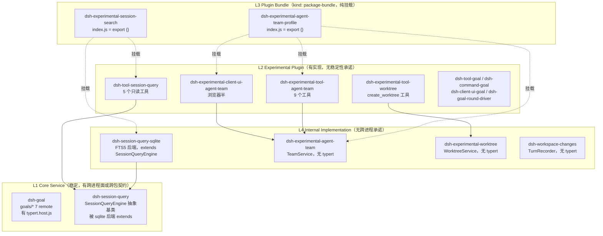

# 官方能力分级矩阵与 6 个能力的真实边界

> 状态：**审计结论（2026-11-01）** · 审计员 capability-matrix-auditor
> 审计对象：官方 DeepSeek Harness **0.2.1-rc.5**（`/Applications/DeepSeek Harness.app/Contents/Resources/app.asar`）
> 对照基线：本机 `~/.dsh/profiles/node_modules/@deepseek-ai/`（**0.1.5-rc.2，244 包**）
> 产出目的：纠正第一阶段"把四个不同层级的东西统称官方插件"的层级混淆，给出可直接执行的使用纪律

---

## 0. 三十秒结论

| 问题 | 答案 |
|---|---|
| 我们之前说的"四个官方插件"？ | **这句话是错的。** 那"四个"横跨 **3 个层级**：2 个是 Core Service/后端、2 个是 Bundle、1 个是 Experimental Plugin。它们不在同一层，不能并列称"插件" |
| 6 个能力里有几个能直接被 DshCockpit 依赖？ | **1 个半。** `dsh-goal` 有跨进程 remote（可用）；`agent-team` 只能读 Session 投影（部分可用）；其余 3 个**没有跨进程面**，第 6 个是纯内部后端 |
| 最容易被误用的 2 个 | **`dsh-workspace-changes`**（被当成 Mission 级 diff 事实源）与 **`dsh-experimental-worktree`**（被当成 Team 成员级隔离） |
| 判断层级的第一判据 | **不是包名，不是 `kind`，而是"有没有跨进程面"**（`lib/typert.host.js`）——308 包里只有 **29 个**有 |

### 本次审计的技术前提（这是结论可信的基础）

既有的 `/tmp/asar_inspect/extract.js` 有对齐 bug，本审计**重新实现**了读取器并做了三重校验：

```
asar header: sz0=4, headerPickleSize=4761012, jsonLen=4761003
正确 data base  = 8 + headerPickleSize        = 4761020
既有脚本 base   = 16 + jsonLen                = 4761019   ← 差 1 字节
```

**密码学证明（同一文件 dsh-goal/package.json，size=2635）**：

| base | sha256 | 与 header `integrity.hash` 一致 |
|---|---|---|
| 16+jsonLen（旧脚本） | `a5c8b144...d85c` | ❌ **不一致**（读出的首字节是 `\n{`） |
| 8+headerPickleSize（正确） | `cb72b49a...7bba` | ✅ **一致**（首字节是 `{`） |

随后按 `dsh/desktop-runtime.json` 的 17190 条文件清单做**全量提取 + 双 hash 校验**：

```
manifestFiles: 17190, extractedAndVerified: 17190,
manifestMismatch: 0, headerMismatch: 0, missing: 0
```

**本文所有 asar 证据均出自这 17190 个已校验文件。** 未校验的内容一律未用于下结论。

---

## 1. 四层分类：定义与判据

### 1.1 先纠正一个方法论错误：`kind` 不在 `package.json` 里

任务书写的判据是「asar 内 `package.json` 的 `kind` 字段」。**实测这个前提不成立**：

```
308 个 @deepseek-ai 包中，package.json 带 kind 字段的：0 个
```

`kind` 实际位于 **`README.md` 的 YAML frontmatter**：

| README frontmatter `kind` | 0.2.1-rc.5 | 0.1.5-rc.2 |
|---|---|---|
| `package-bundle` | **18** | 6 |
| `package-reference` | 244 | 193 |
| `package-library` | 34 | 31 |
| （无 frontmatter） | 12 | 9 |

而 `package.json` 里**机器可读**的 bundle 标记是 `dsh.bundle.patch`，同样是 **18 个**，且与 README 的 18 个 **完全一一对应（零偏差）**：

```
README kind=package-bundle: 18   dsh.bundle set: 18
kind bundle 但无 dsh.bundle: []   有 dsh.bundle 但不是 bundle kind: []
```

**结论：判 bundle 用 `package.json` 的 `dsh.bundle.patch`（机器可读、可断言）；`kind` 只作文档交叉验证。**

### 1.2 四层定义

| 层级 | 定义 | 硬判据（可机械验证） | 稳定性承诺 |
|---|---|---|---|
| **L1 Core Service** | 稳定的跨进程/跨包契约。其他包 import 它，或经 typert remote 暴露给其它进程 | ① 被 ≥2 个非自身包 `peerDependencies` 引用；② 或存在 `lib/typert.host.js`；③ README 无 experimental 自称 | **有**（README 承诺 "stable code"，两代零变化可验证） |
| **L2 Experimental Plugin** | 孵化中的功能插件，契约可自由变更 | ① 包名或 `repository.directory` 落在 `experimental/`；② README 明文 **"Experimental prototype with no stability promise"**；③ 且**不是**纯挂载包 | **无**（明文放弃） |
| **L3 Plugin Bundle** | profile 组合包。只往组合树里插/禁用行，**不实现能力** | ① `package.json` 有 `dsh.bundle.patch`；② README frontmatter `kind: "package-bundle"`；③ `lib/index.js` 内容为 `export {};`（纯挂载） | 随其挂载的成员 |
| **L4 Internal Implementation** | 无跨进程面、只在本进程内被同包/同组代码使用的实现细节 | ① 无 `lib/typert.host.js`；② 无 `exports["./client"]`；③ 只通过 Host 内部 HTTP 路由或 `ctx.*` 服务暴露 | **无**（结构体不承诺） |

### 1.2.1 最强证据：`package.json` 的 `description` 原文（官方自述层级）

`description` 是官方**自己写下的层级定位**，且是 `package.json` 字段（不受对齐/截断影响）。这 12 条是本文最硬的证据，逐条 sha256 已校验：

| 包 | `description` 原文 | 官方自述暴露了什么 |
|---|---|---|
| `dsh-goal` | 「Event-sourced **same-session** goal state and lifecycle **service**」 | **same-session** + **service** = 不能代替 Mission；是 Service 不是插件 |
| `dsh-experimental-agent-team` | 「**Implicit-root** Agent Teams roster, direct peer messaging, and **shared** task DAG」 | **implicit-root**（无独立创建）= `TeamId==SessionId`；**shared** = 共享 |
| `dsh-experimental-agent-team-profile` | 「Agent Teams collaboration, tools, and Web UI in one **experimental bundle**」 | **bundle**（组合包，不实现） |
| `dsh-experimental-tool-agent-team` | 「Scoped **model-facing** Agent Teams tools over `ctx.agentTeams`」 | 模型面工具 + 走 Host 内 `ctx.agentTeams`（无跨进程面） |
| `dsh-experimental-client-ui-agent-team` | 「**Web** Agent Teams roster, task board, and teammate navigation」 | 仅浏览器半 |
| `dsh-experimental-worktree` | 「Creates a named Git worktree and **changes the calling Session working directory**」 | **calling Session** = Session 级隔离的直接证据 |
| `dsh-experimental-tool-worktree` | 「**Model tool** that creates and enters a new Git worktree」 | 模型工具（README kind 却是 bundle，见 §2.3 注） |
| `dsh-experimental-session-search` | 「Give Agents tools to search and read earlier sessions **from the current workspace**」 | **current workspace** = 不是完整跨 Session 记忆 |
| `dsh-workspace-changes` | 「**Per-turn** workspace file changes recorded from git working-tree snapshots…」 | **Per-turn** = span 是一个 turn，不是项目级 |
| `dsh-session-query-sqlite` | 「**Concrete `ctx.sessionQuery` backend** with SQLite FTS5 search」 | **backend** = 不是产品功能 |
| `dsh-session-query` | 「Combined session query **service contract** with concrete reads, traces, and filters」 | **contract** = L1 抽象服务 |
| `dsh-tool-session-query` | 「**Workspace-authorized** model-facing session history search, trace, and event read tools」 | 授权是 workspace 级 |

**⇒ 单看这 12 条 description，四层结构已经自证**：3 条自称 `bundle`、1 条自称 `service`、1 条自称 `backend`、1 条自称 `contract`、其余是"工具/roster/Web"。**官方从来没有把这些东西表达成同一层。**

### 1.2.2 `dsh` 字段的 4 种形态（这比 `kind` 更细）

实测 308 个包的 `package.json.dsh` 有 4 种互斥形态：

| `dsh` 字段形态 | 数量 | 含义 | 命中的能力包 |
|---|---|---|---|
| `dsh.bundle.patch` | **18** | profile 组合包（可 `dsh plugin add`） | `agent-team-profile`、`tool-worktree`、`session-search` |
| `dsh.client` | 若干 | 浏览器半（含 `inject` 依赖表 + `platform`） | `client-ui-agent-team`（`platform: "web"`，inject 5 个 client 包） |
| 只有其它子键 | — | 非 bundle 的普通插件/服务 | `dsh-goal` 等 |
| 无 `dsh` 字段 | 207 | 纯库/服务 | `dsh-session-query`、`dsh-session-query-sqlite`、`dsh-workspace-changes`、`dsh-experimental-agent-team`、`dsh-experimental-worktree`、`dsh-tool-session-query` |

**⇒ 关键推论**：`dsh-experimental-agent-team`、`dsh-experimental-worktree`、`dsh-workspace-changes`、`dsh-session-query`、`dsh-session-query-sqlite`、`dsh-tool-session-query` **都没有 `dsh` 字段**——它们不是 bundle，不能单独 `dsh plugin add`，只能被别的 bundle 挂载或由 composition 直接 mount。**"官方插件"这个词对这 6 个包都不成立。**

### 1.3 判据的有效性验证：typert 是唯一可靠的分层信号

对全部 308 包扫描 `lib/typert.host.js`（跨进程面）：

```
有 lib/typert.host.js 的包: 29 个（占 308 的 9.4%）
dsh-goal / dsh-session-query / dsh-session-query-sqlite /
dsh-experimental-agent-team / dsh-experimental-worktree /
dsh-workspace-changes 中，有 typert.host.js 的：仅 dsh-goal
```

这 29 个包含 `dsh-api-*-controller` 全套、`dsh-commands`、`dsh-subagent`、`dsh-schedule`、`dsh-user-questions`、`dsh-plugin-manager`、`dsh-plugin-market`、`dsh-goal` 等——**正好是"需要被浏览器/外部进程调用"的那批**。判据自洽。

### 1.4 一个额外发现：desktop 构建里**没有任何 `.d.ts`**

```
asar 总文件 18237，其中 .d.ts: 0
package.json 的 "types": "lib/types/index.d.ts" → 该文件在 asar 内不存在（4/4 抽检为 false）
```

**含义**：任务书要求"类型声明证据"，在 desktop 分发物里**做不到**（.d.ts 被裁掉了）。替代证据是 `lib/types/*.js` 里的 **zod schema**（运行时真源）与 `lib/typert.host.js` 内的 `jsonSchema` 字段。**本文所有"类型"证据均来自这两处，不用 .d.ts。**

---

## 2. 六个能力的真实层级（逐条）

先给全景依赖关系，再逐条展开。



### 2.1 `dsh-goal` = **L1 Core Service**（唯一有跨进程面的能力）

**关键纠正：`dsh-goal` 不是"插件"，是一个 Service。** 它自己 README 第一句就说明了这个区分：

> 「The package is a service: the model tools, the `/goal` command, and the continuation driver are separate packages that consume the same goal state, so mounting only this package stores and serves the goal without starting any work.」

| 包 | 层级 | README kind | dsh.bundle | typert | 0.1.5 | 证据 |
|---|---|---|---|---|---|---|
| `dsh-goal` | **L1 Core Service** | package-reference | ❌ | **✅** | ✅ 0.1.5-rc.2 | asar `/dsh/node_modules/@deepseek-ai/dsh-goal/lib/typert.host.js`（93002 B） |
| `dsh-goal-round-driver` | L2（消费者） | package-reference | ❌ | ❌ | ✅ | `dsh-goal-round-driver/README.md:12` |
| `dsh-tool-goal` | L2（消费者） | package-reference | ❌ | ❌ | ✅ | 3 工具：`get_goal`/`create_goal`/`update_goal` |
| `dsh-command-goal` | L2（消费者） | package-reference | ❌ | ❌ | ✅ | `/goal` 斜杠命令 |
| `dsh-client-ui-goal` | L2（消费者） | package-reference | ❌ | ❌ | ✅ | `lib/client.js` 浏览器半 |

**跨进程面证据**（`dsh-goal/lib/typert.host.js`）：

```
createTypertRemoteInfo({ package: '@deepseek-ai/dsh-goal', methods: {...} })
7 个方法，全部 service: 'goals'，全部 scope: { context: 'agent', wire: 'agentId' }：
  goals/get  goals/create  goals/edit  goals/clear  goals/pause  goals/resume  goals/complete
```

**两代稳定性证据（已确认）**：0.1.5-rc.2 与 0.2.1-rc.5 的 `goals/*` 方法名、数量（7）、`scope.wire='agentId'` **完全一致**；README 正文 diff 仅 3 处非行为性改动（`agent/session-start` → `agent/created` 措辞、Agent Note 归档路径、删除 invariant 伴生包）。

#### 边界 ①：Session 级持久化目标，**不能代替 Mission**

| 维度 | `dsh-goal` 的实际行为 | 证据（原文） |
|---|---|---|
| **数量** | **每 Session 至多 1 个当前 goal** | `README.md:32`「The service keeps at most one current goal per session: an unfinished goal must be edited, paused, resumed, blocked, or cleared before another takes its place」；`README.md:160`「**One current goal** — parallel objectives and a separate goal database are intentionally absent」 |
| **存活范围** | 跨 turns / resume / fork / **进程重启** | `README.md:12`「persist across turns, session resume, fork, and process restarts」 |
| **不跨 Session** | 存储介质是**该 Session 的日志**本身 | `README.md:72`「Every accepted change is recorded durably in the session log — **the only store of goal state**」；代码 `dsh-goal/lib/index.js` `commit()` → `agent.session.append("goal/change", change)` |
| **不做调度** | 只是状态机 | `README.md:12`「stores goal state but **does not schedule work**」；`README.md:157`「**State, not scheduling**」 |
| **预算只算轮次** | 不是 token/时间/配额 | `README.md:158`「**Round-count budget only** — `maxGoalRounds` does not meter tokens, currency, wall time, or provider quotas」 |
| **完成由调用方断言** | 无独立评估者 | `README.md:159`「**No independent evaluator** — the caller that records completion or blocking is authoritative」 |

**⇒ 它不能代替 Mission 的四件事**（对照 `docs/architecture/mission-core.md` §1.1）：

1. **跨 Session 存在** — goal 的生命周期严格 ⊂ 一个 Session 的生命周期；Mission 必须比 Session 长。
2. **并行目标** — 官方明确 skip（"skip it for … parallel objectives"）。
3. **Mission 的边界/计划/依赖/证据** — goal 只有 `objective` + `maxGoalRounds` + `phase` + `blockedReason`，**没有任何结构化计划字段**。
4. **完成判定权归属** — goal 的 complete 是"调用方说了算"，Mission 需要的是可验证的完成证据链。

**⇒ 也有一件事它比 Mission 强，必须承认**：`active` 的 goal 在**任何 session-start 边界后自动 disarmed**（`README.md:72`：`an active goal is disarmed after any session-start edge`），这个"不自动复活"的纪律是我们自研 Mission 应该照抄的语义。

---

### 2.2 `dsh-experimental-agent-team` = **L2 Experimental Plugin + L3 Bundle 两层**

**关键纠正：这个词指的不是一个包，是 4 个包跨 2 层。** 最典型的分裂：

| 包 | 层级 | README kind | dsh.bundle | index.js | typert | 0.1.5 | 证据 |
|---|---|---|---|---|---|---|---|
| `dsh-experimental-agent-team` | **L2 Experimental Plugin**（含 `TeamService` 实现） | package-reference | ❌ | 有实现（62 KB） | ❌ | **❌ 不存在** | `repository.directory: packages/experimental/agent-team` |
| `dsh-experimental-tool-agent-team` | L2（模型工具） | package-reference | ❌ | 有实现 | ❌ | ❌ | 9 个工具 |
| `dsh-experimental-client-ui-agent-team` | L2（浏览器半） | package-reference | ❌ | `client.js` | ❌ | ❌ | — |
| `dsh-experimental-agent-team-profile` | **L3 Plugin Bundle** | **package-bundle** | **✅** | **`export {};`（纯挂载）** | ❌ | ❌ | `cordis.patch.yml` 3 行 insert |

`dsh-experimental-agent-team-profile/lib/index.js` 全文：

```js
export {};
```

`dsh-experimental-agent-team-profile/cordis.patch.yml` 实际做两件事：
① 禁用 4 个 legacy 全局子代理行（`tool-subagent-control` / `tool-subagent-list-agents` / `tool-subagent` / `tool-subagent-fork`），② insert 3 行：`agent-team`（`maxMembers: 8`）、`tool-agent-team`、`ui-agent-team`。

**⇒ "启用 Agent Teams"这个动作 = 启用一个 Bundle；实际实现分布在 3 个 Experimental Plugin 里；而这 3 个都没跨进程面。**

#### 边界 ②：成员/任务状态有 Session 关联性；共享工作目录限制

**（a）Session 关联性 —— `TeamId == Lead SessionId`（已确认）**

README 原文（`dsh-experimental-agent-team/README.md:126`）：

> 「Every ordinary runtime root is the implicit Lead of a Team whose **`TeamId` equals its `SessionId`**; there is no creation event, and durable Team state begins with the first member or task record.」

代码印证（`lib/index.js:267`，`lib/types/types.js` 区段）：

```js
/** Brand one root Session identity as its implicit Team identity. */
function TeamId(id) {
    return id;   // ← 同一个字符串，只是 branded
}
```

持久化位置（`README.md`「Durability model」）：`team/member` 与 `team/task` 追加到 **Lead Session 的日志**并 flush；`team/message/*` 仅历史可读。

**⇒ 推论（这是最容易踩的坑）**：Team roster 和任务板**不能跨 Lead Session 存在**。Lead Session 没了 = Team 事实没了。想在 Mission 层做"跨 Session 的组队"，必须自己在 Mission 文档里做映射，不能指望官方 Team 存储。

**（b）共享工作目录限制 —— 官方承认了什么、不承认什么**

| 官方**明确承认**的限制（原文，`README.md:203`） | 官方**明确不提供** |
|---|---|
| 「**One process and one shared checkout** — members share cwd and observe edits immediately」 | 「this package provides **no worktree**, remote member, merge, or filesystem lock」 |

`README.md:32`（When to choose it）：

> 「Separate working directories, **coordination across processes**, and **automatic task-owner release** are unsupported.」

`README.md:202`：

> 「**Experimental prototype with no stability promise** — the package is public, but its contracts can change freely while it incubates.」

**代码级验证**：`spawn_teammate` 工具的完整参数表（`dsh-experimental-tool-agent-team/lib/index.js:251-274`）只有 4 个参数：

```
name（required）· description（required）· prompt（required）· context（enum fresh|fork）
```

**没有 `cwd`、没有 `worktree`、没有 `isolation` 参数。** 而 `dsh-subagent` 的 start 接口**是有** `cwd` 的（`dsh-subagent/README.md:28`：「Each start accepts an optional `cwd` … omission captures that current directory」），spawn 后端也不覆盖它。**⇒ 官方 Team 在"能不能给成员不同工作目录"这件事上，不是"没做"，是"刻意不给这个入口"。**

---

### 2.3 `dsh-experimental-worktree` = **L2 Experimental Plugin（Service）+ L3 Bundle（工具）**

**关键纠正：`dsh-experimental-worktree` 本身不是 bundle。** 它是 Service；bundle 是**另一个包**。

| 包 | 层级 | README kind | dsh.bundle | index.js | typert | 0.1.5 |
|---|---|---|---|---|---|---|
| `dsh-experimental-worktree` | **L2 Experimental Plugin**（`WorktreeService`） | package-reference | **❌ 不是 bundle** | 有实现（368 行） | ❌ | ❌ |
| `dsh-experimental-tool-worktree` | **L3 Bundle，但内含实现**（见下注） | **package-bundle** | **✅** | 有实现（`create_worktree`） | ❌ | ❌ |

> **注（一个容易判错的例外）**：`dsh-experimental-tool-worktree` 声明了 `dsh.bundle.patch`，README kind 也是 `package-bundle`，但它的 `lib/index.js` **不是 `export {}`，而是真的注册了 `create_worktree` 工具**（1973 B）。它是 18 个 bundle 里**唯一一个"bundle 身份 + 实现"混合体**。
> 对照：18 个 bundle 中 13 个是纯挂载（`export {}`），5 个有实现代码（`dsh-acp-app` / `dsh-experimental-auto-review` / `dsh-experimental-tool-worktree` / `dsh-headless` / `dsh-sdk-app` / `dsh-web-app` 中之属）。
> **⇒ "kind: package-bundle"只能证明"它能被 `dsh plugin add`"，不能证明"它只做挂载"。必须读 `lib/index.js`。**

#### 边界 ③：Session 级隔离，**不等于 Team 成员级隔离**

README 两句话就是全部语义（`dsh-experimental-worktree/README.md:2,12`）：

> description：「Create and enter a retained Git worktree **under the calling Session file policy**.」
> 「Create an isolated checkout from a local commit and **continue the same Session in it**. … The existing sandbox governs all writes. Leaving the checkout retains its files and branch.」

代码级：隔离的落点是**改这个 Session 的工作目录**（`lib/index.js`，`WorktreeService.create` 尾部）：

```js
return {
    path: await this.ctx.workingDirectory.set(agent, path, signal),   // ← 改 Session 的 cwd
    branch, baseCommit, repositoryRoot
};
```

**⇒ 三条硬边界**：

1. **粒度是 Session，不是 member。** `ctx.workingDirectory.set(agent, ...)` 改的是**调用者这个 Agent 的 Session 目录**。Team 成员是**独立 Session**，所以理论上每个成员可以各自 `create_worktree`——**但官方 Team 没有任何"给成员分配 worktree"的自动化**，也没有"分配器 / 合并责任归属"。
2. **不是自动隔离。** 不调用工具就仍在共享 checkout 里（默认行为见 §2.2 边界 ②）。"启用 worktree 插件" ≠ "成员被隔离"。
3. **无回收。** 「Leaving the checkout retains its files and branch」+「retained artifacts … removal, pruning, and branch deletion belong to the user or another consumer」——**官方不清理**。

---

### 2.4 `dsh-experimental-session-search` = **L3 Bundle**（纯挂载，5 个只读工具，默认关）

**关键纠正：把它当成"session-search 是个插件/记忆系统"是双重错误。** 它是一个 **bundle**，而且 `lib/index.js` 是空壳：

```js
// dsh-experimental-session-search/lib/index.js
export {};
```

它挂载的是 4 个包，**跨 3 层**：

| 包 | 层级 | README kind | dsh.bundle | typert | 0.1.5 | 备注 |
|---|---|---|---|---|---|---|
| `dsh-experimental-session-search` | **L3 Bundle** | **package-bundle** | ✅ | ❌ | ❌ | `index.js = export {}` |
| `dsh-tool-session-query` | **L2 Experimental Plugin** | package-reference | ❌ | ❌ | ❌ | 5 个工具，目录在 `packages/experimental/` |
| `dsh-session-query` | **L1 Core Service**（抽象基类） | package-reference | ❌ | ❌ | **✅ 已有** | `SessionQueryEngine` |
| `dsh-session-query-sqlite` | **L4 Internal Implementation**（后端） | package-reference | ❌ | ❌ | **✅ 已有** | `extends SessionQueryEngine` |

`dsh-experimental-session-search/cordis.patch.yml`（全文，仅 2 行 insert）：

```yaml
- insert:
    - id: optional-session-search
      name: cordis:group
      group: true
      isolate:
        sessionQuery: true
      config:
        - id: optional-session-query-sqlite
          name: '@deepseek-ai/dsh-session-query-sqlite'
          config:
            path: ':memory:'
            openAt: first-search
        - id: optional-tool-session-query
          name: '@deepseek-ai/dsh-tool-session-query'
```

**⇒ 这个 8 行 YAML 就是"session-search 能力"的全部"组合"。真正的实现 100% 在 0.1.5 就已存在的两个包里。**

#### 边界 ④：实验性历史检索工具，**不是完整跨 Session 长期记忆系统**

| 事实 | 证据 |
|---|---|
| **5 个只读工具**（`session_search` / `session_event_search` / `session_trace` / `session_event_trace` / `session_event_read`） | `dsh-experimental-session-search/README.md:12`「five experimental read-only global tools」；`dsh-tool-session-query/lib/index.js` 实际 `name:` 字段 5 个，`dsh-tool-session-query/README.md:12`「Its five read-only tools」 |
| **默认关闭**（Web 与 Desktop 都是） | `dsh-experimental-session-search/README.md:12`「The bundle **ships switched off in Web and Desktop**. Select it in Plugins to enable it.」 |
| **只在内存里，重启即丢重建** | `README.md:70`「The bundle keeps one **in-memory** index after the first search. The index is **rebuilt after restarting** the application or switching the bundle off and on」 |
| **授权是 cwd 精确相等，不做语义/项目级记忆** | `dsh-tool-session-query/README.md:12`「authorize cross-session access only when the target session's **`cwd` exactly matches** the caller's; callers without a `cwd` can inspect only themselves」 |
| **搜索有上限且无续页** | 同上「Search results are cursor-free … a capped result asks the model to narrow its query」 |

**⇒ 它不构成"跨 Session 长期记忆系统"的四条理由**：
1. **没有写入面** —— 5 个工具全是只读，"记住"这件事它一点不做。
2. **索引不持久** —— `:memory:` + 重启重建，本质是"临时检索引擎"，不是记忆存储。
3. **检索范围受 cwd 硬约束** —— 跨项目、跨主题的记忆召回在授权层就被拒。
4. **默认关闭 + 每 Session 需显式开启** —— 不能作为产品的默认记忆通路。

---

### 2.5 `dsh-workspace-changes` = **L4 Internal Implementation**（最易被误用的一个）

| 包 | 层级 | README kind | dsh.bundle | typert | exports["./client"] | 0.1.5 |
|---|---|---|---|---|---|---|
| `dsh-workspace-changes` | **L4 Internal**（无跨进程面） | package-reference | ❌ | **❌** | ❌ | **❌ 不存在** |

它**不是** bundle（不挂载任何东西），**也不是** Core Service（无 typert、无 client 导出）。它由 `dsh-web-app` 的 patch 行直接 mount，只通过 `ctx.workspaceChanges` 这个 **Host 进程内服务** + `workspace/changes` **Session 事件**暴露。

关键：**它到浏览器/外部的唯一通路，是另一个包 `dsh-client-ui-deliverables` 注册的三条 HTTP 路由**（`dsh-client-ui-deliverables/lib/index.js`）：

```js
const CHANGED_FILES_PATH = "/api/changes.summary";
const CHANGES_DIFF_PATH  = "/api/changes.diff";
const CHANGES_OPEN_PATH  = "/api/changes.open";
...
ctx.connection.fetch.register({ path: CHANGED_FILES_PATH, methods: ["GET"], ... });
```

而 `dsh-client-connection/README.md:49` 明确：「an exact route **answers 403 to a non-owner Peer**」。

**⇒ 对 DshCockpit 这个"进程外消费者"来说，`workspace-changes` 的数据通路是关闭的**（详见 §4.3）。

#### 边界 ⑤：数据生命周期与 Session 生命周期**绑定**

这是用户点名要写清的一条，官方 README **说了三遍**：

| 位置 | 原文 |
|---|---|
| `README.md:12`（Summary） | 「summaries and comparisons stay on the Host **until the Session is disposed**」 |
| `README.md:44` | 「Snapshots are written … into a temporary object directory **owned by the Session** … **Session disposal removes the directory**」 |
| 代码 `lib/index.js:1064` | `ctx.on("session/disposed", (session) => { forget(session); });` — `forget()` 里 `byId.delete(session.id)` 且 `recorder?.dispose()`（`dispose()` 实测 `await rm(scratch, ...)`） |

**必须写清的两个后果**：

1. **Session 释放 → 临时目录被删。** 快照树、整文件副本、以及 `ctx.workspaceChanges.summary()` 的缓存在此之后全部消失，`summary()` 返回 `undefined`。
2. **Host 重启 → 旧轮次无卡片、无对比。** `README.md:48`「A conversation reopened **after a Host restart** therefore has **no card, and no comparison**, for its earlier turns.」`README.md:86` 再确认这是**刻意设计**：「This is the decided behavior: a card whose content the Host can no longer open is not shown.」

**⇒ 直接否掉一个常见误用**：**不能用它做 Mission/Deliverable 级的持久变更事实源**。它能给你的是"**当前进程内、当前 Session 的、当前 turn 的**"变更视图。任何需要跨 Session 存活、跨 Host 重启存活的 diff 索引，**必须自己落盘**。

**另外两个受限条件（同样影响可用性判断）**：
- **subagent Session 不记录**：`lib/index.js` `eligible()`：`origin === "subagent" || delegationDepth > 0` ⇒ `undefined`。README:44 同。
- **无 git 时只剩 file-tool 编辑**：`README.md:44`「Without git … the summary lists the file-tool edits alone … **shell edits are absent**」。本机实测 `git version 2.50.1 (Apple Git-155)` + `/usr/bin/git` 存在但 `xcode-select -p` = `/Library/Developer/CommandLineTools`——**属官方警告的"macOS 只有 developer-tools stub"风险区，实际是否可用需运行验证**（见 §4.4 POC-1）。

---

### 2.6 `dsh-session-query-sqlite` = **L4 Internal Implementation**（Core 层的后端，不是产品功能）

| 包 | 层级 | README kind | typert | 0.1.5 | 备注 |
|---|---|---|---|---|---|
| `dsh-session-query` | **L1 Core Service**（抽象基类 `SessionQueryEngine`） | package-reference | ❌ | **✅ 已有** | 被 sqlite 后端 `import` 并 `extends` |
| `dsh-session-query-sqlite` | **L4 Internal Implementation**（FTS5 后端，**具体实现**） | package-reference | ❌ | **✅ 已有** | `SqliteSessionQueryEngine extends SessionQueryEngine` |

**关键事实：`dsh-session-query` 从不单独挂载。** 它 README 自己说：

> 「The service is provided by a concrete backend plugin — the shipped composition mounts `@deepseek-ai/dsh-session-query-sqlite` — so this package is **never mounted alone**.」

实测印证：web profile 的 `--dump-config` 共 191 行，**没有** `name: '@deepseek-ai/dsh-session-query'` 这一行；只有 `session-query-sqlite` 一行，它同时提供 `ctx.sessionQuery`。

#### 边界 ⑥：Core 层的检索后端，不是产品功能

**（a）它不是产品功能** —— 它没有任何模型面、没有任何 UI、没有任何 remote：

`dsh-session-query-sqlite/README.md`「Model Experience」：「**None**, as the search backend returns hits only to callers and registers nothing model-facing.」

**（b）"能力存在"≠"默认启用" —— `openAt: never` 是实测的运行级事实**

| 证据 | 内容 |
|---|---|
| `dsh-base/cordis.patch.yml:157-161`（0.2.1）与 `:121-133`（0.1.5） | `config: { path: ':memory:', openAt: never }`，注释原文：「Full-text session search is **opt-in**」 |
| `dsh-web-app/cordis.patch.yml` | 再复述一次 `openAt: never`，注释「keeps the Web values on one ephemeral in-memory index」 |
| **运行级实测**（本审计执行） | `node .../dsh/lib/bin.js --profile web --dump-config` → 第 84-88 行：`- id: session-query-sqlite` / `config: { path: ':memory:', openAt: never }` |
| 0.1.5 同样配置 | `~/.dsh/profiles/node_modules/@deepseek-ai/dsh-base/cordis.patch.yml:129-133` 一致 |

配置语义（`dsh-session-query-sqlite/README.md:46`）：

| `openAt` | 行为 |
|---|---|
| `startup` | 激活时打开索引 |
| `first-search` | 推迟到首次搜索（延迟 `node:sqlite` 导入） |
| **`never`** | **全文检索关闭**：`searchSessions`/`searchEvents` 失败并返回 `SESSION_QUERY_SEARCH_DISABLED`，「while every inherited **exact read, filter, and trace keeps working**」 |

**⇒ 精确表述（这是必须一字不差的）**：
- ❌ 错：「官方没有检索能力」
- ❌ 错：「官方有 session-search 这个记忆系统」
- ✅ 对：**官方有分层的一套检索栈——L1 抽象服务（0.1.5 就有）+ L4 SQLite FTS5 后端（0.1.5 就有，但 `openAt: never` 默认关闭）+ L2 模型工具（0.2.1 才有，且需 L3 bundle 开启）+ L3 bundle（0.2.1 才有，默认 off）。当前 web/desktop profile 实测 `openAt: never`，即"精确读/filter/trace 可用，全文检索关闭"。**

---

## 3. 分级矩阵

### 3.1 分层总表（16 个包，全部经 sha256 校验）

| 能力 | 层级 | 包名 | 稳定度 | Session 关联性 | 跨进程 API | 0.1.5 存在 | 需 POC？ | 证据 |
|---|---|---|---|---|---|---|---|---|
| **`dsh-goal`** | **L1 Core Service** | `dsh-goal` | **稳定**（两代 7 方法零变化） | **强**（每 Session ≤1，存于 Session 日志） | **✅ typert `goals/*`×7** | ✅ | 否（已两代验证） | `dsh-goal/lib/typert.host.js`、`README.md:32,72,160` |
| `dsh-goal` 消费者 | L2 | `dsh-tool-goal` | 随 L1 | 同上 | ❌ | ✅ | 否 | 3 工具 |
| `dsh-goal` 消费者 | L2 | `dsh-command-goal` | 随 L1 | 同上 | ❌ | ✅ | 否 | `/goal` |
| `dsh-goal` 消费者 | L2 | `dsh-client-ui-goal` | 随 L1 | 同上 | ❌ | ✅ | 否 | `lib/client.js` |
| `dsh-goal` 消费者 | L2 | `dsh-goal-round-driver` | 随 L1 | 同上 | ❌ | ✅ | 否 | `README.md:12` |
| **`agent-team`** | **L2 Experimental Plugin** | `dsh-experimental-agent-team` | **无承诺**（明文放弃） | **强**（`TeamId==Lead SessionId`） | ❌ | **❌** | **✅ POC-2** | `README.md:126,202` |
| `agent-team` 工具 | L2 | `dsh-experimental-tool-agent-team` | 无承诺 | 同上 | ❌ | ❌ | ✅ POC-2 | 9 工具，无 `cwd` 参数 |
| `agent-team` UI | L2 | `dsh-experimental-client-ui-agent-team` | 无承诺 | 同上 | ❌ | ❌ | ✅ POC-2 | `lib/client.js` |
| `agent-team` 组合 | **L3 Bundle** | `dsh-experimental-agent-team-profile` | 随成员 | — | — | ❌ | ✅ POC-2 | `index.js = export {}` |
| **`worktree`** | **L2 Experimental Plugin** | `dsh-experimental-worktree` | 无承诺 | **强**（改 Session cwd） | ❌ | **❌** | **✅ POC-3** | `README.md:2,12`；`workingDirectory.set(agent,…)` |
| `worktree` 工具 | **L3 Bundle（含实现）** | `dsh-experimental-tool-worktree` | 随成员 | 同上 | ❌ | ❌ | ✅ POC-3 | kind=package-bundle **但** `index.js` 实现 `create_worktree` |
| **`session-search`** | **L3 Bundle** | `dsh-experimental-session-search` | 随成员 | 无（跨 Session 检索） | — | **❌** | **✅ POC-4** | `index.js = export {}`；`README.md:12` |
| `session-search` 工具 | L2 | `dsh-tool-session-query` | 无承诺 | 索引 `:memory:` | ❌ | **❌** | ✅ POC-4 | 5 工具；`README.md:12` |
| `session-search` 服务 | **L1 Core Service** | `dsh-session-query` | **稳定** | 读全 corpus | ❌（从不单独挂载） | **✅** | 否 | `SessionQueryEngine` 抽象基类 |
| `session-search` 后端 | **L4 Internal** | `dsh-session-query-sqlite` | 无承诺 | 读全 corpus | ❌ | **✅** | ✅ POC-4 | `extends SessionQueryEngine`；`:memory:`+`openAt:never` |
| **`workspace-changes`** | **L4 Internal** | `dsh-workspace-changes` | 无承诺 | **强绑定**（Session dispose 删目录） | ❌（仅 `/api/changes.*`，owner-peer 限定） | **❌** | **✅ POC-1** | `README.md:12,44,48,86` |

### 3.2 按四类归类（这是本文件的核心表）

#### ① 官方稳定能力（可依赖，仍需 feature-detect）

| 能力 | 包 | 为什么算稳定 | 跨进程面 |
|---|---|---|---|
| Goal 状态机 | `dsh-goal` | 两代 README 行为描述 diff 仅措辞；`goals/*` 7 方法名/wire 名/agent scope 零变化；被 `dsh-tool-goal`+`dsh-command-goal`+`dsh-goal-round-driver`+`dsh-client-ui-goal` 4 包共同消费 | ✅ `goals/*` |
| Session 查询服务（精确读/filter/trace/lineage） | `dsh-session-query` | 抽象基类，被官方唯一后端 `extends`；README 承诺 exact reads 与 provider 无关 | ❌（Host 内 `ctx.sessionQuery`） |
| Session 事件目录（`known-event-types`） | `dsh-session` | 62 个事件类型，0.1.5→0.2.1 **纯加法 +6**，零删除 | ❌（随协议面） |

#### ② 官方实验性能力（必须 feature-detect + 可降级 + 版本范围约束）

| 能力 | 包 | 官方自述的"不可承诺"原文 |
|---|---|---|
| Agent Teams 服务 | `dsh-experimental-agent-team` | `README.md:202`「Experimental prototype with no stability promise — the package is public, but its contracts can change freely while it incubates.」 |
| Agent Teams 工具（9 个） | `dsh-experimental-tool-agent-team` | 同款句子（其 README 亦有）；schema 可自由变更 |
| Agent Teams UI | `dsh-experimental-client-ui-agent-team` | `packages/experimental/` |
| Worktree 服务 | `dsh-experimental-worktree` | `packages/experimental/` |
| Worktree 工具 | `dsh-experimental-tool-worktree` | 「off in every shipped profile」 |
| Session 历史检索工具（5 个） | `dsh-tool-session-query` | `README.md:12`「Use the **experimental** `dsh-tool-session-query` tools」 |

#### ③ 官方内部实现（**禁止依赖**）

| 包 | 为什么是内部 | 判据命中 |
|---|---|---|
| `dsh-session-query-sqlite` | FTS5 具体后端，schema version 8 + application id 都是私有约定；README 明写「Model Experience: None」 | 无 typert、无 client 导出、只被 composition 挂载 |
| `dsh-workspace-changes` | `TurnRecorder` 内部实现；仅通过 `ctx.workspaceChanges`（Host 内）+ `/api/changes.*`（owner-peer 限定）暴露 | 无 typert、无 client 导出、无稳定事件载荷契约（`workspace/changes` 只带 `{turn}`） |
| （对照）`dsh-client-ui-deliverables` | 它是 `workspace-changes` 的**唯一外部出口**，但它是 UI 包 | 其路由对非 owner peer 返 403 |

#### ④ 需要 POC 验证的能力

| POC | 要验证什么 | 为什么必须验证（不能靠读代码定论） |
|---|---|---|
| **POC-1** | `workspace-changes` 在本机 macOS 上是否真能产出 git 快照 | README 明确警告「on macOS, with only the developer-tools stub at `/usr/bin/git` — no repository is located」。本机 `/usr/bin/git` 存在但 `xcode-select -p` 指向 CommandLineTools，**属需实测的灰区** |
| **POC-2** | Agent Teams 在 0.2.1-rc.5 desktop profile 下真能 spawn/steer/task-board | 全部 4 包在 0.1.5 不存在，无历史兼容证据；且 `agentTeam` 投影需 0.2.x 的 `session/projections` |
| **POC-3** | `create_worktree` 在本机 git 2.50.1 下的完整链路 + 权限/sandbox 约束 | README 有一长串执行要求（`GIT_NO_LAZY_FETCH`、git ≥2.45、sandbox 需允许 shared git metadata 写） |
| **POC-4** | 把 `openAt` 从 `never` 改 `first-search` 后，全文检索是否工作、索引落哪、性能如何 | 默认 `never` 意味着**官方从未在默认配置下跑过这条路径**；`:memory:` 重启即丢 |
| **POC-5** | `agentTeam` Session 投影能否经 `session/projections`（0.2.1 新增）取到 | `session/projections` 在 0.1.5 **不存在**（`grep -c` = 0），仅 0.2.1 有 |

---

## 4. DshCockpit 可以依赖什么：使用纪律

### 4.1 前提：DshCockpit 是**进程外消费者**

这条决定了纪律的形态。实测（扫 `src/` 全部 182 个 js 文件）：

```
scanned js files: 182    dsh imports (@deepseek-ai/*): 0
```

**⇒ 我们一个 `@deepseek-ai/*` 包都不 import。** 所以"层级"对我们的真实含义是：

> **这个能力有没有一条"不 import 也能用"的通路？**

有通路的只有三种：① typert remote（走 `/api/remote.mux`）；② Session 投影 / Session 事件（走 stream）；③ 官方注册的 HTTP 路由（但受 peer owner 限制）。

### 4.2 稳定层（L1）：可依赖，但仍需 feature-detect

| 纪律 | 具体做法 |
|---|---|
| **可依赖** | `goals/*` 7 方法、`session/*` RPC、`session/projections`、Session 事件流 |
| **必须 feature-detect** | 用**能力探测**而非版本字符串：先发一次 `session/list`，看返回是否含 `projections.values`；再决定是否发 `session/projections`。依据：`session/projections` 是 0.1.5→0.2.1 的**新增**（0.1.5 无此方法），硬编码会 404 |
| **禁止假设** | 不要把"包存在"当"能力可用"：`dsh-session-query-sqlite` 在 0.1.5 就有，但 `openAt: never` ⇒ 全文检索调用会返回 `SESSION_QUERY_SEARCH_DISABLED` |
| **错误码可依赖** | `SESSION_QUERY_SEARCH_DISABLED`、`GOAL_INVALID_TRANSITION`、`TEAM_TASK_STALE_REVISION` 等是**稳定 error code**（README 明写 "stable code"），比版本号可靠 |

**goals/* 的 wire 形状（已确认两代一致，可直接实现）**：全部 `scope: { context: 'agent', wire: 'agentId' }`，参数名为 `agent` → wire 名 `agentId`。CAS 用 `{ id, revision }`。

### 4.3 实验层（L2）：feature-detect + 可降级 + 版本范围约束 —— 且**多数对我们不可达**

**先说残酷的部分**：L2 的 6 个包里，**只有 `agentTeam` 投影能跨进程读到**，其余全靠 Host 内 `ctx.*`。

| 能力 | 我们的可达通路 | 能否依赖 |
|---|---|---|
| Agent Team roster/任务板 | **仅** `session/projections` → `values.agentTeam`（0.2.1+） | ⚠️ 只读、只 0.2.x |
| Team 工具（9 个） | ❌ 无（模型面工具，属于 Host 内 Agent） | ❌ |
| Team Service 方法 | ❌ 无 typert | ❌ |
| Worktree Service | ❌ 无 typert | ❌ |
| `create_worktree` 工具 | ❌ 无（同上） | ❌ |
| 5 个 session 检索工具 | ❌ 无（模型面） | ❌ |

**三条硬纪律**：

1. **必须可降级**：`agentTeam` 读不到（0.1.5、或 bundle 未启用）时，办公室的 Team 投影必须回落到自己的事实源，**不能空转**。参照现有 `PROVEN_CAPABILITIES` 模式（`src/office/office-module.js:216-228`）——那里已经用 `Object.freeze({...})` 把"已证实能力"和"未接入"分开，这个模式应延伸到官方能力。
2. **版本范围约束**：`agentTeam` 投影 `stateVersion: 4`（`dsh-experimental-agent-team/lib/types/projection.js:319`），README 明确「Team projection cache version 4 rebuilds checkpoints from earlier cache versions」。**投影版本号必须进我们的兼容台账**。
3. **禁止把实验层当 Mission 存储**：见 §4.5。

### 4.4 内部层（L4）：**禁止依赖**

| 包 | 我们碰了会怎样 |
|---|---|
| `dsh-session-query-sqlite` | 直接读它的 SQLite 文件 = 依赖 schema v8 + application id 1146308689 + 私有表名（`persisted_docs_idx` 等）。**官方明说「only a recognized incompatible derived schema resets in place」** ⇒ 升级即可能清空我们的读取假设 |
| `dsh-workspace-changes` | ① 无 typert；② `/api/changes.*` 只对 **owner peer** 应答（`dsh-client-connection/README.md:49`），DshCockpit 不是 owner peer；③ 数据仅活到 Session dispose。**三条叠加 = 不可用** |

**⇒ 明确写入纪律**：
- **不得**解析 `~/.dsh/` 下任何 `*.db` 派生索引（那是内部实现的私有格式）。
- **不得**依赖 `/api/changes.*` 路由（无鉴权资格 + 生命周期太短）。
- 若确实需要变更事实 → 用 §4.6 的替代路径。

### 4.5 POC 层：先验证再依赖（5 个 POC，见 §3.2 ④）

**纪律**：POC 未通过前，相关代码路径必须标 `[待验证]` 且默认关闭。

### 4.6 六条边界的执行版（一句话一条，可直接进 review checklist）

| # | 能力 | 一句话纪律 |
|---|---|---|
| 1 | `dsh-goal` | **可以用它做"Session 内的目标持久化"，不得用它承载 Mission**——它每 Session 至多 1 个、存于 Session 日志、无计划字段、完成由调用方断言 |
| 2 | `dsh-experimental-agent-team` | **可以只读消费 `agentTeam` 投影（0.2.x），不得假设 Team 事实跨 Session 存活**（`TeamId==SessionId`），**且必须承认成员共享同一个 cwd**（官方无 worktree/锁/跨进程协调） |
| 3 | `dsh-experimental-worktree` | **它是 Session 级 cwd 切换原语，不是成员级隔离**；启用它 ≠ 成员被隔离；且官方不回收 checkout/branch |
| 4 | `dsh-experimental-session-search` | **它是默认关闭的、内存态的、cwd 受限的只读检索工具集，不是记忆系统**；没有写入面、索引重启即重建 |
| 5 | `dsh-workspace-changes` | **它的数据活到 Session dispose 为止**；Host 重启后旧轮次无卡片无对比；**禁止用于 Mission/Deliverable 级持久事实** |
| 6 | `dsh-session-query-sqlite` | **它是 L4 派生索引后端，不是产品功能**；web 实测 `openAt: never`；**禁止直接读它的 DB 文件** |

---

## 5. 我们之前的表述哪里错了（逐条勘误）

| # | 原文位置 | 错误表述 | 正确表述 | 证据 |
|---|---|---|---|---|
| **E1** | `docs/research/capability-providers.md:13` | 「下一阶段要"接"的官方能力：**4 个包**」 | 这"4 个"不是同一层：`dsh-workspace-changes` 是 **L4**、`dsh-experimental-session-search` 是 **L3 bundle**、`dsh-tool-session-query` 是 **L2**、`dsh-experimental-agent-team` 是 **L2**。且真正"接"需要的包数是 **16 个**（跨 4 层），其中 **6 个 0.1.5 就没有**、**6 个 0.1.5 已有** | 本文 §3.1 |
| **E2** | `docs/research/capability-providers.md:162` | 「一步解锁 **5 个官方能力**：`workspace-changes`、`session-search`、`tool-session-query`、`plugin-manager/market`、`agent-team`」 | 这 5 项横跨 3 层且**粒度不同**：`session-search` 是 bundle 不是能力本体（它挂载的 2 个包 0.1.5 已有）；`tool-session-query` 是 L2 工具；`agent-team` 是 4 个包。**"5 个能力"应改为"1 个新增 L4 + 1 个新增 L3 + 3 个新增 L2，共 9 个包"** | 同上；`experimental/session-search/cordis.patch.yml` |
| **E3** | `docs/research/memory-systems.md:57` | 「来源：asar 内**四个包**的 README」 | "四个包"把 `dsh-session-query`（L1 抽象服务）、`dsh-session-query-sqlite`（L4 后端）、`dsh-experimental-session-search`（L3 bundle）、`dsh-tool-session-query`（L2 工具）**平铺成同级**，这正是层级混淆的原始出处 | 本文 §2.4 表 |
| **E4** | `docs/architecture/capability-platform.md:286` | 「`memory` ❌ 不抽象 \| 官方 `dsh-goal` + `dsh-compaction` + **session-search** 已覆盖」 | **`session-search` 不是记忆**：5 个只读工具、无写入面、`:memory:` 索引重启重建、默认关闭。把它列为"记忆已覆盖"是双重错误（层级错 + 语义错） | `session-search/README.md:12,70` |
| **E5** | `docs/architecture/capability-platform.md:287` | 「`history` ❌ 不抽象 \| 官方 `dsh-experimental-session-search` 已覆盖」 | 应写「官方 `dsh-session-query`（L1）+ `dsh-session-query-sqlite`（L4，`openAt:never`）+ `dsh-tool-session-query`（L2）+ bundle（L3）已覆盖**检索栈**」——**能力在 0.1.5 就有，缺的是"打开 + 产品面"，不是"官方没有"** | 本文 §2.6 |
| **E6** | `docs/architecture/runtime-bridge.md:166` | 「0.2.1 新增两包 + **4 个 `team/*` 事件**」 | **错**。`team/member`、`team/task`、`team/message/queued`、`team/message/delivered` **在 0.1.5 的事件目录里就已经存在**（0.1.5 `known-event-types.js` 56 项含全部 4 个）。0.1.5→0.2.1 事件目录真实变化是 **纯加 6 个**：`developer/message`、`image/offload`、`job/registered`、`job/settled`、`working-directory/change`、`workspace/changes`（零删除） | 两代 `dsh-session/lib/types/known-event-types.js` 逐项 diff（56→62） |
| **E6b** | （Lead 在 2026-11-01 04:26 的补充口径） | 「真正新增的 **12 个**是：`developer/message`、`image/offload`、`job/registered`、`job/settled`、**`llm/retry`**、**`llm/retry-started`**、**`permission/preset`**、**`plan/mode`**、**`schedule/change`**、**`subagent/model-selection-policy`**、`working-directory/change`、`workspace/changes`」 | **其中斜体 6 项在 0.1.5 就已存在**，不能算新增。0.1.5 完整 56 项中明确包含：`llm/retry`、`llm/retry-started`、`permission/preset`、`plan/mode`、`schedule/change`、`subagent/model-selection-policy`。**真实新增 = 6 个，不是 12 个；且零删除。** 这条勘误很重要，因为若按 12 个做兼容台账，会为 6 个"其实早就有"的事件白留冗余分支 | 对 0.1.5 `known-event-types.js` 打印全部 56 项逐条比对（复现命令见 §6.1 第 7 条） |
| **E7** | `docs/architecture/mission-core.md:330-332` | 「Team roster → `dsh-experimental-agent-team` → `agentTeam` 客户端视图」「当前 goal phase → `dsh-goal` → `ctx.goals.get(agent)`」「文件变更 → `ctx.workspaceChanges.summary()`」 | 这三条写的是 **Host 进程内的 `ctx.*` 调用**，而 DshCockpit **零 import**（实测 182 文件 0 命中）。必须改写为跨进程通路：goal → `goals/get` remote；roster → `session/projections` 的 `agentTeam`；**文件变更 → 无可用通路**（`/api/changes.*` 对非 owner peer 返 403，且生命周期只到 Session dispose） | `src/` 扫描 0 命中；`dsh-client-connection/README.md:49` |
| **E8** | 任务书本身 | 「asar 内 `package.json` 的 `kind` 字段」 | `kind` 在 **README frontmatter**，`package.json` 里 **0/308** 有 `kind`。机器可读判据应用 `package.json.dsh.bundle.patch`（18 个，与 README kind 18 个一一对应） | `308 包扫描：kind 字段 0 个；dsh.bundle 18 个` |
| **E9** | 任务书本身 | 「是否存在 `lib/typert.host.js`（= 有跨进程 remote API）」（隐含：这是充分条件） | 方向对，但**不充分**：`dsh-goal` 有；而 `agentTeam` 是**通过 Session 投影**（`session/projections`，无 typert 的包也能发出）跨进程的。**完整判据 = typert remote ∪ Session 投影 ∪ 官方 HTTP 路由** | `dsh-experimental-agent-team` 无 typert 但投影键 `agentTeam` 进 `SessionProjectionMap` |

### 5.1 最容易被误用的 2 个能力（用户点名要求明确）

**第一名：`dsh-workspace-changes`**

误用形态：「官方有 `workspace/changes` 事件 + `summary()/diff()`，所以变更事实交给官方，我们不用自己落盘。」

为什么错（三条独立理由，任一成立即不可用）：
1. **生命周期太短**：Session dispose 即删临时目录（`README.md:44` + `lib/index.js:1064` `session/disposed` → `forget`）；Host 重启后旧轮次无卡片无对比（`README.md:48,86`，且明说这是**刻意的**）。
2. **我们够不到**：无 typert；唯一外部出口是 `dsh-client-ui-deliverables` 的 `/api/changes.summary|diff|open`，而这些路由「answers 403 to a non-owner Peer」（`dsh-client-connection/README.md:49`）。
3. **覆盖面有洞**：subagent Session 完全不记录（`eligible()`）；无 git 时 shell 改动全部缺失。

**第二名：`dsh-experimental-worktree`**

误用形态：「官方有 worktree 插件，Team 并行就有隔离了。」

为什么错（三条）：
1. **粒度错**：它改的是**调用者 Session 的 cwd**（`workingDirectory.set(agent, …)`），Team 成员是独立 Session，**官方没有任何"分配 worktree 给成员"的机制**——而 `spawn_teammate` 连 `cwd` 参数都没有（`tool-agent-team/lib/index.js:251-274` 仅 name/description/prompt/context）。
2. **不是自动的**：不显式调用 `create_worktree`，成员仍在同一 checkout（Team README:203「members share cwd and observe edits immediately」）。
3. **不回收**：`Leaving the checkout retains its files and branch`；`removal, pruning, and branch deletion belong to the user or another consumer`。

---

## 6. 演进与观察清单

| 观察项 | 为什么值得盯 | 触发动作 |
|---|---|---|
| `agent-team` 是否摘掉 `experimental` | 它是 4 包 + 一个 `TeamId==SessionId` 的硬约束；一旦升级为稳定层，ADR-0002 的"消费官方 Team"才真正安全 | 重跑本次审计 §2.2 |
| `session/projections` 是否再加 `workspaceChanges` 键 | 若加了，`workspace-changes` 就从"L4 不可达"变成"L2 可读" | 更新 §4.3 表格 |
| `general`/`openAt` 默认值是否变化 | 当前 `never`。若官方某版改默认为 `first-search`，全文检索立刻可用 | 每次升级跑 `--dump-config \| grep -A4 session-query-sqlite` |
| `known-event-types` 是否出现删除 | 目前两代**零删除**（56→62，纯加法）。任何删除都是 breaking | 进兼容台账 |
| `dsh.bundle.patch` 数量变化 | 18 个（0.2.1）vs 6 个（0.1.5）——bundle 层在快速膨胀，意味着"能力组合方式"在变 | 重跑 §1.2 |

### 6.1 复现本文全部证据的最小命令集

```bash
# 1) asar base（正确 = 8+headerPickleSize；旧脚本用 16+jsonLen 差 1 字节）
node -e 'const fs=require("fs");const fd=fs.openSync("/Applications/DeepSeek Harness.app/Contents/Resources/app.asar","r");const h=Buffer.alloc(16);fs.readSync(fd,h,0,16,0);console.log({correctBase:8+h.readUInt32LE(4),buggyBase:16+h.readUInt32LE(12)})'
# → { correctBase: 4761020, buggyBase: 4761019 }

# 2) 全量提取 + 双 hash 校验（本文用的脚本）
node /tmp/asar_v2/extract-verified.js
# → manifestFiles: 17190, extractedAndVerified: 17190, mismatch: 0

# 3) kind 在哪一层（0.2.1 → 0；0.1.5 → 0）
#    机器可读 bundle 标记
node -e 'const A=require("/tmp/asar_v2/asar.js");const B="dsh/node_modules/@deepseek-ai";let k=0,b=0;for(const n of A.list(B)){const j=JSON.parse(A.readText(`${B}/${n}/package.json`).text);if(j.kind!==undefined)k++;if(j.dsh&&j.dsh.bundle)b++;}console.log({packageJsonKind:k,dshBundle:b})'
# → { packageJsonKind: 0, dshBundle: 18 }

# 4) typert（跨进程面）只有 29 个
#    6 个能力涉及的 16 包中只有 dsh-goal 有
node -e 'const A=require("/tmp/asar_v2/asar.js");const B="dsh/node_modules/@deepseek-ai";for(const p of ["dsh-goal","dsh-session-query","dsh-session-query-sqlite","dsh-experimental-agent-team","dsh-experimental-worktree","dsh-workspace-changes"])console.log(p,(A.list(`${B}/${p}/lib`)||[]).includes("typert.host.js"))'

# 5) 运行级：openAt 实测（用已校验的提取副本执行官方 CLI）
node /tmp/asar_v2/root/node_modules/@deepseek-ai/dsh/lib/bin.js --profile web --dump-config | grep -A4 session-query-sqlite
# → path: ':memory:' / openAt: never

# 6) DshCockpit 零 import
#    （见 §4.1，扫 src/ 182 文件，@deepseek-ai 命中 0）

# 7) 事件目录 diff —— 证明真实新增是 6 个而非 12 个
node -e '
const fs=require("fs");
function parse(p){const t=fs.readFileSync(p,"utf8");const m=t.match(/KNOWN_SESSION_EVENT_TYPES = new Set\(\[([\s\S]*?)\]\)/);return new Set((m?m[1]:"").match(/\x27[a-z0-9\/-]+\x27/g).map(s=>s.slice(1,-1)));}
const a=parse(process.env.HOME+"/.dsh/profiles/node_modules/@deepseek-ai/dsh-session/lib/types/known-event-types.js");
const b=parse("/tmp/asar_v2/root/node_modules/@deepseek-ai/dsh-session/lib/types/known-event-types.js");
console.log("0.1.5:",a.size,"0.2.1:",b.size);
console.log("only 0.2.1:",[...b].filter(x=>!a.has(x)).join(", "));
console.log("only 0.1.5:",[...a].filter(x=>!b.has(x)).join(", ")||"(none)");
'
# → 0.1.5: 56  0.2.1: 62
# → only 0.2.1: developer/message, image/offload, job/registered, job/settled, working-directory/change, workspace/changes
# → only 0.1.5: (none)
```

---

## 附录 A：证据索引（asar 内路径，全部 sha256 已校验）

| 用途 | asar 路径 |
|---|---|
| 运行时清单（17190 文件 + sha256 真源） | `/dsh/desktop-runtime.json` |
| Goal 服务实现 / remote / 中文文档 | `/dsh/node_modules/@deepseek-ai/dsh-goal/lib/{index.js,typert.host.js}`、`README.md`、`README.zh.md` |
| Team 服务实现（`TeamId=id` 在 267 行）/ 投影定义（`key:'agentTeam'`, `stateVersion:4`）/ 文档 | `/dsh/node_modules/@deepseek-ai/dsh-experimental-agent-team/lib/{index.js,types/projection.js}`、`README.md` |
| Team 工具 schema（9 工具，`spawn_teammate` 无 cwd） | `/dsh/node_modules/@deepseek-ai/dsh-experimental-tool-agent-team/lib/index.js` |
| Team bundle 纯挂载 + patch | `/dsh/node_modules/@deepseek-ai/dsh-experimental-agent-team-profile/{lib/index.js,cordis.patch.yml}` |
| Worktree 服务（`workingDirectory.set`）/ 工具 / bundle patch | `/dsh/node_modules/@deepseek-ai/dsh-experimental-worktree/lib/index.js`、`.../dsh-experimental-tool-worktree/{lib/index.js,cordis.patch.yml}` |
| Session search bundle patch（8 行 YAML 全文） | `/dsh/node_modules/@deepseek-ai/dsh-experimental-session-search/cordis.patch.yml` |
| 5 个检索工具 | `/dsh/node_modules/@deepseek-ai/dsh-tool-session-query/lib/index.js` |
| L1 抽象服务 / L4 SQLite 后端 | `/dsh/node_modules/@deepseek-ai/dsh-session-query/lib/index.js`、`.../dsh-session-query-sqlite/lib/index.js` |
| workspace-changes 实现（dispose / eligible / append） | `/dsh/node_modules/@deepseek-ai/dsh-workspace-changes/lib/index.js` |
| `/api/changes.*` 路由注册 + owner-peer 403 | `.../dsh-client-ui-deliverables/lib/index.js`、`.../dsh-client-connection/README.md:49` |
| `openAt: never` 配置源（两代） | `.../dsh-base/cordis.patch.yml`、`.../dsh-web-app/cordis.patch.yml` |
| 事件目录（62 项） | `/dsh/node_modules/@deepseek-ai/dsh-session/lib/types/known-event-types.js` |
| `session/projections` remote（0.2.1 新增，含 `agentTeam` 键） | `/dsh/node_modules/@deepseek-ai/dsh-api-session-controller/lib/typert.host.js` |
| 18 个 bundle 的机器可读清单 | `/dsh/node_modules/@deepseek-ai/dsh-app-boot/lib/index.js`（`OPTIONAL_BUNDLES` / `PROFILE_TEMPLATES`） |

## 附录 B：结论置信度

| 结论 | 置信度 | 依据 |
|---|---|---|
| asar 对齐 bug 与正确 base | **[已确认]** | sha256 双向对照（§0） |
| 17190 文件内容正确 | **[已确认]** | 双 hash 全通过 |
| 四层划分与 16 包归属 | **[已确认]** | 逐包读 `package.json`+README frontmatter+`lib/` 文件清单+`cordis.patch.yml` |
| typert 只有 29 个 / 6 能力中仅 goal 有 | **[已确认]** | 全量文件存在性扫描 |
| `openAt: never`（web profile） | **[已确认]** | 官方 CLI `--dump-config` 实跑 |
| 事件目录 56→62 纯加法 | **[已确认]** | 两代 `known-event-types.js` 逐项 diff |
| `/api/changes.*` 对非 owner peer 403 | **[已确认（文档）]** | `dsh-client-connection/README.md:49` 原文；**未做运行级 403 实测** |
| macOS 上 workspace-changes 是否可用 | **[待验证]** | README 自述 Xcode stub 风险；需 POC-1 |
| Agent Teams 端到端行为 | **[待验证]** | 全 4 包 0.1.5 不存在；需 POC-2 |
| worktree 完整链路 | **[待验证]** | 需 POC-3 |
| 打开 `openAt` 后 FTS5 行为/性能 | **[待验证]** | 官方默认从未跑过该路径；需 POC-4 |
| `agentTeam` 经远程取到 | **[待验证]** | 需 POC-5（0.2.x profile 实跑） |
