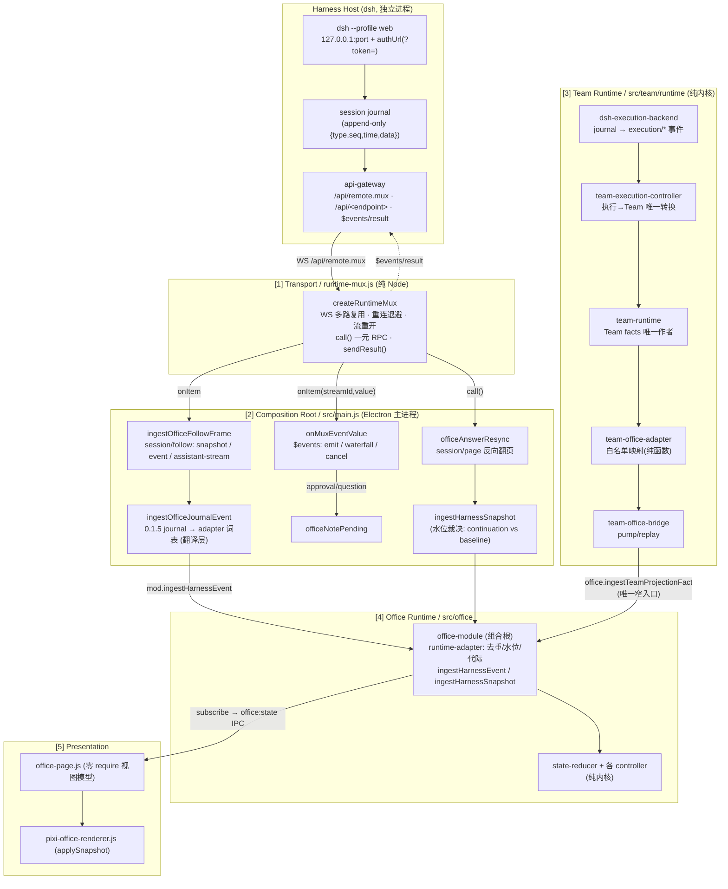
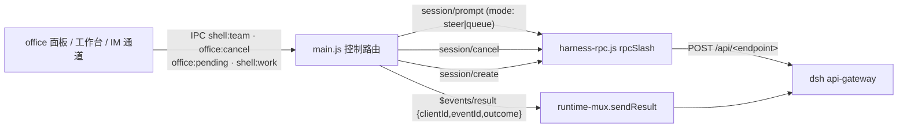
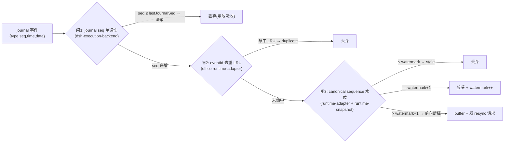
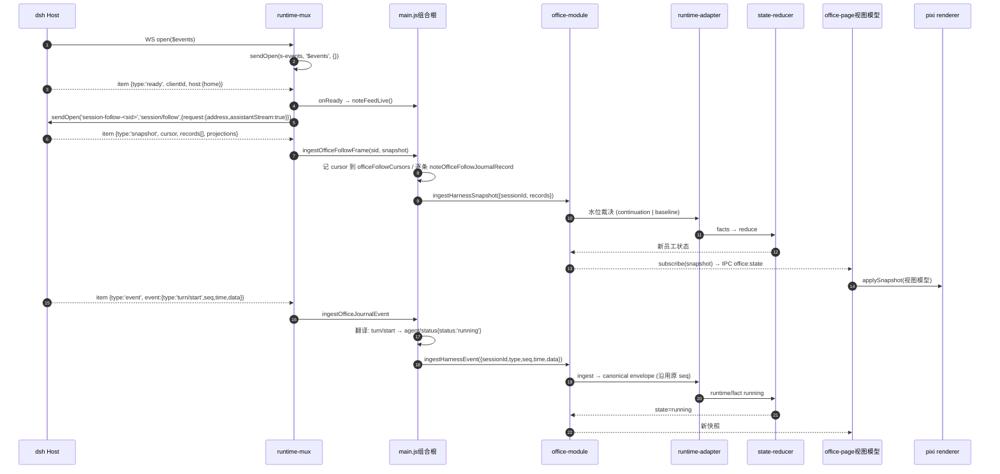
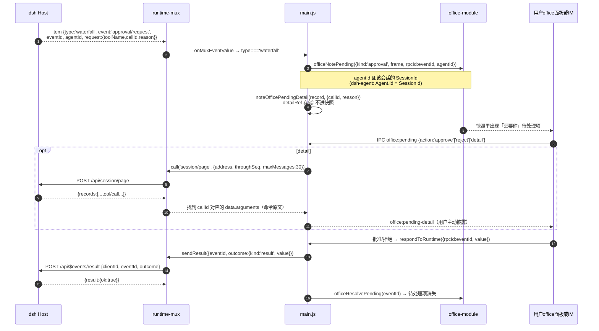
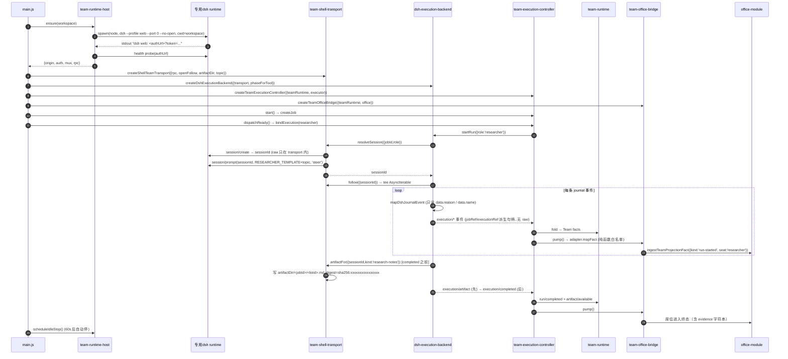

# Runtime Bridge 架构（Harness → Office）

> 状态：**审计 + 可执行设计**（2026-11-01，Harness 集成架构审计）。
> 基线：DshCockpit `develop` @ `ec7e5bc`（221 commits，工作树干净）；锁定 runtime `runtimeVersion = 0.1.5-rc.2`（`package.json:6`）。
> 对照运行时：官方 DSH desktop runtime **0.2.1-rc.5**（`/Applications/DeepSeek Harness.app/Contents/Resources/app.asar` → `/dsh/node_modules/@deepseek-ai/`，305 个 `@deepseek-ai` 依赖）。
> 目标定位：**Harness owns execution, DshCockpit owns the experience, continuity and capability orchestration.** 本文只谈"执行 → 体验"的接缝，不谈体验层内部。

**证据分级图例**（全文强制）：

| 标签 | 含义 |
|---|---|
| **已确认** | 仓库代码 / 运行结果 / 已安装包的可读声明可直接证明，附文件路径+行号 |
| **部分实现** | 代码存在且可运行，但覆盖面或边界有已知缺口 |
| **待验证** | 有设计意图或单侧证据，缺另一侧证据（通常：0.2.x 侧只能从 asar 类型声明推断，无法运行验证） |
| **设计阶段** | 只有契约/计划文本，无代码 |
| **设想** | 本文提出的建议，未落地、未拍板 |

---

## 0. 结论摘要

1. **Bridge 不是一个模块，而是一条四段接缝**：`runtime-mux`（传输）→ `main.js`（翻译/组合根）→ `Team Runtime`（事实收敛）→ `office-module`（投影）。这四段各自有明确的事实所有权，且在 0.2.1 面前**脆弱度不同**：传输段几乎不脆弱，翻译段最脆弱。
2. **0.2.1-rc.5 相对 0.1.5-rc.2 的 session-controller RPC 是零删除 + 3 个新增**（`session/projections`、`session/initializeDefaultModel`、`session/workspacePathApplications`）。**这是最重要的好消息**：升级风险集中在"新增能力面"而非"破坏面"。
3. **`$events` 下行帧与 `$events/result` outcome 形状在两个版本间逐字段一致**（`ready`/`emit`/`waterfall`/`cancel` + `outcome.kind ∈ {next,result,rejected}`）。Bridge 的事件面与审批回传面可以保持稳定。
4. **真正的破坏面在事件词表**：`SessionEventMap` 从 **56 种增到 62 种（净增 6 种、零删除）**，`turn/end` 的 `reason` 新增 `forked` 分支，`SessionSummary` 新增 `agentAvailable`。`main.js` 的翻译层（`ingestOfficeJournalEvent`）对未知事件走"原样透传 + adapter 映射不到就不产 fact"的兜底，因此**不会崩，但会静默丢失能力**（`forked` 会被当成 unknown → attention）。
5. **单库锁定是当前最大的结构性风险**：`SUPPORTED_RUNTIME_RANGE = '<0.2.0-0'`（`src/runtime-manager.js:39`）意味着壳会**主动拒绝** 0.2.x，而官方桌面运行时已经是 0.2.1-rc.5。用户装官方 App 与装 DshCockpit 会得到两套互不兼容的运行时。
6. **但"0.2.x 不可行"这个前提是错的**（本次审计的意外发现）：仓库的 CI 已经**每天**在两个平台上安装并启动上游版本，最近一次（`41187195013`，2026-10-31）对 `0.2.1-rc.5` 的结论是 `ok=true / all green`，且 0.2.1 系列已连续约 10 天全绿。真正的问题是**这个结论没有落到决策者看得见的地方**——`docs/compat/compat-status.json` 停在 `0.1.5-rc.2`（2026-09-16），`badge.json` 写"✅ rc.2 verified"（见 §10 R1b）。所以升级的阻力是**可观测性缺陷**，不是技术未知。
7. **技术债（真实、可复现）**：`DSH_EXECUTION_MAPPING` 的 `source` 行号引用自建表起即漂移 5 处（表按 2026-09-26 的行号写，却在 2026-10-25 才创建），且现有测试只断言"行号 ≤ 文件行数"，拦不住语义漂移。详见 §7。

---

## 1. Bridge 分层

### 1.1 分层图



**反向控制（Command Router）**：



### 1.2 各层事实所有权（谁有权写什么）

| # | 层 | 模块 | 拥有的唯一事实 | 证据 |
|---|---|---|---|---|
| 1 | 传输 | `src/runtime-mux.js` | 连接/流生命周期、`clientId`（ready 帧）、重连代数 | `src/runtime-mux.js:38-372`（`streams`/`opened`/`clientIdValue`/`stateValue` 全为该模块私有） |
| 2 | 组合根 | `src/main.js` | **raw sessionId 的唯一来源**；journal→adapter 词表翻译；P3 detailRef 参数存储；P1 pending 镜像 | `docs/architecture/HARNESS-RUNTIME-CONTRACT-v0.md` §2.1 第 2 行；代码 `src/main.js:4002`（`officeSessionPresets`）、`:4157-4159`（detailRef/游标表） |
| 3 | Team | `src/team/runtime/team-runtime.js` | **`team/*` fact 的唯一作者**（Job/Role/WorkerRun/Artifact） | `docs/architecture/TEAM-RUNTIME-CONTRACT-v0.md` §10；`src/team/runtime/team-office-bridge.js:18` 注释"Team Runtime 是唯一事实作者" |
| 3b | Team→Office | `src/team/runtime/team-office-adapter.js` | Role→Seat **白名单表**（显式、非推导） | `src/team/runtime/team-office-adapter.js:43-46`（`TEAM_ROLE_TO_SEAT` 冻结） |
| 4 | Office 内核 | `src/office/runtime/runtime-adapter.js` | canonical envelope、去重账本、水位、resync 周期、runId→proxy | `HARNESS-RUNTIME-CONTRACT-v0.md` §2.1 第 3a 行；`src/office/runtime/runtime-adapter.js:178-190` |
| 4b | Office 内核 | `src/office/runtime/runtime-snapshot.js` | `office:runtime-*` 消息 schema、facts 白名单、合并语义 | `src/office/runtime/runtime-snapshot.js:35-52` |
| 5 | 呈现 | `src/office/render/pixi-office-renderer.js` | **无**（只消费 `applySnapshot`） | `HARNESS-RUNTIME-CONTRACT-v0.md` §2.1 第 4 行 |

**铁律**（`AGENTS.md` §2.1，代码可证）：任何一层不能冒充另一层的事实作者。审查中未发现违反——`office-module.js` 的 `ingestTeamProjectionFact`（`:2179`）是 Team→Office 的**唯一**窄入口，office 侧不接受 Team 之外的 team fact 来源（`TEAM_FACT_KINDS` 白名单 `src/office/office-module.js:2060-2063`，`TEAM_ADAPTER_CODES` 白名单 `:2067-2073`）。**已确认**。

---

## 2. 稳定 / 实验 / 内部 API 分级

> 分级判据：① 该 API 是否在**两代运行时**（0.1.5-rc.2 与 0.2.1-rc.5）都存在且形状一致；② 是否被 Harness 自己的 client 代码使用（= 有官方使用压力，不轻易改）；③ 是否只在实验包（`dsh-experimental-*`）里。

### 2.1 传输协议级（最稳定）

| API | 分级 | 证据 |
|---|---|---|
| `WS /api/remote.mux` + 帧 `{type:'open'\|'item'\|'end'\|'error'\|'cancel'}` | **稳定** | 0.1.5：`dsh-api-gateway/lib/types/stream-protocol.d.ts:6`（`REMOTE_STREAM_MUX_PATH`）；0.2.1：asar 同路径 `lib/types/stream-protocol.js:4` 导出同一常量字符串 `/api/remote.mux`。两代 `RemoteStreamClientMessage`/`RemoteStreamServerMessage` 定义一致。 |
| `$events` 流 + `ready` 帧 `{type,clientId,host:{home}}` | **稳定** | 0.1.5 `stream-protocol.d.ts:20-34`；0.2.1 同文件逐字段一致（`parseRemoteEventResult` 与 `RemoteEventReadyFrame` 未变） |
| `$events` 帧 `emit{event,args}` / `waterfall{event,eventId,agentId,request}` / `cancel{eventId}` | **稳定** | 同上；两代 `RemoteEventEmitFrame`/`InvocationFrame`/`CancellationFrame` 字段名一一对应 |
| `POST /api/$events/result` body `{clientId,eventId,outcome}`，`outcome.kind ∈ {next,result,rejected}` | **稳定** | 0.1.5 `dsh-api-gateway/lib/index.js:21-49`（`parseRemoteEventResult`）；0.2.1 asar `lib/types/stream-protocol.js` 的 `parseRemoteEventResult` 逐分支一致 |
| 一元 RPC 信封 `POST /api/<endpoint>` body `{type:'client-request',rpcId,method,payload:{args}}` | **稳定** | 0.1.5：`src/runtime-mux.js:302-334` 实现 + `dsh-api-gateway/lib/index.js:1041-1051`（`assertExactArguments`）；0.2.1：asar `dsh-client-connection/lib/client.node.js` 中 `createWebConnectionRpc.call()` 构造完全相同的 `{type:'client-request',rpcId,method,payload}` |
| Cookie 门禁（`dsh-auth-*`，名带随机前缀）+ 401 自愈 | **稳定** | `src/runtime-auth.js:1-24`（注释即契约）；两代都以 `connection.authenticatedUrl` 生成 token URL（0.2.1 asar `dsh-desktop-host/lib/index.js:342`） |

### 2.2 Session RPC 级（稳定，0.2.1 有新增）

完整方法表与 diff 见 `docs/research/deepseek-harness-api-surface.md` §2。此处只列 Bridge 实际使用的：

| 方法 | 分级 | DshCockpit 使用者 | 证据 |
|---|---|---|---|
| `session/list` (args `{_request:{}}` → `{items:SessionSummary[]}`) | **稳定** | `seedOfficeFollowFromSessionList`（`src/main.js:5234-5254`）、IM `/bind`（`:5672`） | 两代 typert 参数名均为 `_request`；`SessionListValue` 声明两代逐字一致 |
| `session/create` (args `{request:{workspaceId?,cwd?,sessionId?,agentPreset?}}` → `{sessionId,agentPreset?}`) | **稳定** | `team-shell-transport.resolveSession`（`src/team-shell-transport.js:171`） | 两代 `SessionCreateRequest`/`Value` 声明一致 |
| `session/prompt` (args `{request:{requestId,sessionId,mode:'queue'\|'steer',content,clientTimeZone?}}`) | **稳定** | `src/harness-rpc.js:381-385`、`team-shell-transport.js:178` | 两代 `SessionPromptRequest` 声明一致 |
| `session/cancel` (args `{request:{sessionId}}` → `{accepted:true}`) | **稳定** | `src/harness-rpc.js:386-388`、office `cancel` 控制 | 两代一致 |
| `session/page` (args `{request:{address,throughSeq,beforeSeq?,maxMessages?}}` → `{records,hasMore}`) | **稳定**（0.2.1 仅新增可选 `turnWindow`） | `officeAnswerResync`（`src/main.js:5586`）、`officePageToolCallArgs`（`:4249`） | 0.1.5 `SessionPageRequest` 无 `turnWindow`；0.2.1 新增 `turnWindow?` —— **纯加法，不破坏** |
| `session/follow` (stream, `{request:{address,maxMessages?,assistantStream?:true}}` → snapshot + event + assistant-stream 帧) | **稳定** | `officeFollowSyncTick`（`src/main.js:5338,5363`）、`openTeamFollowStream`（`:685`） | 两代 `SessionFollowRequest`/`SessionFollowFrame` 声明一致；0.2.1 的 follow 请求通过 `extends Pick<SessionPageRequest,'maxMessages'\|'turnWindow'>` 拿到 `turnWindow`，原有字段不变 |
| `session/control` (stream) | **稳定但未使用** | 无（`src/harness-rpc.js:400` 显式 `noUnary`） | 两代都是 stream；Bridge 未接线 |
| `commands/execute` (args `{agentId,line,submittedAttachments}`) | **稳定** | `/compact` 手工触发（`src/main.js:3841-3855`） | 0.1.5 `dsh-commands/lib/typert.host.js` 与 0.2.1 asar 同名包均为 `agent, line, submittedAttachments` 三参数 |
| `session/projections` | **新增（0.2.1）** | 无 | 仅 0.2.1 存在；返回 `SessionProjectionBaseline \| migration-required \| null` |
| `session/initializeDefaultModel` | **新增（0.2.1）** | 无 | 仅 0.2.1 |
| `session/workspacePathApplications` | **新增（0.2.1）** | 无 | 仅 0.2.1 |

### 2.3 能力面（插件级）分级

| 能力 | 包 | 分级 | 依据 |
|---|---|---|---|
| goal（目标态机） | `dsh-goal` | **稳定**（两代都有 typert remote） | 0.1.5 `dsh-goal/lib/typert.host.js` 已有 7 方法；0.2.1 同 7 方法，零变化 |
| workspace | `dsh-workspace` + `dsh-api-workspace-controller` | **稳定**（0.2.1 新增 4 方法） | 0.2.1 新增 `workspace/initializeDefault`、`pinSession`、`unarchiveSession`、`unpinSession`；零删除 |
| jobs（后台作业） | `dsh-jobs` + `dsh-jobs-local` | **稳定**（客户端面 0.2.1 新增） | 0.1.5 有包无 `api-job-controller`；0.2.1 新增 `job/list`、`job/follow`、`job/kill` |
| schedule（定时） | `dsh-schedule` | **实验偏稳定**（0.2.1 新增 remote） | 0.1.5 有包、无 `typert.host.js`；0.2.1 新增 5 方法 + `schedule/change` 事件 |
| user-questions | `dsh-user-questions` | **稳定**（0.2.1 新增 remote） | 0.1.5 有包无 remote；0.2.1 新增 `userQuestions/answer`、`userQuestions/attachWait`；waterfall 事件名 `user-questions/request` **两代一致**（见 §2.4）|
| user-approval | `dsh-user-approval` | **稳定** | 两代都**没有** remote 面（只走 waterfall），事件名 `approval/request` 两代一致 |
| skill | `dsh-skill` | **稳定**（无 remote） | 两代都只有 `lib/index.js`，通过 `skills/list`（session-controller 内）暴露列表 |
| permission-presets | `dsh-permission-presets` | **实验** | 0.1.5 无 remote；0.2.1 新增 `permissionPresets/catalog` |
| **agent-team** | `dsh-experimental-agent-team` + `-tool-` + `-profile` + `-client-ui-` | **实验（明确标注 experimental）** | **0.1.5 完全不存在**；0.2.1 新增两包 + 4 个 `team/*` 事件。README 原文："The package is experimental and requires durable session storage." |
| plugin-manager / plugin-market | `dsh-plugin-manager`、`dsh-plugin-market` | **实验** | 0.1.5 完全不存在；0.2.1 新增，12 + 3 方法 |
| terminal | `dsh-api-terminal-controller` | **实验** | 0.1.5 无；0.2.1 新增 8 方法 |
| account / remote-access | `dsh-api-account-controller`、`dsh-api-remote-access` | **实验（云端耦合）** | 0.1.5 无；0.2.1 新增 |
| worktree | `dsh-experimental-worktree` / `-tool-worktree` | **实验** | 仅 0.2.1 |

### 2.4 审批 / 提问回传面（Bridge 最关键的稳定性结论）

**已确认：两代完全一致。**

| 项 | 0.1.5-rc.2 | 0.2.1-rc.5 |
|---|---|---|
| waterfall 事件名（审批） | `approval/request` | `approval/request` |
| waterfall 事件名（提问） | `user-questions/request` | `user-questions/request` |
| waterfall 帧字段 | `{type,event,eventId,agentId,request}` | 同 |
| 审批 request 载荷字段 | `{toolName, callId?, reason?}` | 同 |
| 提问 request 载荷字段 | `{questions:[{id,question,detail?,header?,options?,multiSelect?,intent?}]}` | 同 |
| 回传端点 | `POST /api/$events/result` | 同 |
| 回传 body | `{clientId,eventId,outcome}` | 同 |
| 审批 outcome value | 裸字符串 `'allowed-once'` / `'rejected'` | 同 |
| 提问 outcome value | `AskUserQuestionAnswer { answers }` 批 | 同 |

证据：
- 0.1.5：`~/.dsh/profiles/node_modules/@deepseek-ai/dsh-user-approval/lib/index.js`（`ctx.waterfall(..., 'approval/request', ...)`）；`dsh-api-gateway/lib/index.js:21-49`；DshCockpit 侧落地 `src/main.js:5036-5048`（waterfall 分派）+ `:5778-5796`（`respondToRuntime` → `mux.sendResult`）。
- 0.2.1：asar `/dsh/node_modules/@deepseek-ai/dsh-user-approval/lib/index.js`（同一行构造 waterfall）+ `/dsh/node_modules/@deepseek-ai/dsh-api-gateway/lib/types/stream-protocol.js`（`parseRemoteEventResult` 逐分支一致）。
- DshCockpit 侧对字段名的双代兼容已有注释记录：`src/main.js:5038-5039`（"the consumers also accept the legacy names"）、`:5724`（`frame.toolName || frame.tool`）。

**推论**：Bridge 的**审批/提问回路可以视为 0.2.x 安全**，不需要为升级改造。这是本次审计最有价值的稳定性结论——因为它正是"用户必须在场"的那条路径（体验层最不能坏的一条）。

### 2.5 内部 API（不得依赖）

分级为**内部**的判据：官方源码注释自称 "Gateway-internal"，或只在 host 进程内部被 own-package 代码使用、没有任何跨进程稳定性承诺。

| API | 为什么是内部 | 证据 | DshCockpit 是否碰了 |
|---|---|---|---|
| `$events` endpoint 名与 `$events/result` endpoint 名 | 官方注释原文 "Gateway-**internal** logical stream" / "Gateway-**internal** unary endpoint" | 0.1.5 `dsh-api-gateway/lib/types/stream-protocol.d.ts:5,7`；0.2.1 asar 同文件同注释 | **碰了**（`src/runtime-mux.js:35-36`）。但两代逐字未变 + 由官方 client 自己使用（`RemoteStreamMuxClient`），实践上安全；风险等级：**低** |
| `REMOTE_EVENT_STREAM_PAYLOAD`（`{args:{}}`）等常量值的语义 | 值可能变（只要 gateway 两侧同步改） | 同上 | **间接碰了**（`src/runtime-mux.js:238` 传 `{}`）。风险：**低** |
| session-controller 的 `service:` 字段与 `sourceLocation` | 生成器产物，仅用于 host 内部注册与文档 | 0.2.1 `typert.host.js` 的 `$remote.methods[*].service` | **未碰**（本审计只读它们做方法名提取） |
| `dsh-experimental-agent-team/lib/types/projection.js` 的 fold 细节 | 无 `.d.ts`、无 remote 面、README 明确 experimental | asar 内该包只有 `lib/index.js` + 已编译 `types/*.js` | **未碰**（ADR-0002 只计划消费 `agentTeam` 客户端视图） |
| 各包的 `lib/index.js` 内部导出（非 `@Remote` 声明的部分） | 不在 typert 契约内，无跨版本承诺 | 对比 `typert.host.js` 的 method 表 vs `index.js` 的 export | **未碰**（本壳只走 HTTP/WS 协议面，不 import 任何 dsh 包） |

**审查结论（已确认）**：DshCockpit **不 import 任何 `@deepseek-ai/*` 包**——它只通过 HTTP/WS 协议与 dsh 通信。可用一条命令证明：

```bash
# 精确匹配 require()/import/from 形式（避免注释与字符串误报）
node -e '
const fs=require("fs"),path=require("path");
const RE=/(?:require\s*\(\s*|from\s+|import\s+)[\x27\x22](@deepseek-ai\/[^\x27\x22]+)[\x27\x22]/g;
let hits=[];
(function walk(d){for(const e of fs.readdirSync(d,{withFileTypes:true})){const f=path.join(d,e.name);
  if(e.isDirectory())walk(f);else if(e.name.endsWith(".js")){const t=fs.readFileSync(f,"utf8");let m;
    while((m=RE.exec(t)))hits.push(f+" -> "+m[1]);RE.lastIndex=0;}}})("src");
console.log(hits.length?hits.join("\n"):"NO @deepseek-ai imports in src/ (verified)");'
```

**本审计实测输出**：`NO @deepseek-ai imports in src/ (verified)`（2026-11-01，commit `ec7e5bc`）。

这是**当前架构最重要的安全属性**：即使官方把所有包都改成内部实现，只要协议面（§2.1/§2.2/§2.4）不变，Bridge 就不受影响。反过来，一旦开始 import `dsh-experimental-agent-team` 的内部模块（ADR-0002 的诱惑），就会立刻失去这个属性——这也是为什么 ADR-0002 必须写明"只通过客户端视图 + 事件消费"。

---

## 3. 快照 vs 增量事件

### 3.1 Harness 侧提供的两种投递形状（已确认）

`session/follow` 的帧类型（两代一致，`SessionFollowFrame` 声明）：

1. `{type:'snapshot', header, cursor, records:[{type:'event',event}], hasMore, projections}` —— **开窗快照**，每次 open 都从新窗口开始。
2. `{type:'event', event}` —— **增量**，`event = {type,seq,time,data}`。
3. `{type:'assistant-stream', frame}` —— 进程内增量（`start`/`chunk`/`end`），**非持久**。

关键约束（**已确认，且是 DshCockpit 曾经踩过的坑**）：`SessionFollowRequest` **没有 resume cursor**。0.1.5 与 0.2.1 的声明都只有 `{address, maxMessages?, assistantStream?, turnWindow?}`。因此**任何重开都重启窗口**。

DshCockpit 的应对（`src/main.js:5378-5428`，注释即设计说明）：
- 开窗 `snapshot` **不当作增量**，交给 `ingestHarnessSnapshot({sessionId, records})`，由 office 侧按水位裁决 `continuation` vs `baseline`；
- 只有 `{type:'event'}` 才进 `ingestHarnessEvent`；
- `assistant-stream` **刻意不转发**给 office（正文是模型原文，违反隐私边界），只记计数（`src/main.js:5398-5404`、`:5292-5308`）。

### 3.2 三层"快照"语义必须区分（容易混淆，必须写清）

| 层 | 名称 | 作者 | 语义 | 证据 |
|---|---|---|---|---|
| Harness | `session/follow` 开窗 `snapshot` | dsh | 一段持久日志前缀 + `cursor` + `projections` | `SessionFollowFrame` 声明 |
| Office 内核 | `ingestHarnessSnapshot` 的裁决 | `runtime-adapter` | 若窗口首记录 ≤ 水位 → continuation（重放吸收）；否则 → baseline 重启 | `src/main.js:5382-5391` 注释；`src/office/runtime/runtime-adapter.js` 的 `mergeSnapshot` 调用路径 |
| 呈现 | `office:state` IPC 快照 | `office-module` | 白名单投影后的 UI 视图模型 | `src/main.js:1030`（`broadcastToOfficeViews('office:state', snapshot)`） |

**单向数据流铁律**（`AGENTS.md` §2.1 事实作者唯一 + `docs/product/product-vision.md` §3.2 完整矩阵；旧版 `AGENTS.md` 曾把它写作 §2.2）：执行事件 → controller（唯一转换点）→ Team facts → bridge → office 投影 → 快照 → 渲染。审查确认：`office:state` 快照**从不**把 office 侧状态回写进 Team 或 Harness。**已确认**。

### 3.3 `session/page` 是唯一可用的"补历史"手段（已确认）

`session/page` 是**反向翻页**（`SessionPageRequest.throughSeq` inclusive + `beforeSeq?`）。DshCockpit 用它做两件事：

1. **resync 补洞**：`officeAnswerResync`（`src/main.js:5552-5622`）从最新已交付 seq 向后翻，最多 8 页 × 200 消息，覆盖 `request.fromSequence` 或直到日志头（到日志头 = 诚实降级为 partial baseline，绝不猜）。
2. **审批详情回查**：`officePageToolCallArgs`（`src/main.js:4243-4262`）按 `callId` 在 tail 中定位 `tool/call` 记录，拿到命令原文给危险操作模态——因为 dsh 的审批请求**不携带工具参数**（`src/main.js:4133-4155` 注释有 first-hand 证据引用）。

**0.2.1 影响**：`session/page` 新增可选 `turnWindow`，`SessionPage` 返回值形状（`{records,hasMore}`）未变。**已确认不破坏**。

---

## 4. 断线重连

### 4.1 现有实现（已确认）

`src/runtime-mux.js` 拥有**完整的**连接状态机，调用方感知不到代数变化：

| 机制 | 实现 | 证据 |
|---|---|---|
| 状态机 | `idle` → `connecting` → `live` → `reconnecting` → `closed` | `src/runtime-mux.js:66-71`（`stateValue`）、`:169-183`（`scheduleReconnect`） |
| 退避 | `reconnectMs=3000` 起，`2^(attempts-1)`，上限 `maxBackoffMs=60000` | `:44-45` 默认值、`:173` 计算式；生产接线 `src/main.js:4968-4969` |
| 流重开 | `onReady` 后 `openRegisteredStreams()` 重开所有已登记流 | `:100-107`、`:116-120` |
| 流登记内存 | `streams` Map 跨重连存活；`opened` Set 每次重连清空 | `:56-59`、`:159-167` |
| 单次重连 | `if (reconnectTimer) return` 保证同时只有一个 pending 重连 | `:171` |
| timer unref | 忘记 `close()` 也不会钉住宿主进程 | `:180-182` |

### 4.2 上层如何响应"流断了"（这是分层的价值所在）

**关键设计**：mux 只负责"重连 + 重开流"，**不替上层决定语义**。上层三种反应：

| 层 | 反应 | 证据 |
|---|---|---|
| `runtime-health` | 记录降级姿态（`feed-fail-streak` / `auth-fail-streak` / `feed-disconnected`），**不产任何业务 fact** | `src/runtime-health.js:1-25`（注释即契约）、`:96-121`（`noteFeedFailure`）、`:143-166`（`snapshot`） |
| office follow sync | `mux.state !== 'live'` 时**提前 return**，"the shell must not wobble" | `src/main.js:5310-5313`；`officeAnswerResync` 同（`:5558-5561`） |
| team backend | follow 流耗尽而无终态 → **合成一条** `execution/crashed(stream-ended)`；`resume()` 重挂同一会话续流，靠 journal 单调 seq 去重吸收重放 | `src/team/runtime/dsh-execution-backend.js:517-527`（合成崩溃）、`:529-538`（seq 去重）、`:662-675`（`resume`） |

**这是本次审计确认的"分层有效"证据**：连接抖动**不会**变成任务失败事实（`src/team/runtime/dsh-execution-backend.js:141-159` 的 `DSH_BACKEND_GAPS.DSH_NO_CRASH_FACT` 明确记录：进程级 crash 信号仍只走 runtime-health，不从日志文本猜）。

### 4.3 断线重连的已知缺口（部分实现）

| 缺口 | 现状 | 证据 |
|---|---|---|
| **follow 无 resume cursor** | 每次重开都重启窗口；靠 office 侧水位裁决兜底 | 0.1.5/0.2.1 `SessionFollowRequest` 声明均无 cursor |
| **不可寻址会话有界重试** | 连开 3 次零帧 → 判 `unfollowable`，停止重试（防 5s/次错误风暴） | `src/main.js:5115`（`OFFICE_FOLLOW_MAX_REOPENS = 3`）、`:5354-5361` |
| **子会话地址** | 子代理会话必须用 `{kind:'subagent',parentSessionId,childSessionId,mode}`；用根地址会被 `session/agent-busy` 拒 | `src/main.js:5279-5290`（`officeFollowRequest`）、`:5128-5137`（地址簿）；两代 `validateAddress` 规则一致 |
| **mux 断线期间的审批** | `sendResult` 在 `clientIdValue === null` 时诚实拒绝（`mux not ready (no clientId)`）；上层把答案丢弃并告知 | `src/runtime-mux.js:338-343`、`:5797-5802` |

---

## 5. 去重 / 顺序 / 幂等

### 5.1 三道去重闸（各有明确 owner）



| 闸 | 位置 | 参数 | 证据 |
|---|---|---|---|
| 1 | `src/team/runtime/dsh-execution-backend.js:529-538` | 无界（单 run 内单调） | 注释明说"follow 无 resume cursor（重开即从头重放）——重挂后靠 journal 自身的单调 seq 去重吸收重放" |
| 2 | `src/office/runtime/runtime-adapter.js:219-235` | LRU，容量/TTL 可配（`dedupeCapacity`/`dedupeTtlMs`） | `:154-157` 默认值注入 |
| 3 | `src/office/runtime/runtime-adapter.js:178-190` + `runtime-snapshot.js:307+` | `watermark`、`buffer`、`RESYNC_RETRY_SCHEDULE_MS`（250/500/1000/2000/4000）、`RESYNC_MAX_ATTEMPTS=5` | `runtime-snapshot.js:34-42` |

### 5.2 顺序不变式（已确认，且测试钉住）

| 不变式 | 位置 | 测试 |
|---|---|---|
| 翻译后 envelope **必须沿用 journal 原始 `seq`**，否则水位开出假断档 | `HARNESS-RUNTIME-CONTRACT-v0.md` §1.1 硬约束 | `test/harness-runtime-kernel-probe.test.js`（29 项全绿，含 P0-D golden turn 顺序等价） |
| `execution/artifact` **必须先于** `execution/completed` 交付 | `src/team/runtime/dsh-execution-backend.js:428-470`、`:492-495`（规则 0 emissionQueue） | `test/dsh-execution-backend.test.js` |
| `cancel` 回执必须排在**已交付的 journal 事件之后**（否则 `started` 被判乱序） | `:497-503`（规则 1）、`:643-648`（回执入队不立刻分配 seq） | 同上 |
| 未映射的 journal 事件**跳过但不终止流** | `:504-560`（规则 2） | `test/dsh-execution-backend.test.js` 中"full journal sequence"用例 |
| 连续相同 phase 的 progress 去重（N 次同类工具调用 → 1 条 progress） | `:541-546`（规则 2c） | 同上 |

### 5.3 幂等（部分实现）

| 面 | 状态 | 证据 |
|---|---|---|
| Team office adapter | **完全幂等**：`mapFact()` 是无状态纯函数，同一 fact 恒等输出 | `src/team/runtime/team-office-adapter.js:12-16`（注释即契约）、`:176-180` |
| Office team 入口 | **幂等**：`run-started` 对已活跃绑定分三种情况（attention→resumed / 其它→duplicate / 不同座位→fail-closed） | `src/office/office-module.js:2193-2211` |
| Office pending | **幂等 per eventId**（模块内 + pre-module 镜像双存储） | `src/main.js:4038-4041`（注释）、`:4109-4113` |
| Artifact 物化 | **幂等**（`record.materialized` 早返回） | `src/team-shell-transport.js:254` |

---

## 6. 版本兼容策略

### 6.1 现有策略：双协议栈 + 版本锁（已确认）

| 机制 | 实现 | 证据 |
|---|---|---|
| 版本锁 | `runtimeVersion = "0.1.5-rc.2"` | `package.json:6` |
| 支持范围 | `SUPPORTED_RUNTIME_RANGE = '<0.2.0-0'` | `src/runtime-manager.js:39` |
| 协议选择 | 有 token 的 authUrl / 有 live mux → `'slash'`（0.1.5+）；否则 `'legacy'`（0.1.1 点方法） | `src/main.js:1528-1533`（`harnessRpcProtocol`） |
| 事件流选择 | `startMuxEventsFeed` 置 `eventsFeedProtocol='mux'`；`stopEventsFeed` 复位 `'legacy'` | `src/main.js:4951`、`:5067`、`:1089`（初始值） |
| RPC 双栈 | `createHarnessRpcClient`（slash/legacy）+ `createHarnessRpcWire`（`rpc`/`rpcSlash`） | `src/harness-rpc.js:189-265`、`:305-402` |
| 参数形状回退 | `commands/execute` 主用 0.1.5 形状（`submittedAttachments`），遇 argument-shape 错误回退 legacy 形状（`images:[]` 按 rc 号分支） | `src/harness-rpc.js:73-94`（`commandArgsForVersion`/`legacyCommandArgsForVersion`/`isArgumentShapeError`）、`:234-251` |

**评价**：这套双栈在 0.1.1 → 0.1.5 的迁移中是有效的（`docs/archive/strategy/2026-09-22-harness-upgrade-compat-plan.md` §4.2 记载了依据）。但**对 0.2.x 无效**：`SUPPORTED_RUNTIME_RANGE` 会在版本检查阶段直接拒绝，双栈根本不会被走到。

**这构成一个反讽的闭环**（值得记录）：
1. 双栈存在的目的是"版本迁移时不断服"；
2. 但版本锁让双栈**对下一个大版本完全失效**（连协议探测都跑不到）；
3. 而 CI 一直在证明下个大版本是可用的（§10 R1、R1b），只是那个证明没有回流到决策链。

即：**技术上准备好的东西（双栈、每日常态化验证）被两道"安全"机制（版本锁、陈旧账本）互相抵消**。修复优先级应是先打通信息（R1b），再解锁（R1）。

### 6.2 0.1.5 → 0.2.x 的变更面（详见 `docs/research/deepseek-harness-api-surface.md`）

**零破坏的部分**：传输协议、`$events` 帧、`$events/result`、session-controller 的 18 个既有 RPC、`commands/execute` 参数、审批/提问的 waterfall 事件名与载荷。

**新增的部分**：
- session-controller 新增 3 个方法（`session/projections`、`session/initializeDefaultModel`、`session/workspacePathApplications`）；
- `SessionEventMap` 净增 **6** 种事件（56→62，零删除）；
- `turn/end` 的 `reason` 新增 `forked` 分支；
- `SessionSummary` 新增 `agentAvailable`；
- 新增 78 个 `@deepseek-ai` 包（含 `dsh-experimental-agent-team` 全家桶、`dsh-goal-round-driver`、`dsh-jobs` remote 面、`dsh-workspace-changes`、`dsh-plugin-manager/market`）。

**两个方向相反的"删除"**（需要单独核实是否影响 DshCockpit）：
- `dsh-api-settings-controller` 删除 `settings/canOpenAgentPresetDirectory`、`settings/openAgentPresetDirectory`；
- `dsh-api-workspace-files` 删除 `workspaceFiles/readAll`、`workspaceFiles/readRelated`；
- `dsh-subagent` 删除 `subagents/list`。

DshCockpit 当前 grep 未使用上述任何一个（`src/` 内无 `subagents/list`、`workspaceFiles/`、`settings/openAgentPresetDirectory`）。**已确认不受影响**。

### 6.3 版本兼容建议（设想，需拍板）

**S1. 把"支持范围"从硬拒绝改为"能力探测 + 分级降级"**。理由：0.2.1 相对 0.1.5 在 Bridge 使用面上是**纯加法**，硬锁 `<0.2.0-0` 会挡掉本可工作的组合。建议改为：启动时探测 `session/list` 是否接受 `{_request:{}}` 与 `session/projections` 是否存在，据此选择 feature flag 集，而不是看版本字符串。

**S2. 引入 `HarnessCapabilities` 对象作为 Bridge 的唯一版本输入**（替代散落的 `eventsFeedProtocol` / `harnessRpcProtocol` / `activeRuntimeVersion()`）。现有三处版本相关状态各自为政，容易漂移。

**S3. 不追求"同时支持 0.1.5 和 0.2.x 的全部能力"**。只保证"Bridge 使用的 18 + 3 个 RPC 与 3 种帧形状可用"，其余能力（agent-team、jobs、plugin-manager）作为**可选 Capability Pack** 挂载，缺包时 fail-closed 降级（与现有 `PROVEN_CAPABILITIES` 模式同构，`src/office/office-module.js:216-228`）。

---

## 7. 技术债：`DSH_EXECUTION_MAPPING` 的 source 行号漂移（重点）

### 7.1 问题陈述

`src/team/runtime/dsh-execution-backend.js:53-138` 的 `DSH_EXECUTION_MAPPING` 是一张**冻结常量表**，每行用 `source: 'src/xxx.js:NNN-MMM'` 声明"这个映射的事实来源在仓库的哪一行"。这张表被文档 `docs/research/DSH-EXECUTION-BACKEND-COMPAT-2026-10.md` 引用为"盘点依据"，并声称"每个映射项都有仓库内的源码位置"。

**实际审计结果：8 条 file:line 引用中 5 条已指向无关代码或空行。**

**并且 git 取证表明这不是"从未正确过"，而是"曾经正确、随后漂移"** —— 这一点很重要，因为它决定了修复方向（是补断言，不是重写表）：

| 提交 | 日期 | `main.js` 行数 | `turn/start` 翻译实际行号 | 表里引用 |
|---|---|---|---|---|
| `e2e1d71` | 2026-09-26 | 5670 | **4764** | `4760-4762`（区间覆盖，基本正确） |
| `88d5bd5`（表创建） | 2026-10-25 | 6096 | 5187 | `4760-4762`（**已漂移 427 行**） |
| `ec7e5bc`（当前） | 2026-11-01 | 6385 | **5465** | `4760-4762`（**漂移 705 行**） |

复现：

```bash
cd DshCockpit
for c in e2e1d71 88d5bd5 7b2bf0f ec7e5bc; do
  printf "%-9s %-11s size=%-5s turn/start@%s\n" "$c" \
    "$(git log -1 --format=%ad --date=short $c)" \
    "$(git show $c:src/main.js | wc -l)" \
    "$(git show $c:src/main.js | grep -n "event.type === 'turn/start'" | head -1 | cut -d: -f1)"
done
```

**结论**：表是**按 `e2e1d71`（2026-09-26）的行号写的**，但表本身在 `88d5bd5`（2026-10-25）才被创建——中间 29 天里 `main.js` 从 5670 长到 6096，表一落地就已经是旧行号。之后又长了 289 行。**所以这 5 条引用从一开始就偏，且从未被任何断言发现。**

### 7.2 复现命令

```bash
cd DshCockpit
node -e '
const fs=require("fs");
const {DSH_EXECUTION_MAPPING}=require("./src/team/runtime/dsh-execution-backend.js");
const cache={};
const lines=f=>cache[f]||(cache[f]=fs.readFileSync(f,"utf8").split("\n"));
for (const row of DSH_EXECUTION_MAPPING) {
  for (const m of (row.source||"").matchAll(/src\/[\w./-]+\.js:(\d+)(?:-(\d+))?/g)) {
    const file=m[0].split(":")[0], st=Number(m[1]);
    const text=(lines(file)[st-1]||"").trim();
    const code = text && !/^\/\//.test(text) && !/^\*/.test(text) && !/^[}\)\];,]+$/.test(text);
    if (!code) console.log("STALE", row.dshFact, "->", file+":"+st, "| 实际:", JSON.stringify(text.slice(0,60)));
  }
}'
```

**输出（2026-11-01，commit `ec7e5bc`）**：

```
STALE turn end completed (turn/end reason.kind=completed) -> src/main.js:4764 | 实际: ""
STALE turn end failed (reason.kind=error|failed)           -> src/main.js:4764 | 实际: ""
STALE turn end blocked (reason.kind=blocked)               -> src/main.js:4764 | 实际: ""
STALE turn end aborted/interrupted/cancelled               -> src/main.js:4764 | 实际: ""
STALE approval request (mux waterfall / pending)           -> src/main.js:5018 | 实际: "// stays log + counter per the \"no new machinery\" rule."
```

### 7.3 漂移明细（引用 vs 实际）

| # | 表行 | 声明的 source | 声明的含义 | 当前该行实际内容 | 当前真实位置 |
|---|---|---|---|---|---|
| 1 | `session start (turn/start)` | `src/main.js:4760-4762` | `turn/start` → `agent/status{running}` | `} finally {` … `}`（无关的 finally 块） | `src/main.js:5465-5468` |
| 2 | `turn end completed` | `src/main.js:4764-4772` | `data.reason.kind` 提取 | 空行 | `src/main.js:5469-5478` |
| 3 | `turn end failed` | `src/main.js:4764-4772` | 同上 | 空行 | 同上 |
| 4 | `turn end blocked` | `src/main.js:4764-4772` | 同上 | 空行 | 同上 |
| 5 | `turn end aborted/interrupted/cancelled` | `src/main.js:4764-4772` | 同上 | 空行 | 同上 |
| 6 | `approval request (mux waterfall)` | `src/main.js:5018-5045` | waterfall 分派 | `// stays log + counter...`（在 `api-session/error` 分支内） | `src/main.js:5036-5048` |
| 7 | `run identity (raw sessionId)` | `src/main.js:315` | raw sessionId 只存在于壳内 | `const checked = validateShellTeamPayload(payload);`（`shell:team` 入参校验，与 raw sessionId 无关） | 语义最接近的是 `src/main.js:4002`（`officeSessionPresets`，key 是 raw sessionId）与 `src/office/office-module.js:1443-1444` 的注释 |

**未漂移的对照**：
- `src/office/runtime/subagent-wiring.js:170-246` —— 首行 `if (event.type === 'subagent/catalog') {`，末行 `}`，**语义正确且区间精确**。说明这张表**有能力**写对，只是 `main.js` 那几条没跟上。

**注意 #7 的特殊性**：它的行号（315）**在文件内**，字面内容是真实代码（`validateShellTeamPayload`），但**语义完全不对**。这说明"行号漂移"有两种形态：
- **形态 A（空行/无关代码）**：`main.js:4764` 现在是空行 —— 至少"看起来就错"；
- **形态 B（合法但语义无关的代码）**：`main.js:315` 现在是真实的、有意义的、但毫不相干的代码 —— **最危险**，因为任何"该行非空且非注释"的启发式检查都会放行。

修复方案必须同时覆盖两种形态。

### 7.4 为什么现有断言拦不住

`test/dsh-execution-backend.test.js:124-138`：

```js
test('dsh-backend: every mapping source citation points at an existing file and line', () => {
  // 提取所有 src/....js:NNN 引用
  assert.ok(citations.length >= 5, 'the table must carry concrete file:line citations');
  for (const citation of citations) {
    assert.ok(fs.existsSync(file), `cited file must exist: ${citation.file}`);      // ① 文件存在
    const lines = fs.readFileSync(file, 'utf8').split('\n');
    assert.ok(citation.line >= 1 && citation.line <= lines.length, `...out of range`); // ② 行号在文件内
    assert.ok(citation.end <= lines.length, `...out of range`);                        // ③ 同理
  }
});
```

**三条断言全部是"结构性"的，没有一条读该行的内容。** 具体拆解（对应上面 ①②③）：

| 断言 | 实际检查 | 漏掉什么 |
|---|---|---|
| ① `fs.existsSync(file)` | 文件存在 | 文件被整体重写/挪走也不影响 |
| ② `line >= 1 && line <= lines.length` | 行号在文件长度内 | **只要文件变长就永远通过**；该行是空行/注释/无关代码全放行 |
| ③ `end <= lines.length` | 区间终点也在长度内 | 同上；且**不校验 `end >= line`**（区间可反向） |
| 附加 | `citations.length >= 5` | 只保证"至少 5 条"，**不保证每条都语义正确**；当前正好 8 条，删掉 3 条仍绿 |

因此：
- 只要 `main.js` 的行数 ≥ 4772（当前 6385 行），`src/main.js:4764` 永远"通过"；
- 即使该行是空行、注释、或完全无关的代码，测试仍绿；
- **形态 B 尤其危险**：`src/main.js:315` 现在是一行真实的、有意义的、但语义毫不相干的代码（`validateShellTeamPayload`），任何"非空且非注释"的启发式都会放行；
- 漂移是**必然**的，不是偶发：`main.js` 在本审计窗口内从 6096 行（表创建时）长到 6385 行，而两个被引用的代码块都位于文件后 40% 的区域，任何在它们之前插入的改动都会推动行号。

**这是"测试给了假安全感"的典型形态**：测试名是 `every mapping source citation points at an existing file and line`，读起来像"引用都指向正确的代码位置"，实际只验证了"文件存在且行号不超过文件长度"。它无法区分 `main.js:4764` 是 `turn/end` 翻译代码、是一段 `finally`、还是空行。

**更值得记录的元问题**：这条测试的**存在**让 reviewer 倾向相信映射表已被机械保护，从而在 review 时跳过人工核对——漂移因此能存活 7 天以上并跨 3 个版本。这比行号本身错误更贵。

### 7.5 建议修复（设想，建议 Lead 单独开 Issue）

**方向：把 source 引用从"裸行号"改为"符号名 + 代码片段 digest"。**

```js
// 建议形状
{
  dshFact: 'turn end completed (turn/end reason.kind=completed)',
  source: {
    file: 'src/main.js',
    symbol: 'ingestOfficeJournalEvent',   // 必须存在的函数/常量名
    fragment: "if (event.type === 'turn/end')",  // 必须仍出现在该符号的源文本内
    // 不绑定行号；行号只作为生成时的人类提示，不进断言
  },
  mapsTo: 'execution/completed',
  covered: true,
}
```

配套测试（三条断言，全部**语义化**）：

1. `symbol` 在文件中真实定义：`new RegExp('function\\s+' + symbol + '\\b').test(src)`，或对常量则 `new RegExp('const\\s+' + symbol + '\\s*=')`；
2. `fragment` 在该文件的源文本中仍存在（`src.includes(fragment)`）——**片段漂移会红**；
3. 若保留行号（仅作人类可读提示），断言该行内容**包含** `fragment` 的首个 token（软校验），失败时给出"行号已漂移，请更新提示行号（不影响语义）"的明确 message，而不是硬红。

**为什么这样能修好**：把"位置"（易变）与"身份"（稳定）解耦。行号是位置的**缓存**，不是**事实**；符号名 + 片段才是事实。这与仓库已有的成熟做法一致——`src/team/runtime/team-office-adapter.js:43-46` 的 `TEAM_ROLE_TO_SEAT` 用"显式表决定绑定，而非从名字推导"，测试证明"表决定而非名字决定"；同理，这里应"片段决定而非行号决定"。

**顺带收益**：修复后 `docs/research/DSH-EXECUTION-BACKEND-COMPAT-2026-10.md` 的"每个映射项都有仓库内的现成映射位置"这句话才重新成立；否则文档引用表中的行号同样在漂移。

### 7.6 分级与归属

**分级**：**部分实现 → 建议 P1（不阻塞功能，但破坏"可审计证据"承诺）**。

它不阻塞任何功能，但它让"映射表 = 可审计证据"这个承诺失效，而这正是本项目"不伪造 / 没有证据就没有完成"（`AGENTS.md` §2.3）的基础设施。

**归属说明**：`docs/quality/tech-debt-inventory.md` 当前有 32 条（TD-01..TD-32），**没有**收录这一条。建议由 Lead 作为 **TD-33** 补充（该文件不在本任务的 writeScope 内，故本文只记录证据与建议，不直接编辑）。若 Lead 决定收录，可直接引用本文 §7.1–§7.5 作为 evidence + fix 三段。

**一句话给 Issue 用**：

> `DSH_EXECUTION_MAPPING` 的 8 条 `file:line` 引用中有 5 条自建表起即已漂移（表按 `e2e1d71`@2026-09-26 的行号写，但表在 `88d5bd5`@2026-10-25 才创建，期间 `main.js` 长了 426 行）。`test/dsh-execution-backend.test.js:124-138` 只断言"文件存在 + 行号 ≤ 文件行数 + 至少 5 条引用"，不读行内容，因此 7 天 / 3 个版本未发现。建议把 `source` 改为 `{file, symbol, fragment}` 并断言符号存在 + 片段存在，行号降级为人类提示。

---

## 8. 单一事实源矩阵（Single Source of Truth）

| 事实 | 唯一作者 | 唯一入口 | 副本/缓存（非作者） | 冲突时以谁为准 |
|---|---|---|---|---|
| session 是否存在/运行中 | dsh Host | `$events` `api-session/status\|added\|removed` | `officeFollowRunning`（`src/main.js:5141`）、`sessionRunning`（`:4997`） | **dsh** |
| journal 事件与 seq | dsh Host | `session/follow` / `session/page` | `officeFollowCursors`（`src/main.js:4159`） | **dsh** |
| turn 终态与 reason | dsh Host | `turn/end.data.reason` | `runtime-adapter` 的 facts | **dsh** |
| 审批/提问的待决性 | dsh Host | `$events` `waterfall` + `cancel` | `officePendingMirror` + office module pending | **dsh**（本地只是镜像，`stopEventsFeed` 会 `expirePendingFromRuntime`） |
| `clientId` | dsh Host | `$events` `ready` 帧 | `runtime-mux.clientIdValue` | **dsh**（每次连接换代） |
| raw sessionId | **DshCockpit 壳** | `main.js` 内多处 Map | 无外泄（快照从不携带） | **壳** |
| Team Job/Role/WorkerRun/Artifact | `team-runtime` | `createJob`/`dispatchRun` 等 | `team-execution-controller` 的 `sessions` Map（仅执行句柄） | **team-runtime** |
| `execution/*` 事件序列 | `dsh-execution-backend` | `pullEvents` | controller 消费游标 | **backend** |
| Role→Seat 绑定 | `team-office-adapter` 的 `TEAM_ROLE_TO_SEAT` | `seatForRole` | office 的 `registry` 绑定记录 | **adapter 表**（office 只执行） |
| canonical envelope / watermark | `office/runtime/runtime-adapter` | `ingest` | `runtime-snapshot` 的 merge state | **adapter** |
| 员工可见状态（runtime/transition/position/…） | `office-module` 的 `employees` Map | `reduce` → `state-reducer` | 渲染层（只读快照） | **office-module** |
| 队列（FIFO/activeItem） | `office/runtime/queue-controller` | enqueue/终态证据 | registry 的 effects | **queue-controller** |
| 像素 | 无（`pixi-office-renderer` 只消费） | `applySnapshot` | — | 不存在 |

**审查结论**：矩阵内**没有发现双作者**。三处"看似危险"的地方经核查都是合规的：
1. `officeSessionPresets`（`src/main.js:4002`）—— 是 raw sessionId → preset 的**壳侧缓存**，数据源为 `session/list`，非作者；
2. `officeToolCallArgs`（`src/main.js:4158`）—— 是 journal `tool/call` 的**派生副本**，只为 detailRef 回查，不进任何快照（`src/main.js:4151-4155` 注释明确"NEVER part of any snapshot"）；
3. `team-office-bridge` 的 `cursor` —— 消费游标，非事实。

---

## 9. POC 标注

| 能力 | POC 状态 | 边界 | 证据 |
|---|---|---|---|
| mux 连接 + `$events` | **生产**（有真机验收） | — | `src/runtime-mux.js` 374 行 + `test/runtime-mux.test.js` |
| `session/follow` → office | **生产**（有真机验收） | 仅限根会话与子代理会话；地址簿上限 64 | `src/main.js:5107-5116` |
| `session/page` resync | **生产**（2026-09-24 修复后） | 最多 8 页 × 200 消息；到日志头降级 partial baseline | `src/main.js:5124-5126` |
| 审批/提问回传 | **生产** | 仅 `$events/result`；mux 断线时诚实失败 | `src/main.js:5778-5823` |
| Team 真实执行链 | **POC（生产可用但单实例）** | 单实例守卫 `officeTeamRealInstance`；只有 2 个 Role（researcher/reviewer）；任务文本 = 固定模板 + 用户主题 | `src/main.js:721-724`（单实例）、`src/team-shell-transport.js:34-58`（两模板冻结） |
| Artifact 物化 | **POC（本地 materializer）** | 只取"最后一条 assistant 正文"写文件；digest = sha256 前 16 hex；`locationRef` 是受限 token | `src/team-shell-transport.js:250-287` |
| 工作区专用 Team runtime | **POC（独立进程）** | 独立端口/token/mux，共享 `DSH_HOME`；空闲 60s 自动停 | `src/team-runtime-host.js:1-16`、`:29` |
| `assistant-stream` 增量帧 | **POC（只计数，不转发）** | 隐私边界：正文绝不进 office | `src/main.js:5256-5308` |
| 0.2.x 能力（agent-team/goal-round-driver/jobs/plugin-manager） | **未开始** | — | `grep -rn "team/member\|job/registered" src/` 无命中 |

---

## 10. 0.2.x 迁移风险清单（Breaking change 候选，Top 5）

> 完整盘点见 `docs/research/deepseek-harness-api-surface.md` §6。此处只列**桥接层必须行动**的。

### R1（P0）`SUPPORTED_RUNTIME_RANGE = '<0.2.0-0'` 硬拒绝

- **证据**：`src/runtime-manager.js:39`；`isRuntimeSupported`（`:44-49`）。
- **风险**：官方桌面运行时已是 0.2.1-rc.5。壳会把 0.2.x 判为不支持（记录 `knownIssue`、提示降级、保留回滚），**不会崩溃但也不会升级**。
- **影响面**：整个 Bridge 升级路径被本行代码卡住。

**关键更正（2026-11-01 审计补充，来自 CI 运行日志而非推断）**：这个风险**不是"未知是否可行"，而是"已知可行却被代码挡住"**。

`.github/workflows/upstream-compat.yml` 每日定时在两个平台上安装并启动上游版本，最近一次运行（`41187195013`，2026-10-31）的实际结论：

```text
[compat] verifying @deepseek-ai/dsh@0.2.1-rc.5 on win32-x64      → ok=true (install 90.4s, healthCheck 4.5s)
[compat] verifying @deepseek-ai/dsh@0.2.1-rc.5 on darwin-arm64   → ok=true (install 59.2s, healthCheck 3.6s)
[compat-report] latestVerified=0.2.1-rc.5     [verdict] 0.2.1-rc.5 all green
```

且 0.2.1 系列已连续约 10 天全绿（rc.2 → rc.3 → rc.4 → rc.5 逐日推进）。

**但这三个 gate 的覆盖范围必须精确理解**（读 `scripts/upstream-compat-smoke.js`）：
`install`（arborist 装树）+ `dumpConfig`（`--dump-config` 退出 0）+ `healthCheck`（boot `--profile web` 并 `GET` 到 200/3xx）。
**它不连 `/api/remote.mux`、不调任何 RPC、不读任何 journal** —— 因此它证明的是"能装能 boot 能打印同一格式 URL 行"，**不是**"mux 协议行为一致"。

不过有一条可以直接升级的结论：`healthCheck` 匹配的正则是 `/dsh web: (\S+)/`，与 DshCockpit 的 `src/runtime-supervisor.js:105` **是同一条**。因此 **R13（stdout URL 行格式）已从"未验证"升级为"CI 双平台验证通过"**。

- **建议**：改为能力探测（§6.3 S1），不要只改版本字符串——改了版本字符串但翻译层未适配 = 静默丢能力。

### R1b（P0，与 R1 同源）兼容账本陈旧，导致决策依据错误

- **证据**：CI 算出 `latestVerified=0.2.1-rc.5`，但仓库 `docs/compat/compat-status.json` 仍写 `latestVerified: "0.1.5-rc.2"`（`updatedAt: 2026-09-16`），`docs/compat/badge.json` 仍写 `"✅ rc.2 verified"`；自动更新的 PR #7 自 2026-09-17 起一直 OPEN，其分支停在 `c740b3d`（2026-09-26，`latestVerified=0.1.7-rc.2`）。
- **为什么这是 P0**：`src/compat-status.js:78-81` 用 `compatible = currentVersion === latestVerified` 判断，而当前锁定版本正好是 `0.1.5-rc.2` → 设置页显示"**已是最新已验证版本**"。**用户与决策者看到的是"我们没有落后"，实际落后一个大版本且上游天天验证通过。**
- **影响面**：所有基于"0.2.x 未验证"的论证（含本审计之前的假设）都可能是被陈旧账本误导的产物。
- **建议**：修复顺序应为 ①让 `compat-status` 识别账本过期 N 天并如实提示；②修复 PR #7 卡死；③再改 `SUPPORTED_RUNTIME_RANGE`。否则改了版本锁也没有决策依据。详见 `docs/research/deepseek-harness-api-surface.md` §5.4.3。

### R2（P0）`turn/end` 新增 `forked` reason 未映射

- **证据**：0.2.1 asar `dsh-api-session-controller/lib/typert.host.js` 的 `TurnEndReasonMap` 比 0.1.5 多一行 `forked: { kind: 'forked'; }`（0.1.5 为 `completed|aborted|blocked|error|max-tokens|interrupted` 六种，0.2.1 为七种）。
- **现状**：`src/team/runtime/dsh-execution-backend.js:219-234` 的 `switch` 无 `forked` 分支 → 落到 `default: execution/attention reason='unknown-reason'`。
- **后果**：一次 fork 出来的 turn 会被上报为"需要你处理"（attention），员工卡在待处理态，且 `resume()` 会重挂一个已结束的 turn。
- **建议**：`forked` 语义上等价于"该 turn 的会话被 fork 分叉，本 turn 不再推进"，应映射为 `execution/cancelled`（reason `'forked'`）或新增专门 reason；**不要**降级为 attention。

### R3（P1）`SessionEventMap` 净增 6 种事件，翻译层不知道它们

- **证据**（2026-11-01 第二轮实测修正）：0.2.1 **62 种** vs 0.1.5 **56 种**，交集 56，**净增 6、零删除**。真正新增：`developer/message`、`image/offload`、`job/registered`、`job/settled`、`working-directory/change`、`workspace/changes`。
  > 早期版本写"新增 12 种"是错的：`llm/retry`、`llm/retry-started`、`permission/preset`、`plan/mode`、`schedule/change`、`subagent/model-selection-policy` **在 0.1.5 就已声明**，只是从未被消费。
- **现状**：`ingestOfficeJournalEvent`（`src/main.js:5451-5534`）对未翻译类型走末尾兜底 `mod.ingestHarnessEvent({sessionId, type: event.type, ...})`，adapter 映射不到 → 不产 fact。
- **后果**：**不崩，但静默丢失**。按对"Workspace for AI Teams"战略的价值排序：
  - **真正新增的 6 个中，2 个高价值**：`workspace/changes`（工作区变更 → 工作台/产物真相）、`job/registered|settled`（后台作业可见性）。
  - **0.1.5 已声明但从未消费的 6 个中，2 个高价值**：`plan/mode`（计划模式 → Mission Board）、`permission/preset`（权限轴可观测）。
  - **两代都存在但从未消费**：`team/member`、`team/task`（Team 事实）。
  - ⚠️ 注意：`team/*` **不是** 0.2.x 新增事件，0.1.5 的 SessionEventMap 里就有声明，只是 0.1.5 没有生产它们的包。
- **建议**：**本轮不翻译**，但必须让"未翻译"变成**可观测的计数**而不是静默丢弃（现在 run 只有 log + 无指标）。最小改动：在兜底分支加一个按 `event.type` 计数的 Map（有界），暴露在 `office:diagnostics`。

### R4（P1）`SessionSummary` 新增 `agentAvailable` 且 `agentPreset` 归位

- **证据**：0.1.5 `SessionSummary` 无 `agentAvailable`；0.2.1 有 `readonly agentAvailable: boolean`。两代都有 `projections?: SessionProjectionHints`。
- **现状**：`src/harness-rpc.js:61-67` 的 `agentPresetOf` 已同时读 flat `agentPreset` 与 `projections.values.agentPreset`（双代兼容，**已确认这一条是安全的**）。
- **风险**：`agentAvailable: false` 的会话（schema 迁移未完成 / preset 不可用）若被当作正常会话开 follow，会持续报错；当前 `seedOfficeFollowFromSessionList`（`src/main.js:5234-5254`）不检查该字段。
- **建议**：升级时把 `agentAvailable === false` 的会话排除出 follow 目标集（一行过滤），否则会触发 §4.3 的 `unfollowable` 有界重试路径。

### R5（P2）`dsh-experimental-agent-team` 与 DshCockpit 自研 Team Runtime 的**语义重叠**

- **证据**：0.2.1 有 `dsh-experimental-agent-team`（README: "gives one session a Lead, named teammates, direct messages, and a durable shared task board"）+ `-tool-` + `-profile` + `-client-ui-`；DshCockpit 有自研 `src/team/runtime/**`（3809 行，`team/*` fact 唯一作者）。
- **重叠点**：roster（Lead/teammate）、task board（含 `writeScopes` + CAS revision）、成员 phase（`provisioning|active|failed`）、`team/member`/`team/task` 事件、`SessionProjectionMap.agentTeam`。
- **差异点**：官方 Team 是**同进程、同 workspace、Lead=root session** 的协作模型；DshCockpit Team 是**独立 workspace runtime + 固定 2 Role + artifact handoff** 的任务编排模型。
- **风险**：这不是 breaking change，而是**战略分叉点**——继续自研 = 长期维护一份与官方重叠的事实模型；改用官方 = 放弃现有 artifact/handoff/seat 映射，且要接受其 "experimental" 标注与"单 workspace、无跨进程协调"的限制。
- **建议**：**本轮不改**。下一个规划周期做一次显式决策（记录在 `docs/plans/`），并明确"DshCockpit Team Runtime 是否降级为官方 Team 之上的一个 Profile"。这是唯一条**需要产品拍板**而非工程修复的风险。

---

## 11. 时序图

### 11.1 执行事件 → Office 快照（正常路径）



### 11.2 审批回传（waterfall → $events/result）



### 11.3 Team 执行链（固定模板 + artifact handoff）



---

## 12. 与既有文档的关系

| 文档 | 关系 |
|---|---|
| `docs/architecture/HARNESS-RUNTIME-CONTRACT-v0.md` | **上游权威**。本文不修改其任何条款；本文 §1/§5 是其 §1/§8 的"实现现状核对"，§7 是对其"§18 如何被持续校验"的补充缺陷报告 |
| `docs/architecture/WORKER-EXECUTION-CONTRACT-v0.md` | **上游权威**（执行端口契约）。本文 §5.2 的顺序不变式是该契约 §9 的实现侧证据 |
| `docs/architecture/TEAM-RUNTIME-CONTRACT-v0.md` | **上游权威**（Team 事实唯一作者）。本文 §1.2/§8 是其 §10 责任矩阵的核对 |
| `docs/research/DSH-EXECUTION-BACKEND-COMPAT-2026-10.md` | **兄弟文档**。其映射表就是本文 §7 报告漂移的那张表；**本文 §7 是该文档的一个已知缺陷，需要同步修正** |
| `docs/research/deepseek-harness-api-surface.md` | **兄弟文档**（本次同期产出）。本文 §2/§6 的完整证据在那里 |
| `docs/architecture/data-flow.md` | **兄弟文档**（本次同期产出）。端到端数据流的细节在那里 |

---

## 13. 复现本审计

```bash
cd DshCockpit

# 1) Bridge 相关测试（108 项，全绿）
node --test test/runtime-mux.test.js test/harness-rpc.test.js \
  test/dsh-execution-backend.test.js test/team-shell-transport.test.js \
  test/team-runtime-host.test.js test/harness-runtime-kernel-probe.test.js

# 2) 版本锁与协议选择
grep -n "SUPPORTED_RUNTIME_RANGE" src/runtime-manager.js
grep -n "harnessRpcProtocol" src/main.js
node -e "console.log(require('./package.json').runtimeVersion)"

# 3) mux 路径常量（两代一致性）
node -e "console.log(require('./src/runtime-mux.js').MUX_PATH)"

# 4) §7 的行号漂移复现（命令见 §7.2）

# 5) 读 0.2.1-rc.5 的 asar（本审计使用的工具，注意 4 字节对齐）
node /tmp/asar2/extract.cjs /dsh/node_modules/@deepseek-ai/dsh-api-gateway/lib/types/stream-protocol.js | head -20
node /tmp/asar2/extract.cjs /dsh/node_modules/@deepseek-ai/dsh-api-session-controller/lib/typert.host.js | grep -c "service:"
```

> 注：`/tmp/asar_inspect/extract.js` 的计算 `BASE = 16 + size` **未做 4 字节对齐**，读出的内容会带 1-4 字节错位（本审计最初踩到，症状是文件首行出现 `p/**`、`es.js.map/**` 这类残片）。正确算法见 `/tmp/asar2/extract.cjs`：`BASE = Math.ceil((16 + headerSize) / 4) * 4`。已用 asar 的 per-file `integrity.hash`（sha256）验证对齐正确。
