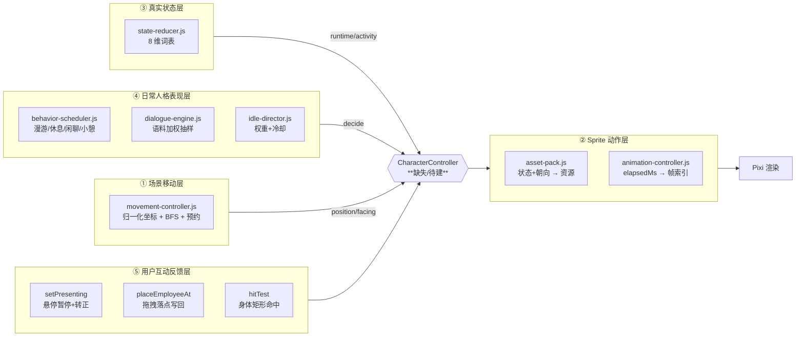
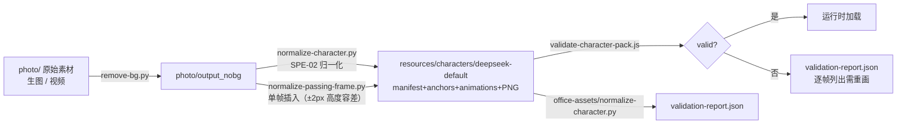
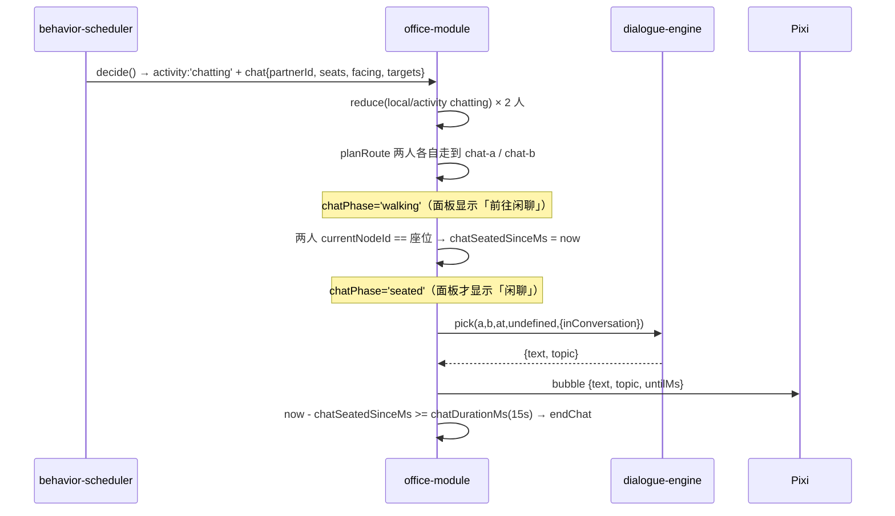

# Character System 设计（角色控制器 + 角色资产包）

> 状态：**审计 + 设计建议**（2026-11-01）。审计对象：`src/office/runtime/{asset-pack,animation-controller,movement-controller,employee-profile,subagent-classifier,character-pack-installer,validate-character-pack}.js`、`src/office/render/{pixi-office-renderer,frame-hygiene}.js`、`resources/characters/deepseek-default/**`、`src/workbench/**`。
> 分级：**【已确认】**=代码可证；**【部分实现】**=链路有缺口；**【待验证】**=需真机；**【设计阶段】**=只有文档；**【设想】**=本文建议。
> **本文不实现 Live2D**，只预留接口边界（§7）。

---

## 0. 一句话结论

角色系统**已经是"五层分离"的雏形**：位置层（movement）与素材层（asset-pack）已经彻底解耦，真实状态层（reducer runtime）与人格表现层（behavior-scheduler + 台词语料）也各有一份纯模块。**缺的不是分层，而是"层与层之间的显式控制器"**——目前这四层靠 `office-module.js` 的 `animationStateFor()`（`:3756`）一个 50 行函数 + `state()` 里的背面朝向合成（`:3320-3390`）硬拼在一起。把它提成一个 `CharacterController`，就能同时解决"新增角色表现要改组合根"和"Live2D 无处接入"两个问题。

第二个结论更重要：**当前角色包只有 1 套素材，且 7 种状态缺能力**（validator 实测 `capabilitiesMissing` = completed/failed/attention/thinking/waiting/celebrating/chatting）——每一缺项都靠回退链落到 `idle`/`error`。这意味着**"角色能表达的情绪"远少于"状态机产生的状态"**，是体验上最大的实在缺口。

---

## 1. 五层分离（现状 vs 目标）



### 1.1 现状：四层已解耦，第五层部分解耦

| 层 | 唯一作者 | 是否纯模块 | 证据 | 判定 |
|---|---|---|---|---|
| ① 场景移动 | `movement-controller.js` | **是**（无 Electron/Pixi/DOM/fs/clock/random，坐标与 dt 全部入参） | `movement-controller.js:1-25` | **已确认，可独立复用** |
| ② Sprite 动作 | `asset-pack.js` + `animation-controller.js` | **是**（pack 以内存对象注入，不读文件） | `asset-pack.js:1-15`、`animation-controller.js:1-20` | **已确认，可独立复用** |
| ③ 真实状态 | `state-reducer.js` | **是** | `state-reducer.js:1-33` | **已确认，是权威** |
| ④ 日常人格表现 | `behavior-scheduler.js` + `idle-director.js` + `dialogue-engine.js` | **是**（seeded PRNG，无墙钟） | `behavior-scheduler.js:1-40`、`idle-director.js:1-28`、`dialogue-engine.js:1-8` | **已确认，可独立复用** |
| ⑤ 用户互动反馈 | **混在组合根 + 渲染器** | 否 | `office-module.js:2157 setPresenting`、`:2507 placeEmployeeAt`；`pixi-office-renderer.js:4282 hitTest`、`:4337 beginDrag` | **部分实现**：行为都对，但没有一层"互动 → 角色表现"的统一入口 |

### 1.2 缺口：`CharacterController` 不存在【已确认】

现在"状态 → 该播什么"的决策被拆在 **5 处**：

| 决策 | 位置 | 行数 |
|---|---|---|
| 状态 → 动画状态名（idle/working/attention/finished/error/sleeping/side/walk） | `office-module.js:3756 animationStateFor` | 30 |
| 状态 → 面板 activity 文本（celebrating/working/else reducer） | `office-module.js:3778 activityFor` | 20 |
| 背面朝向合成（物理是否真在座位上） | `office-module.js:3320-3390` | ~70 |
| 状态+朝向 → 资源（含回退链） | `asset-pack.js:63 STATE_FALLBACK_CHAINS` + `:41 SIDE_PREFERENCE` | 数据 |
| 资源+时间 → 帧 | `animation-controller.js:70 resolveAnimation` | 90 |

**这 5 处没有共同接口**：新增一种表现（例如"被拖拽时挣扎"或"Live2D 参数"）要改至少 3 处，其中 2 处在已顶上限的组合根里。

### 1.3 建议：`runtime/character-controller.js`【设想】

```js
// 纯函数。输入：状态快照 + 人格上下文 + 互动上下文；输出：一个不可变的"角色表现指令"。
createCharacterController({ pack, config }).present({
  runtime,          // 'unbound'|'idle'|'running'|'attention'|'completed'|'failed'
  activity,         // reducer 8 值
  movement,         // 'stationary'|'moving'|...
  facing,           // 'left'|'right'|'up'|'down'
  phase,            // transition {kind, phase} | null
  physicallySeated, // boolean（现在是 reachedSeat||currentNodeId===seatNodeId）
  interaction,      // { presenting, dragging, hovered } —— 第⑤层
  bubble,           // { text, topic } | null
  elapsedMs,
})
// → {
//   resource, frameIndex, frameCount, loop, emphasis, fallbackReason,
//   facingOverride,         // 'back' | null
//   label,                  // 面板 activity 文本的 key
//   parameters,             // ← Live2D/骨骼扩展位：现在恒为 null（§7）
//   capabilitiesMissing,    // 面向前端的能力缺口提示
// }
```

收益：
- 组合根只需 `const view = characterController.present(...)`（约 5 行），`state()` 少 ~120 行；
- 5 处决策变成 1 处 + 一份闭集词表，可用**纯 headless 测试**覆盖全部组合（不需要 Pixi）；
- `parameters` 是 Live2D 预留位（§7），不影响当前渲染。

---

## 2. Character Asset Pack 契约（已冻结，不可擅改）

### 2.1 三文件结构【已确认】

```
resources/characters/<packId>/
  manifest.json              # 9 个固定字段
  animation/anchors.json     # 几何唯一权威（每帧 outputAnchor / visibleBounds）
  animation/animations.json  # 帧序/时长唯一权威
  assets/**/*.png            # 素材
  LICENSE / NOTICE           # 必须
  validation-report.json     # 归一化产物（只读诊断）
```

- manifest 九字段：`schemaVersion, id, version, author, license, runtimeCompatibility, geometry, animations, fallback`（`validate-character-pack.js:37-47 MANIFEST_FIELDS`）。
- **anchors.json 是几何唯一权威、animations.json 是帧序/时长唯一权威**，两者冲突即 `PACK_GEOMETRY_CONFLICT`（`test/office-asset-pack.test.js:9-13`）。
- 8 条硬校验：manifest 字段集 / 路径安全（禁绝对路径、`..`、反斜杠）/ license 必填 / PNG 头 / 尺寸上限 / 可执行内容 / **walk 帧脚锚点 ±1px** / 未引用资产即不安全（`validate-character-pack.js:440-486`）。

### 2.2 现有内置包实况（`deepseek-default` v1.1.0）【已确认】

| 项 | 值 | 证据 |
|---|---|---|
| 画布 | 源 256×256 → 输出 352×352（scale 1.375） | `validation-report.json` outputCanvas/outputScale |
| 脚锚点 | `(178, 296)` | `anchors.json` `anchor` |
| 动画数 | **17** | `animations.json` |
| 帧文件数 | **74** 个唯一 PNG | 脚本统计 |
| 走路 | 4 方向 × 14–15 帧，`durationMs 83`，loop | `animations.json` |
| 工作（背面） | `working-back` 3 帧 loop | 同上 |
| 静态表情 | idle / idle-blink / idle-lunch / working / finished / warning / error / offline / sleeping | 9 个 PNG |
| 侧面 | side-left / side-right / side-back | 3 个 |
| 素材体积 | 7.5 MB | `du -sh` |
| **能力缺口** | `completed, failed, attention, thinking, waiting, celebrating, chatting`（7 项） | **validator 实测** `validateCharacterPack()` 返回 `capabilitiesMissing` |

### 2.3 能力缺口 → 回退链（这是角色"表情单一"的根因）【已确认】

`asset-pack.js:63-77 STATE_FALLBACK_CHAINS`：

| 请求状态 | 回退链 | 实际播放 | 面板却显示 |
|---|---|---|---|
| `attention` | `attention → warning → error → idle` | **warning.png** | 「需要注意」 |
| `completed` | `completed → finished → idle` | **finished.png** | 「已完成」 |
| `failed` | `failed → error → idle` | **error.png** | 「未完成」 |
| `celebrating` | `celebrating → completed → finished → idle` | **finished.png** | 「庆祝中」 |
| `thinking` / `waiting` | 各自 → `idle` / `waiting→idle` | **idle.png** | 「思考中」/「等待中」 |
| `chatting` | `chatting`（**无回退**） | 由 `office-module` 走 `side` 朝向素材 | 「交流中」 |
| `sleeping` | `sleeping → idle` | **sleeping.png ✔** | 「小憩中」 |

**结论**：`thinking` 与 `waiting` 在画面上**与 idle 完全相同**，`celebrating` 与 `completed` 相同。这不是 bug（回退链是显式设计的），但**是体验上限**：状态机有 8 种 activity，素材只能表达 5 种。

> 补充：`thinking`/`waiting` 目前**根本产生不了**（见 office-runtime.md §3.1：adapter 的 running fact 不带 reason）。所以真正的缺口只有 `celebrating` vs `completed`（都是 finished.png）与 `attention` vs `failed`（都是 error 家族）。若把 reason 接进来，缺口立刻变成 2 个可见缺口。

### 2.4 未被使用的已声明能力【已确认】

`animations.json` 声明了 `idle-blink`、`idle-lunch`、`offline` 三段，但：
- `idle-blink` / `idle-lunch` 在全仓 `src/` 中**零引用**（grep 确认）；
- `offline` 被**设计性禁用**：`asset-pack.js:431` 一旦请求 `offline` 立刻返回 `ANIMATION_CAPABILITY_MISSING` / `OFFLINE_NOT_A_RESIDENT_STATE`（因为 `presence=present` 是常驻不变式）。

**这 3 段素材（含 2 个 PNG + 元数据）是沉没资产**：要么接进人格表现层（眨眼=idle 时的微动作；午饭=休息/茶水间行为），要么在文档里标"保留素材"。**建议接入 idle-blink**（成本低、收益直观：静止角色不再像贴图）。

### 2.5 验证报告已过期【已确认 —— 这是一个真实缺陷】

| 项 | 报告说法 | 实际 | 影响 |
|---|---|---|---|
| `capabilitiesMissing` | `sleeping, completed, failed, attention, thinking, waiting, celebrating, chatting`（8 项） | validator 实测 **7 项**（无 `sleeping`） | 报告称 sleeping 缺失，但包里有 `sleeping.png` |
| 帧覆盖 | 25 帧 | 74 帧 | 报告的 `frames` 只覆盖第一代走路帧 |
| `sourceManifestVersion` | `0.2.0` | manifest `version` = `1.1.0` | 报告生成于源包 v0.2.0 |

根因：`validation-report.json` 由 `scripts/office-assets/normalize-character.py` 在**第一次归一化**时生成，之后素材持续更新（`git log`：`animations.json` 最后一次改动是 `d6a50b1`，而 report 最后改动是 `44ed956` 合并提交），但**报告从未重生成**。
测试为什么没抓到：`test/office-asset-pack.test.js:397-425` 只断言"报告存在 + schemaVersion + 9 项能力字段 + walk 帧 ≥4/方向 + passed 帧 ≤1px"，**不断言 capabilitiesMissing 与 animations.json 一致**。

> **建议（低成本高价值）**：给 `test/office-asset-pack.test.js` 加一条断言——用当前 `animations.json` 的 state 集合重算 capabilitiesMissing，必须等于 report 里的值。这会让"报告过期"变成测试红，而不是文档里的一句"可能不准"。

---

## 3. 从视频/生图到 Character Pack 的流程（现有资产链）



### 3.1 工具链现状【部分实现】

| 环节 | 工具 | 状态 | 证据 |
|---|---|---|---|
| 生图 | `gen-img.js` / `gen-frames.js` / `gen-props.js` | **已清出主仓**（`ebf8e59`），git 可找回 | `docs/quality/2026-09-26-asset-provenance.md` §2、§3.2 |
| 抠像 | `scripts/remove-bg.py` | **在盘** | 同上 §2 |
| 整包归一化 | `scripts/office-assets/normalize-character.py` | **在盘**（PIL，阈值 alpha16 定界 / alpha128 主体 / 底部 15% 找脚 / ±1px 容差） | 文件头 `:26-40` |
| 单帧插入 | `scripts/office-assets/normalize-passing-frame.py` | **在盘**（幂等；插在 walk 第 3 帧） | 文件头 `:1-30` |
| 视频拆帧 | `photo/video-matting-kit/`（任务书 + 脚本 + 选帧记录） | **在盘，人工流程** | `photo/video-matting-kit/任务书-视频抠像.md` |
| 发布内核 | `src/workbench/lib/action-publisher.js` `publishAction()` | **在盘（工具侧）**，含 provenance 台账 + backup | 同上 §2、§3.1 |
| 校验 | `src/office/runtime/validate-character-pack.js` | **在盘（产品侧，单一实现）** | — |

**逐资产生成参数从未入账**（17 个动作的生图 prompt/grid/ref 全部无台账），这是素材级复现的真实断点（`asset-provenance.md` §3.3 原话）。

### 3.2 走路帧的几何纪律（不可违反）【已确认】

- 脚锚点：同方向 14–15 帧的 `outputAnchor` 必须一致（±1px），由 validator 强制（`validate-character-pack.js:449-460`）。
- 可见高度：`normalize-passing-frame.py` 要求与同方向中位数差 ≤ **2px**（文件头）。
- 帧序 = **数据**（`animations.json` 数组顺序），**不是文件名排序**。`test/office-ui.test.js` 的真机探针 `E5a-R1` 专门验证"播放流必须是 animations.json 的邻接关系"，防止有人按文件名排。
- **禁止**：裁剪、旋转、几何补偿。`test/office-release-gate.test.js:175` 断言 `codeOffsetCompensation:false`（已知两项走路缺陷必须由**美术重画**解决，不许代码补偿）。

### 3.3 已知未修的美术缺陷【已确认，仍在案】

`test/office-release-gate.test.js` 的 `manual-review.json` 里两项 `status: open`：
- `walk-right-single-frame-left-jump`（右走单帧左跳）
- `walk-leg-continuity-unnatural`（腿部连续性不自然）

两者 `layer: 'asset'`（责任在美术，不在渲染），且释放门禁因此**保持 blocked**（`:131-145`）。

---

## 4. 动画状态机

### 4.1 状态 → 资源（现状，`office-module.js:3756-3776`）

```
transition task-end:result  → outcome=failed ? 'error' : 'finished'
segment 存在                → 'walk'（锚点插值按朝向选）
movement=moving             → 'walk'
activity=sleeping           → 'sleeping'
runtime=attention           → 'attention'      ← 2026-10-23 修复：必须优先于 working
transition task-start:work  → 'working'
runtime=running             → 'working'
activity=chatting           → 'side'
否则                         → 'idle'
```
**优先级顺序是刻意设计的**：位置事实（走）> 睡眠 > attention > 任务。`attention` 提到 `working` 之前是 2026-10-23 修的（此前"等待确认"和"正在工作"画面完全相同，吞掉了最重要的信息）。

### 4.2 朝向 → 资源（`asset-pack.js:41-50 SIDE_PREFERENCE`）

| facing | 优先资源链 | 语义理由 |
|---|---|---|
| `left` | side-left → side-right → side-back | 侧面素材 |
| `right` | side-right → side-left → side-back | 侧面素材 |
| `up` | **side-back** → side-left → side-right | 朝屏幕外=背面（2026-10-30 用户拍板：上下站位闲聊时，下方那个人朝上，观众应看到背影） |
| `down` | **idle** → side-left → side-back | 朝观众=正面 |
| `none` | side-back → side-left → side-right | 默认背面 |

### 4.3 背面朝向合成（`office-module.js:3320-3390`）

规则：**只有物理上真的在座位节点**（`reachedSeat === true` 或 `currentNodeId === seatNodeId`，`:3362`）才允许用 side-back / working-back 替换稳态 idle/working。
- 2026-10-30 修复（bug1）：此前用"task-start 的 sit/work 相位"当"已落座"→ 角色走在半路被挡住时会"坐在空地上"。**这是"意图 vs 事实"的经典教训**：现在判据是事实（`reachedSeat` 由 `completeSegment` 在插值真正到达锚点时置位），不是意图。
- `sleeping` 被**排除**在合成之外（自己的素材 `sleeping.png` 本来就是背向）。见 D1/M4.1g 两处注释。

### 4.4 帧时钟（`animation-controller.js`）

- 时长优先级：`userFrameDurationOverrideMs` > 帧 `durationMs` > 动画 `frameDurationMs` > 包 `defaultFrameDurationMs`（1000）> 1000 兜底。
- **帧边界属于下一帧**（`elapsed == boundary` → frameElapsed 归零），保证确定性。
- 帧索引由 `elapsedMs` 纯函数算出，**不读时钟、不推进位置**。`animationElapsedMs` 由模块每 tick `+= 16`（`office-module.js:2999`）。
- 实际速度：走路帧 83ms/帧 × 15 帧 ≈ 1.245s/循环；配合 `sceneMinDimensionPerSecond: 0.046`（`office-module.js:241`）做了步频匹配（曾按 0.12 试过 → 脚底打滑约 2.6 倍）。

### 4.5 程序化强调（emoji 式代替缺失素材）

`asset-pack.js:78-83 EMPHASIS_EFFECTS`：`celebrating/completed → 'bounce'`；`failed/attention → 'shake'`。
这是**素材缺失时的兜底**，返回 `resource:null + emphasis`，由渲染器做整节点形变（`animation-controller.js:110-125`）。**注意**：这是"不改位置、只改缩放/位移"的效果，不是新动画。

---

## 5. 走路系统

### 5.1 三层职责（2026-10-29 结论，已写进计划）【已确认】

| 层 | 只负责 | 文件 |
|---|---|---|
| 规划 | 图上**有没有**一条路 | `movement-controller.js:265 findRoute`（BFS，保留 fixture 边序） |
| 逐腿推进 | 这一步**会不会踩到人** | `movement-controller.js:359 step`（occupant gate，社交半径） |
| 目标选择 | 去哪里**更舒服** | `behavior-scheduler.js`（间距分级、区域配额、左区偏好） |

**关键洞察（原话）**："能不能到达"和"路上有没有人"是两件事，必须分开。把后者塞进前者 = 一张随时会变的图 + 必然死锁。（`OFFICE-V3-CODED-2.5D-PLAN` §21.3）
**实测**：含 `blockedSegments` 时 3 个 seed 全部 TIMEOUT；删除后 49/52/46s 全部到达（§21.4）。

### 5.2 坐标与速度

- 归一化 `[0,1]`；屏幕距离 `hypot(dx*w, dy*h)`；速度 = `sceneMinDimensionPerSecond × min(w,h)` px/s。
- 默认 `0.046`（步频匹配后的值，**不是** 0.12）。
- resize 只重投影，不改变逻辑位置。安全半径/闲聊几何按 **min(w,h)** 缩放。

### 5.3 预约与让位

- `acquireReservation`（`:597`）检查容量 + 段冲突；半衰期续约；到达释放。
- `tryAcquirePathReservation`（`office-module.js:1195`）有**抢占阶梯**：优先释放非 task-bound 持有者。
- `handleBlocked`（`:2666`）有**耐心阶梯**：task 700ms / 左区漫游任务 2000ms；重规划 1000ms / 1500ms（`:2674-2695`）。
- 实测：左半区时间占比契约 40–50%，三个 seed 0.504/0.498/0.334（pooled 在带内）。

### 5.4 已知残留风险

| 项 | 状态 | 证据 |
|---|---|---|
| 五层死锁的第五层（几何层 occupant gate 双方都 wait） | 已修（§20.2 ④） | 计划 §20 |
| `ROUTE_UNAVAILABLE` 诊断在长时间挂机中频繁出现 | **观察到的现象**：探针 A 60s 出现 7 次（去重后 1 条码，count 累加）；探针 D 640s 持续出现 | 这是"抢不到路径预留"的正常诊断，不是错误；但**噪声**值得收敛（见 office-runtime.md §4.1 的 dedup 窗口） |
| 拖拽落点吸附到最近节点 | 已实现（`employee-placement.js:60 resolvePlacement`），任务中的角色拒绝被拖（`TASK_BOUND`） | 已确认 |

---

## 6. 站位 / 闲聊 / 悬停卡

### 6.1 座位与落点【已确认】

- 4 名常驻 + 1 名协作者 = 5 个座位（desk-1..5），desk-6 是"未来座位"（`employee-profile.js:24-53`）。
- 每座位在图上有 3 个节点：`desk-N`（坐点）、`desk-N-approach`（接近点）、`desk-N-leave`（离场点）。座位→接近点用**锚点插值段**（600ms，reducedMotion 时为 0），绝不瞬移（`transition-controller.js:18-19`）。
- 站姿/坐姿切换由 `reachedSeat` 驱动（§4.3）。

### 6.2 闲聊系统【已确认，且是"作者内容"不是 LLM】



| 项 | 值 | 证据 |
|---|---|---|
| 触发概率 | 基础 15%；另有"45s 空闲后渴求"分支（`CHAT_CRAVE_AFTER_MS`，50% 概率） | `behavior-scheduler.js:41`、`:1471-1474` |
| 配对 | 至多 **1 对**；两个座位**原子预留**（任一失败则都取消） | `behavior-scheduler.js:461 beginChat` |
| 朝向 | 2026-10-30 回退为**上下站位 + 一正一背**（左右站位已整体撤掉，因三种解法都更糟） | `asset-pack.js:16-40`；`OFFICE-V3-INTERACTION-STAGE-REPORT` §3.1 |
| 语料 | `resources/dialogue/base.json` 46 条（6 topic）+ `characters/deepseek-default.json` 22 条（鲸鱼娘覆盖层），**加权抽样** | `--` |
| 冷却 | 30s（pair 级）；会话内不受冷却限制（`inConversation`） | `dialogue-engine.js:78-86` |
| 气泡时长 | 3200ms | `base.json` `limits` |
| 内容红线 | 四类禁用清单进 CI（`test/office-dialogue-engine.test.js`） | 报告 §5.2 |
| 实测 | 640s 探针：chatting 3398 采样、气泡 758 采样 | 探针 D |

**两个已修复的真实缺陷（值得记住）**：
1. "从来不聊天"的真因**不是闲聊逻辑**，而是 `visibleViews` 恒空 → `isPaused()` 恒真 → 整个仿真不 tick（`window-manager.js:78-93` 强制重发修复）。
2. "聊完天卡死"：`endChat` 只清调度器预留，没清模块侧 `parkReservation` → 死锁环（报告 §2.4）。

### 6.3 悬停卡（member card）【已确认，第⑤层的样板】

- 触发：`pointermove` 命中角色身体矩形（12Hz 节流）→ `bridge.present(employeeId)`（shell 通道）→ `setPresenting({employeeId, presenting:true})`（`office-module.js:2157`）。
- 效果：**暂停该员工**的运动/决策（`advanceOneTick` 里三处 `if (rec.presenting) continue`：`:2883` 路线重试 / `:2956` 本地决策 / `:2983` 走位；插值段另把起点往后推，`:2942`），并 `facing='down'`（转正面）。
- 卡片内容**只来自快照字段**：名字/角色/状态徽标/当前工具短语/任务#N/产物数/今日完成数/队列数（`office.html:1502-1517`）。
- 点击钉住、Esc 关闭、双击开工作坞（`shell:office-focus`）。
- **边界正确**：`presenting` 是"纯呈现，不是事实"（`office-module.js:646` 注释），且不进 reducer 任何维度。

### 6.4 拖拽（2026-10-30 修好，曾是"纸面功能"）【已确认】

- 渲染层：`beginDrag`/`dragTo`/`endDrag` 只移动**画出来的节点**（`pixi-office-renderer.js:4337-4396`）。
- 落点回报：`endDrag()` 返回 `dropPosition`（归一化坐标）→ 页面调 `office:place` → `placeEmployeeAt` → **吸附到最近图节点**并写回模拟位置（`office-module.js:2507`）。
- 曾经的两次失败（报告 §2.5）：① `OFFICE_IPC_CHANNELS` 与 `registerOfficeIpc` 漏加通道 → `CHANNEL_UNKNOWN`；② **CSS 像素当 scene 像素用**（1280×840 vs 参考 960×630，落点放大 33%）。
- **教训**："组件返回了正确值" ≠ "链路通了"，跨进程功能必须端到端验证。

---

## 7. Sprite vs Live2D 混合渲染的接口预留（不实现）

### 7.1 现状：接口位只有一个，且不够

`animation-controller.js` 的返回结构固定为 `{resource, frameIndex, frameCount, loop, emphasis, fallbackReason, capabilityMissing}`。渲染层据此 `texture = textures.get(resource#frameIndex)`（`pixi-office-renderer.js` 纹理查表）。
**这套结构是"帧序列"专用的**：Live2D 需要的是"参数向量 + 动作名 + 表情名"，不是帧索引。

### 7.2 建议的预留（纯接口，工作量小，不影响现渲染）【设想】

```js
// 在 character-controller 的输出里增加一个可空字段：
{
  kind: 'sprite' | 'live2d' | 'static',   // 现在恒为 'sprite'（pack 无模型时）
  sprite: { resource, frameIndex, frameCount, loop, emphasis },  // 现有字段原样
  live2d: null,                            // 未来：{ modelPath, motions:[{group,index}], expressions:[], parameters:{ParamAngleX:.., ParamMouthOpenY:..} }
  parameters: null,                        // 语义参数（跨实现通用）：{ facing, mouthOpen, blink, leanX, ... }
}
```

三条纪律（**现在就必须写进契约，避免未来返工**）：
1. **渲染后端可替换，事实不可替换**：`kind` 只影响"怎么画"，绝不影响 reducer/快照字段。快照里**不出现** `kind`。
2. **语义参数优先**：先定 `parameters`（facing/mouthOpen/blink/leanX…），再让 sprite 后端把它映射成"换哪一帧"、Live2D 后端映射成"设哪些 Param*"。这样**同一个人格表现层可以同时驱动两种后端**。
3. **能力协商**：`pack.manifest` 增加可选 `renderer: 'sprite' | 'live2d'`（缺省 sprite）。缺模型时 fail-closed 回退 sprite，**绝不黑屏**（现有 `asset-pack` 的回退链就是正确范式）。

### 7.3 为什么"现在不要做 Live2D"【已确认的分级依据】

| 门槛 | 现状 |
|---|---|
| 许可 | Cubism SDK 的 Expandable Application 条款、模型分发限制 —— 属外部法务问题，本仓无法自证（详见 task-4 的 `docs/research/live2d-evaluation.md`） |
| 素材 | 现有 74 帧是**位图**；Live2D 需要分层 PSD/模型文件，等于**全部重做角色** |
| 收益 | 当前最大体验缺口是"7 种状态落到 2 张表情"和"静态帧不像活的"，**加眨眼/呼吸（sprite 就能做）比换渲染器性价比高一个数量级** |
| 结论 | **先做 §7.4 的三件 sprite 级小改，Live2D 只留接口位** |

### 7.4 立刻可做的三件 sprite 级改进（不需要新素材）【设想，高性价比】

| # | 改进 | 用现有素材 | 落点 |
|---|---|---|---|
| S-1 | **眨眼**：idle 时每 4–8s 播一次 `idle-blink`（1 帧，120ms） | `idle-blink.png`（已存在，零引用） | `character-controller` 的 idle 分支 |
| S-2 | **呼吸**：idle/sleeping 时给 sprite 加 ±0.8% 的纵向缩放正弦（相位由 elapsedMs 派生，种子化） | 无（纯变换） | `pixi-office-renderer.placeEntity` |
| S-3 | **午饭**：`activity:resting` 且目标在休闲区时播 `idle-lunch` | `idle-lunch.png`（已存在，零引用） | `character-controller` 的 resting 分支 |

这三项都**不产生新事实**（纯表现），符合现有边界；成本约 1–2 天；收益远大于 Live2D POC。

---

## 8. 资产清单与许可证（逐项核实）

### 8.1 生产素材

| 路径 | 内容 | 体积 | 许可证声明 | 判定 |
|---|---|---|---|---|
| `resources/characters/deepseek-default/**` | 角色包（74 PNG + 3 JSON + LICENSE + NOTICE + validation-report） | 7.5 MB | `LICENSE`：**"DshCockpit 官方占位资产 · 版权独立声明 · 不随核心代码 MIT"**；`manifest.license` 同义："Layer 2, 版权独立声明不随 MIT; 正式稿约稿买断后替换本占位资产"；"禁止用于 DshCockpit 以外发行物" | **已确认是占位美术**（自绘简化鲸鱼轮廓），**不是第三方素材** |
| `resources/office/**` | 办公室贴图（flat/ 23 张 + layout-editor/ 24 张 8 方向 + 根目录 prop-*.png 10 张） | 25 MB | **无独立 LICENSE 文件**；由 `layout-assets.js` catalog 登记 | **待验证**：来源链在 `docs/quality/2026-09-26-asset-provenance.md` §3.4 记为 `not-recorded`（无生成脚本/作者/批次台账）。**风险点**：若将来开源/分发，这批素材的授权无法自证 |
| `resources/dialogue/**` | 语料（base.json 46 条 + 鲸鱼娘覆盖层 22 条） | 20 KB | 无 LICENSE；`README.md` 说明"发行版语料副本，创作在 content/" | 自撰内容，**已确认**（有内容红线测试） |
| `resources/icon.png` / `icon-source.jpg` | 应用图标 | — | — | 待验证 |
| `photo/**` | 原始素材/生成记录/参考（1.7 GB） | 1.7 GB | `photo/README.md` 明文："美术与角色素材不因存放在代码仓库而自动获得 MIT 许可；使用前应核对原始资源授权" | **明确非生产依赖**（SPEC-00 禁止 `photo/` 成为运行时依赖；asar 排除 `!photo/**`） |

### 8.2 第三方素材

`resources/characters/deepseek-default/LICENSE` 明文：**"本包不含任何社区角色素材（如女仆鲸鱼娘/溟月等，均为 Layer 3 社区包，仅可由用户自行安装且 manifest 需声明原作者与其许可证）"**。

**结论【已确认】**：当前仓库**没有**任何社区/第三方角色素材。Layer 3（社区包）机制是设计好的（`manifest.license` 必填 + `character-pack-installer` 的校验），但**没有入口**（§9）。

### 8.3 一个必须提请注意的合规事实

`assets/expressions/offline.png`、`idle-blink.png`、`idle-lunch.png` 在运行中**不会被加载**（§2.4），但**仍会被打包**（整目录进 `resources/characters`）。这不影响合规（都是自绘占位），但如果未来引入第三方包，**"未引用素材也进包"会放大授权风险**。建议在 pack 校验里对"声明了但未被 animations.json 引用"的资产给出 warning（现在 `validate-character-pack.js:479-490` 只对 `manifest-external` 资产报 `PACK_UNSAFE_ARCHIVE`，对"声明但未引用"不报）。

---

## 9. Character Pack 安装器：库就绪、未接线【已确认 —— 重要】

| 事实 | 证据 |
|---|---|
| `character-pack-installer.js`（442 行）功能完整：本地目录/ZIP buffer 导入、ZIP 安全（路径穿越/绝对路径/反斜杠/符号链接/加密/未知压缩/重名/条目数与体积上限/压缩比炸弹）、CRC-32 校验、`incoming/` → `versions/<v>/` 原子 rename、失败清理旧包不受影响 | `character-pack-installer.js:1-40`、`:75-90 LIMITS` |
| **没有任何产品代码实例化它** | 全仓 grep `createCharacterPackInstaller` → 只有 `src/office/runtime/index.js:61`（IO 边界清单）与 `test/office-character-pack-installer.test.js` |
| 选择"当前包"的 `settings.characterPackId` **从未被写入** | `src/main.js:151` 只读；`office-persistence.js:59-66 SETTINGS_BOUNDS` **无此键** → `validateSettingsPatch` 拒绝未知键、`normalizeSettings` 只保留 SETTINGS_BOUNDS 的键 → **该值永远是 undefined** |
| 于是：`selectedOfficeCharacterPackId()` 恒 null → `resolveOfficeCharacterPack()` 恒返回内置 `deepseek-default` | `office-pack-resolver.js:26-52` |

**判定**：`Character Pack 安装` = **纸面功能**（库完整 + 有 28 条测试，但用户无法使用）。
**接线成本**（若要做）：① `SETTINGS_BOUNDS` 加 `characterPackId: {type:'string', pattern}`；② 设置页加"角色包"区块（安装/切换/卸载）；③ main.js 加 IPC（`shell:character-pack` 命名空间，**不要**动 `office:*` 冻结集合）；④ 切换后需重建 office module（pack 是构造时注入的，`office-module.js:472`）——**最后这条是真正的成本**，需要一次"重载办公室视图"。

---

## 10. 保留 / 改造 / 废弃

| 模块 | 判定 | 理由 |
|---|---|---|
| `asset-pack.js`（回退链 + 朝向偏好） | **保留（不可推翻）** | 契约冻结在 SPEC-02；回退链是"缺素材不崩"的唯一保障 |
| `animation-controller.js` | **保留** | 纯函数、确定性、帧边界语义明确 |
| `validate-character-pack.js` | **保留（唯一实现）** | 产品与工具共用；P5 内化到 `src/` 是为了 asar 打包 |
| `movement-controller.js` | **保留（不可推翻）** | 十轮修复的运动学 + 死锁结论 |
| `behavior-scheduler.js` | **保留（核心资产）** | 1,911 行，含左区公平/配额/耐心阶梯/小憩门禁；有 7/7 专项测试 |
| `dialogue-engine.js` + 语料 | **保留** | 内容红线已进 CI |
| `subagent-classifier.js` | **保留** | 保守 fail-closed + 显式优先级表 |
| `character-pack-installer.js` | **保留但接线或标"未接线"** | 功能完整，见 §9 |
| `employee-profile.js` | **保留** | 4 常驻 + 1 协作者是 SPEC-00 冻结的产品范围 |
| 组合根里的 `animationStateFor`/`activityFor`/背面合成 | **改造**：抽成 `runtime/character-controller.js` | 见 §1.3 |
| `idle-blink` / `idle-lunch` 素材 | **改造**：接入 | 见 §7.4 |
| `offline` 素材 | **废弃（设计性）** | `presence=present` 是不变式，永不使用 |
| Live2D | **仅预留接口** | 见 §7.3 |

---

## 11. 待补 / 未验证

| # | 项 | 原因 |
|---|---|---|
| C-1 | 角色在实际窗口尺寸下的最终视觉高度（`clamp(64, h*0.11, 180)` × `characterScale 1.50` 的叠加结果） | 需真机目检；`office.html:558` 把 characterScale 从 1.18 提到 1.50 以对抗"家具放大后角色显小" |
| C-2 | `presentation.heightRatio` 与 `characterScale` 的交互在极端布局草案下是否双重缩放 | 代码上 ratio 是"相对默认高度的比例"、scale 是面板倍率，理论上独立；需一次真机验证 |
| C-3 | 第三方角色包（Layer 3）的完整生命周期 | 安装器无入口，无法验证 |
| C-4 | `resources/office/**` 51 张 flat/layout-editor 贴图的授权链 | 台账 `not-recorded`；需人工回溯 s1 仓 |
| C-5 | Live2D 的许可条款（Cubism SDK Expandable Application / 模型分发） | 属外部法务，task-4 负责 |
| C-6 | 走路两项美术缺陷（walk-right 单帧左跳 / 腿部连续性） | 需美术重画，不是代码问题 |

---

## 12. 与其他文档的关系

- Office 运行时分层/状态所有权/渲染管线 → `docs/architecture/office-runtime.md`
- 可交互物件 → `docs/design/office-interaction.md`
- 角色素材的工具链（工作台）→ `docs/architecture/office-workbench-design.md`、`office-workbench-m0.md`
- 素材来源链 → `docs/quality/2026-09-26-asset-provenance.md`
- Live2D 许可评估 → task-4 的 `docs/research/live2d-evaluation.md`

> **索引提醒（给 Lead）**：本文需在 `docs/README.md` 登记（`test/docs-index.test.js` 会校验）。本次任务限定只写 3 个文件，故未改索引。
