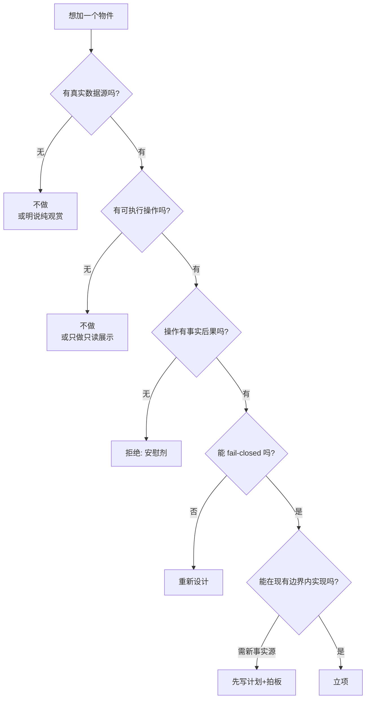

# Office 可交互物件设计（Mission Board / 白板 / 会议桌 / 资料架 / 收件箱 / 成果区）

> 状态：**审计 + 设计建议**（2026-11-01）。审计对象：`src/office/render/{pixi-office-renderer,code-office,code-scene}.js`、`src/office/office.html`、`src/office/runtime/*`、`src/work/**`、`src/team/runtime/team-office-*.js`。
> 分级：**【已确认】**=代码可证；**【部分实现】**；**【待验证】**；**【设计阶段】**；**【设想】**。
> **本文的核心纪律：每个物件必须对应真实数据 + 可执行操作。没有数据的物件一律不做，只做"观赏件"就明说。**

---

## 0. 一句话结论

**这 6 个物件目前 0 个存在**。办公室里现在**唯一可交互的对象是角色本身**（悬停卡 / 点击选中 / 拖拽 / 双击开工作坞）。墙上的钟表和白板、茶水间、沙发、绿植、前台全部是**纯 Pixi Graphics 绘制的背景**：无命中测试、无数据绑定、无点击响应（`pixi-office-renderer.js:4282 hitTest` 只遍历 `entities` 表，该表只含员工；家具节点从不进入）。

但**数据已经就位**：`shell:work` 已经有工作项/产物/验证的完整状态机（`src/work/work-controller.js`），`Team` 已经有 run/artifact 事实，`pending` 已经有审批/提问队列。**缺的只是"把数据画到物件上 + 给物件一个命中区"这一层**。这是本文的建设性结论：**不需要新事实源，只需要一个新的呈现层**。

---

## 1. 现状盘点（逐物件）

### 1.1 总表

| 物件 | 现在存在吗 | 形态 | 可交互 | 数据绑定 | 判定 |
|---|---|---|---|---|---|
| **Mission Board**（任务板） | **不存在** | — | — | — | **设想** |
| **白板** | **存在（装饰）** | 墙面 `Graphics`：白面板 + 边框 + 2 条 marker 笔迹 + 笔槽 + 一支笔 | **无** | **无** | **纯观赏** |
| **会议桌** | **不存在**（有"休闲区茶几"，但不是会议桌） | — | — | — | **设想** |
| **资料架 / 书架** | **存在（装饰，且只在茶水间）** | `kitchen-shelf`：2px 板 + L 形托架 + 3 个杯子 | **无** | **无** | **纯观赏** |
| **收件箱** | **存在（右栏 DOM，不是办公室物件）** | `#pending-block` 列表 + 徽标 + 危险模态 | **有**（行内批/拒、模态「仅本次批准/拒绝」） | **有**（runtime waterfall 真事件） | **已确认可用**，但**在面板里，不在场景里** |
| **成果区** | **部分存在（工作坞 DOM，不是办公室物件）** | `src/work/work.html` 的 `#artifacts` 列表 + read/open/reveal | **有**（读/打开/定位文件） | **有**（工作区 `.dsh/index.json`） | **已确认可用**，但**在独立视图里** |

### 1.2 逐条证据

**白板（唯一"看起来像可交互物件"的东西）**
- 绘制：`pixi-office-renderer.js:725-748`。位置 `wbX = sceneWidth * 0.835`、`wbY = walls.h * 0.24`，尺寸 `0.145W × 0.30H`。
- 内容：**固定的两条 marker 笔迹**（`:736-743`，坐标写死为 `wbW*0.10/0.44/0.58` 等），与任何状态无关。
- **无 hitTest**：渲染器的 `hitTest` 只查 `entities`（员工表），家具节点从不进入（`:4282-4320`）。
- 结论：**纯观赏**。它是"墙面装饰的完成度"证据，不是功能。

**墙上的钟表**
- `pixi-office-renderer.js:689-719`：指针**固定 10:10**（`:715-724`，注释 "deterministic, and the classic clock pose"）。
- **无数据绑定**：不显示真实时间/仿真时间/今日进度。这是"确定性优先"的刻意选择（同一输入必须同一帧），**不应该改成真实时钟**（会破坏截图基线），但**可以**加一个"第二个表盘显示今日任务进度"的变体——见 §3.3。

**资料架 / 书架**
- 只在茶水间：`code-office.js:439-445`（`kitchen-shelf` + 3 个 `kitchen-cup-*`），由 `:469 makeGroup('kitchen')` 组装。
- 没有"资料"概念：架子上是杯子，不是文档。
- 办公室**没有**独立书架/资料架几何（`code-office.js` 的 group 只有 `station-desk` / `kitchen` / `lounge` / `plant`）。**注意**：`layout-assets.js:114` 在**素材目录**里有 `prop-whiteboard`（'白板'）、`flat-whiteboard`，这些是**旧贴图路径的遗留素材**，代码化 2.5D 分支不用（asar 里 `resources/office/**` 仍打包，但渲染不消费）。

**休闲区（沙发 + 茶几）**
- `code-office.js:472-616 loungeGroups`：地毯、沙发（4 脚 + 底座 + 裙边 + 2 段靠背 + 2 扶手 + 3 坐垫 + 2 抱枕）、茶几（2 腿 + 台面）、杂志堆、遥控器。
- **无交互**。且**员工不会走到沙发上坐**——座位是 office 的座位，沙发不是节点（`office-layout-flat.json` 的 37 节点里没有 `lounge-*`）。休息行为只走到 `rest-area` 标记的漫游点。
- 结论：**纯观赏**，且是"看起来能坐但不能坐"的典型——这是**体验陷阱**（用户会去点它）。

**收件箱（右栏）**
- `office.html:82-110` + `:1079-1294`：卡片按 `risk` 降序 → 时间升序（`office-module.js:3716 pendingSnapshot`）。
- 交互：低/中风险行内 `批准/拒绝`（`:1189-1200`）；高危 → 「查看并批准」打开模态（`:1199-1208`）；提问类 → 行内表单（`:1192-1198`）。
- 回答路径：页面 → `office:pending` → `module.answerPending`（`:3661`）→ `main.js` 的 `answerRequest` → 与 IM **同一个** `$events/result` 通道（`main.js:962` 注释："It is respondToRuntime itself"）。
- **已确认是真功能**，且有 4 个专项测试套件（`office-right-panel-p1..p4`）。
- **但它不在场景里**：右侧面板，不是办公室物件。用户看鲸鱼娘在走，而"需要你"的徽标在右栏。

**成果区（工作坞）**
- `src/work/work.html:73-75` `#artifacts` + `#artifactEmpty`（"这个任务还没有产物（未产出不会显示为完成）"）。
- 交互：`open-artifact` → `read`（读内容，≤256KB）/ `open`（系统默认程序）/ `reveal`（在 Finder/资源管理器里显示）（`main.js:616-634`）。
- 事实来源：`<workspace>/.dsh/index.json`（`workspace-store.js:1-20`），**只有工作区相对路径**，绝对路径只在壳内。
- 工作坞可 dock 在办公室右侧（`window-manager.js:205 showWorkDock`），双击角色可聚焦（`shell:office-focus`）。
- **已确认是真功能**（v0.7 P1 真机验收过）。
- **但它是一个"面板"**：不是办公室里的"成果区"。

---

## 2. 设计原则（每个物件必须过这五道闸）



**五道闸的正面例子（已有的收件箱）**：数据=runtime waterfall 真事件 ✔；操作=批准/拒绝 ✔；后果=会真的放行/拒绝工具调用 ✔；fail-closed=回答失败显示本地化错误 + 不假装成功 ✔；边界内=复用现有 `$events/result` 通道，不新增 `office:*` ✔。**这就是模板。**

**反面例子（必须避免）**：
- ❌ 白板上"显示今日任务"但当数据为空时显示假数据/占位假文案
- ❌ 点白板弹出"敬请期待"
- ❌ 会议桌"开会"按钮只是让所有角色走到一个点（无事实后果）
- ❌ 成果区展示"产物"但实际是随机图/写死列表

---

## 3. 六个物件的设计

### 3.1 Mission Board（任务板）——**最高优先级**

**为什么最高**：它是"从看团队到用团队工作"（v0.7 方向）在办公室里的**唯一自然入口**。用户的诉求"我想要一个地方看今天在干什么、派新活"在右栏和 App 之间是断的。

| 项 | 设计 |
|---|---|
| **位置** | 墙面右侧（现在白板的位置 `x≈0.835`），或独立一块墙面（`code-scene.js` 的 `walls` 区域，可扩展）。**不建议**占地板——会让走位图变复杂 |
| **数据源（真实）** | `workStatusPayload()`（`main.js:424-439`）：`items[]`（workItemId/goal/status/verifyCommand/verification/artifactRefs/attempt）+ `current` + `team`（状态）+ `focusEmployee` |
| **可执行操作** | ① **新建任务**（打开现有工作坞的 `#taskForm`，不在场景里造第二个表单）② **点某项看详情**（聚焦工作坞到该 item）③ **重试/取消**（全部复用 `shell:work` 现有 action：`retry`/`cancel`） |
| **呈现** | 板面画出 **N 行卡片**（最多 5 行，超出显示 "+N"）：每行 = 状态图标（running/attention/completed/failed/incomplete）+ 目标首 18 字 + 尝试次数。**文本渲染用 Pixi Text**（渲染器已依赖 `PIXI.Text`，见气泡实现 `:3211`） |
| **命中** | 新增 `hitTestFurniture(px, py)`：物件命中区由 `code-office`/`code-scene` 的描述里带 `hotspot: {x0,y0,x1,y1}` 给出。**这是唯一需要改渲染器架构的地方**（见 §4） |
| **边界** | 只读工作项 + 转发到 `shell:work`（壳自有通道）。**不新增 `office:*`**（该集合 9 个已冻结，`test/office-interaction-p3.test.js:258-263` 断言） |
| **fail-closed** | 无工作区时板面空白 + 一行"未选择工作区"+ 点击打开工作坞的选择器；**不显示假任务** |
| **数据为空时** | 显示空态（与 `#artifactEmpty` 同一口径："还没有任务"） |
| **POC 边界** | **只读展示 + 点击聚焦工作坞**（不做场景内新建表单）→ 约 1.5 天，零新事实源 |
| **依赖** | ① `shell:work status` 已存在 ② 需要把 work 状态推给办公室页面（现在推给 work view：`window-manager.js` `sendToWorkView`）→ **需要一条新推送路径**（见 §4.3） |
| **判定** | **POC 推荐**（数据/操作/后果三者齐备） |

### 3.2 收件箱（把右栏的 pending 搬进场景）——**第二优先**

**为什么**：功能**已经完整**，只是"位置不对"。用户会盯着场景看鲸鱼娘，而"需要你审批"在右栏角落。这是**纯呈现迁移**，风险最低、收益最直接。

| 项 | 设计 |
|---|---|
| **位置** | 前台（reserve zone 的低矮台面，`code-scene.js:305 reception`）上放一个"文件托盘"几何；或墙上一个小格子 |
| **数据源（真实）** | 快照的 `pending[]`（已存在，含 `risk`）+ `pendingInvalid` |
| **可执行操作** | **点击 → 打开右栏 pending 区块并滚动到该卡**（不重复实现批/拒，避免两套逻辑）。第一版**不做**场景内行内批/拒 |
| **呈现** | 托盘上的**纸张数量** = pending 长度；有 high 风险时加红色角标；有卡片时角色可"走过去取件"（见 §3.2.1） |
| **边界** | 纯呈现 + 聚焦，**零新事实源、零新通道** |
| **fail-closed** | pending 为空 → 空托盘。`pendingInvalid=true` → 托盘上出现"作废"戳（复用现有失效语义，`office-module.js:3733`） |
| **POC 边界** | 托盘几何 + 数量角标 + 点击聚焦右栏 = **约 1 天** |
| **判定** | **POC 推荐**（几乎没有风险） |

#### 3.2.1 可选增益：让"取件"成为一种行为
【设想】当 `pending` 新增且某员工空闲时，让最近的那名员工走到托盘（一个新增的图节点 `inbox`）再走回来——**这是纯粹的表现编排**，不产生事实，但会让"有人需要你"这件事**被看见**。成本：1 个图节点 + 1 个调度器分支（会让 `behavior-scheduler` 再长）。**建议放到 POC 之后**，因为 `behavior-scheduler` 已经很重（1,911 行）。

### 3.3 白板（改造现有的装饰件）——**低风险高性价比**

| 项 | 设计 |
|---|---|
| **位置** | 不变（`pixi-office-renderer.js:725`） |
| **数据源（真实）** | `usage` 块（今日 token/金额）+ `record`（今日任务数/完成数）。两者都已在快照里 |
| **可执行操作** | 点击 → 打开右栏「今日用量」区块（滚动定位）。**不做**写白板（无此需求） |
| **呈现** | 把现在**固定的两条 marker 笔迹**换成**真实数据的极简可视化**：一条横条 = 今日完成/总任务比例；旁边 3 个短横 = 今日 token 三段（input/output/cacheRead）的相对长度。**无数据时不画笔迹**（空白板是诚实的） |
| **为什么值得做** | 现在的固定笔迹是"假装有人在用白板"——它是**装饰性谎言**。换成真数据后，同一个几何变成了**只读仪表盘**，零新素材、零新事实源 |
| **风险** | **破坏确定性截图基线**（现有渲染测试可能断言笔迹坐标）。需先查 `test/office-render-regression.test.js` 是否锁了白板像素 |
| **POC 边界** | 1 天（含测试调整） |
| **判定** | **POC 次选**（先做 Mission Board + 收件箱，此项排第三） |

### 3.4 会议桌 —— **不建议做**

| 项 | 结论 |
|---|---|
| 数据源 | **没有**"会议"这个事实。Team 有 job/run，但没有"多人围坐讨论"语义 |
| 可执行操作 | 提不出有事实后果的操作（"开始会议"= 让角色走到一个点 = 纯动画） |
| 后果 | 无。这正是 §2 的"安慰剂" |
| 结论 | **不做**。若一定要有"多人协作"的视觉，正确方向是**让多个 subagent 同时占座**（真相已在：`subagent/start` 会绑到 researcher/coder/reviewer 三个座位），而不是造一张桌子 |
| 替代方案 | 已有：`subagent-start` 事件驱动多座位并发（`office-module.js:1789-1830`）。**这已经是"多人在忙"的真实表现**，比造会议桌强 |

### 3.5 资料架 —— **不做（但可做"产物架"）**

| 项 | 结论 |
|---|---|
| 作为"资料/知识库" | **不做**：本仓没有知识库事实源（task-4 在评估 WeKnora，属外部） |
| 作为**产物架** | **可做（低优先）**：数据源 = 快照的 `artifacts{count, kinds}`（`:3438`，**只有计数 + 2 种 kind**，无标题无路径）。呈现 = 架子上 `count` 个纸堆 + kind 颜色区分。点击 → 双击角色打开工作坞（现有 `shell:office-focus`）。**但信息量极低**（只有计数），价值不如 Mission Board 的一行卡片 |
| 判定 | **暂缓**，等 `artifacts` 能带标题（需 Team 侧扩展，属新事实） |

### 3.6 成果区 —— **不做新物件，改造工作坞的可见性**

| 项 | 结论 |
|---|---|
| 事实源 | **已完整**：工作区 `.dsh/index.json` + `shell:work open-artifact` |
| 现在的形态 | 独立视图 / 可 dock 到右侧（`window-manager.js:205`） |
| 正确做法 | **不做"场景里的成果墙"**（会与工作坞重复，且场景里没有空间展示文件名/大小）。而是**让"有成果"这件事在场景里可见**：角色完成任务时，桌面多一张纸（`rec.artifactCount` 驱动，纯装饰但**有真实数据依据**）、`finished` 表情 + 徽标（已存在） |
| 判定 | **不做物件；做"角色桌面随产物增加"的微表现**（POC 0.5 天，纯装饰但有据） |

---

## 4. 需要的架构改动（按侵入度排序）

### 4.1 【必须】物件命中测试

**现状**：`pixi-office-renderer.js:4282 hitTest(px,py)` 只遍历 `entities`（员工）。物件无命中可能。

**最小侵入方案【设想】**：
```js
// 1) 场景描述里给可交互物件加热点（纯数据，几何层零副作用）
//    code-scene.js / code-office.js 的输出增加：
{ hotspots: [ { id:'mission-board', rect:{x,y,w,h}, cursor:'pointer' } ] }

// 2) 渲染器新增一个方法（不动 hitTest，避免破坏角色优先）：
hitTestFurniture(px, py)  // 只查 hotspots，返回 id | null

// 3) 页面：先 hitTest（角色优先），未命中再 hitTestFurniture
```
- **好处**：`hitTest` 的行为完全不变（现有 4 个调用点 `office.html:1566/1609/1633/1656` 全部不受影响）。
- **成本**：渲染器 +60 行（会加剧 §8.2 的单文件体量问题，建议先拆或与拆分一起做）。

### 4.2 【必须】工作项状态需要推给办公室页面

**现状**：`work` 状态只推给 work view（`window-manager.js` `sendToWorkView('work:update', ...)`，由 `main.js:463 sendWorkUpdate` 触发）。办公室页面拿不到 `items[]`。

**两个选项**：

| 方案 | 做法 | 评价 |
|---|---|---|
| A. 快照加 `work` 块 | `office-module` 增加 `setWorkSnapshot()`，main.js 注入；快照多一个 `work: {items:[{status, attempt, hasVerification}], current: id}` | **推荐**：与 `usage` 完全同构（已有先例 `:3519 setUsageSnapshot`），走同一套脱敏/白名单；缺点：**要改组合根**（74 行余量！） |
| B. 新推送通道 | `window-manager` 增加 `broadcastToOfficeViews('shell:work-summary', ...)` | **不推荐**：办公室页面只订阅 `office:state` 是硬契约（`office-preload.js` 注释"no raw send/on business channels"） |

**建议 A**，且把 `work` 块的规范化放进 `runtime/work-summary.js`（新纯模块，不进组合根 require 冻结清单——**注意**：这需要改 `test/office-runtime-boundary.test.js:487` 的冻结清单，属"显式决定"）。
**隐私**：`work` 块**只能有** `{ workItemId?, status, attempt, hasVerify, artifactCount }`——**goal 正文、路径、产物名一律不进**（否则违反 repo-map.md §2.3 铁律）。目标标题的展示应走"用户点击 → 工作坞"路径，不在场景里渲染任务正文。

### 4.3 【可选】物件点击的 IPC

**现状**：`office:place` 是 9 个通道里最新的一个（2026-10-30 加），加了就要同步 3 处（`OFFICE_IPC_CHANNELS`、`registerOfficeIpc` switch、preload 白名单）+ 测试（`office-interaction-p3.test.js:258` 断言 9）。**这个教训写在阶段报告 §2.5**。

**结论**：**场景内物件点击不要新增 `office:*` 通道**。需要壳动作时用 `shell:*` 命名空间（已有先例：`shell:office-present`、`shell:office-focus`、`shell:work`、`shell:team`）。Mission Board 点击 = `shell:office-focus` 的扩展（或新增 `shell:work-focus`）。

---

## 5. POC 计划（三轮，每轮可独立验收）

### 第一轮：收件箱托盘（1 天）
- [ ] `code-scene.js` 前台增加托盘几何（在 `reception` 上，3–5 行）
- [ ] 渲染器按 `pending.length` 画纸张 + high 风险红标
- [ ] `hotspots` + `hitTestFurniture`（§4.1）
- [ ] 页面指针事件：命中托盘 → `document.getElementById('pending-block').scrollIntoView()`
- [ ] 测试：空/1 条/3 条/high 风险四态截图 + 命中边界（`office-render-regression.test.js` 新增用例）
- [ ] **验收**：无新通道、快照零新字段、`npm test` 全绿

### 第二轮：Mission Board（1.5 天，依赖 §4.2）
- [ ] `runtime/work-summary.js`（纯模块：work snapshot → 5 行粗粒度摘要，**无正文/无路径**）
- [ ] `office-module` 增加 `setWorkSummary()`（+8 行，撞上限风险 → 先拆 §8.2 或同步拆一个函数出去）
- [ ] 快照加 `work` 块（白名单 + 脱敏 + 心跳签名纳入 `contentSignature`）
- [ ] 白板改成"任务进度板"（或新几何在墙面右）
- [ ] 点击行 → `shell:office-focus`（现成）
- [ ] 测试：无工作区/空/1 项 running/1 项 completed/5+ 项 五态
- [ ] **验收**：隐私扫描无 goal 正文、无路径；`test/office-privacy.test.js` 增量

### 第三轮：白板真数据化（1 天）
- [ ] 用 `usage` + `record` 重画白板笔迹
- [ ] 空数据 = 空白板（诚实）
- [ ] 更新渲染基线测试
- [ ] **验收**：视觉回归基线更新并留截图

**总成本 ≈ 3.5 天**，零新事实源、零新 `office:*` 通道、1 处组合根改动（且已预留余量方案）。

---

## 6. 明确拒绝的物件（附理由）

| 物件 | 拒绝理由 |
|---|---|
| **会议桌** | 无"会议"事实；"开会"只能是纯动画 = 安慰剂 |
| **资料架（作为知识库）** | 无知识库事实源（外部方案在 task-4 评估）；做成装饰就是假 |
| **成果墙（场景内）** | 与工作坞重复；场景无空间展示文件名/大小；正确做法是让成果在**工作坞**可见（已实现） |
| **可写的白板** | 无需求、无数据源、会引入"用户输入 → 事实"的新通道 |
| **场景内行内审批** | 会与右栏形成两套回答实现（违反"回答统一走一处"的既有纪律，见右栏 spec §9 风险表） |
| **收银机/门禁/打印机等"氛围道具"** | 纯装饰，不解决任何用户问题；现有装饰已足够 |

---

## 7. 与现有边界的关系（必须遵守）

| 铁律 | 对本文档的约束 |
|---|---|
| 办公室不是输入面（repo-map.md §2.5） | 物件点击**只能触发壳动作或聚焦**，不能在场景里直接派发任务/审批。派发仍走 `shell:team` / `shell:work` |
| `office:*` 通道集合冻结（9 个） | 不改集合。需要新动作 → `shell:*` |
| 真相不伪造 | 无数据 → 空态；操作失败 → 显示错误，不假装成功 |
| 快照隐私 | `work` 块只放枚举 + 计数；**goal 正文/路径/产物名永不进** |
| 渲染层不产生事实 | 物件只显示快照字段，不自己算 |

---

## 8. 待补 / 未验证

| # | 项 | 原因 |
|---|---|---|
| I-1 | 白板像素是否被现有渲染回归测试锁死 | 未逐一检查 `test/office-render-regression.test.js` 的断言范围（需在 POC 第一轮前确认） |
| I-2 | 墙面剩余空间是否够放 Mission Board | 需真机目检；白板占 `x 0.835~0.98`，钟表在 `0.674`，左侧有茶水间（`x≈0.245`） |
| I-3 | 物件热点与角色重叠加时的手感 | 需真机；规则已定（角色优先），但"点到白板却选中身后角色"需实测 |
| I-4 | `work` 块注入后对快照体积/推送频率的影响 | 需测（当前快照 ~5KB 静止；每行 ~40 字节 × 5 = 200 字节，可接受） |
| I-5 | 是否值得做"角色走到收件箱取件"的编排 | 需用户判断；成本在 `behavior-scheduler`（已 1,911 行） |

---

## 9. 与其他文档的关系

- 状态所有权/渲染管线/快照契约 → `docs/architecture/office-runtime.md`
- 角色控制器与资产 → `docs/design/character-system.md`
- 工作坞与 `shell:work` 完整契约 → `docs/plans/active/HARNESS-V0.7-P1-PLAN-2026-10-27.md`
- 右栏 6 区块的数据契约 → `docs/architecture/2026-09-23-office-right-panel-spec.md`

> **索引提醒（给 Lead）**：本文需在 `docs/README.md` 登记（`test/docs-index.test.js` 校验）。本次任务限定只写 3 个文件，故未改索引。
