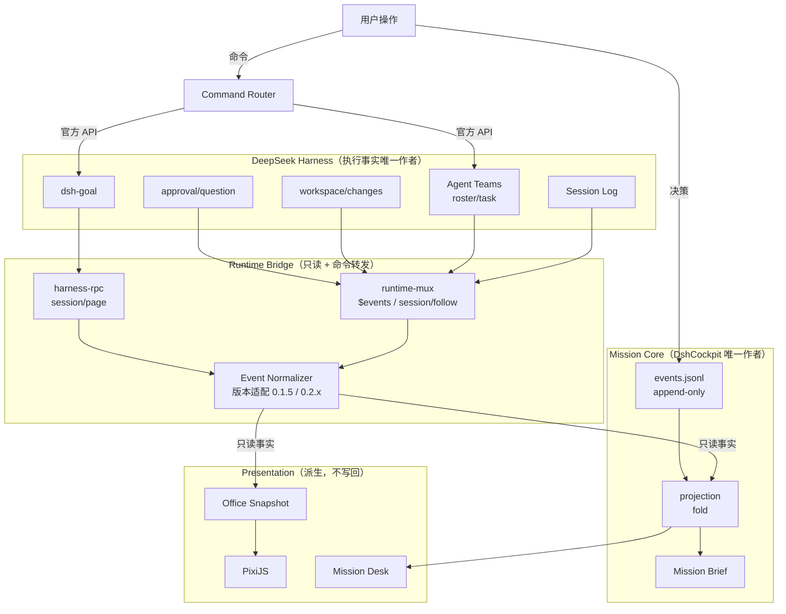

# Execution Plan：P0 地基校准 → P1 Mission Core 启动

> 状态：**active** · 创建 2026-11-01 · 负责人：Lead（用户最终拍板）
> 上游：`docs/product/product-roadmap.md` P0/P1、`docs/adr/ADR-0001..0006`
> 纪律：本计划随开发更新，不是写完就遗忘的文档。每完成一个工作包，更新 §6 进度表。

## 1. Goal（目标）

在不破坏现有功能的前提下，完成三件事：

1. **把新战略变成可执行的工程事实**：文档、ADR、Issue、门禁全部落位。
2. **解决两个前置不确定性**：Harness 0.2.x 能否升级；自研 Team Runtime 如何退场。
3. **启动 P1 Mission Core 的第一个可验证切片**。

## 2. Non-goals（明确不做）

- ❌ 不实现完整 Mission Core（只做第一切片）。
- ❌ 不切换 runtime 到 0.2.x（只做 POC）。
- ❌ 不改办公室业务代码。
- ❌ 不删除自研 Team Runtime（只标记 legacy）。
- ❌ 不引入新运行时依赖。
- ❌ 不做 Live2D / LayerFS / 知识库。

## 3. Scope（范围）

### 3.1 本轮已完成（P0.1–P0.2，2026-11-01）

| 工作包 | 交付物 | 状态 |
|---|---|---|
| P0.1a Harness 桥审计 | `docs/architecture/runtime-bridge.md`、`data-flow.md`、`docs/research/deepseek-harness-api-surface.md` | 进行中（bridge-auditor） |
| P0.1b 办公室审计 | `docs/architecture/office-runtime.md`、`docs/design/character-system.md`、`office-interaction.md` | 进行中（office-auditor） |
| P0.1c 壳层审计 | `docs/architecture/architecture-overview.md`、`docs/quality/tech-debt-inventory.md`、`testing-strategy.md` | 进行中（shell-auditor） |
| P0.1d 第三方评估 | `docs/research/{capability-providers,memory-systems,workspace-isolation,live2d-evaluation,third-party-projects}.md` | 基本完成（research-scout） |
| P0.2 战略与模型 | `docs/product/{product-vision,product-principles,product-roadmap,user-journeys}.md`、`docs/architecture/{domain-model,mission-core,capability-platform}.md`、`docs/adr/ADR-0001..0006` | ✅ 完成 |

### 3.2 执行顺序（2026-11-01 第二轮审查后修订）

**用户明确要求「将 CI 基础门禁提前」「在重大功能开发前至少建立可运行的核心 CI 门禁」。**
因此顺序调整如下（**严格串行**）：

| 序 | 工作包 | 内容 | 预估 | Issue |
|---|---|---|---|---|
| **1** | **P0.2b 修复兼容账本** | CI 已连续 10 天验证 0.2.1 全绿，但账本陈旧/PR #7 卡死 → UI 误显示"已是最新"。含 L2 超期检测 + 四级结论分离 | 0.5–1 天 | #21 |
| **2** | **P0.2c CI 测试门禁**（提前） | `CI=1 npm test`（1935/1935/0 fail）作为唯一基线；禁止 `continue-on-error` | 0.5 天 | #10 |
| **3** | **P0.2d 许可证检查** | `scripts/check-licenses.js` + CI job | 0.5 天 | #14 |
| **4** | **P0.3 runtime POC** | 隔离目录 + 独立 Profile；验证 **Protocol 层**（CI 未覆盖）。**不得**改动生产 runtime/settings/workspace | 1–2 天 | #9 |
| **5** | P0.4 工程规范收尾 | 文档索引、Issue 同步 | 0.2 天 | — |

**为什么 CI 门禁排在 POC 之前**：
- #21 修好后若仍无 CI 门禁，账本会再次静默劣化；
- 后续所有架构规则（Mission 边界、许可证、IPC 冻结）都靠测试强制；
- POC 结论也需要一个可靠的测试基线来对照。

**POC 硬约束**（用户明确）：
- ✅ 独立目录、独立 Profile
- ❌ 不得修改生产 Runtime / Settings / 真实 Workspace / 现有锁定版本
- 结果必须含：命令、版本、安装日志、测试日志、数据变化、成功与失败项、未验证项
- **CI 结果与 POC 结果不得混为一谈**（账本中 `verifiedBy` 必须区分 `ci:*` 与 `poc:*`）

### 3.2.1 第二轮审查产生的文档修订

| 文档 | 修订内容 |
|---|---|
| `docs/architecture/official-capability-matrix.md` | **新增**：官方能力四层分级矩阵（Core Service / Experimental Plugin / Plugin Bundle / Internal） |
| `docs/quality/compatibility-ledger-spec.md` | **新增**：账本 v2 规范，Installed/Healthy/Compatible/Supported 四级分离 |
| `docs/quality/test-tiers-and-baseline.md` | **新增**：C/I/E 测试分级 + 正式基线（`CI=1 npm test`） |
| `docs/architecture/domain-model.md` | **修订**：Mission 支持多 Active（Active/Focused/Running 三轴） |
| `docs/architecture/mission-core.md` | **修订**：Mission Store ≠ Settings Store；多 Mission 存储组织 |
| `docs/product/product-vision.md` | **修订**：North Star / MVP / Deferred 三层范围；五支柱 |
| `docs/product/product-roadmap.md` | **修订**：三层范围 + 第二轮修订记录 |
| `docs/research/*`（4 份） | **修订**：Deferred/Re-evaluation 框架替代"判死" |

### 3.3 下一轮（P1.1–P1.3）

| 工作包 | 内容 |
|---|---|
| P1.1 | `src/mission/schema.js` + `event-log.js` + 单元测试 |
| P1.2 | `src/mission/store.js` + `projection.js` + 损坏恢复测试 |
| P1.3 | `src/mission/brief.js` + 长度/隐私测试 |

## 4. Architecture（架构决策摘要）

| 决策 | 结论 | ADR |
|---|---|---|
| 产品定位 | AI 团队工作空间，不做 Harness 桌面壳竞争者 | ADR-0001 |
| Team 编排 | 消费官方 Agent Teams，自研退为适配/投影层 | ADR-0002 |
| Capability | 验证过的组合（Pack），不做市场 | ADR-0003 |
| Runtime | 分阶段升级到 0.2.x + 采用 shell-held carrier | ADR-0004 |
| 记忆 | 官方栈 + 零第三方 | ADR-0005 |
| Live2D | 不接生产，仅留接口 | ADR-0006 |
| Mission 存储 | Append-only JSONL + 派生投影 | `mission-core.md` §4 |
| Mission 边界 | 只做跨 Session 连续性与共识 | `mission-core.md` §1 |

## 5. Data Flow（数据流）



**关键约束**：
- Harness → Mission 是**只读**（Mission 不写 Session/Team/Goal）。
- 用户 → Harness 通过**官方 API 转发**（不直接改状态）。
- Mission/Office **不互相写**。

## 6. Implementation Steps（实施步骤）

### 当前：P0 收尾

```
[x] 1. 四路审计派发
[x] 2. 战略与领域模型文档
[x] 3. ADR-0001..0006
[ ] 4. 收集四路审计产出并做一致性检查
[ ] 5. 更新 docs/README.md 索引（Lead 统一，避免冲突）
[ ] 6. 重整 AGENTS.md（反映新定位，≤130 行）
[ ] 7. 写 quality-gates.md
[ ] 8. 建立 GitHub Issues（含 Deferred）
[ ] 9. 跑通 test/docs-index.test.js 与 npm test
[ ] 10. 输出最终规划报告
```

### P0.3：runtime 升级 POC（下一批）

```
[ ] 1. 准备隔离的 DSH_HOME（不污染 ~/.dsh）
[ ] 2. 安装 0.2.1-rc.5
[ ] 3. 验证：能否启动 + mux 是否兼容
[ ] 4. 验证：agentTeam 客户端视图字段形状
[ ] 5. 验证：workspace/changes 事件形状
[ ] 6. 验证：净增 6 个 SessionEventMap 事件（56→62）是否影响现有翻译层
[ ] 7. 产出 docs/research/harness-0.2-poc-report.md（含"不支持"结论）
[ ] 8. 回填 ADR-0004 §11
```

### P1.1：Mission schema 与事件日志

```
[ ] 1. src/mission/schema.js（实体校验，纯函数）
[ ] 2. src/mission/event-log.js（append-only，原子追加）
[ ] 3. 单元测试 + 变异测试（破坏 schema / 破坏原子写）
[ ] 4. 从 src/work/workspace-store.js 搬运原子写/路径守卫（约 200 行，附来源注释）
```

## 7. Dependencies（依赖）

| 依赖 | 类型 | 阻塞什么 |
|---|---|---|
| 官方 0.2.x 可安装性 | 外部 | P1.5 harness-reader、ADR-0002 实施 |
| 用户拍板 ADR-0001..0006 | 决策 | P1 全部 |
| 四路审计产出 | 内部 | 最终报告、Issue 内容 |
| `src/work/workspace-store.js` 可复用性 | 内部 | 已确认（35% 可复用） |

## 8. Failure Modes（失败模式）

| 失败模式 | 检测 | 应对 |
|---|---|---|
| **Mission Core 越界成第二个 Harness** | 代码评审 + 边界测试 | 停手，回到 `mission-core.md` §1 |
| **runtime 升级 POC 失败** | POC 有明确"不支持"结论 | 如实记录，重评 ADR-0004，可能延后 P1.5 |
| **文档与代码矛盾** | 审计交叉检查 | 矛盾文档优先修正或归档 |
| **测试变红** | `npm test` | 回退该变更，不放宽断言 |
| **工作范围膨胀** | 每批次检查是否超出本计划 | 移入下一批次或 Deferred Issue |
| **两套 Team 状态并存** | 检查是否存在第二个写入者 | 立即标记自研为 legacy 且默认不启用 |

## 9. Testing（测试要求）

| 层 | 本轮要求 |
|---|---|
| 文档门禁 | `test/docs-index.test.js` 必须绿（新增文档必须入索引） |
| 全量测试 | `npm test` 不得新增红（基线 1935 / 1 环境相关红） |
| 新增代码 | 每个新模块必须有单元测试 + 至少 1 组变异测试 |
| 边界 | 新增边界规则必须可机械检测（测试优先于文档） |
| 真机 | P0.3 POC 与后续 P1 UI 需真机脚本 |

## 10. Acceptance Criteria（验收标准）

- [ ] 四路审计文档齐全，结论有文件路径 + 行号证据
- [ ] `docs/README.md` 索引覆盖全部新增文档
- [ ] `AGENTS.md` ≤ 130 行且反映新定位
- [ ] `npm test` 无新增红
- [ ] ADR-0001..0006 全部成文，每条有替代方案与重新评估条件
- [ ] P0.3 POC 对 4 个问题都有明确结论（含"不支持"）
- [ ] GitHub Issues 已建立（含 Deferred）
- [ ] 最终规划报告覆盖用户要求的 A–I 全部九项

## 11. Rollback Plan（回退方案）

| 变更类型 | 回退方式 |
|---|---|
| 新增文档 | 删除文件 + 从索引移除（无代码影响） |
| AGENTS.md 重整 | `git restore --source=HEAD -- AGENTS.md` |
| 新增测试 | 删除测试文件（但需说明为何放弃该约束） |
| POC 代码 | POC 在独立目录/分支，不进主流程 |
| Mission 代码 | 新目录，不影响现有功能；失败即不合并 |

**禁止**：`git reset --hard` / `git clean -fd` / `git checkack -- .`（AGENTS.md §6）。

## 12. 进度表（每批次更新）

| 日期 | 工作包 | 结果 | 证据 |
|---|---|---|---|
| 2026-11-01 | P0.1d 第三方评估 | 5 份 research 文档（1,578 行） | `docs/research/*.md` |
| 2026-11-01 | P0.2 战略与模型 | 4 产品 + 4 架构 + 6 ADR | `docs/product/`、`docs/architecture/`、`docs/adr/` |
| 2026-11-01 | P0.1c 壳层审计 | 3 文档（1,957 行），32 条技术债 | `docs/architecture/architecture-overview.md`、`docs/quality/` |
| 2026-11-01 | P0.1b 办公室审计 | 3 文档（1,243 行），5 个 headless 探针实证 | `docs/architecture/office-runtime.md`、`docs/design/` |
| 2026-11-01 | P0.1a Harness 桥审计 | 3 文档（1,857 行），0.1.5↔0.2.1 方法级 diff | `docs/architecture/runtime-bridge.md` 等 |
| 2026-11-01 | P0.4 工程规范 | AGENTS.md 重整、docs 索引、quality-gates | `AGENTS.md`、`docs/README.md` |
| 2026-11-01 | GitHub Issues | 12 条（含 2 Deferred + 2 Epic） | #9–#20 |
| 2026-11-01 | 测试验证 | 1935 项 / 1934 pass / 1 已知环境红（与基线一致） | `npm test` |

## 13. 未解决风险（移交下一批次）

| # | 风险 | 需要什么 |
|---|---|---|
| 1 | runtime 0.2.x 升级破坏性未知 | POC |
| 2 | 自研 Team Runtime 与官方并存期间的双写风险 | ADR-0002 实施纪律 |
| 3 | `DSH_EXECUTION_MAPPING` 行号漂移（5 处） | Tech Debt Issue |
| 4 | 真实 Electron 探针测试不稳定（基线唯一红） | 测试基础设施改进 |
| 5 | 鲸鱼娘素材授权链覆盖度 | 素材来源核查 |
| 6 | `.dsh/` 会污染用户 git 仓库（无 .gitignore 写入） | P1 修复 |

## 14. 决策记录（随计划更新）

| # | 决策 | 理由 | 日期 |
|---|---|---|---|
| D1 | 索引由 Lead 统一更新 | 4 名 teammate 并行写，避免冲突 | 2026-11-01 |
| D2 | 先落草稿再迭代 | 避免长时间读代码无产出 | 2026-11-01 |
| D3 | Mission 新建 `src/mission/**`，不扩展 `work-controller` | 状态机语义对立（单活动 vs 长期跨 run） | 2026-11-01 |
