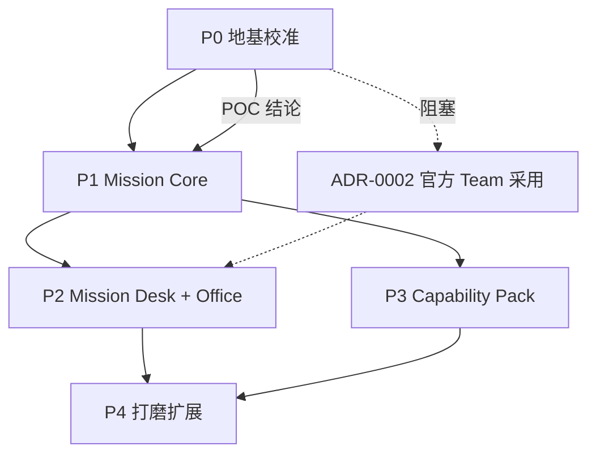

# 产品路线图与分阶段开发计划

> 状态：**草案（2026-11-01，待用户拍板）**
> 依据：`docs/product/product-vision.md`、`docs/adr/ADR-0001..0004`
> 纪律：**串行推进**。上一阶段未达退出条件，不启动下一阶段。P0 不完成不碰 P1。

## 0. 总览

### 0.0 三层范围（2026-11-01 审查新增，防止战略窄化）

| 层级 | 内容 | 时间尺度 |
|---|---|---|
| **North Star** | Opinionated Agent Workspace 五支柱（Mission Core / Capability Orchestration / Starter Kits / Provider 层 / Virtual Office） | 长期，不排期 |
| **MVP** | P0 地基 + P1 Mission Core + P2 Mission Desk/Office（2 物件）+ P3 一个 Capability Pack | 当前路线图 |
| **Deferred** | Live2D 生产、LayerFS 生产、Knowledge Provider、多 Harness Adapter、Character Pack 市场、Community Hub、跨项目 Team | 触发条件满足时再启 |

> **关键纪律**：**MVP 只是 North Star 的第一步，不是全部。**
> 不得因为"MVP 聚焦 Mission Core"就认为 Capability Orchestration / Starter Kits / Provider 层已放弃
> —— 它们仍在路线图内，只是不在当前批次（见 `product-vision.md` §2.3）。

### 0.1 阶段流水

```
P0  地基校准          ← 现在在这里（审计已完成，待用户拍板 + POC）
    ↓ 退出条件：用户拍板 ADR + 审计结论被接受 + runtime POC 有明确结论
P1  Mission Core 最小闭环
    ↓ 退出条件：跨 ≥2 次会话的 Mission 真实可用
P2  Mission Desk 与办公室落地
    ↓ 退出条件：办公室每个交互物件都有真实数据源
P3  Capability Pack 与 Starter Kit
    ↓ 退出条件：1 个 Pack 完整经历 安装→使用→卸载 验证
P4  体验打磨与扩展
```

**明确不排期的（Deferred）**：Live2D 生产接入、LayerFS 生产集成、多 Harness Adapter、
Character Pack 市场、Community Hub、跨项目 Team、高级自动化工作流。
见 §6 与 GitHub Deferred Issues（#15、#16）。

### 0.2 审计发现对路线图的修正（2026-11-01）

四路审计完成后，路线图的**优先级发生一处重要调整**：

| 原计划 | 修正 | 理由 |
|---|---|---|
| P0 只做审计 + POC | **P0 增加两项 0.5 天的工程门禁**（#10 CI、#14 许可证） | 投产比最高；且没有它们，后续所有架构规则的强制力都是纸的 |
| P1 直接建 Mission | **P1 前置 P1.0 存储加固**（#19） | Mission 将成为唯一事实源；当前存储无迁移/无备份/静默丢设置 |
| P2 做 6 个办公室物件 | **P2 只做 2 个**（白板 + 收件箱） | 审计确认当前 6 个物件 0 个真正可交互；先验证模式 |

### 0.3 汇报轮修订（2026-11-01 第二轮审查）

| 项 | 修订 |
|---|---|
| **测试基线** | 原称"1934/1935，1 个环境相关红"。实测 **`CI=1 npm test` → 1935/1935/0 fail**。该探针在 CI 下显式 skip，不是持续失败。见 `docs/quality/test-tiers-and-baseline.md` |
| **兼容判定** | 原把"CI 双平台全绿"当作接近可升级。修正为 **Installed/Healthy ≠ Compatible**：CI 不覆盖 mux/RPC。见 `docs/quality/compatibility-ledger-spec.md` |
| **升级顺序** | 原 S0 POC 打头。修正为 **先修账本 #21**，否则决策依据本身是错的 |
| **Mission 多实例** | 原隐含"全局唯一 active"。修正为 **Active / Focused / Running 三轴分离**，一个 Workspace 可多 Active |
| **战略范围** | 原报告易被读成"DshCockpit = Mission Manager"。修正为 **North Star / MVP / Deferred 三层** |

**修补优先级**（按 ROI 排序）：
1. **#21 修复兼容账本**（0.5–1 天）— **最高优先**。不修这个，所有升级决策建立在错误信息上
2. **#10 CI 测试门禁**（0.5 天）— 让 1935 项测试真正起拦截作用
3. **#14 许可证检查**（0.5 天）— 让许可证决策从"文档承诺"变"机械约束"
4. **#9 runtime POC**（1–2 天）— 验证 Protocol 层（CI 未覆盖的部分）

> **重要修正**：原先认为"0.2.x 未验证所以不能升级"。这个判断是**错的**——
> `upstream-compat.yml` 每日在 darwin-arm64 + win32-x64 验证 `0.2.1-rc.5`，
> 2026-10-31 的 run（`41187195013`）判 `ok=true` 且已连续约 10 天全绿。
> 真正的阻塞是**信息链缺陷**（账本陈旧 + PR 卡死），不是技术未知。
> 但注意：CI 三个 gate **不覆盖 mux/RPC 行为**，所以**协议一致性仍需 POC 运行级验证**。

---

## P0：地基校准（当前阶段）

### 目标
在不写新功能的前提下，把"我们站在哪里"变成**有证据、可评审**的事实，并解决阻塞后续全部工作的两个前置问题：
① Harness 0.2.x 是否可升级；② 自研 Team Runtime 如何退场。

### 范围
| 工作包 | 内容 | 交付物 |
|---|---|---|
| **P0.1 现状审计** | 四路审计：Harness 桥 / 办公室 / 壳层 / 第三方 | `docs/architecture/architecture-overview.md`、`office-runtime.md`、`runtime-bridge.md`、`docs/quality/tech-debt-inventory.md` 等 |
| **P0.2 战略与领域模型** | 定位、原则、领域模型、ADR | `docs/product/*`、`docs/architecture/domain-model.md`、`docs/adr/ADR-0001..0004` |
| **P0.3 runtime 升级 POC** | 隔离安装 0.2.1-rc.5，验证 mux 协议 / agentTeam 视图 / workspace-changes | `docs/research/harness-0.2-poc-report.md`（待建） |
| **P0.4 工程规范落地** | AGENTS.md 重整、docs 索引、Issue 规范、质量门禁 | `AGENTS.md`、`docs/README.md`、`docs/quality/quality-gates.md` |

### 非目标
- ❌ 不实现 Mission Core。
- ❌ 不改办公室业务代码。
- ❌ 不做 runtime 升级的实际切换（只做 POC）。
- ❌ 不引入新依赖。

### 技术依赖
无（全部是只读审计 + 文档 + 隔离 POC）。

### 验收标准
1. 四路审计文档齐全，每条结论有文件路径 + 行号证据。
2. `docs/README.md` 索引覆盖全部新增文档，`test/docs-index.test.js` 绿。
3. `AGENTS.md` ≤ 130 行且反映新定位。
4. P0.3 POC 对 4 个问题都有明确结论（含"不支持"）。
5. GitHub Issues 建立（含 Deferred）。
6. 全部测试仍绿（基线 1935 项，1 个环境相关红）。

### 测试要求
- `node --test test/docs-index.test.js` 必须绿。
- `npm test` 不得新增红。
- POC 脚本产出可复现的命令与输出。

### 风险
| 风险 | 缓解 |
|---|---|
| 审计结论与既有文档冲突 | 矛盾文档优先修正或归档，不留错误描述（已有纪律） |
| POC 无法验证（0.2.x 装不上） | 如实记录"无法验证"，升级决策改为"需要用户提供环境" |
| 文档规模膨胀 | 每份文档只答自己的问题；细节放子文档 |

### 退出条件
**用户明确接受**：新定位 + 领域模型 + ADR-0001..0004 的结论（或修改后接受），并指定 P1 起点。

---

## P1：Mission Core 最小闭环

### 目标
让**跨会话的项目连续性**真实可用：一个 Mission 能横跨 ≥2 次会话、≥1 天，重开后状态/决策/产物仍完整。

### 范围
| 工作包 | 内容 | 关键文件 |
|---|---|---|
| **P1.1 Mission 数据模型** | Mission / Workstream / TaskRef / SharedContext / Deliverable 的 schema + 校验 | `src/mission/*.js`（新建） |
| **P1.2 持久化** | Append-only JSONL + 派生索引；原子写；损坏恢复 | `src/mission/store.js` |
| **P1.3 Mission Brief** | 面向 Agent 的项目摘要（可注入下一次会话） | `src/mission/brief.js` |
| **P1.4 最小 UI** | 创建 Mission / 打开 Mission / 看到当前状态与产物 | `src/mission/mission.html` 或并入 `src/work/` |
| **P1.5 与 Harness 的只读接线** | 读 goal phase / team roster / workspace changes | `src/mission/harness-reader.js` |

### 非目标
- ❌ 不做 Team 编排（官方负责）。
- ❌ 不做向量检索记忆。
- ❌ 不做办公室交互物件（P2）。
- ❌ 不做 Capability Pack（P3）。

### 技术依赖
- P0.3 的 POC 结论（决定读哪些官方 API）。
- `src/work/workspace-store.js` 的原子写模式（复用）。
- **若 P0.3 证明 0.2.x 不可升级** → P1.5 只能读 0.1.5 的 goal/jobs，功能受限，需与用户确认是否继续。

### 验收标准（硬门）
1. 创建一个 Mission，关闭应用，重开，Mission 状态完整（`updatedAtMs` 正确、状态未丢失）。
2. 在 Mission 中记录 3 条 Decision + 2 条 OpenQuestion，重开后全部可见且可追溯证据。
3. 一个 Deliverable 指向真实工作区文件，重开后能打开（digest 校验）。
4. **跨 2 次会话**：第二次会话开始时，Mission Brief 能提供上下文（内容包含决策与未答问题）。
5. 无产物时 UI **不显示**"完成"（沿用现有机械门）。
6. 数据损坏时有 fail-closed 行为（不静默重建）。

### 测试要求
- 单元测试：schema 校验、store 原子写、损坏恢复、brief 生成。
- 集成测试：创建 → 关闭 → 重开 → 状态一致。
- 变异测试：至少 3 组（破坏 schema 校验 / 破坏原子写 / 破坏 brief 内容）。
- 真机验收脚本（用户执行）。

### 风险
| 风险 | 缓解 |
|---|---|
| **Mission Core 变成第二个 Harness** | 每个实体都必须有"为什么官方不够"的论证；代码评审强制检查 |
| 存储方案选错（JSONL vs SQLite） | P1.1 前做 1 天 POC 对比写入/检索性能 |
| 与官方 goal 语义冲突 | 严格"引用不复制"；冲突时以官方为准 |
| UI 过度设计 | P1 只做"能看能改"，不做精美 |

### 退出条件
用户实际用一个真实 Mission 完成 ≥1 次跨会话工作，并确认"不用重新交代背景"。

---

## P2：Mission Desk 与办公室落地

### 目标
把 Mission 与虚拟办公室打通：办公室的每个交互物件都对应真实数据 + 可执行操作，**零装饰性假功能**。

### 范围
| 工作包 | 内容 | 关键文件 |
|---|---|---|
| **P2.1 Mission Desk** | 用户与团队的主交互面：Mission Summary / 重要变化 / Shared Context / 需要你 / Deliverables | `src/office/*` 或新窗口 |
| **P2.2 Human Inbox** | 待决策、待审批、待回答的统一收件箱，就地处理 | 复用 `pending-mirror.js` + 官方 approval 通道 |
| **P2.3 办公室交互物件（第一批 2 个）** | 项目白板（Mission 状态）+ 收件箱（Human Inbox） | `src/office/runtime/*`、`pixi-office-renderer.js` |
| **P2.4 Companion Mode** | 鲸鱼娘常驻桌面 + 按需唤起完整办公室 | `office-rail.js` 扩展 |

### 非目标
- ❌ 不做全部 6 个物件（先做 2 个验证模式）。
- ❌ 不做 Live2D。
- ❌ 不做办公室视觉大改。

### 技术依赖
- P1 Mission 数据可用。
- 现有 office 快照契约（只读投影，不得写 Team fact）。

### 验收标准
1. 办公室「项目白板」显示当前 Mission 的真实状态（workstream / 决策数 / 未答问题），点击能进入 Mission Desk。
2. 办公室「收件箱」显示真实的 pending 审批/提问，能就地处理，处理后**真实消失**（不是假动画）。
3. Companion Mode 能把办公室收成常驻小窗，不丢状态。
4. 任一物件断线时显示 `stale` 而非编造数据。

### 测试要求
- 快照契约测试（新字段必须进白名单 + 隐私脱敏）。
- 交互端到端测试（点击 → 命令 → 状态变化）。
- 真机视觉验收（截图）。

### 风险
| 风险 | 缓解 |
|---|---|
| 视觉工作吞掉功能时间 | P2.3 只做 2 个物件，视觉够用即可 |
| 办公室与 Mission 双写 | 办公室只读，写入走 Mission 命令通道 |
| 交互物件变成装饰 | 每个物件必须有验收标准里的"真实数据 + 真实操作" |

### 退出条件
用户能用办公室完成"看团队状态 → 发现需要我 → 就地处理"的完整回路，不需要打开其他窗口。

---

## P3：Capability Pack 与 Starter Kit

### 目标
让新手 5 分钟内拿到真实产物，且不需要懂底层设施。

### 范围
| 工作包 | 内容 |
|---|---|
| **P3.1 Capability Manifest + Pack 结构** | `capability-packs/<id>/manifest.json` + verify 脚本 |
| **P3.2 VerificationProvider** | 唯一值得做的 Provider 接口（复用 `command-runner.js`） |
| **P3.3 第一个 Pack** | `workspace-verification`（工作区 + 验证） |
| **P3.4 第一个 Starter Kit** | `research-report` 或 `code-change` |
| **P3.5 安装/卸载/健康检查** | 安装 → 验证 → 使用 → 卸载 全链路 |

### 非目标
- ❌ 不做 Pack 市场。
- ❌ 不做 5 个以上 Pack。
- ❌ 不做 MemoryProvider 抽象（无第二实现）。

### 技术依赖
- P1 Mission（Starter Kit 需要 Mission 模板）。
- 官方 plugin-manager（消费而非重写）。

### 验收标准
1. 一个 Pack 经历完整生命周期：安装 → verify 通过 → 使用产出真实文件 → 卸载 → 无残留。
2. 平台不支持时**明确拒绝**（不是崩溃）。
3. 一个 Starter Kit 让新用户 5 分钟内拿到真实产物（P50 计时）。
4. verify 脚本在 CI 可跑（不需要真机）。

### 测试要求
- 安装/卸载幂等测试。
- 失败注入测试（缺依赖 / 平台不支持 / 网络失败）。
- 真机验收（mac + win）。

### 风险
| 风险 | 缓解 |
|---|---|
| Pack 数量膨胀 | 硬约束：每个 Pack 必须有 verify + 真实价值论证 |
| verify 成为负担 | 复用 command-runner，最小断言 |
| 官方能力变化破坏 Pack | 版本范围约束 + CI 定期跑 |

### 退出条件
一个真实新用户（非开发者）能在 5 分钟内用 Starter Kit 拿到可用产物。

---

## P4：体验打磨与扩展（方向，不排期）

可能包含（按优先级）：
- 更多办公室交互物件（会议桌 / 资料架 / 成果区）。
- 第二个 Capability Pack。
- Live2D POC（独立评估后决定）。
- 多 Mission 并行。
- 跨项目视图。

**前置**：P1–P3 全部退出条件达成。

---

## 6. 明确 Deferred 的清单

| 项目 | 为什么现在不做 | 重新评估的触发条件 |
|---|---|---|
| **Live2D 生产接入** | 许可以及素材分发风险未厘清；Sprite 系统已可用 | Live2D POC 通过 + 许可证结论明确 |
| **LayerFS 生产集成** | 官方 `dsh-workspace-changes` 已覆盖变更捕获；并行隔离需求未验证 | 出现真实"多人/多 agent 并行写同一工作区"需求 |
| **多 Harness Adapter** | 只有一个 Runtime；抽象是负债 | 出现真实的第二个 Harness 需求 |
| **Character Pack 市场** | 素材授权链未建立；分发有风险 | 素材授权体系建立 |
| **Community Hub** | 用户规模不足以支撑 | 有稳定用户社区 |
| **跨项目 Team** | Mission 单项目闭环尚未验证 | P1 退出条件达成 |
| **高级 Agent Personality** | 不影响核心价值 | P2 完成后 |
| **插件市场替代品** | 官方已有 `dsh-plugin-market` | 官方 market 无法满足某个具体场景 |
| **自研 Memory 系统** | 官方 goal/compaction/session-search 已覆盖 | 证明官方三者组合存在明确缺口 |

## 7. 阶段间依赖图



## 8. 本轮（P0）之后可直接执行的任务

见 `docs/plans/active/` 中的 Execution Plan 与最终报告的「下一次会话可直接执行的任务清单」。
