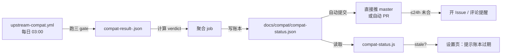

# 兼容性账本规范 v2（Compatibility Ledger Spec）

> 状态：**规范草案（2026-11-01，待拍板）** · 本轮审查新增
> 上游：`docs/adr/ADR-0004-upgrade-harness-runtime-0.2.md`、Issue #21（账本陈旧）、Issue #9（0.2.x POC）
> 目的：修复**信息链断裂**这一根因，并把"验证"从单一布尔值升级为**分级结论**
> 现状账本：`docs/compat/compat-status.json`（schema 1，2026-09-16，已陈旧三个月）

## 0. 为什么必须重做

当前账本只有一个布尔 `ok` 和 `latestVerified` 字符串。它把四件本应分开的事压成了一件：

| 被压平的维度 | 后果 |
|---|---|
| 安装成功 vs 协议兼容 | 装上了 ≠ 能对话 |
| 健康检查通过 vs 端到端可用 | HTTP 200 ≠ mux 可连 |
| 已验证 vs 已支持 | 验证过 ≠ 我们承诺支持 |
| 一次 CI 结果 vs 持续状态 | 单次绿 ≠ 稳定 |

**直接导致的事故**（Issue #21）：CI 每日验证 `0.2.1-rc.5` 全绿，但账本停在三个月前，而 `compat-status.js:78-81` 的 `current === latestVerified` 判断恰好因"锁定版本 = 陈旧账本值"而返回 `compatible: true` → UI 显示"已是最新已验证版本"，实际落后一个大版本。

## 1. 核心：四级结论分离

**这是本规范最重要的部分。四个词不可互换，不得由低阶推导高阶。**

```
Installed  →  Healthy  →  Compatible  →  Supported
（装上了）    （能起来）    （能对话）     （我们承诺）
```

| 级别 | 定义 | 判定依据 | 谁可以下结论 |
|---|---|---|---|
| **Installed** | 包能被解析、下载、写入磁盘 | `arborist` 装树成功，退出码 0 | 自动化 |
| **Healthy** | 进程能启动并进入可服务状态 | `--dump-config` 退出 0 **且** boot `--profile web` 后 `GET /` 返回 200/3xx | 自动化 |
| **Compatible** | **协议行为**在双版本间一致（我们实际依赖的 API） | mux 可连 + `$events` ready + `session/list` 可调 + `$events/result` 可回 + journal 可读 | **POC / 集成测试**（不可仅凭 CI） |
| **Supported** | 我们**承诺**在这个版本上提供完整功能并承担回归责任 | Compatible + 真机全量验收 + 关键回归项通过 | **人工拍板** |

**铁律**：
1. **Installed + Healthy ≠ Compatible。** 当前 CI 只覆盖前两级（见 §2），**不足以**判断兼容。
2. **Compatible ≠ Supported。** 兼容是技术事实，支持是产品承诺。
3. **任何级别不得由更低级别推导。** 不得因为 `ok: true` 就写 `compatible: true`。
4. **Supported 必须有人类签名**（`verifiedBy` 字段），不允许 CI 自动写。

## 2. 当前 CI 覆盖边界（必须诚实标注）

`scripts/upstream-compat-smoke.js` 的三个 gate：

| Gate | 实际做什么 | 覆盖到哪级 |
|---|---|---|
| `install` | `arborist` 装依赖树 | **Installed** |
| `dumpConfig` | `dsh --dump-config` 退出 0 | 部分 **Healthy** |
| `healthCheck` | boot `--profile web`，`GET` 到 200/3xx | **Healthy** |

**它不覆盖**：
- ❌ `/api/remote.mux` 连接（WebSocket + Cookie 门禁）
- ❌ 任何 RPC 调用（`session/list` / `session/page` / `session/prompt`）
- ❌ `$events` 帧形状（`ready` / `emit` / `waterfall`）
- ❌ `$events/result` 回传
- ❌ journal 事件词表
- ❌ 任何 Team / Goal / workspace-changes 行为

**因此：CI 全绿只能写 `installed: true, healthy: true`，`compatible` 必须留 `unknown`。**

> ⚠️ 这条是本次审查的核心修正。第一阶段报告曾把"CI 双平台全绿"当作接近可升级的证据 —— 方向正确，但**证据强度被高估了**。

## 3. 账本 Schema v2

```jsonc
{
  "schema": 2,
  "updatedAt": "2026-11-01T00:00:00.000Z",
  "policy": {
    // 通道分级新鲜度（2026-11-01 用户决策：不采用统一 7 天）
    "freshness": {
      "prerelease": { "staleAfterDays": 7 },   // alpha / rc：7 天未复验 → 陈旧
      "stable":     { "staleAfterDays": 30 }   // stable：30 天 → 提醒复核
    },
    // 触发强制复验的事件（不看时间）
    "revalidateOn": [
      "runtime-major-minor-change",
      "adapter-contract-change",
      "lockfile-change",
      "test-matrix-change"
    ]
  },

  // 当前推荐版本（由 Supported 级别的最高版本推导，不由单次 ok 决定）
  "recommended": {
    "version": "0.2.1-rc.5",
    "channel": "next",
    "supportedLevel": "compatible",   // installed|healthy|compatible|supported
    "since": "2026-11-01"
  },

  // 逐版本记录（append-only，不覆盖历史）
  "entries": [
    {
      "releaseChannel": "next",        // latest | next | alpha | rc | explicit
      "runtimeVersion": "0.2.1-rc.5",
      "resolvedVia": "dist-tag:next",  // 如何解析到的（可复现）
      "resolvedAt": "2026-10-31T09:05:16.907Z",

      "platforms": [
        {
          "platform": "darwin-arm64",

          // ---- 四级结论（分离，不可推导）----
          "install":     { "result": "pass", "ms": 59248, "reason": "" },
          "healthCheck": { "result": "pass", "ms": 3624,  "reason": "" },
          "protocol":    { "result": "unknown", "reason": "CI does not exercise mux/RPC" },
          "endToEnd":    { "result": "not-run", "reason": "" },
          "teamIntegration": { "result": "not-run", "reason": "" },

          // ---- 综合（取四级中的最低级）----
          "verdict": "healthy"          // installed|healthy|compatible|supported|failed
        },
        {
          "platform": "win32-x64",
          "install":     { "result": "pass", "ms": 90389, "reason": "" },
          "healthCheck": { "result": "pass", "ms": 4539,  "reason": "" },
          "protocol":    { "result": "unknown", "reason": "CI does not exercise mux/RPC" },
          "endToEnd":    { "result": "not-run", "reason": "" },
          "teamIntegration": { "result": "not-run", "reason": "" },
          "verdict": "healthy"
        }
      ],

      // ---- 溯源（解决"证据从哪来"）----
      "verifiedCommit": "ec7e5bc",     // 仓库 commit（可能为空）
      "verifiedAt": "2026-10-31T09:06:55.455Z",
      "verifiedBy": "ci:upstream-compat",   // ci:<workflow> | human:<name> | poc:<script>
      "ciRunId": "41187195013",
      "evidenceRefs": [
        "artifact:compat-result-darwin-arm64.json",
        "artifact:compat-result-windows-latest.json"
      ],

      // ---- 已知缺口（诚实清单）----
      "unverified": [
        "mux 连接与 $events 帧形状",
        "session RPC 行为",
        "$events/result 回传",
        "journal 事件词表（净增 6 种：56→62）",
        "Team / Goal / workspace-changes 行为"
      ]
    }
  ]
}
```

### 3.1 字段语义（不允许多义）

| 字段 | 类型 | 语义 | 谁写 |
|---|---|---|---|
| `releaseChannel` | enum | 版本来自哪个 dist-tag / 显式指定 | 自动化 |
| `runtimeVersion` | semver | 实际验证的版本 | 自动化 |
| `resolvedVia` | string | 可复现的解析方式 | 自动化 |
| `install` / `healthCheck` | gate result | 见 §1 | 自动化 |
| **`protocol`** | gate result | mux/RPC 行为一致性 | **POC 或集成测试** |
| **`endToEnd`** | gate result | 真实工作流跑通 | **POC / 真机** |
| **`teamIntegration`** | gate result | Agent Teams 等能力可用 | **POC** |
| `verdict` | enum | **四级中的最低级**（不取平均、不取最高） | 派生 |
| **`verifiedBy`** | `ci:*` / `poc:*` / `human:*` | 谁下的结论 | 写入方 |
| `unverified` | string[] | 明确列出**没验证**的项 | 写入方 |

### 3.2 `verdict` 派生规则（必须机械实现）

```
verdict = min(install, healthCheck, protocol, endToEnd, teamIntegration)
其中：fail < unknown < not-run < pass（对升级判断而言，unknown 不能当作 pass）
```

**关键**：`unknown` 和 `not-run` **不得**被当作 `pass`。这是防止"信息链断裂"重演的核心机制。

## 4. 版本通道策略

### 4.1 通道定义

| 通道 | dist-tag | 当前指向 | 我们的策略 |
|---|---|---|---|
| `latest` | `latest` | `0.2.1-rc.5` | 观察 |
| `next` | `next` | `0.2.1-rc.5` | **CI 默认跟随**（现状） |
| `alpha` | `alpha` | `0.2.2-alpha.2` | **仅记录，不自动验证** |
| 显式版本 | — | — | POC / 回归时指定 |

### 4.2 关于 0.2.2-alpha.2（用户点名要求明确的关系）

**实测事实（2026-11-01，npm registry）**：

| 版本 | 发布时间 |
|---|---|
| `0.2.1-rc.4` | 2026-10-26T15:28:13Z |
| **`0.2.2-alpha.2`** | **2026-10-27T19:10:28Z** |
| `0.2.1-rc.5` | 2026-10-29T14:15:23Z |

**关键结论**：
1. `0.2.2-alpha.2` 发布于 **0.2.1-rc.5 之前**，它不是 rc.5 的后继，而是 **0.2.2 线的预览分支**（alpha 通道）。
2. 它**不在** `next` / `latest` 通道上 → **CI 从未验证过它**。
3. 版本号 `0.2.2-alpha.2` 在 semver 上**高于** `0.2.1-rc.5`（`0.2.2-alpha.2 > 0.2.1-rc.5`），但按 **dist-tag 优先级** rc.5 是发布推荐版本。
4. **不得**因为版本号更大就认为它是升级目标。

**处置**：
- 账本中记为独立 entry，`releaseChannel: "alpha"`，`verdict: "not-run"`。
- **不纳入** CI 每日验证（避免噪声）。
- 仅在明确要评估 0.2.2 线时手动触发一次 POC。

### 4.3 通道与 Supported 的关系

**Supported 只对具体版本成立，不对通道成立。**
- ❌ 错误：「我们支持 0.2.x」
- ✅ 正确：「我们支持 `0.2.1-rc.5`（darwin-arm64 + win32-x64，2026-11-01 起）」

## 5. 回写机制（修复根因）

Information chain 断在三处，逐一修复：



### 5.1 三层防线

| 层 | 机制 | 解决什么 |
|---|---|---|
| **L1 自动回写** | CI 聚合后**直接推** `docs/compat/*.json` 到 master（或自动 PR 且自动合并） | PR #7 卡死三个月 |
| **L2 超期检测** | `compat-status.js` 读账本时检查 `updatedAt` 超期 → UI 如实提示"兼容信息已过期 N 天" | 陈旧账本被当真相 |
| **L3 决策失败可见** | CI 失败用 `::error::`；不依赖需手工配的 SMTP | 绿/红都看不见 |

**为什么 L1 优先"直接推"而非 PR**：资产类 JSON 的自动更新走 PR 是过度流程。三个月的事实证明人工 review 环节会卡死信息链。若担心安全，可加"仅改 `docs/compat/**` 且字段受限"的路径白名单。

### 5.2 L2 的具体实现要求（2026-11-01 用户决策修订）

**核心原则：Verified 与 Fresh 是两个独立概念，且历史验证成功不得因时间流逝被改写成失败。**

| 概念 | 含义 | 会不会因时间变成 false |
|---|---|---|
| **Verified** | 该版本**曾经**通过验证（事实，append-only） | ❌ **永不改变** |
| **Fresh** | 该验证结论**现在**是否足够新、可据以决策 | ✅ 会随时间变 false |
| **Supported** | 我们**承诺**支持（人工签名） | ❌ 不因时间自动撤销，但超期会提示复核 |

**通道分级新鲜度（不采用统一 7 天）**：

| 通道 | 陈旧阈值 | 依据 |
|---|---|---|
| `alpha` / `rc`（prerelease） | **7 天** | 预发布迭代快，7 天前的结论参考价值低 |
| `stable` | **30 天** | 稳定版变化慢，30 天复核一次足够 |

**强制复验触发条件（不看时间，事件驱动）**：
- runtime major/minor 变化
- adapter 契约变化
- lockfile 变化
- 测试矩阵变化

`evaluate()` 实现要求：

```js
const DAY = 86400000;

/** 通道 → 陈旧阈值（天）。prerelease 走 7，stable 走 30。 */
function staleThresholdDays(version, policy) {
  const isPre = /-(alpha|beta|rc)\./i.test(String(version || ''));
  const band = isPre ? policy?.freshness?.prerelease : policy?.freshness?.stable;
  return Number(band?.staleAfterDays) || (isPre ? 7 : 30);
}

function evaluate(currentVersion, data, nowMs = Date.now()) {
  const latestVerified = data?.latestVerified ?? '';
  const updatedAtMs = Date.parse(data?.updatedAt || '');
  const ageDays = Number.isFinite(updatedAtMs) ? (nowMs - updatedAtMs) / DAY : Infinity;
  const threshold = staleThresholdDays(latestVerified, data?.policy);

  // Verified = 账本里确实有这条通过记录（事实，不随时间变）
  const verified = !!latestVerified;

  // Fresh = 该结论是否足够新（会随时间变）
  const fresh = ageDays <= threshold;

  // 版本匹配 = 当前 runtime 就是那个已验证版本
  const versionMatches = !!currentVersion && !!latestVerified && currentVersion === latestVerified;

  return {
    latestVerified,
    ageDays,
    staleThresholdDays: threshold,
    verified,                 // 永不因时间变 false
    fresh,                    // 会随时间变 false
    stale: !fresh,            // 兼容旧字段名（= !fresh）
    // 关键：只有"版本匹配 且 结论新鲜"才能报告"已是最新"
    compatible: versionMatches && fresh,
    // 但"版本匹配 + 陈旧"要如实说是"曾经验证过，但需要复验"
    verifiedButStale: versionMatches && !fresh,
    reason: !fresh
      ? `compat ledger is ${Math.floor(ageDays)} days old (threshold ${threshold}d for this channel); re-verification recommended`
      : (versionMatches ? '' : 'active runtime differs from latest verified'),
  };
}
```

**必须配的变异测试**：
1. 删掉 `&& fresh` → 测试必须红（陈旧仍报 compatible）
2. 把 prerelease 阈值改成 Infinity → 测试必须红
3. 把 stable 阈值改成 7 → 测试必须红（验证分级生效）
4. 让 `verified` 依赖 `fresh` → 测试必须红（**这条最重要：防止历史成功被时间改写**）

## 6. 账本更新纪律

| 规则 | 说明 |
|---|---|
| **append-only** | 新结果追加到 `entries`，不覆盖历史（保留演进轨迹） |
| **不删失败记录** | 失败的 entry 保留（这是最有价值的数据） |
| **`updatedAt` 每次写入必更** | 它是 L2 超期检测的依据 |
| **`unverified` 必填** | 空数组 = 声称"全验证了"，需人工确认 |
| **`recommended` 从 Supported 推导** | 不由单次 `ok: true` 决定 |

## 7. 与 POC 的关系（CI ≠ POC）

用户明确要求：**「CI 和 POC 验证结果不能混为一谈」**。

| | CI（upstream-compat.yml） | POC（手动，隔离环境） |
|---|---|---|
| 覆盖 | Installed + Healthy | **Protocol + EndToEnd + TeamIntegration** |
| 环境 | GitHub runner（干净 VM） | **独立目录 + 独立 Profile + 独立 DSH_HOME** |
| 频次 | 每日 | 一次性 / 里程碑 |
| 产物 | `compat-result-*.json` | 报告 + 命令 + 日志（见 Issue #9 要求） |
| 写入账本 | `install` / `healthCheck` 字段 | `protocol` / `endToEnd` / `teamIntegration` 字段 |
| 权威性 | 只证明"能装能起" | 证明"能用" |

**账本中这两类结果必须来自不同 `verifiedBy`**（`ci:*` vs `poc:*`），不得互相冒充。

## 8. 验收标准（实施本规范时）

- [ ] `compat-status.json` 升级到 schema 2，含 `policy` / `recommended` / `entries`
- [ ] 历史数据迁移：3 条旧 run 转为 entries（保留），`verdict: "healthy"`（因为只做了 install+healthCheck）
- [ ] `compat-status.js` 实现 L2 超期检测 + `compatible` 不再因陈旧而 true
- [ ] 变异测试：删除 stale 判断 → 红
- [ ] CI 实现 L1 自动回写（直接推或自动合并 PR）
- [ ] CI 失败用 `::error::`（L3）
- [ ] PR #7 处置（合并或关闭并说明）
- [ ] `badge.json` 由账本派生，不再手写
- [ ] 0.2.2-alpha.2 记入 `entries`（`releaseChannel: alpha`，`verdict: not-run`）
- [ ] 文档：`README` 或设置页说明"compatible ≠ supported"

## 9. 开放问题

| # | 问题 | 待定 |
|---|---|---|
| Q1 | L1 用"直接推 master"还是"自动合并 PR"？ | 倾向直接推（限路径白名单），避免重演 PR 卡死 |
| Q2 | ~~`staleAfterDays` 定 7 天合适？~~ | ✅ **已决策（2026-11-01 用户）：不采用统一 7 天。prerelease 7 天 / stable 30 天 / 事件驱动强制复验。见 §5.2** |
| Q3 | `Supported` 需要几个人签名？ | 初期 1 人（项目负责人） |
| Q4 | 是否保留旧 schema 1 读取兼容？ | 需要（用户可能停留在旧版本） |

## 10. 相关文档与代码

| 目的 | 位置 |
|---|---|
| 升级决策 | `docs/adr/ADR-0004-upgrade-harness-runtime-0.2.md` |
| 账本陈旧 Issue | GitHub #21 |
| runtime POC Issue | GitHub #9 |
| 官方能力分级 | `docs/architecture/official-capability-matrix.md` |
| 现有账本 | `docs/compat/compat-status.json`、`badge.json` |
| CI | `.github/workflows/upstream-compat.yml`、`scripts/upstream-compat-smoke.js` |
| 消费方 | `src/compat-status.js:78-81` |
